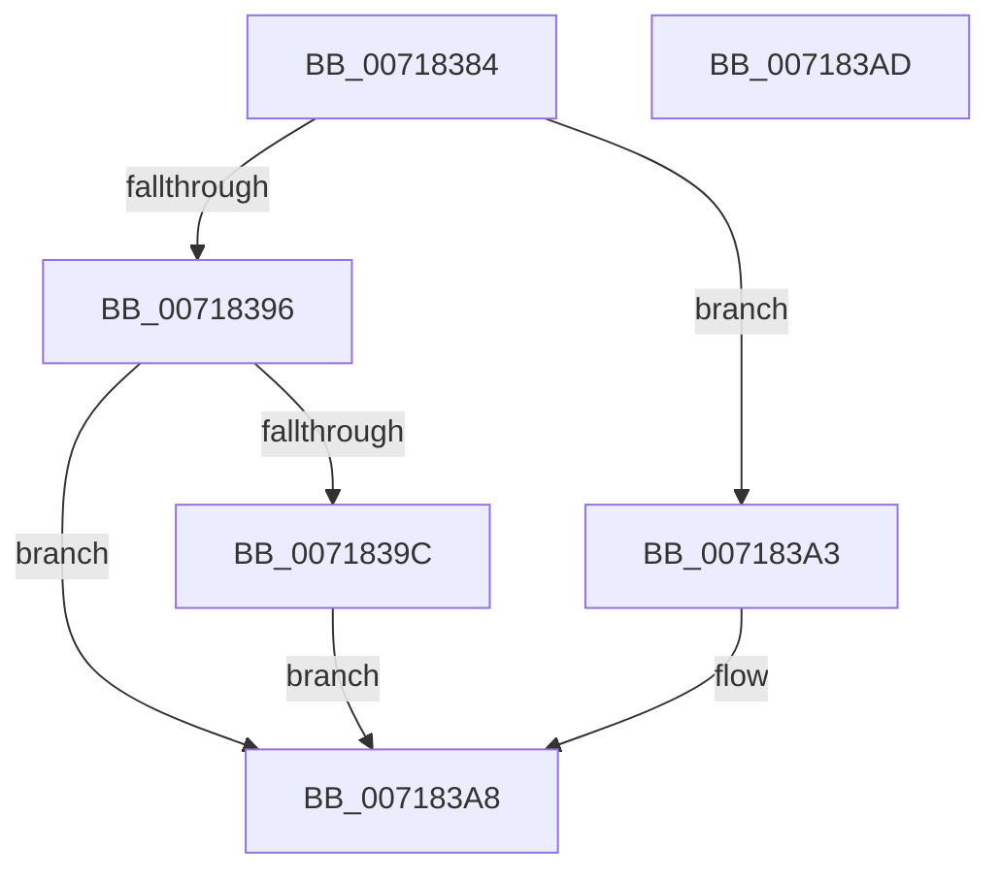

# HvlpDiscoverTopologyWorker

- RVA: `0x00718384`–`0x007183AE` (길이 `42` bytes)
- VA: `0x0000000140718384`
- 실행 섹션: `PAGE`
- PDB 이름 있음: `예`; PDB Function 태그: `예`
- unwind 정보 RVA: `0x0005C788`
- 디코드: `12`개 명령, `42/42` bytes 표시
- 미해석 바이트: `0` (있으면 어셈블리에 `.byte`로 보존)

> 이 문서는 커널 이미지의 기계어와 PDB 기호를 분석해 생성했습니다. 4번과 5번은 함수 원형과 자료형을 바이너리 사용 방식에서 추정한 C 해석이며 원본 소스 복구 결과는 아닙니다.

## 1. Dependencies

- 직접 호출 지점: **2**; 고유 호출 대상: **2**
- 직접 호출자로 확인된 함수: **2**
- RIP 상대 이미지 참조: **1**

### Outgoing calls
- `0x0071839C` → [HvlpDiscoverTopologyIntel](../../init/C2/HvlpDiscoverTopologyIntel_function_00C29938.md) (function, `0x00C29938`)
- `0x007183A3` → [HvlpDiscoverTopologyAmd](../../init/C2/HvlpDiscoverTopologyAmd_function_00C2972C.md) (function, `0x00C2972C`)

### Direct callers
- [HvlpDiscoverTopologyLocal](HvlpDiscoverTopologyLocal_function_0071836C.md) at `0x00718373`
- [HvlpDiscoverTopologyComplete](../../init/C2/HvlpDiscoverTopologyComplete_function_00C2984C.md) at `0x00C29889`

### Static image references
- `0x00718388` → RVA `0x00FC6B46` (`ALMOSTRO`; read)

## 2. Other-region calls and transfers

- 다른 실행 섹션으로 향하는 call: **2**
  - `0x0071839C` → [HvlpDiscoverTopologyIntel](../../init/C2/HvlpDiscoverTopologyIntel_function_00C29938.md) (`PAGE` → `INIT`)
  - `0x007183A3` → [HvlpDiscoverTopologyAmd](../../init/C2/HvlpDiscoverTopologyAmd_function_00C2972C.md) (`PAGE` → `INIT`)
- 별도 외부 분기/꼬리 이동을 확인하지 못했습니다.

## 3. Assembly (complete function range)

```asm
00718384  48 83 EC 28                     sub rsp, 0x28
00718388  44 0F B6 15 B6 E7 8A 00         movzx r10d, byte ptr [rip + 0x8ae7b6]
00718390  41 83 EA 01                     sub r10d, 1
00718394  74 0D                           je 0x1407183a3
00718396  41 83 FA 01                     cmp r10d, 1
0071839A  75 0C                           jne 0x1407183a8
0071839C  E8 97 15 51 00                  call 0x140c29938
007183A1  EB 05                           jmp 0x1407183a8
007183A3  E8 84 13 51 00                  call 0x140c2972c
007183A8  48 83 C4 28                     add rsp, 0x28
007183AC  C3                              ret
007183AD  CC                              int3
```

## 4. C-style interpretation (structured pseudocode)

```c
__int64 __fastcall HvlpDiscoverTopologyWorker(void)
{
    __int64 result;
    __int64 v_r10;
    __int64 v_rsp;

    v_rsp = (v_rsp) - (40);
    v_r10 = (unsigned int)((*(unsigned __int8 *)(v_rip + 9103286)) - (1));
    if (condition_is_equal) goto loc_007183A3;
    if (((unsigned int)(v_r10)) != 1) goto loc_007183A8;
    result = HvlpDiscoverTopologyIntel(a1, a2, a3, a4);
    goto loc_007183A8;
loc_007183A3:
    result = HvlpDiscoverTopologyAmd(a1, a2, a3, a4);
loc_007183A8:
    v_rsp = (v_rsp) + (40);
    return result;
}
```

## 5. (Beta) C Style

```c
void HvlpDiscoverTopologyWorker(void)
{
    int64_t result;
    int64_t local_r10;
    int64_t local_rsp;

    local_rsp = (local_rsp) - (40);
    local_r10 = (uint32_t)((*(uint8_t *)(v_rip + 0x8AE7B6)) - (1));
    if (condition_is_equal) goto loc_007183A3;
    if (((uint32_t)(local_r10)) != 1) goto loc_007183A8;
    result = HvlpDiscoverTopologyIntel(a1, a2, a3, a4);
    goto loc_007183A8;
loc_007183A3:
    result = HvlpDiscoverTopologyAmd(a1, a2, a3, a4);
loc_007183A8:
    local_rsp = (local_rsp) + (40);
    return result;
}
```

## 6. Execution-region graph

[열기: 2D/3D 그래프와 함수 탐색 컨트롤 패널](../../../control-panel.html?section=page&rva=0x00718384&view=graph)

- 2D 그래프는 위에서 아래로 흐르고, 3D 그래프는 빈 공간을 드래그해 회전합니다. Shift+드래그는 이동, 휠은 확대·축소, 함수 노드 선택은 대상 보고서 이동입니다.

### Static fallback


