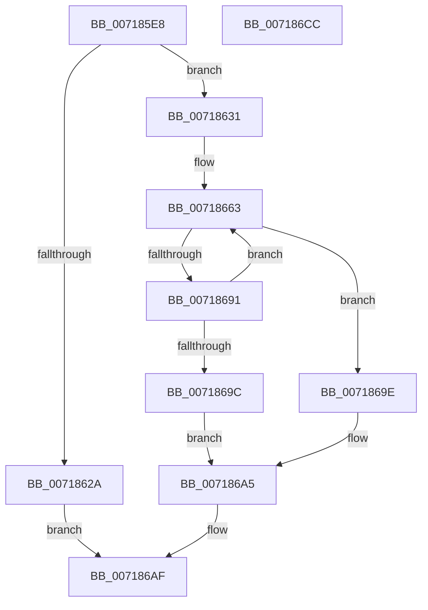

# HvlpDynamicUpdateMicrocode

- RVA: `0x007185E8`–`0x007186CD` (길이 `229` bytes)
- VA: `0x00000001407185E8`
- 실행 섹션: `PAGE`
- PDB 이름 있음: `예`; PDB Function 태그: `아니요`
- unwind 정보 RVA: `0x000C6688`
- 디코드: `65`개 명령, `229/229` bytes 표시
- 미해석 바이트: `0` (있으면 어셈블리에 `.byte`로 보존)

> 이 문서는 커널 이미지의 기계어와 PDB 기호를 분석해 생성했습니다. 4번과 5번은 함수 원형과 자료형을 바이너리 사용 방식에서 추정한 C 해석이며 원본 소스 복구 결과는 아닙니다.

## 1. Dependencies

- 직접 호출 지점: **9**; 고유 호출 대상: **9**
- 직접 호출자로 확인된 함수: **1**
- RIP 상대 이미지 참조: **1**

### Outgoing calls
- `0x0071861D` → [IoAllocateMdl](../../text/29/IoAllocateMdl_function_0029EBF0.md) (function, `0x0029EBF0`)
- `0x00718634` → [MmBuildMdlForNonPagedPool](../../text/23/MmBuildMdlForNonPagedPool_function_0023A870.md) (function, `0x0023A870`)
- `0x00718643` → [HvcallInitInputControl](../../text/46/HvcallInitInputControl_function_00464730.md) (function, `0x00464730`)
- `0x00718679` → [HvcallFastExtended](../../text/31/HvcallFastExtended_function_003130E0.md) (function, `0x003130E0`)
- `0x00718684` → [HvlpHvStatusIsInsufficientMemory](../../text/30/HvlpHvStatusIsInsufficientMemory_function_00307BB0.md) (function, `0x00307BB0`)
- `0x00718691` → [HvlpHandleInsufficientMemory](../../text/58/HvlpHandleInsufficientMemory_function_00584514.md) (function, `0x00584514`)
- `0x0071869E` → [HvlpHvToNtStatus](../../text/30/HvlpHvToNtStatus_function_00307BD8.md) (function, `0x00307BD8`)
- `0x007186A8` → [IoFreeMdl](../../text/29/IoFreeMdl_function_0029EA80.md) (function, `0x0029EA80`)
- `0x007186B7` → [_security_check_cookie](../../text/6A/_security_check_cookie_function_006AC640.md) (function, `0x006AC640`)

### Direct callers
- [HvlUpdateMicrocodeDatabase](HvlUpdateMicrocodeDatabase_function_007185D0.md) at `0x007185D4`

### Static image references
- `0x007185F4` → RVA `0x00E0A740` (`.data`; read)

## 2. Other-region calls and transfers

- 다른 실행 섹션으로 향하는 call: **9**
  - `0x0071861D` → [IoAllocateMdl](../../text/29/IoAllocateMdl_function_0029EBF0.md) (`PAGE` → `.text`)
  - `0x00718634` → [MmBuildMdlForNonPagedPool](../../text/23/MmBuildMdlForNonPagedPool_function_0023A870.md) (`PAGE` → `.text`)
  - `0x00718643` → [HvcallInitInputControl](../../text/46/HvcallInitInputControl_function_00464730.md) (`PAGE` → `.text`)
  - `0x00718679` → [HvcallFastExtended](../../text/31/HvcallFastExtended_function_003130E0.md) (`PAGE` → `.text`)
  - `0x00718684` → [HvlpHvStatusIsInsufficientMemory](../../text/30/HvlpHvStatusIsInsufficientMemory_function_00307BB0.md) (`PAGE` → `.text`)
  - `0x00718691` → [HvlpHandleInsufficientMemory](../../text/58/HvlpHandleInsufficientMemory_function_00584514.md) (`PAGE` → `.text`)
  - `0x0071869E` → [HvlpHvToNtStatus](../../text/30/HvlpHvToNtStatus_function_00307BD8.md) (`PAGE` → `.text`)
  - `0x007186A8` → [IoFreeMdl](../../text/29/IoFreeMdl_function_0029EA80.md) (`PAGE` → `.text`)
  - `0x007186B7` → [_security_check_cookie](../../text/6A/_security_check_cookie_function_006AC640.md) (`PAGE` → `.text`)
- 별도 외부 분기/꼬리 이동을 확인하지 못했습니다.

## 3. Assembly (complete function range)

```asm
007185E8  48 89 5C 24 18                  mov qword ptr [rsp + 0x18], rbx
007185ED  55                              push rbp
007185EE  56                              push rsi
007185EF  57                              push rdi
007185F0  48 83 EC 70                     sub rsp, 0x70
007185F4  48 8B 05 45 21 6F 00            mov rax, qword ptr [rip + 0x6f2145]
007185FB  48 33 C4                        xor rax, rsp
007185FE  48 89 44 24 60                  mov qword ptr [rsp + 0x60], rax
00718603  48 83 64 24 30 00               and qword ptr [rsp + 0x30], 0
00718609  41 8A E8                        mov bpl, r8b
0071860C  48 83 64 24 20 00               and qword ptr [rsp + 0x20], 0
00718612  45 33 C0                        xor r8d, r8d
00718615  45 33 C9                        xor r9d, r9d
00718618  8B F2                           mov esi, edx
0071861A  48 8B D9                        mov rbx, rcx
0071861D  E8 CE 65 B8 FF                  call 0x14029ebf0
00718622  48 8B F8                        mov rdi, rax
00718625  48 85 C0                        test rax, rax
00718628  75 07                           jne 0x140718631
0071862A  B8 9A 00 00 C0                  mov eax, 0xc000009a
0071862F  EB 7E                           jmp 0x1407186af
00718631  48 8B CF                        mov rcx, rdi
00718634  E8 37 22 B2 FF                  call 0x14023a870
00718639  48 8D 54 24 30                  lea rdx, [rsp + 0x30]
0071863E  B9 07 00 00 00                  mov ecx, 7
00718643  E8 E8 C0 D4 FF                  call 0x140464730
00718648  0F BA 6C 24 30 10               bts dword ptr [rsp + 0x30], 0x10
0071864E  33 C0                           xor eax, eax
00718650  40 84 ED                        test bpl, bpl
00718653  48 89 5C 24 40                  mov qword ptr [rsp + 0x40], rbx
00718658  89 74 24 48                     mov dword ptr [rsp + 0x48], esi
0071865C  0F 95 C0                        setne al
0071865F  89 44 24 58                     mov dword ptr [rsp + 0x58], eax
00718663  48 8B 4C 24 30                  mov rcx, qword ptr [rsp + 0x30]
00718668  48 8D 54 24 40                  lea rdx, [rsp + 0x40]
0071866D  83 64 24 20 00                  and dword ptr [rsp + 0x20], 0
00718672  45 33 C9                        xor r9d, r9d
00718675  45 8D 41 20                     lea r8d, [r9 + 0x20]
00718679  E8 62 AA BF FF                  call 0x1403130e0
0071867E  0F B7 C8                        movzx ecx, ax
00718681  4C 8B C0                        mov r8, rax
00718684  E8 27 F5 BE FF                  call 0x140307bb0
00718689  41 0F B7 C8                     movzx ecx, r8w
0071868D  84 C0                           test al, al
0071868F  74 0D                           je 0x14071869e
00718691  E8 7E BE E6 FF                  call 0x140584514
00718696  8B D8                           mov ebx, eax
00718698  85 C0                           test eax, eax
0071869A  79 C7                           jns 0x140718663
0071869C  EB 07                           jmp 0x1407186a5
0071869E  E8 35 F5 BE FF                  call 0x140307bd8
007186A3  8B D8                           mov ebx, eax
007186A5  48 8B CF                        mov rcx, rdi
007186A8  E8 D3 63 B8 FF                  call 0x14029ea80
007186AD  8B C3                           mov eax, ebx
007186AF  48 8B 4C 24 60                  mov rcx, qword ptr [rsp + 0x60]
007186B4  48 33 CC                        xor rcx, rsp
007186B7  E8 84 3F F9 FF                  call 0x1406ac640
007186BC  48 8B 9C 24 A0 00 00 00         mov rbx, qword ptr [rsp + 0xa0]
007186C4  48 83 C4 70                     add rsp, 0x70
007186C8  5F                              pop rdi
007186C9  5E                              pop rsi
007186CA  5D                              pop rbp
007186CB  C3                              ret
007186CC  CC                              int3
```

## 4. C-style interpretation (structured pseudocode)

```c
__int64 __fastcall HvlpDynamicUpdateMicrocode(__int64 a1, int a2, int a3, int a4)
{
    __int64 result;
    __int64 v_rsp;
    unsigned __int64 v_stack_m28;
    unsigned int v_stack_m30;
    unsigned int v_stack_m40;
    unsigned __int64 v_stack_m48;
    unsigned __int64 v_stack_m58;
    unsigned __int64 v_stack_m68;
    unsigned __int64 v_stack_p18;

    v_stack_p18 = v_rbx;
    v_rsp = (v_rsp) - (112);
    result = (*(unsigned __int64 *)(v_rip + 7283013)) ^ (v_rsp);
    v_stack_m28 = result;
    a3 = 0;
    a4 = 0;
    result = IoAllocateMdl(a1, a2, a3, a4);
    if (result != 0) goto loc_00718631;
    goto loc_007186AF;
loc_00718631:
    result = MmBuildMdlForNonPagedPool(result, a2, a3, a4);
    result = HvcallInitInputControl(7, v_stack_m58, a3, a4);
    result = 0;
    v_stack_m48 = a1;
    v_stack_m40 = (unsigned int)((unsigned int)(a2));
    result = ((unsigned __int8)((unsigned __int8)(a3)) != 0) ? 1 : 0;
    v_stack_m30 = (unsigned int)(result);
loc_00718663:
    a4 = 0;
    result = HvcallFastExtended(v_stack_m58, v_stack_m48, a4 + 32, a4);
    result = HvlpHvStatusIsInsufficientMemory((unsigned __int16)(result), v_stack_m48, result, a4);
    if ((unsigned __int8)(result) == 0) goto loc_0071869E;
    result = HvlpHandleInsufficientMemory((unsigned __int16)(result), v_stack_m48, result, a4);
    if (!sign_flag) goto loc_00718663;
    goto loc_007186A5;
loc_0071869E:
    result = HvlpHvToNtStatus((unsigned __int16)(result), v_stack_m48, result, a4);
loc_007186A5:
    result = IoFreeMdl(result, v_stack_m48, result, a4);
loc_007186AF:
    a1 = (v_stack_m28) ^ (v_rsp);
    result = _security_check_cookie(a1, v_stack_m48, result, a4);
    v_rsp = (v_rsp) + (112);
    return result;
}
```

## 5. (Beta) C Style

```c
int64_t HvlpDynamicUpdateMicrocode(int64_t Arg1, int32_t Arg2, int32_t Arg3, int32_t Arg4)
{
    int64_t result;
    int64_t local_rsp;
    uint64_t v_stack_m28;
    uint32_t v_stack_m30;
    uint32_t v_stack_m40;
    uint64_t v_stack_m48;
    uint64_t v_stack_m58;
    uint64_t v_stack_m68;
    uint64_t v_stack_p18;

    v_stack_p18 = local_rbx;
    local_rsp = (local_rsp) - (112);
    result = (*(uint64_t *)(v_rip + 0x6F2145)) ^ (local_rsp);
    v_stack_m28 = result;
    Arg3 = 0;
    Arg4 = 0;
    result = IoAllocateMdl(Arg1, Arg2, Arg3, Arg4);
    if (result != 0) goto loc_00718631;
    goto loc_007186AF;
loc_00718631:
    result = MmBuildMdlForNonPagedPool(result, Arg2, Arg3, Arg4);
    result = HvcallInitInputControl(7, v_stack_m58, Arg3, Arg4);
    result = 0;
    v_stack_m48 = Arg1;
    v_stack_m40 = (uint32_t)((uint32_t)(Arg2));
    result = ((uint8_t)((uint8_t)(Arg3)) != 0) ? 1 : 0;
    v_stack_m30 = (uint32_t)(result);
loc_00718663:
    Arg4 = 0;
    result = HvcallFastExtended(v_stack_m58, v_stack_m48, Arg4 + 32, Arg4);
    result = HvlpHvStatusIsInsufficientMemory((uint16_t)(result), v_stack_m48, result, Arg4);
    if ((uint8_t)(result) == 0) goto loc_0071869E;
    result = HvlpHandleInsufficientMemory((uint16_t)(result), v_stack_m48, result, Arg4);
    if (!sign_flag) goto loc_00718663;
    goto loc_007186A5;
loc_0071869E:
    result = HvlpHvToNtStatus((uint16_t)(result), v_stack_m48, result, Arg4);
loc_007186A5:
    result = IoFreeMdl(result, v_stack_m48, result, Arg4);
loc_007186AF:
    Arg1 = (v_stack_m28) ^ (local_rsp);
    result = _security_check_cookie(Arg1, v_stack_m48, result, Arg4);
    local_rsp = (local_rsp) + (112);
    return result;
}
```

## 6. Execution-region graph

[열기: 2D/3D 그래프와 함수 탐색 컨트롤 패널](../../../control-panel.html?section=page&rva=0x007185E8&view=graph)

- 2D 그래프는 위에서 아래로 흐르고, 3D 그래프는 빈 공간을 드래그해 회전합니다. Shift+드래그는 이동, 휠은 확대·축소, 함수 노드 선택은 대상 보고서 이동입니다.

### Static fallback


