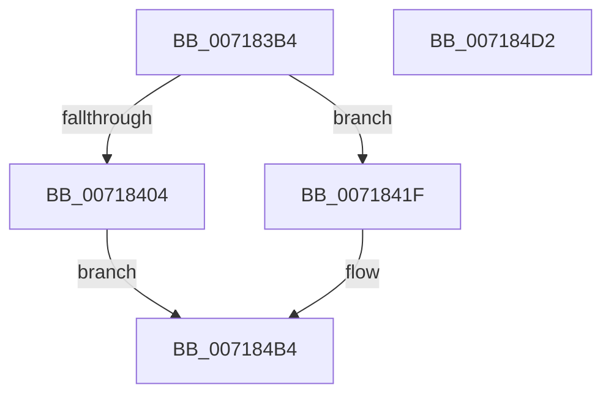

# HvlpLpCpuid

- RVA: `0x007183B4`–`0x007184D3` (길이 `287` bytes)
- VA: `0x00000001407183B4`
- 실행 섹션: `PAGE`
- PDB 이름 있음: `예`; PDB Function 태그: `아니요`
- unwind 정보 RVA: `0x000C3B78`
- 디코드: `84`개 명령, `287/287` bytes 표시
- 미해석 바이트: `0` (있으면 어셈블리에 `.byte`로 보존)

> 이 문서는 커널 이미지의 기계어와 PDB 기호를 분석해 생성했습니다. 4번과 5번은 함수 원형과 자료형을 바이너리 사용 방식에서 추정한 C 해석이며 원본 소스 복구 결과는 아닙니다.

## 1. Dependencies

- 직접 호출 지점: **6**; 고유 호출 대상: **4**
- 직접 호출자로 확인된 함수: **2**
- RIP 상대 이미지 참조: **0**

### Outgoing calls
- `0x00718428` → [HvcallInitInputControl](../../text/46/HvcallInitInputControl_function_00464730.md) (function, `0x00464730`)
- `0x0071844C` → [HvlpAcquireHypercallPage](../../text/47/HvlpAcquireHypercallPage_function_00471410.md) (function, `0x00471410`)
- `0x00718461` → [HvlpAcquireHypercallPage](../../text/47/HvlpAcquireHypercallPage_function_00471410.md) (function, `0x00471410`)
- `0x00718487` → [HvcallInitiateHypercall](../../text/31/HvcallInitiateHypercall_function_00313630.md) (function, `0x00313630`)
- `0x007184A6` → [HvlpReleaseHypercallPage](../../text/31/HvlpReleaseHypercallPage_function_00313480.md) (function, `0x00313480`)
- `0x007184AF` → [HvlpReleaseHypercallPage](../../text/31/HvlpReleaseHypercallPage_function_00313480.md) (function, `0x00313480`)

### Direct callers
- [HvlpDiscoverTopologyAmd](../../init/C2/HvlpDiscoverTopologyAmd_function_00C2972C.md) at `0x00C29778`
- [HvlpDiscoverTopologyAmd](../../init/C2/HvlpDiscoverTopologyAmd_function_00C2972C.md) at `0x00C29794`
- [HvlpDiscoverTopologyAmd](../../init/C2/HvlpDiscoverTopologyAmd_function_00C2972C.md) at `0x00C297CD`
- [HvlpDiscoverTopologyAmd](../../init/C2/HvlpDiscoverTopologyAmd_function_00C2972C.md) at `0x00C297EB`
- [HvlpDiscoverTopologyIntel](../../init/C2/HvlpDiscoverTopologyIntel_function_00C29938.md) at `0x00C2997D`
- [HvlpDiscoverTopologyIntel](../../init/C2/HvlpDiscoverTopologyIntel_function_00C29938.md) at `0x00C29999`
- [HvlpDiscoverTopologyIntel](../../init/C2/HvlpDiscoverTopologyIntel_function_00C29938.md) at `0x00C299BA`
- [HvlpDiscoverTopologyIntel](../../init/C2/HvlpDiscoverTopologyIntel_function_00C29938.md) at `0x00C29A02`
- [HvlpDiscoverTopologyIntel](../../init/C2/HvlpDiscoverTopologyIntel_function_00C29938.md) at `0x00C29A36`

### Static image references
- 디코드된 RIP-relative 메모리 참조가 없습니다.

## 2. Other-region calls and transfers

- 다른 실행 섹션으로 향하는 call: **6**
  - `0x00718428` → [HvcallInitInputControl](../../text/46/HvcallInitInputControl_function_00464730.md) (`PAGE` → `.text`)
  - `0x0071844C` → [HvlpAcquireHypercallPage](../../text/47/HvlpAcquireHypercallPage_function_00471410.md) (`PAGE` → `.text`)
  - `0x00718461` → [HvlpAcquireHypercallPage](../../text/47/HvlpAcquireHypercallPage_function_00471410.md) (`PAGE` → `.text`)
  - `0x00718487` → [HvcallInitiateHypercall](../../text/31/HvcallInitiateHypercall_function_00313630.md) (`PAGE` → `.text`)
  - `0x007184A6` → [HvlpReleaseHypercallPage](../../text/31/HvlpReleaseHypercallPage_function_00313480.md) (`PAGE` → `.text`)
  - `0x007184AF` → [HvlpReleaseHypercallPage](../../text/31/HvlpReleaseHypercallPage_function_00313480.md) (`PAGE` → `.text`)
- 별도 외부 분기/꼬리 이동을 확인하지 못했습니다.

## 3. Assembly (complete function range)

```asm
007183B4  48 8B C4                        mov rax, rsp
007183B7  48 89 58 08                     mov qword ptr [rax + 8], rbx
007183BB  48 89 70 10                     mov qword ptr [rax + 0x10], rsi
007183BF  48 89 78 18                     mov qword ptr [rax + 0x18], rdi
007183C3  4C 89 60 20                     mov qword ptr [rax + 0x20], r12
007183C7  55                              push rbp
007183C8  41 56                           push r14
007183CA  41 57                           push r15
007183CC  48 8B EC                        mov rbp, rsp
007183CF  48 83 EC 70                     sub rsp, 0x70
007183D3  48 83 65 B0 00                  and qword ptr [rbp - 0x50], 0
007183D8  33 C0                           xor eax, eax
007183DA  48 89 45 E8                     mov qword ptr [rbp - 0x18], rax
007183DE  0F 57 C0                        xorps xmm0, xmm0
007183E1  89 45 F0                        mov dword ptr [rbp - 0x10], eax
007183E4  49 8B F1                        mov rsi, r9
007183E7  48 89 45 C8                     mov qword ptr [rbp - 0x38], rax
007183EB  45 8B F0                        mov r14d, r8d
007183EE  89 45 D0                        mov dword ptr [rbp - 0x30], eax
007183F1  44 8B FA                        mov r15d, edx
007183F4  44 8B E1                        mov r12d, ecx
007183F7  0F 11 45 D8                     movups xmmword ptr [rbp - 0x28], xmm0
007183FB  0F 11 45 B8                     movups xmmword ptr [rbp - 0x48], xmm0
007183FF  83 F9 FF                        cmp ecx, -1
00718402  75 1B                           jne 0x14071841f
00718404  8B C2                           mov eax, edx
00718406  41 8B C8                        mov ecx, r8d
00718409  0F A2                           cpuid
0071840B  41 89 01                        mov dword ptr [r9], eax
0071840E  41 89 59 04                     mov dword ptr [r9 + 4], ebx
00718412  41 89 49 08                     mov dword ptr [r9 + 8], ecx
00718416  41 89 51 0C                     mov dword ptr [r9 + 0xc], edx
0071841A  E9 95 00 00 00                  jmp 0x1407184b4
0071841F  48 8D 55 B0                     lea rdx, [rbp - 0x50]
00718423  B9 88 00 00 00                  mov ecx, 0x88
00718428  E8 03 C3 D4 FF                  call 0x140464730
0071842D  8B 45 B4                        mov eax, dword ptr [rbp - 0x4c]
00718430  48 8D 4D D8                     lea rcx, [rbp - 0x28]
00718434  BA 01 00 00 00                  mov edx, 1
00718439  25 01 F0 00 F0                  and eax, 0xf000f001
0071843E  0B C2                           or eax, edx
00718440  45 33 C0                        xor r8d, r8d
00718443  89 45 B4                        mov dword ptr [rbp - 0x4c], eax
00718446  8D 7A 0F                        lea edi, [rdx + 0xf]
00718449  44 8B CF                        mov r9d, edi
0071844C  E8 BF 8F D5 FF                  call 0x140471410
00718451  44 8B CF                        mov r9d, edi
00718454  8D 57 F2                        lea edx, [rdi - 0xe]
00718457  45 33 C0                        xor r8d, r8d
0071845A  48 8D 4D B8                     lea rcx, [rbp - 0x48]
0071845E  48 8B D8                        mov rbx, rax
00718461  E8 AA 8F D5 FF                  call 0x140471410
00718466  4C 8B 45 D0                     mov r8, qword ptr [rbp - 0x30]
0071846A  48 8B F8                        mov rdi, rax
0071846D  48 8B 55 F0                     mov rdx, qword ptr [rbp - 0x10]
00718471  48 8B 4D B0                     mov rcx, qword ptr [rbp - 0x50]
00718475  44 89 23                        mov dword ptr [rbx], r12d
00718478  C7 43 04 00 00 01 00            mov dword ptr [rbx + 4], 0x10000
0071847F  44 89 7B 08                     mov dword ptr [rbx + 8], r15d
00718483  44 89 73 0C                     mov dword ptr [rbx + 0xc], r14d
00718487  E8 A4 B1 BF FF                  call 0x140313630
0071848C  8B 0F                           mov ecx, dword ptr [rdi]
0071848E  89 0E                           mov dword ptr [rsi], ecx
00718490  8B 4F 04                        mov ecx, dword ptr [rdi + 4]
00718493  89 4E 04                        mov dword ptr [rsi + 4], ecx
00718496  8B 4F 08                        mov ecx, dword ptr [rdi + 8]
00718499  89 4E 08                        mov dword ptr [rsi + 8], ecx
0071849C  48 8D 4D B8                     lea rcx, [rbp - 0x48]
007184A0  8B 47 0C                        mov eax, dword ptr [rdi + 0xc]
007184A3  89 46 0C                        mov dword ptr [rsi + 0xc], eax
007184A6  E8 D5 AF BF FF                  call 0x140313480
007184AB  48 8D 4D D8                     lea rcx, [rbp - 0x28]
007184AF  E8 CC AF BF FF                  call 0x140313480
007184B4  4C 8D 5C 24 70                  lea r11, [rsp + 0x70]
007184B9  49 8B 5B 20                     mov rbx, qword ptr [r11 + 0x20]
007184BD  49 8B 73 28                     mov rsi, qword ptr [r11 + 0x28]
007184C1  49 8B 7B 30                     mov rdi, qword ptr [r11 + 0x30]
007184C5  4D 8B 63 38                     mov r12, qword ptr [r11 + 0x38]
007184C9  49 8B E3                        mov rsp, r11
007184CC  41 5F                           pop r15
007184CE  41 5E                           pop r14
007184D0  5D                              pop rbp
007184D1  C3                              ret
007184D2  CC                              int3
```

## 4. C-style interpretation (structured pseudocode)

```c
__int64 __fastcall HvlpLpCpuid(int a1, int a2, int a3, __int64 a4)
{
    __int64 result;
    __int64 v_rsp;
    unsigned __int64 v_stack_m18;
    unsigned int v_stack_m28;
    unsigned __int64 v_stack_m30;
    unsigned __int64 v_stack_m40;
    unsigned int v_stack_m48;
    unsigned __int64 v_stack_m50;
    unsigned __int64 v_stack_m60;
    unsigned int v_stack_m64;
    unsigned __int64 v_stack_m68;

    *(unsigned __int64 *)(v_rsp + 8) = v_rbx;
    *(unsigned __int64 *)(v_rsp + 16) = v_rsi;
    *(unsigned __int64 *)(v_rsp + 24) = v_rdi;
    *(unsigned __int64 *)(v_rsp + 32) = v_r12;
    v_rsp = (v_rsp) - (112);
    result = 0;
    v_stack_m30 = 0;
    v_stack_m28 = 0;
    v_stack_m50 = 0;
    v_stack_m48 = 0;
    v_stack_m40 = v_xmm0;
    v_stack_m60 = v_xmm0;
    if (a1 != -1) goto loc_0071841F;
    *(unsigned int *)(a4) = (unsigned int)((unsigned int)(a2));
    *(unsigned int *)(a4 + 4) = (unsigned int)(v_rbx);
    *(unsigned int *)(a4 + 8) = (unsigned int)((unsigned int)(a3));
    *(unsigned int *)(a4 + 12) = a2;
    goto loc_007184B4;
loc_0071841F:
    result = HvcallInitInputControl(136, v_stack_m68, a3, a4);
    result = (unsigned int)(((unsigned int)(v_stack_m64)) & (0xF000F001ULL));
    result = (unsigned int)((result) | (1));
    a3 = 0;
    v_stack_m64 = (unsigned int)(result);
    result = HvlpAcquireHypercallPage(v_stack_m40, 1, a3, (unsigned int)((unsigned int)(1 + 15)));
    a3 = 0;
    result = HvlpAcquireHypercallPage(v_stack_m60, 1 + 15 - 14, a3, (unsigned int)((unsigned int)(1 + 15)));
    *(unsigned int *)(result) = (unsigned int)((unsigned int)(a1));
    *(unsigned int *)(result + 4) = 0x10000ULL;
    *(unsigned int *)(result + 8) = (unsigned int)((unsigned int)(a2));
    *(unsigned int *)(result + 12) = (unsigned int)((unsigned int)(a3));
    result = HvcallInitiateHypercall(v_stack_m68, v_stack_m28, v_stack_m48, (unsigned int)((unsigned int)(1 + 15)));
    *(unsigned int *)(a4) = (unsigned int)((unsigned int)(*(unsigned int *)(result)));
    *(unsigned int *)(a4 + 4) = (unsigned int)((unsigned int)(*(unsigned int *)(result + 4)));
    *(unsigned int *)(a4 + 8) = (unsigned int)((unsigned int)(*(unsigned int *)(result + 8)));
    *(unsigned int *)(a4 + 12) = (unsigned int)((unsigned int)(*(unsigned int *)(result + 12)));
    result = HvlpReleaseHypercallPage(v_stack_m60, v_stack_m28, v_stack_m48, (unsigned int)((unsigned int)(1 + 15)));
    result = HvlpReleaseHypercallPage(v_stack_m40, v_stack_m28, v_stack_m48, (unsigned int)((unsigned int)(1 + 15)));
loc_007184B4:
    return result;
}
```

## 5. (Beta) C Style

```c
int64_t HvlpLpCpuid(int32_t Arg1, int32_t Arg2, int32_t Arg3, void *Arg4)
{
    uint8_t *arg4 = (uint8_t *)Arg4;

    int64_t result;
    int64_t local_rsp;
    uint64_t v_stack_m18;
    uint32_t v_stack_m28;
    uint64_t v_stack_m30;
    uint64_t v_stack_m40;
    uint32_t v_stack_m48;
    uint64_t v_stack_m50;
    uint64_t v_stack_m60;
    uint32_t v_stack_m64;
    uint64_t v_stack_m68;

    *(uint64_t *)(local_rsp + 0x8) = local_rbx;
    *(uint64_t *)(local_rsp + 0x10) = local_rsi;
    *(uint64_t *)(local_rsp + 0x18) = local_rdi;
    *(uint64_t *)(local_rsp + 0x20) = local_r12;
    local_rsp = (local_rsp) - (112);
    result = 0;
    v_stack_m30 = 0;
    v_stack_m28 = 0;
    v_stack_m50 = 0;
    v_stack_m48 = 0;
    v_stack_m40 = v_xmm0;
    v_stack_m60 = v_xmm0;
    if (Arg1 != -1) goto loc_0071841F;
    *(uint32_t *)(arg4) = (uint32_t)((uint32_t)(Arg2));
    *(uint32_t *)(arg4 + 0x4) = (uint32_t)(local_rbx);
    *(uint32_t *)(arg4 + 0x8) = (uint32_t)((uint32_t)(Arg3));
    *(uint32_t *)(arg4 + 0xC) = Arg2;
    goto loc_007184B4;
loc_0071841F:
    result = HvcallInitInputControl(136, v_stack_m68, Arg3, Arg4);
    result = (uint32_t)(((uint32_t)(v_stack_m64)) & (0xF000F001ULL));
    result = (uint32_t)((result) | (1));
    Arg3 = 0;
    v_stack_m64 = (uint32_t)(result);
    result = HvlpAcquireHypercallPage(v_stack_m40, 1, Arg3, (uint32_t)((uint32_t)(1 + 15)));
    Arg3 = 0;
    result = HvlpAcquireHypercallPage(v_stack_m60, 1 + 15 - 14, Arg3, (uint32_t)((uint32_t)(1 + 15)));
    *(uint32_t *)(result) = (uint32_t)((uint32_t)(Arg1));
    *(uint32_t *)(result + 0x4) = 0x10000ULL;
    *(uint32_t *)(result + 0x8) = (uint32_t)((uint32_t)(Arg2));
    *(uint32_t *)(result + 0xC) = (uint32_t)((uint32_t)(Arg3));
    result = HvcallInitiateHypercall(v_stack_m68, v_stack_m28, v_stack_m48, (uint32_t)((uint32_t)(1 + 15)));
    *(uint32_t *)(arg4) = (uint32_t)((uint32_t)(*(uint32_t *)(result)));
    *(uint32_t *)(arg4 + 0x4) = (uint32_t)((uint32_t)(*(uint32_t *)(result + 0x4)));
    *(uint32_t *)(arg4 + 0x8) = (uint32_t)((uint32_t)(*(uint32_t *)(result + 0x8)));
    *(uint32_t *)(arg4 + 0xC) = (uint32_t)((uint32_t)(*(uint32_t *)(result + 0xC)));
    result = HvlpReleaseHypercallPage(v_stack_m60, v_stack_m28, v_stack_m48, (uint32_t)((uint32_t)(1 + 15)));
    result = HvlpReleaseHypercallPage(v_stack_m40, v_stack_m28, v_stack_m48, (uint32_t)((uint32_t)(1 + 15)));
loc_007184B4:
    return result;
}
```

### 관측된 메모리 오프셋

구조체 형식이 확인되지 않은 접근은 인자 기준의 오프셋으로만 기록했습니다.

| 기준 인자 | 오프셋 표현 | 폭 (bit) | 접근 |
|---|---:|---:|---|
| `Arg4` | `+ 0x0` | `32` | `W` |
| `Arg4` | `+ 0x4` | `32` | `W` |
| `Arg4` | `+ 0x8` | `32` | `W` |
| `Arg4` | `+ 0xC` | `32` | `W` |

## 6. Execution-region graph

[열기: 2D/3D 그래프와 함수 탐색 컨트롤 패널](../../../control-panel.html?section=page&rva=0x007183B4&view=graph)

- 2D 그래프는 위에서 아래로 흐르고, 3D 그래프는 빈 공간을 드래그해 회전합니다. Shift+드래그는 이동, 휠은 확대·축소, 함수 노드 선택은 대상 보고서 이동입니다.

### Static fallback


