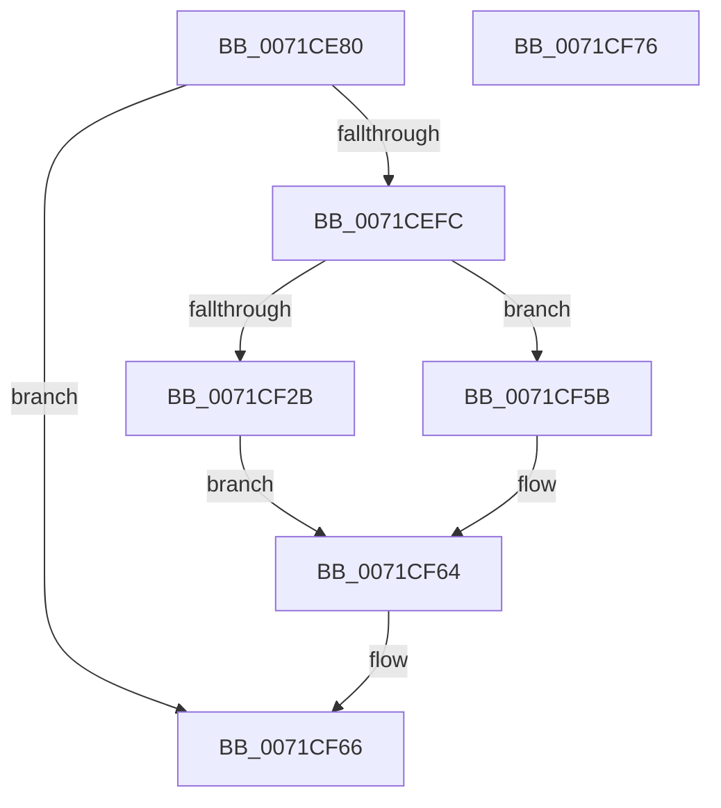

# IoAttachDevice

- RVA: `0x0071CE80`–`0x0071CF77` (길이 `247` bytes)
- VA: `0x000000014071CE80`
- 실행 섹션: `PAGE`
- PDB 이름 있음: `예`; PDB Function 태그: `아니요`
- unwind 정보 RVA: `0x000C4620`
- 디코드: `67`개 명령, `247/247` bytes 표시
- 미해석 바이트: `0` (있으면 어셈블리에 `.byte`로 보존)

> 이 문서는 커널 이미지의 기계어와 PDB 기호를 분석해 생성했습니다. 4번과 5번은 함수 원형과 자료형을 바이너리 사용 방식에서 추정한 C 해석이며 원본 소스 복구 결과는 아닙니다.

## 1. Dependencies

- 직접 호출 지점: **7**; 고유 호출 대상: **6**
- 직접 호출자로 확인된 함수: **1**
- RIP 상대 이미지 참조: **2**

### Outgoing calls
- `0x0071CEF3` → [ZwOpenFile](../../text/6A/ZwOpenFile_function_006AD730.md) (function, `0x006AD730`)
- `0x0071CF20` → [ObReferenceObjectByHandle](../86/ObReferenceObjectByHandle_function_00868DB0.md) (function, `0x00868DB0`)
- `0x0071CF2F` → [IoGetRelatedDeviceObject](../../text/29/IoGetRelatedDeviceObject_function_0029B120.md) (function, `0x0029B120`)
- `0x0071CF3B` → [ZwClose](../../text/6A/ZwClose_function_006AD2B0.md) (function, `0x006AD2B0`)
- `0x0071CF49` → [IoAttachDeviceToDeviceStackSafe](../../text/41/IoAttachDeviceToDeviceStackSafe_function_00410550.md) (function, `0x00410550`)
- `0x0071CF54` → [ObfDereferenceObject](../../text/2F/ObfDereferenceObject_function_002F9350.md) (function, `0x002F9350`)
- `0x0071CF5F` → [ZwClose](../../text/6A/ZwClose_function_006AD2B0.md) (function, `0x006AD2B0`)

### Direct callers
- [DifIoAttachDeviceWrapper](../../text/62/DifIoAttachDeviceWrapper_function_00627EB0.md) at `0x00627F95`

### Static image references
- `0x0071CEA7` → RVA `0x00E0A9C0` (`.data`; read)
- `0x0071CEFC` → RVA `0x00FC6AE0` (`ALMOSTRO`; read)

## 2. Other-region calls and transfers

- 다른 실행 섹션으로 향하는 call: **6**
  - `0x0071CEF3` → [ZwOpenFile](../../text/6A/ZwOpenFile_function_006AD730.md) (`PAGE` → `.text`)
  - `0x0071CF2F` → [IoGetRelatedDeviceObject](../../text/29/IoGetRelatedDeviceObject_function_0029B120.md) (`PAGE` → `.text`)
  - `0x0071CF3B` → [ZwClose](../../text/6A/ZwClose_function_006AD2B0.md) (`PAGE` → `.text`)
  - `0x0071CF49` → [IoAttachDeviceToDeviceStackSafe](../../text/41/IoAttachDeviceToDeviceStackSafe_function_00410550.md) (`PAGE` → `.text`)
  - `0x0071CF54` → [ObfDereferenceObject](../../text/2F/ObfDereferenceObject_function_002F9350.md) (`PAGE` → `.text`)
  - `0x0071CF5F` → [ZwClose](../../text/6A/ZwClose_function_006AD2B0.md) (`PAGE` → `.text`)
- 별도 외부 분기/꼬리 이동을 확인하지 못했습니다.

## 3. Assembly (complete function range)

```asm
0071CE80  48 89 5C 24 08                  mov qword ptr [rsp + 8], rbx
0071CE85  55                              push rbp
0071CE86  56                              push rsi
0071CE87  57                              push rdi
0071CE88  48 8B EC                        mov rbp, rsp
0071CE8B  48 83 EC 70                     sub rsp, 0x70
0071CE8F  83 65 EC 00                     and dword ptr [rbp - 0x14], 0
0071CE93  4C 8D 4D C0                     lea r9, [rbp - 0x40]
0071CE97  48 83 65 28 00                  and qword ptr [rbp + 0x28], 0
0071CE9C  48 8B F1                        mov rsi, rcx
0071CE9F  48 83 65 D8 00                  and qword ptr [rbp - 0x28], 0
0071CEA4  0F 57 C0                        xorps xmm0, xmm0
0071CEA7  8B 05 13 DB 6E 00               mov eax, dword ptr [rip + 0x6edb13]
0071CEAD  49 8B F8                        mov rdi, r8
0071CEB0  48 C7 45 D0 30 00 00 00         mov qword ptr [rbp - 0x30], 0x30
0071CEB8  4C 8D 45 D0                     lea r8, [rbp - 0x30]
0071CEBC  83 65 D4 00                     and dword ptr [rbp - 0x2c], 0
0071CEC0  F7 D8                           neg eax
0071CEC2  48 89 55 E0                     mov qword ptr [rbp - 0x20], rdx
0071CEC6  C7 44 24 28 40 00 00 80         mov dword ptr [rsp + 0x28], 0x80000040
0071CECE  BA 80 00 00 00                  mov edx, 0x80
0071CED3  1B C9                           sbb ecx, ecx
0071CED5  83 64 24 20 00                  and dword ptr [rsp + 0x20], 0
0071CEDA  83 E1 40                        and ecx, 0x40
0071CEDD  81 C1 00 02 00 00               add ecx, 0x200
0071CEE3  89 4D E8                        mov dword ptr [rbp - 0x18], ecx
0071CEE6  48 8D 4D 28                     lea rcx, [rbp + 0x28]
0071CEEA  0F 11 45 C0                     movups xmmword ptr [rbp - 0x40], xmm0
0071CEEE  F3 0F 7F 45 F0                  movdqu xmmword ptr [rbp - 0x10], xmm0
0071CEF3  E8 38 08 F9 FF                  call 0x1406ad730
0071CEF8  85 C0                           test eax, eax
0071CEFA  78 6A                           js 0x14071cf66
0071CEFC  4C 8B 05 DD 9B 8A 00            mov r8, qword ptr [rip + 0x8a9bdd]
0071CF03  48 8D 45 38                     lea rax, [rbp + 0x38]
0071CF07  48 83 64 24 28 00               and qword ptr [rsp + 0x28], 0
0071CF0D  45 33 C9                        xor r9d, r9d
0071CF10  48 8B 4D 28                     mov rcx, qword ptr [rbp + 0x28]
0071CF14  33 D2                           xor edx, edx
0071CF16  48 83 65 38 00                  and qword ptr [rbp + 0x38], 0
0071CF1B  48 89 44 24 20                  mov qword ptr [rsp + 0x20], rax
0071CF20  E8 8B BE 14 00                  call 0x140868db0
0071CF25  8B D8                           mov ebx, eax
0071CF27  85 C0                           test eax, eax
0071CF29  78 30                           js 0x14071cf5b
0071CF2B  48 8B 4D 38                     mov rcx, qword ptr [rbp + 0x38]
0071CF2F  E8 EC E1 B7 FF                  call 0x14029b120
0071CF34  48 8B 4D 28                     mov rcx, qword ptr [rbp + 0x28]
0071CF38  48 8B D8                        mov rbx, rax
0071CF3B  E8 70 03 F9 FF                  call 0x1406ad2b0
0071CF40  4C 8B C7                        mov r8, rdi
0071CF43  48 8B D3                        mov rdx, rbx
0071CF46  48 8B CE                        mov rcx, rsi
0071CF49  E8 02 36 CF FF                  call 0x140410550
0071CF4E  48 8B 4D 38                     mov rcx, qword ptr [rbp + 0x38]
0071CF52  8B D8                           mov ebx, eax
0071CF54  E8 F7 C3 BD FF                  call 0x1402f9350
0071CF59  EB 09                           jmp 0x14071cf64
0071CF5B  48 8B 4D 28                     mov rcx, qword ptr [rbp + 0x28]
0071CF5F  E8 4C 03 F9 FF                  call 0x1406ad2b0
0071CF64  8B C3                           mov eax, ebx
0071CF66  48 8B 9C 24 90 00 00 00         mov rbx, qword ptr [rsp + 0x90]
0071CF6E  48 83 C4 70                     add rsp, 0x70
0071CF72  5F                              pop rdi
0071CF73  5E                              pop rsi
0071CF74  5D                              pop rbp
0071CF75  C3                              ret
0071CF76  CC                              int3
```

## 4. C-style interpretation (structured pseudocode)

```c
__int64 __fastcall IoAttachDevice(__int64 a1, __int64 a2, __int64 a3)
{
    __int64 result;
    __int64 v_rsp;
    unsigned __int64 v_stack_m28;
    unsigned int v_stack_m2C;
    unsigned int v_stack_m30;
    unsigned __int64 v_stack_m38;
    unsigned __int64 v_stack_m40;
    unsigned int v_stack_m44;
    unsigned __int64 v_stack_m48;
    unsigned __int64 v_stack_m58;
    unsigned int v_stack_m60;
    unsigned int v_stack_m68;
    unsigned __int64 v_stack_p10;
    unsigned __int64 v_stack_p20;
    unsigned __int64 v_stack_p8;

    v_stack_p8 = v_rbx;
    v_rsp = (v_rsp) - (112);
    v_stack_m48 = 48;
    result = (unsigned int)(-((unsigned int)(*(unsigned int *)(v_rip + 7265043))));
    v_stack_m38 = a2;
    v_stack_m60 = 0x80000040ULL;
    a1 = (unsigned int)((a1) & (64));
    a1 = (unsigned int)((a1) + (512));
    v_stack_m30 = (unsigned int)(a1);
    v_stack_m58 = v_xmm0;
    v_stack_m28 = v_xmm0;
    result = ZwOpenFile(v_stack_p10, 128, v_stack_m48, v_stack_m58);
    if (sign_flag) goto loc_0071CF66;
    a4 = 0;
    a2 = 0;
    v_stack_m68 = v_stack_p20;
    result = ObReferenceObjectByHandle(v_stack_p10, a2, *(unsigned __int64 *)(v_rip + 9083869), a4);
    if (sign_flag) goto loc_0071CF5B;
    result = IoGetRelatedDeviceObject(v_stack_p20, a2, *(unsigned __int64 *)(v_rip + 9083869), a4);
    result = ZwClose(v_stack_p10, a2, *(unsigned __int64 *)(v_rip + 9083869), a4);
    result = IoAttachDeviceToDeviceStackSafe(a1, result, a3, a4);
    result = ObfDereferenceObject(v_stack_p20, result, a3, a4);
    goto loc_0071CF64;
loc_0071CF5B:
    result = ZwClose(v_stack_p10, result, a3, a4);
loc_0071CF64:
loc_0071CF66:
    v_rsp = (v_rsp) + (112);
    return (unsigned int)((unsigned int)((unsigned int)((unsigned int)(result))));
}
```

## 5. (Beta) C Style

```c
int64_t IoAttachDevice(int64_t Arg1, int64_t Arg2, int64_t Arg3)
{
    int64_t result;
    int64_t local_rsp;
    uint64_t v_stack_m28;
    uint32_t v_stack_m2C;
    uint32_t v_stack_m30;
    uint64_t v_stack_m38;
    uint64_t v_stack_m40;
    uint32_t v_stack_m44;
    uint64_t v_stack_m48;
    uint64_t v_stack_m58;
    uint32_t v_stack_m60;
    uint32_t v_stack_m68;
    uint64_t v_stack_p10;
    uint64_t v_stack_p20;
    uint64_t v_stack_p8;

    v_stack_p8 = local_rbx;
    local_rsp = (local_rsp) - (112);
    v_stack_m48 = 48;
    result = (uint32_t)(-((uint32_t)(*(uint32_t *)(v_rip + 0x6EDB13))));
    v_stack_m38 = Arg2;
    v_stack_m60 = 0x80000040ULL;
    Arg1 = (uint32_t)((Arg1) & (64));
    Arg1 = (uint32_t)((Arg1) + (512));
    v_stack_m30 = (uint32_t)(Arg1);
    v_stack_m58 = v_xmm0;
    v_stack_m28 = v_xmm0;
    result = ZwOpenFile(v_stack_p10, 128, v_stack_m48, v_stack_m58);
    if (sign_flag) goto loc_0071CF66;
    a4 = 0;
    Arg2 = 0;
    v_stack_m68 = v_stack_p20;
    result = ObReferenceObjectByHandle(v_stack_p10, Arg2, *(uint64_t *)(v_rip + 0x8A9BDD), a4);
    if (sign_flag) goto loc_0071CF5B;
    result = IoGetRelatedDeviceObject(v_stack_p20, Arg2, *(uint64_t *)(v_rip + 0x8A9BDD), a4);
    result = ZwClose(v_stack_p10, Arg2, *(uint64_t *)(v_rip + 0x8A9BDD), a4);
    result = IoAttachDeviceToDeviceStackSafe(Arg1, result, Arg3, a4);
    result = ObfDereferenceObject(v_stack_p20, result, Arg3, a4);
    goto loc_0071CF64;
loc_0071CF5B:
    result = ZwClose(v_stack_p10, result, Arg3, a4);
loc_0071CF64:
loc_0071CF66:
    local_rsp = (local_rsp) + (112);
    return (uint32_t)((uint32_t)((uint32_t)((uint32_t)(result))));
}
```

## 6. Execution-region graph

[열기: 2D/3D 그래프와 함수 탐색 컨트롤 패널](../../../control-panel.html?section=page&rva=0x0071CE80&view=graph)

- 2D 그래프는 위에서 아래로 흐르고, 3D 그래프는 빈 공간을 드래그해 회전합니다. Shift+드래그는 이동, 휠은 확대·축소, 함수 노드 선택은 대상 보고서 이동입니다.

### Static fallback


