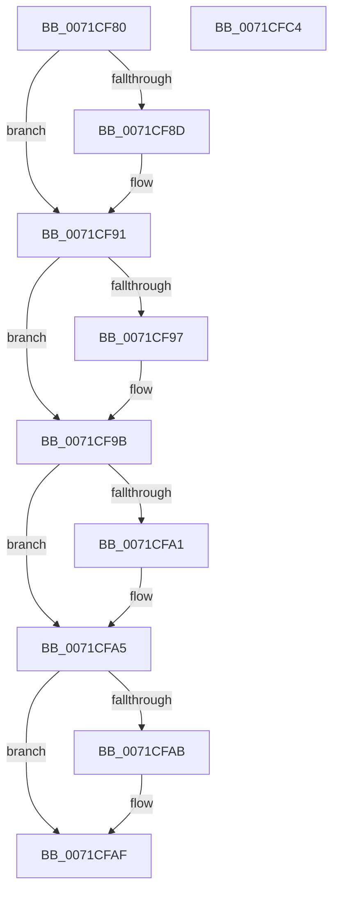

# IoCheckDesiredAccess

- RVA: `0x0071CF80`–`0x0071CFC5` (길이 `69` bytes)
- VA: `0x000000014071CF80`
- 실행 섹션: `PAGE`
- PDB 이름 있음: `예`; PDB Function 태그: `아니요`
- unwind 정보 RVA: `0x000DB714`
- 디코드: `23`개 명령, `69/69` bytes 표시
- 미해석 바이트: `0` (있으면 어셈블리에 `.byte`로 보존)

> 이 문서는 커널 이미지의 기계어와 PDB 기호를 분석해 생성했습니다. 4번과 5번은 함수 원형과 자료형을 바이너리 사용 방식에서 추정한 C 해석이며 원본 소스 복구 결과는 아닙니다.

## 1. Dependencies

- 직접 호출 지점: **0**; 고유 호출 대상: **0**
- 직접 호출자로 확인된 함수: **0**
- RIP 상대 이미지 참조: **1**

### Outgoing calls
- 직접 디코드된 call 명령이 없습니다.

### Direct callers
- 이 함수 시작 RVA로 연결되는 직접 call은 확인되지 않았습니다. 간접 호출은 완전히 역산할 수 없습니다.

### Static image references
- `0x0071CF82` → RVA `0x00FC6AE0` (`ALMOSTRO`; read)

## 2. Other-region calls and transfers

- 다른 실행 섹션으로 향하는 call: **0**
- 별도 외부 분기/꼬리 이동을 확인하지 못했습니다.

## 3. Assembly (complete function range)

```asm
0071CF80  8B 01                           mov eax, dword ptr [rcx]
0071CF82  4C 8B 05 57 9B 8A 00            mov r8, qword ptr [rip + 0x8a9b57]
0071CF89  85 C0                           test eax, eax
0071CF8B  79 04                           jns 0x14071cf91
0071CF8D  41 0B 40 4C                     or eax, dword ptr [r8 + 0x4c]
0071CF91  0F BA E0 1E                     bt eax, 0x1e
0071CF95  73 04                           jae 0x14071cf9b
0071CF97  41 0B 40 50                     or eax, dword ptr [r8 + 0x50]
0071CF9B  0F BA E0 1D                     bt eax, 0x1d
0071CF9F  73 04                           jae 0x14071cfa5
0071CFA1  41 0B 40 54                     or eax, dword ptr [r8 + 0x54]
0071CFA5  0F BA E0 1C                     bt eax, 0x1c
0071CFA9  73 04                           jae 0x14071cfaf
0071CFAB  41 0B 40 58                     or eax, dword ptr [r8 + 0x58]
0071CFAF  25 FF FF FF 0F                  and eax, 0xfffffff
0071CFB4  F7 D2                           not edx
0071CFB6  23 D0                           and edx, eax
0071CFB8  89 01                           mov dword ptr [rcx], eax
0071CFBA  F7 DA                           neg edx
0071CFBC  1B C0                           sbb eax, eax
0071CFBE  25 22 00 00 C0                  and eax, 0xc0000022
0071CFC3  C3                              ret
0071CFC4  CC                              int3
```

## 4. C-style interpretation (structured pseudocode)

```c
__int64 __fastcall IoCheckDesiredAccess(__int64 a1, int a2)
{
    __int64 result;

    result = (unsigned int)(*(unsigned int *)(a1));
    if (sign_flag) {
        result = (unsigned int)(((unsigned int)(*(unsigned int *)(a1))) | (*(unsigned int *)(*(unsigned __int64 *)(v_rip + 9083735) + 76)));
    }
    if (!(condition_is_above_or_equal)) {
        result = (unsigned int)((result) | (*(unsigned int *)(*(unsigned __int64 *)(v_rip + 9083735) + 80)));
    }
    if (!(condition_is_above_or_equal)) {
        result = (unsigned int)((result) | (*(unsigned int *)(*(unsigned __int64 *)(v_rip + 9083735) + 84)));
    }
    if (!(condition_is_above_or_equal)) {
        result = (unsigned int)((result) | (*(unsigned int *)(*(unsigned __int64 *)(v_rip + 9083735) + 88)));
    }
    result = (unsigned int)((result) & (0xFFFFFFFULL));
    a2 = (unsigned int)(~(a2));
    a2 = (unsigned int)((a2) & ((unsigned int)(result)));
    *(unsigned int *)(a1) = (unsigned int)(result);
    a2 = (unsigned int)(-(a2));
    result = (unsigned int)((result) & (0xC0000022ULL));
    return result;
}
```

## 5. (Beta) C Style

```c
int64_t IoCheckDesiredAccess(void *Arg1, int32_t Arg2)
{
    uint8_t *arg1 = (uint8_t *)Arg1;

    int64_t result;

    result = (uint32_t)(*(uint32_t *)(arg1));
    if (sign_flag) {
        result = (uint32_t)(((uint32_t)(*(uint32_t *)(arg1))) | (*(uint32_t *)(*(uint64_t *)(v_rip + 0x8A9B57) + 0x4C)));
    }
    if (!(condition_is_above_or_equal)) {
        result = (uint32_t)((result) | (*(uint32_t *)(*(uint64_t *)(v_rip + 0x8A9B57) + 0x50)));
    }
    if (!(condition_is_above_or_equal)) {
        result = (uint32_t)((result) | (*(uint32_t *)(*(uint64_t *)(v_rip + 0x8A9B57) + 0x54)));
    }
    if (!(condition_is_above_or_equal)) {
        result = (uint32_t)((result) | (*(uint32_t *)(*(uint64_t *)(v_rip + 0x8A9B57) + 0x58)));
    }
    result = (uint32_t)((result) & (0xFFFFFFFULL));
    Arg2 = (uint32_t)(~(Arg2));
    Arg2 = (uint32_t)((Arg2) & ((uint32_t)(result)));
    *(uint32_t *)(arg1) = (uint32_t)(result);
    Arg2 = (uint32_t)(-(Arg2));
    result = (uint32_t)((result) & (0xC0000022ULL));
    return result;
}
```

### 관측된 메모리 오프셋

구조체 형식이 확인되지 않은 접근은 인자 기준의 오프셋으로만 기록했습니다.

| 기준 인자 | 오프셋 표현 | 폭 (bit) | 접근 |
|---|---:|---:|---|
| `Arg1` | `+ 0x0` | `32` | `R` |
| `Arg1` | `+ 0x0` | `32` | `W` |

## 6. Execution-region graph

[열기: 2D/3D 그래프와 함수 탐색 컨트롤 패널](../../../control-panel.html?section=page&rva=0x0071CF80&view=graph)

- 2D 그래프는 위에서 아래로 흐르고, 3D 그래프는 빈 공간을 드래그해 회전합니다. Shift+드래그는 이동, 휠은 확대·축소, 함수 노드 선택은 대상 보고서 이동입니다.

### Static fallback


