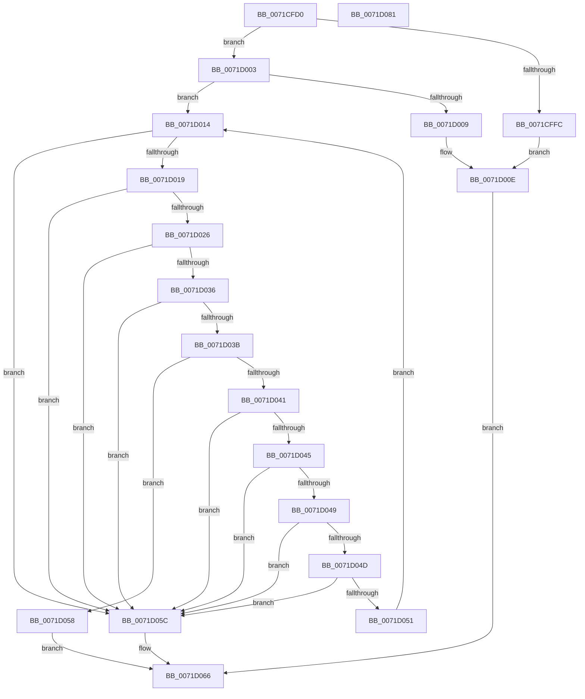

# IoCheckQuotaBufferValidity

- RVA: `0x0071CFD0`–`0x0071D082` (길이 `178` bytes)
- VA: `0x000000014071CFD0`
- 실행 섹션: `PAGE`
- PDB 이름 있음: `예`; PDB Function 태그: `아니요`
- unwind 정보 RVA: `0x0005E6B4`
- 디코드: `60`개 명령, `178/178` bytes 표시
- 미해석 바이트: `0` (있으면 어셈블리에 `.byte`로 보존)

> 이 문서는 커널 이미지의 기계어와 PDB 기호를 분석해 생성했습니다. 4번과 5번은 함수 원형과 자료형을 바이너리 사용 방식에서 추정한 C 해석이며 원본 소스 복구 결과는 아닙니다.

## 1. Dependencies

- 직접 호출 지점: **2**; 고유 호출 대상: **2**
- 직접 호출자로 확인된 함수: **1**
- RIP 상대 이미지 참조: **0**

### Outgoing calls
- `0x0071D01D` → [RtlValidSid](../92/RtlValidSid_function_00929710.md) (function, `0x00929710`)
- `0x0071D02A` → [RtlLengthSid](../../text/45/RtlLengthSid_function_0045D270.md) (function, `0x0045D270`)

### Direct callers
- [IopSetEaOrQuotaInformationFile](IopSetEaOrQuotaInformationFile_function_0071BD70.md) at `0x0071C052`

### Static image references
- 디코드된 RIP-relative 메모리 참조가 없습니다.

## 2. Other-region calls and transfers

- 다른 실행 섹션으로 향하는 call: **1**
  - `0x0071D02A` → [RtlLengthSid](../../text/45/RtlLengthSid_function_0045D270.md) (`PAGE` → `.text`)
- 별도 외부 분기/꼬리 이동을 확인하지 못했습니다.

## 3. Assembly (complete function range)

```asm
0071CFD0  48 8B C4                        mov rax, rsp
0071CFD3  48 89 58 08                     mov qword ptr [rax + 8], rbx
0071CFD7  48 89 68 10                     mov qword ptr [rax + 0x10], rbp
0071CFDB  48 89 70 18                     mov qword ptr [rax + 0x18], rsi
0071CFDF  48 89 78 20                     mov qword ptr [rax + 0x20], rdi
0071CFE3  41 56                           push r14
0071CFE5  48 83 EC 20                     sub rsp, 0x20
0071CFE9  4D 8B F0                        mov r14, r8
0071CFEC  8B FA                           mov edi, edx
0071CFEE  48 8B F1                        mov rsi, rcx
0071CFF1  48 8B D9                        mov rbx, rcx
0071CFF4  81 FA FF FF FF 7F               cmp edx, 0x7fffffff
0071CFFA  76 07                           jbe 0x14071d003
0071CFFC  B8 14 00 00 80                  mov eax, 0x80000014
0071D001  EB 0B                           jmp 0x14071d00e
0071D003  40 F6 C6 07                     test sil, 7
0071D007  74 0B                           je 0x14071d014
0071D009  B8 02 00 00 80                  mov eax, 0x80000002
0071D00E  41 83 20 00                     and dword ptr [r8], 0
0071D012  EB 52                           jmp 0x14071d066
0071D014  83 FF 34                        cmp edi, 0x34
0071D017  72 43                           jb 0x14071d05c
0071D019  48 8D 4B 28                     lea rcx, [rbx + 0x28]
0071D01D  E8 EE C6 20 00                  call 0x140929710
0071D022  84 C0                           test al, al
0071D024  74 36                           je 0x14071d05c
0071D026  48 8D 4B 28                     lea rcx, [rbx + 0x28]
0071D02A  E8 41 02 D4 FF                  call 0x14045d270
0071D02F  8D 48 28                        lea ecx, [rax + 0x28]
0071D032  3B F9                           cmp edi, ecx
0071D034  72 26                           jb 0x14071d05c
0071D036  39 43 04                        cmp dword ptr [rbx + 4], eax
0071D039  75 21                           jne 0x14071d05c
0071D03B  8B 03                           mov eax, dword ptr [rbx]
0071D03D  85 C0                           test eax, eax
0071D03F  74 17                           je 0x14071d058
0071D041  3B C8                           cmp ecx, eax
0071D043  77 17                           ja 0x14071d05c
0071D045  A8 07                           test al, 7
0071D047  75 13                           jne 0x14071d05c
0071D049  85 C0                           test eax, eax
0071D04B  78 0F                           js 0x14071d05c
0071D04D  3B F8                           cmp edi, eax
0071D04F  72 0B                           jb 0x14071d05c
0071D051  2B F8                           sub edi, eax
0071D053  48 03 D8                        add rbx, rax
0071D056  EB BC                           jmp 0x14071d014
0071D058  33 C0                           xor eax, eax
0071D05A  EB 0A                           jmp 0x14071d066
0071D05C  2B DE                           sub ebx, esi
0071D05E  B8 66 02 00 C0                  mov eax, 0xc0000266
0071D063  41 89 1E                        mov dword ptr [r14], ebx
0071D066  48 8B 5C 24 30                  mov rbx, qword ptr [rsp + 0x30]
0071D06B  48 8B 6C 24 38                  mov rbp, qword ptr [rsp + 0x38]
0071D070  48 8B 74 24 40                  mov rsi, qword ptr [rsp + 0x40]
0071D075  48 8B 7C 24 48                  mov rdi, qword ptr [rsp + 0x48]
0071D07A  48 83 C4 20                     add rsp, 0x20
0071D07E  41 5E                           pop r14
0071D080  C3                              ret
0071D081  CC                              int3
```

## 4. C-style interpretation (structured pseudocode)

```c
__int64 __fastcall IoCheckQuotaBufferValidity(__int64 a1, int a2, __int64 a3)
{
    __int64 result;
    __int64 v_rbx;
    __int64 v_rdi;
    __int64 v_rsp;
    unsigned __int64 v_stack_p10;
    unsigned __int64 v_stack_p18;
    unsigned __int64 v_stack_p20;
    unsigned __int64 v_stack_p8;

    *(unsigned __int64 *)(v_rsp + 8) = v_rbx;
    *(unsigned __int64 *)(v_rsp + 16) = v_rbp;
    *(unsigned __int64 *)(v_rsp + 24) = v_rsi;
    *(unsigned __int64 *)(v_rsp + 32) = v_rdi;
    v_rsp = (v_rsp) - (32);
    if (a2 <= 0x7FFFFFFFULL) goto loc_0071D003;
    goto loc_0071D00E;
loc_0071D003:
    if ((((unsigned __int8)(a1)) & (7)) == 0) goto loc_0071D014;
loc_0071D00E:
    goto loc_0071D066;
loc_0071D014:
    if (((unsigned int)((unsigned int)(a2))) < 52) goto loc_0071D05C;
    result = RtlValidSid(a1 + 40, a2, a3, a4);
    if ((unsigned __int8)(result) == 0) goto loc_0071D05C;
    result = RtlLengthSid(a1 + 40, a2, a3, a4);
    if (((unsigned int)((unsigned int)(a2))) < ((unsigned int)(result + 40))) goto loc_0071D05C;
    if ((*(unsigned int *)(a1 + 4)) != ((unsigned int)(result))) goto loc_0071D05C;
    if ((unsigned int)((unsigned int)(*(unsigned int *)(a1))) == 0) goto loc_0071D058;
    if (((unsigned int)(result + 40)) > ((unsigned int)((unsigned int)(*(unsigned int *)(a1))))) goto loc_0071D05C;
    if ((((unsigned __int8)((unsigned int)(*(unsigned int *)(a1)))) & (7)) != 0) goto loc_0071D05C;
    if (sign_flag) goto loc_0071D05C;
    if (((unsigned int)((unsigned int)(a2))) < ((unsigned int)((unsigned int)(*(unsigned int *)(a1))))) goto loc_0071D05C;
    v_rdi = (unsigned int)(((unsigned int)(a2)) - ((unsigned int)((unsigned int)(*(unsigned int *)(a1)))));
    v_rbx = (a1) + ((unsigned int)(*(unsigned int *)(a1)));
    goto loc_0071D014;
loc_0071D058:
    result = 0;
    goto loc_0071D066;
loc_0071D05C:
    v_rbx = (unsigned int)((v_rbx) - ((unsigned int)(a1)));
    *(unsigned int *)(a3) = (unsigned int)(v_rbx);
loc_0071D066:
    v_rsp = (v_rsp) + (32);
    return (unsigned int)(0xC0000266ULL);
}
```

## 5. (Beta) C Style

```c
int64_t IoCheckQuotaBufferValidity(void *Arg1, int32_t Arg2, void *Arg3)
{
    uint8_t *arg1 = (uint8_t *)Arg1;
    uint8_t *arg3 = (uint8_t *)Arg3;

    int64_t result;
    int64_t local_rbx;
    int64_t local_rdi;
    int64_t local_rsp;
    uint64_t v_stack_p10;
    uint64_t v_stack_p18;
    uint64_t v_stack_p20;
    uint64_t v_stack_p8;

    *(uint64_t *)(local_rsp + 0x8) = local_rbx;
    *(uint64_t *)(local_rsp + 0x10) = local_rbp;
    *(uint64_t *)(local_rsp + 0x18) = local_rsi;
    *(uint64_t *)(local_rsp + 0x20) = local_rdi;
    local_rsp = (local_rsp) - (32);
    if (Arg2 <= 0x7FFFFFFFULL) goto loc_0071D003;
    goto loc_0071D00E;
loc_0071D003:
    if ((((uint8_t)(Arg1)) & (7)) == 0) goto loc_0071D014;
loc_0071D00E:
    goto loc_0071D066;
loc_0071D014:
    if (((uint32_t)((uint32_t)(Arg2))) < 52) goto loc_0071D05C;
    result = RtlValidSid(Arg1 + 40, Arg2, Arg3, a4);
    if ((uint8_t)(result) == 0) goto loc_0071D05C;
    result = RtlLengthSid(Arg1 + 40, Arg2, Arg3, a4);
    if (((uint32_t)((uint32_t)(Arg2))) < ((uint32_t)(result + 40))) goto loc_0071D05C;
    if ((*(uint32_t *)(arg1 + 0x4)) != ((uint32_t)(result))) goto loc_0071D05C;
    if ((uint32_t)((uint32_t)(*(uint32_t *)(arg1))) == 0) goto loc_0071D058;
    if (((uint32_t)(result + 40)) > ((uint32_t)((uint32_t)(*(uint32_t *)(arg1))))) goto loc_0071D05C;
    if ((((uint8_t)((uint32_t)(*(uint32_t *)(arg1)))) & (7)) != 0) goto loc_0071D05C;
    if (sign_flag) goto loc_0071D05C;
    if (((uint32_t)((uint32_t)(Arg2))) < ((uint32_t)((uint32_t)(*(uint32_t *)(arg1))))) goto loc_0071D05C;
    local_rdi = (uint32_t)(((uint32_t)(Arg2)) - ((uint32_t)((uint32_t)(*(uint32_t *)(arg1)))));
    local_rbx = (Arg1) + ((uint32_t)(*(uint32_t *)(arg1)));
    goto loc_0071D014;
loc_0071D058:
    result = 0;
    goto loc_0071D066;
loc_0071D05C:
    local_rbx = (uint32_t)((local_rbx) - ((uint32_t)(Arg1)));
    *(uint32_t *)(arg3) = (uint32_t)(local_rbx);
loc_0071D066:
    local_rsp = (local_rsp) + (32);
    return (uint32_t)(0xC0000266ULL);
}
```

### 관측된 메모리 오프셋

구조체 형식이 확인되지 않은 접근은 인자 기준의 오프셋으로만 기록했습니다.

| 기준 인자 | 오프셋 표현 | 폭 (bit) | 접근 |
|---|---:|---:|---|
| `Arg1` | `+ 0x0` | `32` | `R` |
| `Arg1` | `+ 0x4` | `32` | `R` |
| `Arg1` | `+ 0x28` | `64` | `R` |
| `Arg3` | `+ 0x0` | `32` | `R/W` |
| `Arg3` | `+ 0x0` | `32` | `W` |

## 6. Execution-region graph

[열기: 2D/3D 그래프와 함수 탐색 컨트롤 패널](../../../control-panel.html?section=page&rva=0x0071CFD0&view=graph)

- 2D 그래프는 위에서 아래로 흐르고, 3D 그래프는 빈 공간을 드래그해 회전합니다. Shift+드래그는 이동, 휠은 확대·축소, 함수 노드 선택은 대상 보고서 이동입니다.

### Static fallback


