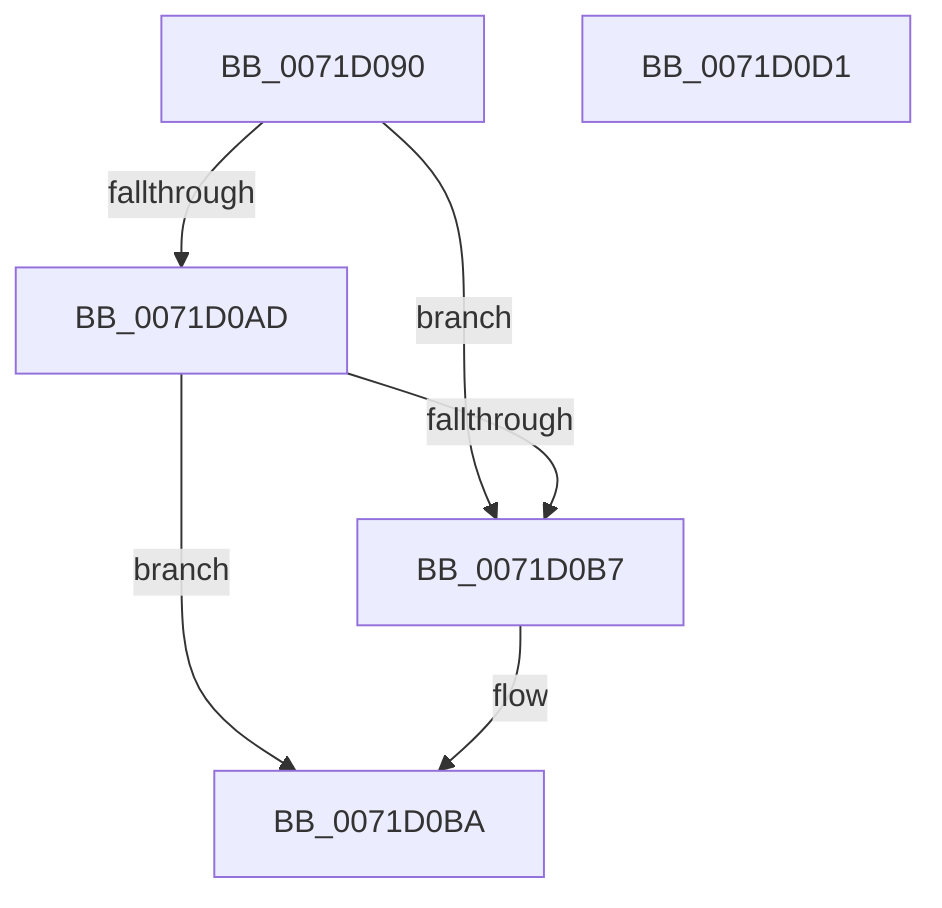

# IoCheckShareAccessEx

- RVA: `0x0071D090`–`0x0071D0D2` (길이 `66` bytes)
- VA: `0x000000014071D090`
- 실행 섹션: `PAGE`
- PDB 이름 있음: `예`; PDB Function 태그: `아니요`
- unwind 정보 RVA: `0x0005D2F4`
- 디코드: `19`개 명령, `66/66` bytes 표시
- 미해석 바이트: `0` (있으면 어셈블리에 `.byte`로 보존)

> 이 문서는 커널 이미지의 기계어와 PDB 기호를 분석해 생성했습니다. 4번과 5번은 함수 원형과 자료형을 바이너리 사용 방식에서 추정한 C 해석이며 원본 소스 복구 결과는 아닙니다.

## 1. Dependencies

- 직접 호출 지점: **1**; 고유 호출 대상: **1**
- 직접 호출자로 확인된 함수: **0**
- RIP 상대 이미지 참조: **0**

### Outgoing calls
- `0x0071D0C7` → [IoCheckLinkShareAccess](../9A/IoCheckLinkShareAccess_function_009A4180.md) (function, `0x009A4180`)

### Direct callers
- 이 함수 시작 RVA로 연결되는 직접 call은 확인되지 않았습니다. 간접 호출은 완전히 역산할 수 없습니다.

### Static image references
- 디코드된 RIP-relative 메모리 참조가 없습니다.

## 2. Other-region calls and transfers

- 다른 실행 섹션으로 향하는 call: **0**
- 별도 외부 분기/꼬리 이동을 확인하지 못했습니다.

## 3. Assembly (complete function range)

```asm
0071D090  48 83 EC 38                     sub rsp, 0x38
0071D094  48 8B 44 24 68                  mov rax, qword ptr [rsp + 0x68]
0071D099  45 33 DB                        xor r11d, r11d
0071D09C  44 38 5C 24 60                  cmp byte ptr [rsp + 0x60], r11b
0071D0A1  45 8B D3                        mov r10d, r11d
0071D0A4  41 0F 95 C2                     setne r10b
0071D0A8  48 85 C0                        test rax, rax
0071D0AB  74 0A                           je 0x14071d0b7
0071D0AD  44 38 18                        cmp byte ptr [rax], r11b
0071D0B0  B8 00 00 00 80                  mov eax, 0x80000000
0071D0B5  74 03                           je 0x14071d0ba
0071D0B7  41 8B C3                        mov eax, r11d
0071D0BA  44 0B D0                        or r10d, eax
0071D0BD  44 89 54 24 28                  mov dword ptr [rsp + 0x28], r10d
0071D0C2  4C 89 5C 24 20                  mov qword ptr [rsp + 0x20], r11
0071D0C7  E8 B4 70 28 00                  call 0x1409a4180
0071D0CC  48 83 C4 38                     add rsp, 0x38
0071D0D0  C3                              ret
0071D0D1  CC                              int3
```

## 4. C-style interpretation (structured pseudocode)

```c
__int64 __fastcall IoCheckShareAccessEx(__int64 a1, __int64 a2, __int64 a3, __int64 a4, unsigned __int8 a5, __int64 a6)
{
    __int64 result;
    __int64 v_r10;
    __int64 v_r11;
    __int64 v_rsp;
    unsigned int v_stack_m10;
    unsigned __int64 v_stack_m18;

    v_rsp = (v_rsp) - (56);
    v_r11 = 0;
    v_r10 = (a5 != 0) ? 1 : 0;
    if (a6 == 0) goto loc_0071D0B7;
    result = (unsigned int)(0x80000000ULL);
    if ((*(unsigned __int8 *)(a6)) != 0) {
        result = 0;
    }
    v_r10 = (unsigned int)((v_r10) | ((unsigned int)(result)));
    v_stack_m10 = (unsigned int)(v_r10);
    v_stack_m18 = 0;
    result = IoCheckLinkShareAccess(a1, a2, a3, a4);
    v_rsp = (v_rsp) + (56);
    return result;
}
```

## 5. (Beta) C Style

```c
int64_t IoCheckShareAccessEx(int64_t Arg1, int64_t Arg2, int64_t Arg3, int64_t Arg4, uint8_t Arg5, int64_t Arg6)
{
    int64_t result;
    int64_t local_r10;
    int64_t local_r11;
    int64_t local_rsp;
    uint32_t v_stack_m10;
    uint64_t v_stack_m18;

    local_rsp = (local_rsp) - (56);
    local_r11 = 0;
    local_r10 = (Arg5 != 0) ? 1 : 0;
    if (Arg6 == 0) goto loc_0071D0B7;
    result = (uint32_t)(0x80000000ULL);
    if ((*(uint8_t *)(Arg6)) != 0) {
        result = 0;
    }
    local_r10 = (uint32_t)((local_r10) | ((uint32_t)(result)));
    v_stack_m10 = (uint32_t)(local_r10);
    v_stack_m18 = 0;
    result = IoCheckLinkShareAccess(Arg1, Arg2, Arg3, Arg4);
    local_rsp = (local_rsp) + (56);
    return result;
}
```

## 6. Execution-region graph

[열기: 2D/3D 그래프와 함수 탐색 컨트롤 패널](../../../control-panel.html?section=page&rva=0x0071D090&view=graph)

- 2D 그래프는 위에서 아래로 흐르고, 3D 그래프는 빈 공간을 드래그해 회전합니다. Shift+드래그는 이동, 휠은 확대·축소, 함수 노드 선택은 대상 보고서 이동입니다.

### Static fallback


