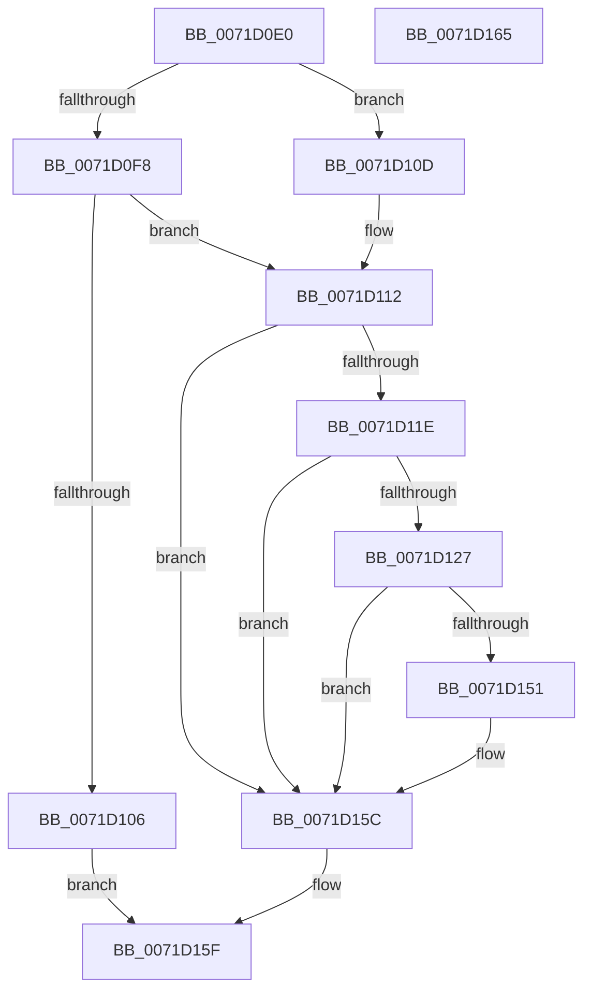

# IoCopyDeviceObjectHint

- RVA: `0x0071D0E0`–`0x0071D166` (길이 `134` bytes)
- VA: `0x000000014071D0E0`
- 실행 섹션: `PAGE`
- PDB 이름 있음: `예`; PDB Function 태그: `아니요`
- unwind 정보 RVA: `0x00064C80`
- 디코드: `39`개 명령, `134/134` bytes 표시
- 미해석 바이트: `0` (있으면 어셈블리에 `.byte`로 보존)

> 이 문서는 커널 이미지의 기계어와 PDB 기호를 분석해 생성했습니다. 4번과 5번은 함수 원형과 자료형을 바이너리 사용 방식에서 추정한 C 해석이며 원본 소스 복구 결과는 아닙니다.

## 1. Dependencies

- 직접 호출 지점: **1**; 고유 호출 대상: **1**
- 직접 호출자로 확인된 함수: **0**
- RIP 상대 이미지 참조: **0**

### Outgoing calls
- `0x0071D145` → [IopGetSetSpecificExtension](../../text/42/IopGetSetSpecificExtension_function_0042EE80.md) (function, `0x0042EE80`)

### Direct callers
- 이 함수 시작 RVA로 연결되는 직접 call은 확인되지 않았습니다. 간접 호출은 완전히 역산할 수 없습니다.

### Static image references
- 디코드된 RIP-relative 메모리 참조가 없습니다.

## 2. Other-region calls and transfers

- 다른 실행 섹션으로 향하는 call: **1**
  - `0x0071D145` → [IopGetSetSpecificExtension](../../text/42/IopGetSetSpecificExtension_function_0042EE80.md) (`PAGE` → `.text`)
- 별도 외부 분기/꼬리 이동을 확인하지 못했습니다.

## 3. Assembly (complete function range)

```asm
0071D0E0  40 53                           push rbx
0071D0E2  48 83 EC 30                     sub rsp, 0x30
0071D0E6  48 8B 82 D0 00 00 00            mov rax, qword ptr [rdx + 0xd0]
0071D0ED  45 33 C0                        xor r8d, r8d
0071D0F0  4C 8B D2                        mov r10, rdx
0071D0F3  48 85 C0                        test rax, rax
0071D0F6  74 15                           je 0x14071d10d
0071D0F8  48 8B 40 10                     mov rax, qword ptr [rax + 0x10]
0071D0FC  48 89 44 24 48                  mov qword ptr [rsp + 0x48], rax
0071D101  48 85 C0                        test rax, rax
0071D104  74 0C                           je 0x14071d112
0071D106  B8 01 00 00 C0                  mov eax, 0xc0000001
0071D10B  EB 52                           jmp 0x14071d15f
0071D10D  4C 21 44 24 48                  and qword ptr [rsp + 0x48], r8
0071D112  48 8B 99 D0 00 00 00            mov rbx, qword ptr [rcx + 0xd0]
0071D119  48 85 DB                        test rbx, rbx
0071D11C  74 3E                           je 0x14071d15c
0071D11E  48 8B 5B 10                     mov rbx, qword ptr [rbx + 0x10]
0071D122  48 85 DB                        test rbx, rbx
0071D125  74 35                           je 0x14071d15c
0071D127  4C 21 44 24 28                  and qword ptr [rsp + 0x28], r8
0071D12C  48 8D 44 24 48                  lea rax, [rsp + 0x48]
0071D131  BA 01 00 00 00                  mov edx, 1
0071D136  48 89 44 24 20                  mov qword ptr [rsp + 0x20], rax
0071D13B  41 B1 01                        mov r9b, 1
0071D13E  49 8B CA                        mov rcx, r10
0071D141  44 8D 42 1F                     lea r8d, [rdx + 0x1f]
0071D145  E8 36 1D D1 FF                  call 0x14042ee80
0071D14A  44 8B C0                        mov r8d, eax
0071D14D  85 C0                           test eax, eax
0071D14F  75 0B                           jne 0x14071d15c
0071D151  48 8B 4C 24 48                  mov rcx, qword ptr [rsp + 0x48]
0071D156  48 8B 13                        mov rdx, qword ptr [rbx]
0071D159  48 89 11                        mov qword ptr [rcx], rdx
0071D15C  41 8B C0                        mov eax, r8d
0071D15F  48 83 C4 30                     add rsp, 0x30
0071D163  5B                              pop rbx
0071D164  C3                              ret
0071D165  CC                              int3
```

## 4. C-style interpretation (structured pseudocode)

```c
__int64 __fastcall IoCopyDeviceObjectHint(__int64 a1, __int64 a2, int a3)
{
    __int64 result;
    __int64 v_rsp;
    unsigned __int64 v_stack_m10;
    unsigned __int64 v_stack_m18;
    unsigned __int64 v_stack_p10;

    v_rsp = (v_rsp) - (48);
    a3 = 0;
    if (*(unsigned __int64 *)(a2 + 208) == 0) goto loc_0071D10D;
    v_stack_p10 = *(unsigned __int64 *)(*(unsigned __int64 *)(a2 + 208) + 16);
    if (*(unsigned __int64 *)(*(unsigned __int64 *)(a2 + 208) + 16) == 0) goto loc_0071D112;
    goto loc_0071D15F;
loc_0071D10D:
loc_0071D112:
    if (*(unsigned __int64 *)(a1 + 208) == 0) goto loc_0071D15C;
    if (*(unsigned __int64 *)(*(unsigned __int64 *)(a1 + 208) + 16) == 0) goto loc_0071D15C;
    v_stack_m18 = v_stack_p10;
    result = IopGetSetSpecificExtension(a2, 1, 1 + 31, 1);
    if ((unsigned int)(result) == 0) {
        a1 = v_stack_p10;
        a2 = *(unsigned __int64 *)(*(unsigned __int64 *)(*(unsigned __int64 *)(a1 + 208) + 16));
        *(unsigned __int64 *)(a1) = a2;
    }
loc_0071D15F:
    v_rsp = (v_rsp) + (48);
    return (unsigned int)((unsigned int)((unsigned int)((unsigned int)(result))));
}
```

## 5. (Beta) C Style

```c
int64_t IoCopyDeviceObjectHint(void *Arg1, void *Arg2, int32_t Arg3)
{
    uint8_t *arg1 = (uint8_t *)Arg1;
    uint8_t *arg2 = (uint8_t *)Arg2;

    int64_t result;
    int64_t local_rsp;
    uint64_t v_stack_m10;
    uint64_t v_stack_m18;
    uint64_t v_stack_p10;

    local_rsp = (local_rsp) - (48);
    Arg3 = 0;
    if (*(uint64_t *)(arg2 + 0xD0) == 0) goto loc_0071D10D;
    v_stack_p10 = *(uint64_t *)(*(uint64_t *)(arg2 + 0xD0) + 0x10);
    if (*(uint64_t *)(*(uint64_t *)(arg2 + 0xD0) + 0x10) == 0) goto loc_0071D112;
    goto loc_0071D15F;
loc_0071D10D:
loc_0071D112:
    if (*(uint64_t *)(arg1 + 0xD0) == 0) goto loc_0071D15C;
    if (*(uint64_t *)(*(uint64_t *)(arg1 + 0xD0) + 0x10) == 0) goto loc_0071D15C;
    v_stack_m18 = v_stack_p10;
    result = IopGetSetSpecificExtension(Arg2, 1, 1 + 31, 1);
    if ((uint32_t)(result) == 0) {
        Arg1 = v_stack_p10;
        Arg2 = *(uint64_t *)(*(uint64_t *)(*(uint64_t *)(arg1 + 0xD0) + 0x10));
        *(void **)(arg1) = Arg2;
    }
loc_0071D15F:
    local_rsp = (local_rsp) + (48);
    return (uint32_t)((uint32_t)((uint32_t)((uint32_t)(result))));
}
```

### 관측된 메모리 오프셋

구조체 형식이 확인되지 않은 접근은 인자 기준의 오프셋으로만 기록했습니다.

| 기준 인자 | 오프셋 표현 | 폭 (bit) | 접근 |
|---|---:|---:|---|
| `Arg1` | `+ 0xD0` | `64` | `R` |
| `Arg2` | `+ 0xD0` | `64` | `R` |

## 6. Execution-region graph

[열기: 2D/3D 그래프와 함수 탐색 컨트롤 패널](../../../control-panel.html?section=page&rva=0x0071D0E0&view=graph)

- 2D 그래프는 위에서 아래로 흐르고, 3D 그래프는 빈 공간을 드래그해 회전합니다. Shift+드래그는 이동, 휠은 확대·축소, 함수 노드 선택은 대상 보고서 이동입니다.

### Static fallback


