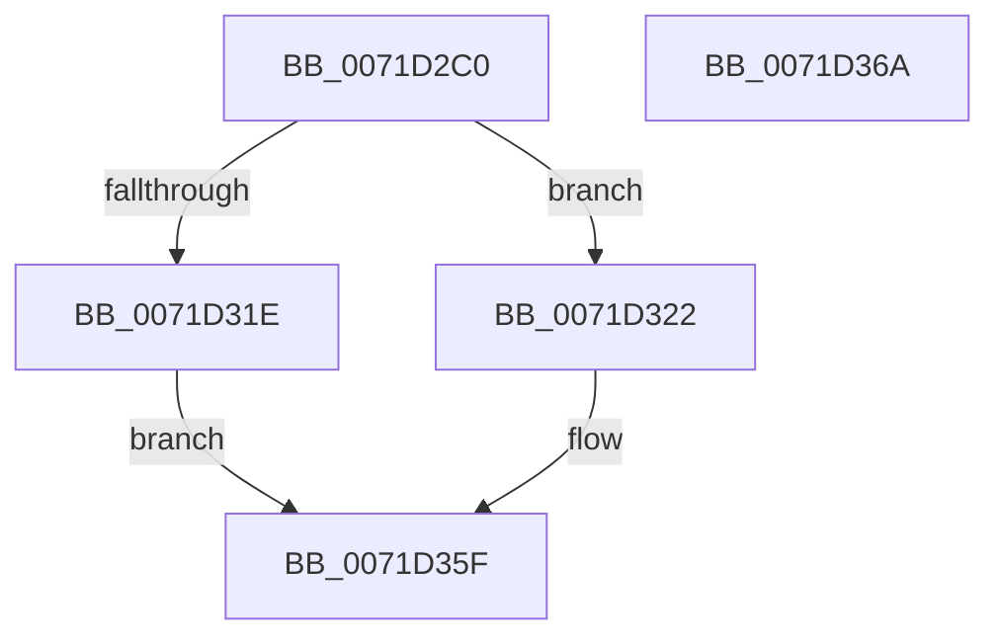

# IoCreateSynchronizationEvent

- RVA: `0x0071D2C0`–`0x0071D36B` (길이 `171` bytes)
- VA: `0x000000014071D2C0`
- 실행 섹션: `PAGE`
- PDB 이름 있음: `예`; PDB Function 태그: `아니요`
- unwind 정보 RVA: `0x000C4610`
- 디코드: `43`개 명령, `171/171` bytes 표시
- 미해석 바이트: `0` (있으면 어셈블리에 `.byte`로 보존)

> 이 문서는 커널 이미지의 기계어와 PDB 기호를 분석해 생성했습니다. 4번과 5번은 함수 원형과 자료형을 바이너리 사용 방식에서 추정한 C 해석이며 원본 소스 복구 결과는 아닙니다.

## 1. Dependencies

- 직접 호출 지점: **3**; 고유 호출 대상: **3**
- 직접 호출자로 확인된 함수: **1**
- RIP 상대 이미지 참조: **1**

### Outgoing calls
- `0x0071D315` → [ZwCreateEvent](../../text/6A/ZwCreateEvent_function_006AD9D0.md) (function, `0x006AD9D0`)
- `0x0071D346` → [ObReferenceObjectByHandle](../86/ObReferenceObjectByHandle_function_00868DB0.md) (function, `0x00868DB0`)
- `0x0071D34F` → [ObfDereferenceObject](../../text/2F/ObfDereferenceObject_function_002F9350.md) (function, `0x002F9350`)

### Direct callers
- [DifIoCreateSynchronizationEventWrapper](../../text/62/DifIoCreateSynchronizationEventWrapper_function_006297E0.md) at `0x006298B4`

### Static image references
- `0x0071D32C` → RVA `0x00FC6B80` (`ALMOSTRO`; read)

## 2. Other-region calls and transfers

- 다른 실행 섹션으로 향하는 call: **2**
  - `0x0071D315` → [ZwCreateEvent](../../text/6A/ZwCreateEvent_function_006AD9D0.md) (`PAGE` → `.text`)
  - `0x0071D34F` → [ObfDereferenceObject](../../text/2F/ObfDereferenceObject_function_002F9350.md) (`PAGE` → `.text`)
- 별도 외부 분기/꼬리 이동을 확인하지 못했습니다.

## 3. Assembly (complete function range)

```asm
0071D2C0  48 89 5C 24 10                  mov qword ptr [rsp + 0x10], rbx
0071D2C5  55                              push rbp
0071D2C6  48 8B EC                        mov rbp, rsp
0071D2C9  48 83 EC 60                     sub rsp, 0x60
0071D2CD  83 65 EC 00                     and dword ptr [rbp - 0x14], 0
0071D2D1  4C 8D 45 D0                     lea r8, [rbp - 0x30]
0071D2D5  48 83 65 10 00                  and qword ptr [rbp + 0x10], 0
0071D2DA  48 8B DA                        mov rbx, rdx
0071D2DD  48 83 65 D8 00                  and qword ptr [rbp - 0x28], 0
0071D2E2  0F 57 C0                        xorps xmm0, xmm0
0071D2E5  48 89 4D E0                     mov qword ptr [rbp - 0x20], rcx
0071D2E9  BA 03 00 1F 00                  mov edx, 0x1f0003
0071D2EE  48 C7 45 D0 30 00 00 00         mov qword ptr [rbp - 0x30], 0x30
0071D2F6  48 8D 4D 10                     lea rcx, [rbp + 0x10]
0071D2FA  83 65 D4 00                     and dword ptr [rbp - 0x2c], 0
0071D2FE  41 B9 01 00 00 00               mov r9d, 1
0071D304  F3 0F 7F 45 F0                  movdqu xmmword ptr [rbp - 0x10], xmm0
0071D309  C7 45 E8 80 02 00 00            mov dword ptr [rbp - 0x18], 0x280
0071D310  C6 44 24 20 01                  mov byte ptr [rsp + 0x20], 1
0071D315  E8 B6 06 F9 FF                  call 0x1406ad9d0
0071D31A  85 C0                           test eax, eax
0071D31C  79 04                           jns 0x14071d322
0071D31E  33 C0                           xor eax, eax
0071D320  EB 3D                           jmp 0x14071d35f
0071D322  48 83 64 24 28 00               and qword ptr [rsp + 0x28], 0
0071D328  48 8D 45 20                     lea rax, [rbp + 0x20]
0071D32C  4C 8B 05 4D 98 8A 00            mov r8, qword ptr [rip + 0x8a984d]
0071D333  45 33 C9                        xor r9d, r9d
0071D336  48 8B 4D 10                     mov rcx, qword ptr [rbp + 0x10]
0071D33A  33 D2                           xor edx, edx
0071D33C  48 83 65 20 00                  and qword ptr [rbp + 0x20], 0
0071D341  48 89 44 24 20                  mov qword ptr [rsp + 0x20], rax
0071D346  E8 65 BA 14 00                  call 0x140868db0
0071D34B  48 8B 4D 20                     mov rcx, qword ptr [rbp + 0x20]
0071D34F  E8 FC BF BD FF                  call 0x1402f9350
0071D354  48 8B 4D 10                     mov rcx, qword ptr [rbp + 0x10]
0071D358  48 8B 45 20                     mov rax, qword ptr [rbp + 0x20]
0071D35C  48 89 0B                        mov qword ptr [rbx], rcx
0071D35F  48 8B 5C 24 78                  mov rbx, qword ptr [rsp + 0x78]
0071D364  48 83 C4 60                     add rsp, 0x60
0071D368  5D                              pop rbp
0071D369  C3                              ret
0071D36A  CC                              int3
```

## 4. C-style interpretation (structured pseudocode)

```c
__int64 __fastcall IoCreateSynchronizationEvent(__int64 a1, __int64 a2)
{
    __int64 result;
    __int64 v_rsp;
    unsigned __int64 v_stack_m18;
    unsigned int v_stack_m1C;
    unsigned int v_stack_m20;
    unsigned __int64 v_stack_m28;
    unsigned __int64 v_stack_m30;
    unsigned int v_stack_m34;
    unsigned __int64 v_stack_m38;
    unsigned __int64 v_stack_m40;
    unsigned __int8 v_stack_m48;
    unsigned __int64 v_stack_p10;
    unsigned __int64 v_stack_p18;
    unsigned __int64 v_stack_p8;

    v_stack_p10 = v_rbx;
    v_rsp = (v_rsp) - (96);
    v_stack_m28 = a1;
    v_stack_m38 = 48;
    v_stack_m18 = v_xmm0;
    v_stack_m20 = 640;
    v_stack_m48 = 1;
    result = ZwCreateEvent(v_stack_p8, (unsigned int)(0x1F0003ULL), v_stack_m38, 1);
    if (!sign_flag) goto loc_0071D322;
    result = 0;
    goto loc_0071D35F;
loc_0071D322:
    a4 = 0;
    a2 = 0;
    v_stack_m48 = v_stack_p18;
    result = ObReferenceObjectByHandle(v_stack_p8, a2, *(unsigned __int64 *)(v_rip + 9082957), a4);
    result = ObfDereferenceObject(v_stack_p18, a2, *(unsigned __int64 *)(v_rip + 9082957), a4);
    *(unsigned __int64 *)(a2) = v_stack_p8;
loc_0071D35F:
    v_rsp = (v_rsp) + (96);
    return v_stack_p18;
}
```

## 5. (Beta) C Style

```c
int64_t IoCreateSynchronizationEvent(int64_t Arg1, void *Arg2)
{
    uint8_t *arg2 = (uint8_t *)Arg2;

    int64_t result;
    int64_t local_rsp;
    uint64_t v_stack_m18;
    uint32_t v_stack_m1C;
    uint32_t v_stack_m20;
    uint64_t v_stack_m28;
    uint64_t v_stack_m30;
    uint32_t v_stack_m34;
    uint64_t v_stack_m38;
    uint64_t v_stack_m40;
    uint8_t v_stack_m48;
    uint64_t v_stack_p10;
    uint64_t v_stack_p18;
    uint64_t v_stack_p8;

    v_stack_p10 = local_rbx;
    local_rsp = (local_rsp) - (96);
    v_stack_m28 = Arg1;
    v_stack_m38 = 48;
    v_stack_m18 = v_xmm0;
    v_stack_m20 = 640;
    v_stack_m48 = 1;
    result = ZwCreateEvent(v_stack_p8, (uint32_t)(0x1F0003ULL), v_stack_m38, 1);
    if (!sign_flag) goto loc_0071D322;
    result = 0;
    goto loc_0071D35F;
loc_0071D322:
    a4 = 0;
    Arg2 = 0;
    v_stack_m48 = v_stack_p18;
    result = ObReferenceObjectByHandle(v_stack_p8, Arg2, *(uint64_t *)(v_rip + 0x8A984D), a4);
    result = ObfDereferenceObject(v_stack_p18, Arg2, *(uint64_t *)(v_rip + 0x8A984D), a4);
    *(uint64_t *)(arg2) = v_stack_p8;
loc_0071D35F:
    local_rsp = (local_rsp) + (96);
    return v_stack_p18;
}
```

### 관측된 메모리 오프셋

구조체 형식이 확인되지 않은 접근은 인자 기준의 오프셋으로만 기록했습니다.

| 기준 인자 | 오프셋 표현 | 폭 (bit) | 접근 |
|---|---:|---:|---|
| `Arg2` | `+ 0x0` | `64` | `W` |

## 6. Execution-region graph

[열기: 2D/3D 그래프와 함수 탐색 컨트롤 패널](../../../control-panel.html?section=page&rva=0x0071D2C0&view=graph)

- 2D 그래프는 위에서 아래로 흐르고, 3D 그래프는 빈 공간을 드래그해 회전합니다. Shift+드래그는 이동, 휠은 확대·축소, 함수 노드 선택은 대상 보고서 이동입니다.

### Static fallback


