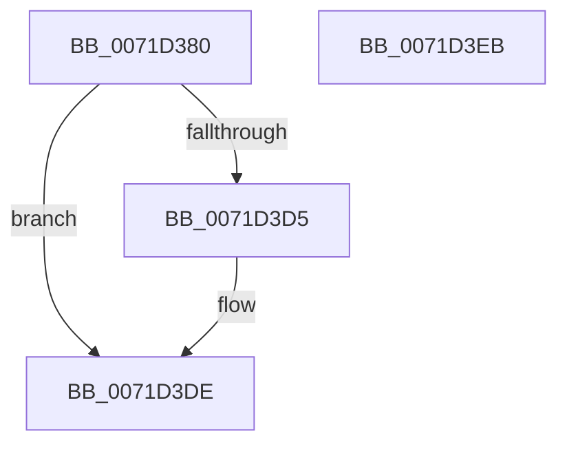

# IoCreateUnprotectedSymbolicLink

- RVA: `0x0071D380`–`0x0071D3EC` (길이 `108` bytes)
- VA: `0x000000014071D380`
- 실행 섹션: `PAGE`
- PDB 이름 있음: `예`; PDB Function 태그: `아니요`
- unwind 정보 RVA: `0x000BDDB4`
- 디코드: `29`개 명령, `108/108` bytes 표시
- 미해석 바이트: `0` (있으면 어셈블리에 `.byte`로 보존)

> 이 문서는 커널 이미지의 기계어와 PDB 기호를 분석해 생성했습니다. 4번과 5번은 함수 원형과 자료형을 바이너리 사용 방식에서 추정한 C 해석이며 원본 소스 복구 결과는 아닙니다.

## 1. Dependencies

- 직접 호출 지점: **2**; 고유 호출 대상: **2**
- 직접 호출자로 확인된 함수: **1**
- RIP 상대 이미지 참조: **0**

### Outgoing calls
- `0x0071D3CA` → [ZwCreateSymbolicLinkObject](../../text/6A/ZwCreateSymbolicLinkObject_function_006AE9D0.md) (function, `0x006AE9D0`)
- `0x0071D3D9` → [ZwClose](../../text/6A/ZwClose_function_006AD2B0.md) (function, `0x006AD2B0`)

### Direct callers
- [DifIoCreateUnprotectedSymbolicLinkWrapper](../../text/62/DifIoCreateUnprotectedSymbolicLinkWrapper_function_00629950.md) at `0x00629A24`

### Static image references
- 디코드된 RIP-relative 메모리 참조가 없습니다.

## 2. Other-region calls and transfers

- 다른 실행 섹션으로 향하는 call: **2**
  - `0x0071D3CA` → [ZwCreateSymbolicLinkObject](../../text/6A/ZwCreateSymbolicLinkObject_function_006AE9D0.md) (`PAGE` → `.text`)
  - `0x0071D3D9` → [ZwClose](../../text/6A/ZwClose_function_006AD2B0.md) (`PAGE` → `.text`)
- 별도 외부 분기/꼬리 이동을 확인하지 못했습니다.

## 3. Assembly (complete function range)

```asm
0071D380  48 89 5C 24 10                  mov qword ptr [rsp + 0x10], rbx
0071D385  55                              push rbp
0071D386  48 8B EC                        mov rbp, rsp
0071D389  48 83 EC 50                     sub rsp, 0x50
0071D38D  83 65 EC 00                     and dword ptr [rbp - 0x14], 0
0071D391  4C 8D 45 D0                     lea r8, [rbp - 0x30]
0071D395  48 83 65 10 00                  and qword ptr [rbp + 0x10], 0
0071D39A  0F 57 C0                        xorps xmm0, xmm0
0071D39D  48 83 65 D8 00                  and qword ptr [rbp - 0x28], 0
0071D3A2  4C 8B CA                        mov r9, rdx
0071D3A5  48 89 4D E0                     mov qword ptr [rbp - 0x20], rcx
0071D3A9  BA 01 00 0F 00                  mov edx, 0xf0001
0071D3AE  48 C7 45 D0 30 00 00 00         mov qword ptr [rbp - 0x30], 0x30
0071D3B6  48 8D 4D 10                     lea rcx, [rbp + 0x10]
0071D3BA  83 65 D4 00                     and dword ptr [rbp - 0x2c], 0
0071D3BE  F3 0F 7F 45 F0                  movdqu xmmword ptr [rbp - 0x10], xmm0
0071D3C3  C7 45 E8 50 02 00 00            mov dword ptr [rbp - 0x18], 0x250
0071D3CA  E8 01 16 F9 FF                  call 0x1406ae9d0
0071D3CF  8B D8                           mov ebx, eax
0071D3D1  85 C0                           test eax, eax
0071D3D3  78 09                           js 0x14071d3de
0071D3D5  48 8B 4D 10                     mov rcx, qword ptr [rbp + 0x10]
0071D3D9  E8 D2 FE F8 FF                  call 0x1406ad2b0
0071D3DE  8B C3                           mov eax, ebx
0071D3E0  48 8B 5C 24 68                  mov rbx, qword ptr [rsp + 0x68]
0071D3E5  48 83 C4 50                     add rsp, 0x50
0071D3E9  5D                              pop rbp
0071D3EA  C3                              ret
0071D3EB  CC                              int3
```

## 4. C-style interpretation (structured pseudocode)

```c
__int64 __fastcall IoCreateUnprotectedSymbolicLink(__int64 a1, __int64 a2)
{
    __int64 result;
    __int64 v_rsp;
    unsigned __int64 v_stack_m18;
    unsigned int v_stack_m1C;
    unsigned int v_stack_m20;
    unsigned __int64 v_stack_m28;
    unsigned __int64 v_stack_m30;
    unsigned int v_stack_m34;
    unsigned __int64 v_stack_m38;
    unsigned __int64 v_stack_p10;
    unsigned __int64 v_stack_p8;

    v_stack_p10 = v_rbx;
    v_rsp = (v_rsp) - (80);
    v_stack_m28 = a1;
    v_stack_m38 = 48;
    v_stack_m18 = v_xmm0;
    v_stack_m20 = 592;
    result = ZwCreateSymbolicLinkObject(v_stack_p8, (unsigned int)(0xF0001ULL), v_stack_m38, a2);
    if (!(sign_flag)) {
        a1 = v_stack_p8;
        result = ZwClose(a1, (unsigned int)(0xF0001ULL), v_stack_m38, a2);
    }
    v_rsp = (v_rsp) + (80);
    return (unsigned int)((unsigned int)((unsigned int)((unsigned int)(result))));
}
```

## 5. (Beta) C Style

```c
int64_t IoCreateUnprotectedSymbolicLink(int64_t Arg1, int64_t Arg2)
{
    int64_t result;
    int64_t local_rsp;
    uint64_t v_stack_m18;
    uint32_t v_stack_m1C;
    uint32_t v_stack_m20;
    uint64_t v_stack_m28;
    uint64_t v_stack_m30;
    uint32_t v_stack_m34;
    uint64_t v_stack_m38;
    uint64_t v_stack_p10;
    uint64_t v_stack_p8;

    v_stack_p10 = local_rbx;
    local_rsp = (local_rsp) - (80);
    v_stack_m28 = Arg1;
    v_stack_m38 = 48;
    v_stack_m18 = v_xmm0;
    v_stack_m20 = 592;
    result = ZwCreateSymbolicLinkObject(v_stack_p8, (uint32_t)(0xF0001ULL), v_stack_m38, Arg2);
    if (!(sign_flag)) {
        Arg1 = v_stack_p8;
        result = ZwClose(Arg1, (uint32_t)(0xF0001ULL), v_stack_m38, Arg2);
    }
    local_rsp = (local_rsp) + (80);
    return (uint32_t)((uint32_t)((uint32_t)((uint32_t)(result))));
}
```

## 6. Execution-region graph

[열기: 2D/3D 그래프와 함수 탐색 컨트롤 패널](../../../control-panel.html?section=page&rva=0x0071D380&view=graph)

- 2D 그래프는 위에서 아래로 흐르고, 3D 그래프는 빈 공간을 드래그해 회전합니다. Shift+드래그는 이동, 휠은 확대·축소, 함수 노드 선택은 대상 보고서 이동입니다.

### Static fallback


