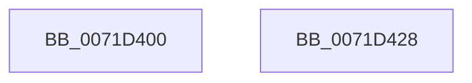

# IoDeleteDriver

- RVA: `0x0071D400`–`0x0071D429` (길이 `41` bytes)
- VA: `0x000000014071D400`
- 실행 섹션: `PAGE`
- PDB 이름 있음: `예`; PDB Function 태그: `아니요`
- unwind 정보 RVA: `0x0005CF00`
- 디코드: `13`개 명령, `41/41` bytes 표시
- 미해석 바이트: `0` (있으면 어셈블리에 `.byte`로 보존)

> 이 문서는 커널 이미지의 기계어와 PDB 기호를 분석해 생성했습니다. 4번과 5번은 함수 원형과 자료형을 바이너리 사용 방식에서 추정한 C 해석이며 원본 소스 복구 결과는 아닙니다.

## 1. Dependencies

- 직접 호출 지점: **3**; 고유 호출 대상: **3**
- 직접 호출자로 확인된 함수: **1**
- RIP 상대 이미지 참조: **0**

### Outgoing calls
- `0x0071D40D` → [EtwTiLogDriverObjectUnLoad](../AA/EtwTiLogDriverObjectUnLoad_function_00AA7C60.md) (function, `0x00AA7C60`)
- `0x0071D415` → [ObMakeTemporaryObject](../A7/ObMakeTemporaryObject_function_00A7F860.md) (function, `0x00A7F860`)
- `0x0071D41D` → [ObfDereferenceObject](../../text/2F/ObfDereferenceObject_function_002F9350.md) (function, `0x002F9350`)

### Direct callers
- [IopInitializePlugPlayServices](../../init/C2/IopInitializePlugPlayServices_function_00C2F298.md) at `0x00C2FCE8`

### Static image references
- 디코드된 RIP-relative 메모리 참조가 없습니다.

## 2. Other-region calls and transfers

- 다른 실행 섹션으로 향하는 call: **1**
  - `0x0071D41D` → [ObfDereferenceObject](../../text/2F/ObfDereferenceObject_function_002F9350.md) (`PAGE` → `.text`)
- 별도 외부 분기/꼬리 이동을 확인하지 못했습니다.

## 3. Assembly (complete function range)

```asm
0071D400  40 53                           push rbx
0071D402  48 83 EC 20                     sub rsp, 0x20
0071D406  48 8B D9                        mov rbx, rcx
0071D409  48 83 C1 38                     add rcx, 0x38
0071D40D  E8 4E A8 38 00                  call 0x140aa7c60
0071D412  48 8B CB                        mov rcx, rbx
0071D415  E8 46 24 36 00                  call 0x140a7f860
0071D41A  48 8B CB                        mov rcx, rbx
0071D41D  E8 2E BF BD FF                  call 0x1402f9350
0071D422  48 83 C4 20                     add rsp, 0x20
0071D426  5B                              pop rbx
0071D427  C3                              ret
0071D428  CC                              int3
```

## 4. C-style interpretation (structured pseudocode)

```c
__int64 __fastcall IoDeleteDriver(__int64 a1)
{
    __int64 result;
    __int64 v_rsp;

    v_rsp = (v_rsp) - (32);
    a1 = (a1) + (56);
    result = EtwTiLogDriverObjectUnLoad(a1, a2, a3, a4);
    result = ObMakeTemporaryObject(a1, a2, a3, a4);
    result = ObfDereferenceObject(a1, a2, a3, a4);
    v_rsp = (v_rsp) + (32);
    return result;
}
```

## 5. (Beta) C Style

```c
int64_t IoDeleteDriver(int64_t Arg1)
{
    int64_t result;
    int64_t local_rsp;

    local_rsp = (local_rsp) - (32);
    Arg1 = (Arg1) + (56);
    result = EtwTiLogDriverObjectUnLoad(Arg1, a2, a3, a4);
    result = ObMakeTemporaryObject(Arg1, a2, a3, a4);
    result = ObfDereferenceObject(Arg1, a2, a3, a4);
    local_rsp = (local_rsp) + (32);
    return result;
}
```

## 6. Execution-region graph

[열기: 2D/3D 그래프와 함수 탐색 컨트롤 패널](../../../control-panel.html?section=page&rva=0x0071D400&view=graph)

- 2D 그래프는 위에서 아래로 흐르고, 3D 그래프는 빈 공간을 드래그해 회전합니다. Shift+드래그는 이동, 휠은 확대·축소, 함수 노드 선택은 대상 보고서 이동입니다.

### Static fallback


