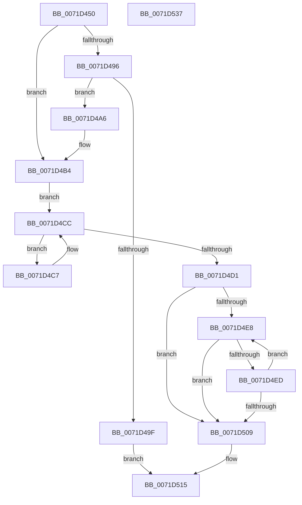

# IoEnumerateRegisteredFiltersList

- RVA: `0x0071D450`–`0x0071D538` (길이 `232` bytes)
- VA: `0x000000014071D450`
- 실행 섹션: `PAGE`
- PDB 이름 있음: `예`; PDB Function 태그: `아니요`
- unwind 정보 RVA: `0x0005E6B4`
- 디코드: `64`개 명령, `232/232` bytes 표시
- 미해석 바이트: `0` (있으면 어셈블리에 `.byte`로 보존)

> 이 문서는 커널 이미지의 기계어와 PDB 기호를 분석해 생성했습니다. 4번과 5번은 함수 원형과 자료형을 바이너리 사용 방식에서 추정한 C 해석이며 원본 소스 복구 결과는 아닙니다.

## 1. Dependencies

- 직접 호출 지점: **6**; 고유 호출 대상: **5**
- 직접 호출자로 확인된 함수: **0**
- RIP 상대 이미지 참조: **2**

### Outgoing calls
- `0x0071D48D` → [ExAcquireResourceExclusiveLite](../../text/21/ExAcquireResourceExclusiveLite_function_00214E20.md) (function, `0x00214E20`)
- `0x0071D496` → [IopGetFsRegistrationInProgress](../../text/59/IopGetFsRegistrationInProgress_function_00597F58.md) (function, `0x00597F58`)
- `0x0071D4AF` → [ExAcquireResourceExclusiveLite](../../text/21/ExAcquireResourceExclusiveLite_function_00214E20.md) (function, `0x00214E20`)
- `0x0071D4F1` → [ObfReferenceObject](../../text/20/ObfReferenceObject_function_0020FA20.md) (function, `0x0020FA20`)
- `0x0071D510` → [ExReleaseResourceLite](../../text/25/ExReleaseResourceLite_function_0025FA10.md) (function, `0x0025FA10`)
- `0x0071D515` → [KeLeaveCriticalRegion](../../text/25/KeLeaveCriticalRegion_function_0025D8B0.md) (function, `0x0025D8B0`)

### Direct callers
- 이 함수 시작 RVA로 연결되는 직접 call은 확인되지 않았습니다. 간접 호출은 완전히 역산할 수 없습니다.

### Static image references
- `0x0071D479` → RVA `0x00F8D320` (`.data`; read)
- `0x0071D4B4` → RVA `0x00F8D450` (`.data`; read)

## 2. Other-region calls and transfers

- 다른 실행 섹션으로 향하는 call: **6**
  - `0x0071D48D` → [ExAcquireResourceExclusiveLite](../../text/21/ExAcquireResourceExclusiveLite_function_00214E20.md) (`PAGE` → `.text`)
  - `0x0071D496` → [IopGetFsRegistrationInProgress](../../text/59/IopGetFsRegistrationInProgress_function_00597F58.md) (`PAGE` → `.text`)
  - `0x0071D4AF` → [ExAcquireResourceExclusiveLite](../../text/21/ExAcquireResourceExclusiveLite_function_00214E20.md) (`PAGE` → `.text`)
  - `0x0071D4F1` → [ObfReferenceObject](../../text/20/ObfReferenceObject_function_0020FA20.md) (`PAGE` → `.text`)
  - `0x0071D510` → [ExReleaseResourceLite](../../text/25/ExReleaseResourceLite_function_0025FA10.md) (`PAGE` → `.text`)
  - `0x0071D515` → [KeLeaveCriticalRegion](../../text/25/KeLeaveCriticalRegion_function_0025D8B0.md) (`PAGE` → `.text`)
- 별도 외부 분기/꼬리 이동을 확인하지 못했습니다.

## 3. Assembly (complete function range)

```asm
0071D450  48 8B C4                        mov rax, rsp
0071D453  48 89 58 08                     mov qword ptr [rax + 8], rbx
0071D457  48 89 68 10                     mov qword ptr [rax + 0x10], rbp
0071D45B  48 89 70 18                     mov qword ptr [rax + 0x18], rsi
0071D45F  48 89 78 20                     mov qword ptr [rax + 0x20], rdi
0071D463  41 56                           push r14
0071D465  48 83 EC 20                     sub rsp, 0x20
0071D469  65 48 8B 04 25 88 01 00 00      mov rax, qword ptr gs:[0x188]
0071D472  8B F2                           mov esi, edx
0071D474  4C 8B F1                        mov r14, rcx
0071D477  33 D2                           xor edx, edx
0071D479  48 8D 0D A0 FE 86 00            lea rcx, [rip + 0x86fea0]
0071D480  49 8B F8                        mov rdi, r8
0071D483  33 DB                           xor ebx, ebx
0071D485  66 FF 88 E4 01 00 00            dec word ptr [rax + 0x1e4]
0071D48C  90                              nop
0071D48D  E8 8E 79 AF FF                  call 0x140214e20
0071D492  84 C0                           test al, al
0071D494  75 1E                           jne 0x14071d4b4
0071D496  E8 BD AA E7 FF                  call 0x140597f58
0071D49B  84 C0                           test al, al
0071D49D  74 07                           je 0x14071d4a6
0071D49F  BF 2D 02 00 C0                  mov edi, 0xc000022d
0071D4A4  EB 6F                           jmp 0x14071d515
0071D4A6  B2 01                           mov dl, 1
0071D4A8  48 8D 0D 71 FE 86 00            lea rcx, [rip + 0x86fe71]
0071D4AF  E8 6C 79 AF FF                  call 0x140214e20
0071D4B4  48 8B 05 95 FF 86 00            mov rax, qword ptr [rip + 0x86ff95]
0071D4BB  48 8D 2D 8E FF 86 00            lea rbp, [rip + 0x86ff8e]
0071D4C2  C1 EE 03                        shr esi, 3
0071D4C5  EB 05                           jmp 0x14071d4cc
0071D4C7  48 8B 00                        mov rax, qword ptr [rax]
0071D4CA  FF C3                           inc ebx
0071D4CC  48 3B C5                        cmp rax, rbp
0071D4CF  75 F6                           jne 0x14071d4c7
0071D4D1  3B F3                           cmp esi, ebx
0071D4D3  89 1F                           mov dword ptr [rdi], ebx
0071D4D5  48 8B 1D 74 FF 86 00            mov rbx, qword ptr [rip + 0x86ff74]
0071D4DC  1B FF                           sbb edi, edi
0071D4DE  81 E7 23 00 00 C0               and edi, 0xc0000023
0071D4E4  85 F6                           test esi, esi
0071D4E6  74 21                           je 0x14071d509
0071D4E8  48 3B DD                        cmp rbx, rbp
0071D4EB  74 1C                           je 0x14071d509
0071D4ED  48 8B 4B 10                     mov rcx, qword ptr [rbx + 0x10]
0071D4F1  E8 2A 25 AF FF                  call 0x14020fa20
0071D4F6  48 8B 43 10                     mov rax, qword ptr [rbx + 0x10]
0071D4FA  49 89 06                        mov qword ptr [r14], rax
0071D4FD  49 83 C6 08                     add r14, 8
0071D501  48 8B 1B                        mov rbx, qword ptr [rbx]
0071D504  83 C6 FF                        add esi, -1
0071D507  75 DF                           jne 0x14071d4e8
0071D509  48 8D 0D 10 FE 86 00            lea rcx, [rip + 0x86fe10]
0071D510  E8 FB 24 B4 FF                  call 0x14025fa10
0071D515  E8 96 03 B4 FF                  call 0x14025d8b0
0071D51A  48 8B 5C 24 30                  mov rbx, qword ptr [rsp + 0x30]
0071D51F  8B C7                           mov eax, edi
0071D521  48 8B 7C 24 48                  mov rdi, qword ptr [rsp + 0x48]
0071D526  48 8B 6C 24 38                  mov rbp, qword ptr [rsp + 0x38]
0071D52B  48 8B 74 24 40                  mov rsi, qword ptr [rsp + 0x40]
0071D530  48 83 C4 20                     add rsp, 0x20
0071D534  41 5E                           pop r14
0071D536  C3                              ret
0071D537  CC                              int3
```

## 4. C-style interpretation (structured pseudocode)

```c
__int64 __fastcall IoEnumerateRegisteredFiltersList(__int64 a1, int a2, __int64 a3)
{
    __int64 result;
    __int64 v_r14;
    __int64 v_rbx;
    __int64 v_rdi;
    __int64 v_rsi;
    __int64 v_rsp;
    unsigned __int64 v_stack_p10;
    unsigned __int64 v_stack_p18;
    unsigned __int64 v_stack_p20;
    unsigned __int64 v_stack_p8;

    *(unsigned __int64 *)(v_rsp + 8) = v_rbx;
    *(unsigned __int64 *)(v_rsp + 16) = v_rbp;
    *(unsigned __int64 *)(v_rsp + 24) = v_rsi;
    *(unsigned __int64 *)(v_rsp + 32) = v_rdi;
    v_rsp = (v_rsp) - (32);
    a2 = 0;
    v_rbx = 0;
    result = ExAcquireResourceExclusiveLite(v_rip + 8847008, a2, a3, a4);
    if ((unsigned __int8)(result) != 0) goto loc_0071D4B4;
    result = IopGetFsRegistrationInProgress(v_rip + 8847008, a2, a3, a4);
    if ((unsigned __int8)(result) == 0) goto loc_0071D4A6;
    goto loc_0071D515;
loc_0071D4A6:
    result = ExAcquireResourceExclusiveLite(v_rip + 8846961, 1, a3, a4);
loc_0071D4B4:
    v_rsi = (unsigned int)(((unsigned int)(a2)) >> (3));
    goto loc_0071D4CC;
loc_0071D4C7:
    v_rbx = (unsigned int)((v_rbx) + 1);
loc_0071D4CC:
    if ((*(unsigned __int64 *)(*(unsigned __int64 *)(v_rip + 8847253))) != (v_rip + 8847246)) goto loc_0071D4C7;
    *(unsigned int *)((unsigned int)(0xC000022DULL)) = (unsigned int)(v_rbx);
    v_rdi = (unsigned int)(((unsigned int)(0xC000022DULL)) & (0xC0000023ULL));
    if ((unsigned int)(v_rsi) == 0) goto loc_0071D509;
loc_0071D4E8:
    if ((*(unsigned __int64 *)(v_rip + 8847220)) == (v_rip + 8847246)) goto loc_0071D509;
    result = ObfReferenceObject(*(unsigned __int64 *)(*(unsigned __int64 *)(v_rip + 8847220) + 16), 1, a3, a4);
    *(unsigned __int64 *)(a1) = *(unsigned __int64 *)(*(unsigned __int64 *)(v_rip + 8847220) + 16);
    v_r14 = (a1) + (8);
    v_rsi = (unsigned int)((v_rsi) + (-1));
    if (condition_is_not_equal) goto loc_0071D4E8;
loc_0071D509:
    result = ExReleaseResourceLite(v_rip + 8846864, 1, a3, a4);
loc_0071D515:
    result = KeLeaveCriticalRegion(v_rip + 8846864, 1, a3, a4);
    v_rsp = (v_rsp) + (32);
    return (unsigned int)((unsigned int)(v_rdi));
}
```

## 5. (Beta) C Style

```c
int64_t IoEnumerateRegisteredFiltersList(void *Arg1, int32_t Arg2, void *Arg3)
{
    uint8_t *arg1 = (uint8_t *)Arg1;
    uint8_t *arg3 = (uint8_t *)Arg3;

    int64_t result;
    int64_t local_r14;
    int64_t local_rbx;
    int64_t local_rdi;
    int64_t local_rsi;
    int64_t local_rsp;
    uint64_t v_stack_p10;
    uint64_t v_stack_p18;
    uint64_t v_stack_p20;
    uint64_t v_stack_p8;

    *(uint64_t *)(local_rsp + 0x8) = local_rbx;
    *(uint64_t *)(local_rsp + 0x10) = local_rbp;
    *(uint64_t *)(local_rsp + 0x18) = local_rsi;
    *(uint64_t *)(local_rsp + 0x20) = local_rdi;
    local_rsp = (local_rsp) - (32);
    Arg2 = 0;
    local_rbx = 0;
    result = ExAcquireResourceExclusiveLite(v_rip + 8847008, Arg2, Arg3, a4);
    if ((uint8_t)(result) != 0) goto loc_0071D4B4;
    result = IopGetFsRegistrationInProgress(v_rip + 8847008, Arg2, Arg3, a4);
    if ((uint8_t)(result) == 0) goto loc_0071D4A6;
    goto loc_0071D515;
loc_0071D4A6:
    result = ExAcquireResourceExclusiveLite(v_rip + 8846961, 1, Arg3, a4);
loc_0071D4B4:
    local_rsi = (uint32_t)(((uint32_t)(Arg2)) >> (3));
    goto loc_0071D4CC;
loc_0071D4C7:
    local_rbx = (uint32_t)((local_rbx) + 1);
loc_0071D4CC:
    if ((*(uint64_t *)(*(uint64_t *)(v_rip + 0x86FF95))) != (v_rip + 8847246)) goto loc_0071D4C7;
    *(uint32_t *)((uint32_t)(0xC000022DULL)) = (uint32_t)(local_rbx);
    local_rdi = (uint32_t)(((uint32_t)(0xC000022DULL)) & (0xC0000023ULL));
    if ((uint32_t)(local_rsi) == 0) goto loc_0071D509;
loc_0071D4E8:
    if ((*(uint64_t *)(v_rip + 0x86FF74)) == (v_rip + 8847246)) goto loc_0071D509;
    result = ObfReferenceObject(*(uint64_t *)(*(uint64_t *)(v_rip + 0x86FF74) + 0x10), 1, Arg3, a4);
    *(uint64_t *)(arg1) = *(uint64_t *)(*(uint64_t *)(v_rip + 0x86FF74) + 0x10);
    local_r14 = (Arg1) + (8);
    local_rsi = (uint32_t)((local_rsi) + (-1));
    if (condition_is_not_equal) goto loc_0071D4E8;
loc_0071D509:
    result = ExReleaseResourceLite(v_rip + 8846864, 1, Arg3, a4);
loc_0071D515:
    result = KeLeaveCriticalRegion(v_rip + 8846864, 1, Arg3, a4);
    local_rsp = (local_rsp) + (32);
    return (uint32_t)((uint32_t)(local_rdi));
}
```

### 관측된 메모리 오프셋

구조체 형식이 확인되지 않은 접근은 인자 기준의 오프셋으로만 기록했습니다.

| 기준 인자 | 오프셋 표현 | 폭 (bit) | 접근 |
|---|---:|---:|---|
| `Arg1` | `+ 0x0` | `64` | `W` |
| `Arg3` | `+ 0x0` | `32` | `W` |

## 6. Execution-region graph

[열기: 2D/3D 그래프와 함수 탐색 컨트롤 패널](../../../control-panel.html?section=page&rva=0x0071D450&view=graph)

- 2D 그래프는 위에서 아래로 흐르고, 3D 그래프는 빈 공간을 드래그해 회전합니다. Shift+드래그는 이동, 휠은 확대·축소, 함수 노드 선택은 대상 보고서 이동입니다.

### Static fallback


