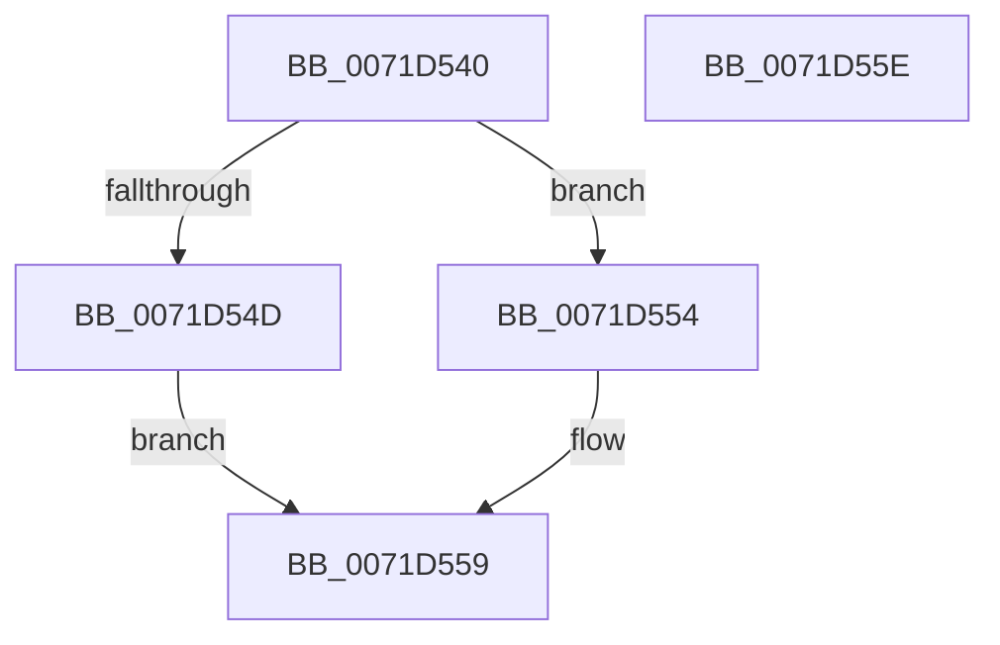

# IoGetBootDiskInformation

- RVA: `0x0071D540`–`0x0071D55F` (길이 `31` bytes)
- VA: `0x000000014071D540`
- 실행 섹션: `PAGE`
- PDB 이름 있음: `예`; PDB Function 태그: `아니요`
- unwind 정보 RVA: `0x0005C788`
- 디코드: `9`개 명령, `31/31` bytes 표시
- 미해석 바이트: `0` (있으면 어셈블리에 `.byte`로 보존)

> 이 문서는 커널 이미지의 기계어와 PDB 기호를 분석해 생성했습니다. 4번과 5번은 함수 원형과 자료형을 바이너리 사용 방식에서 추정한 C 해석이며 원본 소스 복구 결과는 아닙니다.

## 1. Dependencies

- 직접 호출 지점: **1**; 고유 호출 대상: **1**
- 직접 호출자로 확인된 함수: **0**
- RIP 상대 이미지 참조: **1**

### Outgoing calls
- `0x0071D554` → [IopGetBootDiskInformation](../../init/C2/IopGetBootDiskInformation_function_00C2DAAC.md) (function, `0x00C2DAAC`)

### Direct callers
- 이 함수 시작 RVA로 연결되는 직접 call은 확인되지 않았습니다. 간접 호출은 완전히 역산할 수 없습니다.

### Static image references
- `0x0071D544` → RVA `0x00FC41A0` (`.data`; read)

## 2. Other-region calls and transfers

- 다른 실행 섹션으로 향하는 call: **1**
  - `0x0071D554` → [IopGetBootDiskInformation](../../init/C2/IopGetBootDiskInformation_function_00C2DAAC.md) (`PAGE` → `INIT`)
- 별도 외부 분기/꼬리 이동을 확인하지 못했습니다.

## 3. Assembly (complete function range)

```asm
0071D540  48 83 EC 28                     sub rsp, 0x28
0071D544  83 3D 55 6C 8A 00 02            cmp dword ptr [rip + 0x8a6c55], 2
0071D54B  72 07                           jb 0x14071d554
0071D54D  B8 89 01 00 C0                  mov eax, 0xc0000189
0071D552  EB 05                           jmp 0x14071d559
0071D554  E8 53 05 51 00                  call 0x140c2daac
0071D559  48 83 C4 28                     add rsp, 0x28
0071D55D  C3                              ret
0071D55E  CC                              int3
```

## 4. C-style interpretation (structured pseudocode)

```c
__int64 __fastcall IoGetBootDiskInformation(void)
{
    __int64 result;
    __int64 v_rsp;

    v_rsp = (v_rsp) - (40);
    if ((*(unsigned int *)(v_rip + 9071701)) < 2) goto loc_0071D554;
    goto loc_0071D559;
loc_0071D554:
    result = IopGetBootDiskInformation(a1, a2, a3, a4);
loc_0071D559:
    v_rsp = (v_rsp) + (40);
    return result;
}
```

## 5. (Beta) C Style

```c
void IoGetBootDiskInformation(void)
{
    int64_t result;
    int64_t local_rsp;

    local_rsp = (local_rsp) - (40);
    if ((*(uint32_t *)(v_rip + 0x8A6C55)) < 2) goto loc_0071D554;
    goto loc_0071D559;
loc_0071D554:
    result = IopGetBootDiskInformation(a1, a2, a3, a4);
loc_0071D559:
    local_rsp = (local_rsp) + (40);
    return result;
}
```

## 6. Execution-region graph

[열기: 2D/3D 그래프와 함수 탐색 컨트롤 패널](../../../control-panel.html?section=page&rva=0x0071D540&view=graph)

- 2D 그래프는 위에서 아래로 흐르고, 3D 그래프는 빈 공간을 드래그해 회전합니다. Shift+드래그는 이동, 휠은 확대·축소, 함수 노드 선택은 대상 보고서 이동입니다.

### Static fallback


