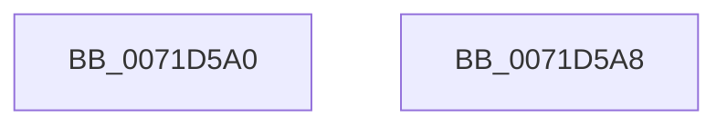

# IoGetConfigurationInformation

- RVA: `0x0071D5A0`–`0x0071D5A9` (길이 `9` bytes)
- VA: `0x000000014071D5A0`
- 실행 섹션: `PAGE`
- PDB 이름 있음: `예`; PDB Function 태그: `아니요`
- unwind 정보 RVA: `0x000DB714`
- 디코드: `3`개 명령, `9/9` bytes 표시
- 미해석 바이트: `0` (있으면 어셈블리에 `.byte`로 보존)

> 이 문서는 커널 이미지의 기계어와 PDB 기호를 분석해 생성했습니다. 4번과 5번은 함수 원형과 자료형을 바이너리 사용 방식에서 추정한 C 해석이며 원본 소스 복구 결과는 아닙니다.

## 1. Dependencies

- 직접 호출 지점: **0**; 고유 호출 대상: **0**
- 직접 호출자로 확인된 함수: **6**
- RIP 상대 이미지 참조: **1**

### Outgoing calls
- 직접 디코드된 call 명령이 없습니다.

### Direct callers
- [DifIoGetConfigurationInformationWrapper](../../text/62/DifIoGetConfigurationInformationWrapper_function_0062A730.md) at `0x0062A7E7`
- [IopCreateArcNamesCd](../../init/C2/IopCreateArcNamesCd_function_00C2C060.md) at `0x00C2C0DC`
- [IopCreateArcNamesDisk](../../init/C2/IopCreateArcNamesDisk_function_00C2C594.md) at `0x00C2C5DC`
- [IopGetBootDiskInformation](../../init/C2/IopGetBootDiskInformation_function_00C2DAAC.md) at `0x00C2DB26`
- [VhdiInitializeBootDisk](../../init/C6/VhdiInitializeBootDisk_function_00C6E190.md) at `0x00C6E243`
- [CimfsInitializeBootDisk](../../init/C6/CimfsInitializeBootDisk_function_00C6E9D0.md) at `0x00C6EA71`

### Static image references
- `0x0071D5A0` → RVA `0x00FD8838` (`PAGEDATA`; read)

## 2. Other-region calls and transfers

- 다른 실행 섹션으로 향하는 call: **0**
- 별도 외부 분기/꼬리 이동을 확인하지 못했습니다.

## 3. Assembly (complete function range)

```asm
0071D5A0  48 8D 05 91 B2 8B 00            lea rax, [rip + 0x8bb291]
0071D5A7  C3                              ret
0071D5A8  CC                              int3
```

## 4. C-style interpretation (structured pseudocode)

```c
__int64 __fastcall IoGetConfigurationInformation(void)
{
    return v_rip + 9155217;
}
```

## 5. (Beta) C Style

```c
void IoGetConfigurationInformation(void)
{
    return v_rip + 9155217;
}
```

## 6. Execution-region graph

[열기: 2D/3D 그래프와 함수 탐색 컨트롤 패널](../../../control-panel.html?section=page&rva=0x0071D5A0&view=graph)

- 2D 그래프는 위에서 아래로 흐르고, 3D 그래프는 빈 공간을 드래그해 회전합니다. Shift+드래그는 이동, 휠은 확대·축소, 함수 노드 선택은 대상 보고서 이동입니다.

### Static fallback


