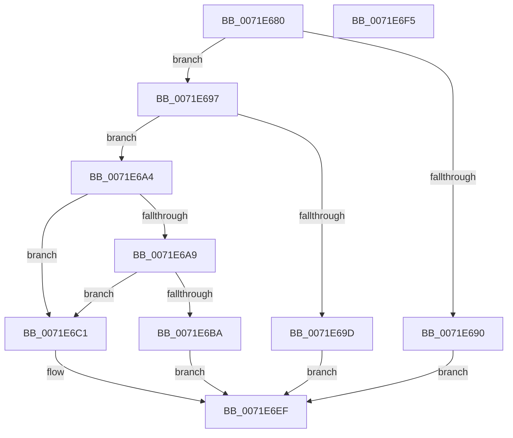

# IoGetContainerInformation

- RVA: `0x0071E680`–`0x0071E6F6` (길이 `118` bytes)
- VA: `0x000000014071E680`
- 실행 섹션: `PAGE`
- PDB 이름 있음: `예`; PDB Function 태그: `아니요`
- unwind 정보 RVA: `0x0005CF00`
- 디코드: `37`개 명령, `118/118` bytes 표시
- 미해석 바이트: `0` (있으면 어셈블리에 `.byte`로 보존)

> 이 문서는 커널 이미지의 기계어와 PDB 기호를 분석해 생성했습니다. 4번과 5번은 함수 원형과 자료형을 바이너리 사용 방식에서 추정한 C 해석이며 원본 소스 복구 결과는 아닙니다.

## 1. Dependencies

- 직접 호출 지점: **3**; 고유 호출 대상: **3**
- 직접 호출자로 확인된 함수: **0**
- RIP 상대 이미지 참조: **0**

### Outgoing calls
- `0x0071E6A9` → [PsGetCurrentProcessSessionId](../../text/23/PsGetCurrentProcessSessionId_function_002303D0.md) (function, `0x002303D0`)
- `0x0071E6B0` → [PsGetSessionObjectById](../../text/22/PsGetSessionObjectById_function_002250C0.md) (function, `0x002250C0`)
- `0x0071E6CE` → [PsGetIoSessionState](../70/PsGetIoSessionState_function_0070553C.md) (function, `0x0070553C`)

### Direct callers
- 이 함수 시작 RVA로 연결되는 직접 call은 확인되지 않았습니다. 간접 호출은 완전히 역산할 수 없습니다.

### Static image references
- 디코드된 RIP-relative 메모리 참조가 없습니다.

## 2. Other-region calls and transfers

- 다른 실행 섹션으로 향하는 call: **2**
  - `0x0071E6A9` → [PsGetCurrentProcessSessionId](../../text/23/PsGetCurrentProcessSessionId_function_002303D0.md) (`PAGE` → `.text`)
  - `0x0071E6B0` → [PsGetSessionObjectById](../../text/22/PsGetSessionObjectById_function_002250C0.md) (`PAGE` → `.text`)
- 별도 외부 분기/꼬리 이동을 확인하지 못했습니다.

## 3. Assembly (complete function range)

```asm
0071E680  40 53                           push rbx
0071E682  48 83 EC 20                     sub rsp, 0x20
0071E686  49 8B D8                        mov rbx, r8
0071E689  48 8B C2                        mov rax, rdx
0071E68C  85 C9                           test ecx, ecx
0071E68E  74 07                           je 0x14071e697
0071E690  B8 EF 00 00 C0                  mov eax, 0xc00000ef
0071E695  EB 58                           jmp 0x14071e6ef
0071E697  41 83 F9 0C                     cmp r9d, 0xc
0071E69B  73 07                           jae 0x14071e6a4
0071E69D  B8 F2 00 00 C0                  mov eax, 0xc00000f2
0071E6A2  EB 4B                           jmp 0x14071e6ef
0071E6A4  48 85 C0                        test rax, rax
0071E6A7  75 18                           jne 0x14071e6c1
0071E6A9  E8 22 1D B1 FF                  call 0x1402303d0
0071E6AE  8B C8                           mov ecx, eax
0071E6B0  E8 0B 6A B0 FF                  call 0x1402250c0
0071E6B5  48 85 C0                        test rax, rax
0071E6B8  75 07                           jne 0x14071e6c1
0071E6BA  B8 F0 00 00 C0                  mov eax, 0xc00000f0
0071E6BF  EB 2E                           jmp 0x14071e6ef
0071E6C1  83 64 24 30 00                  and dword ptr [rsp + 0x30], 0
0071E6C6  48 8D 54 24 30                  lea rdx, [rsp + 0x30]
0071E6CB  48 8B C8                        mov rcx, rax
0071E6CE  E8 69 6E FE FF                  call 0x14070553c
0071E6D3  89 43 04                        mov dword ptr [rbx + 4], eax
0071E6D6  A1 D8 02 00 00 80 F7 FF FF      movabs eax, dword ptr [0xfffff780000002d8]
0071E6DF  8B 4C 24 30                     mov ecx, dword ptr [rsp + 0x30]
0071E6E3  3B C8                           cmp ecx, eax
0071E6E5  89 0B                           mov dword ptr [rbx], ecx
0071E6E7  0F 94 C0                        sete al
0071E6EA  88 43 08                        mov byte ptr [rbx + 8], al
0071E6ED  33 C0                           xor eax, eax
0071E6EF  48 83 C4 20                     add rsp, 0x20
0071E6F3  5B                              pop rbx
0071E6F4  C3                              ret
0071E6F5  CC                              int3
```

## 4. C-style interpretation (structured pseudocode)

```c
__int64 __fastcall IoGetContainerInformation(int a1, __int64 a2, __int64 a3, int a4)
{
    __int64 result;
    __int64 v_rsp;
    unsigned int v_stack_p8;

    v_rsp = (v_rsp) - (32);
    if (a1 == 0) goto loc_0071E697;
    goto loc_0071E6EF;
loc_0071E697:
    if (a4 >= 12) goto loc_0071E6A4;
    goto loc_0071E6EF;
loc_0071E6A4:
    if ((unsigned int)(0xC00000F2ULL) != 0) goto loc_0071E6C1;
    result = PsGetCurrentProcessSessionId(a1, a2, a3, a4);
    result = PsGetSessionObjectById((unsigned int)((unsigned int)(result)), a2, a3, a4);
    if (result != 0) goto loc_0071E6C1;
    goto loc_0071E6EF;
loc_0071E6C1:
    result = PsGetIoSessionState((unsigned int)(0xC00000F0ULL), v_stack_p8, a3, a4);
    *(unsigned int *)(a3 + 4) = (unsigned int)(result);
    *(unsigned int *)(a3) = (unsigned int)((unsigned int)(v_stack_p8));
    result = (((unsigned int)((unsigned int)(v_stack_p8))) == ((unsigned int)(result))) ? 1 : 0;
    *(unsigned __int8 *)(a3 + 8) = (unsigned __int8)(result);
    result = 0;
loc_0071E6EF:
    v_rsp = (v_rsp) + (32);
    return result;
}
```

## 5. (Beta) C Style

```c
int64_t IoGetContainerInformation(int32_t Arg1, int64_t Arg2, void *Arg3, int32_t Arg4)
{
    uint8_t *arg3 = (uint8_t *)Arg3;

    int64_t result;
    int64_t local_rsp;
    uint32_t v_stack_p8;

    local_rsp = (local_rsp) - (32);
    if (Arg1 == 0) goto loc_0071E697;
    goto loc_0071E6EF;
loc_0071E697:
    if (Arg4 >= 12) goto loc_0071E6A4;
    goto loc_0071E6EF;
loc_0071E6A4:
    if ((uint32_t)(0xC00000F2ULL) != 0) goto loc_0071E6C1;
    result = PsGetCurrentProcessSessionId(Arg1, Arg2, Arg3, Arg4);
    result = PsGetSessionObjectById((uint32_t)((uint32_t)(result)), Arg2, Arg3, Arg4);
    if (result != 0) goto loc_0071E6C1;
    goto loc_0071E6EF;
loc_0071E6C1:
    result = PsGetIoSessionState((uint32_t)(0xC00000F0ULL), v_stack_p8, Arg3, Arg4);
    *(uint32_t *)(arg3 + 0x4) = (uint32_t)(result);
    *(uint32_t *)(arg3) = (uint32_t)((uint32_t)(v_stack_p8));
    result = (((uint32_t)((uint32_t)(v_stack_p8))) == ((uint32_t)(result))) ? 1 : 0;
    *(uint8_t *)(arg3 + 0x8) = (uint8_t)(result);
    result = 0;
loc_0071E6EF:
    local_rsp = (local_rsp) + (32);
    return result;
}
```

### 관측된 메모리 오프셋

구조체 형식이 확인되지 않은 접근은 인자 기준의 오프셋으로만 기록했습니다.

| 기준 인자 | 오프셋 표현 | 폭 (bit) | 접근 |
|---|---:|---:|---|
| `Arg3` | `+ 0x0` | `32` | `W` |
| `Arg3` | `+ 0x4` | `32` | `W` |
| `Arg3` | `+ 0x8` | `8` | `W` |

## 6. Execution-region graph

[열기: 2D/3D 그래프와 함수 탐색 컨트롤 패널](../../../control-panel.html?section=page&rva=0x0071E680&view=graph)

- 2D 그래프는 위에서 아래로 흐르고, 3D 그래프는 빈 공간을 드래그해 회전합니다. Shift+드래그는 이동, 휠은 확대·축소, 함수 노드 선택은 대상 보고서 이동입니다.

### Static fallback


