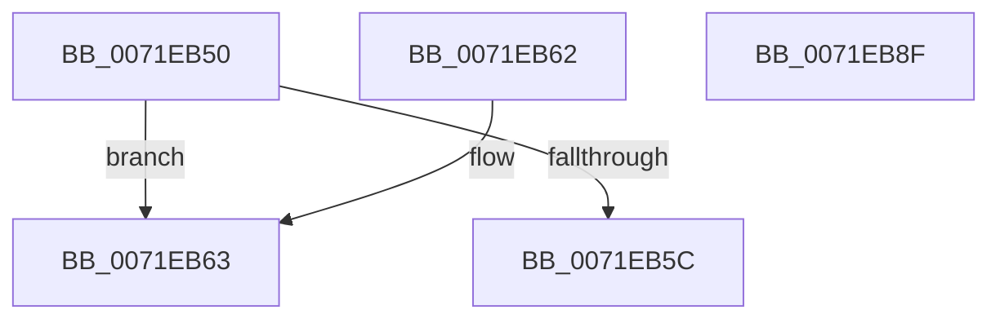

# IoGetSymlinkSupportInformation

- RVA: `0x0071EB50`–`0x0071EB90` (길이 `64` bytes)
- VA: `0x000000014071EB50`
- 실행 섹션: `PAGE`
- PDB 이름 있음: `예`; PDB Function 태그: `아니요`
- unwind 정보 RVA: `0x000DB714`
- 디코드: `24`개 명령, `64/64` bytes 표시
- 미해석 바이트: `0` (있으면 어셈블리에 `.byte`로 보존)

> 이 문서는 커널 이미지의 기계어와 PDB 기호를 분석해 생성했습니다. 4번과 5번은 함수 원형과 자료형을 바이너리 사용 방식에서 추정한 C 해석이며 원본 소스 복구 결과는 아닙니다.

## 1. Dependencies

- 직접 호출 지점: **0**; 고유 호출 대상: **0**
- 직접 호출자로 확인된 함수: **0**
- RIP 상대 이미지 참조: **1**

### Outgoing calls
- 직접 디코드된 call 명령이 없습니다.

### Direct callers
- 이 함수 시작 RVA로 연결되는 직접 call은 확인되지 않았습니다. 간접 호출은 완전히 역산할 수 없습니다.

### Static image references
- `0x0071EB50` → RVA `0x00E66130` (`.data`; read)

## 2. Other-region calls and transfers

- 다른 실행 섹션으로 향하는 call: **0**
- 별도 외부 분기/꼬리 이동을 확인하지 못했습니다.

## 3. Assembly (complete function range)

```asm
0071EB50  44 8B 05 D9 75 74 00            mov r8d, dword ptr [rip + 0x7475d9]
0071EB57  83 FA 04                        cmp edx, 4
0071EB5A  73 07                           jae 0x14071eb63
0071EB5C  B8 0D 00 00 C0                  mov eax, 0xc000000d
0071EB61  C3                              ret
0071EB62  CC                              int3
0071EB63  41 8A C0                        mov al, r8b
0071EB66  B2 01                           mov dl, 1
0071EB68  22 C2                           and al, dl
0071EB6A  88 01                           mov byte ptr [rcx], al
0071EB6C  41 8B C0                        mov eax, r8d
0071EB6F  D1 E8                           shr eax, 1
0071EB71  22 C2                           and al, dl
0071EB73  88 41 01                        mov byte ptr [rcx + 1], al
0071EB76  41 8B C0                        mov eax, r8d
0071EB79  C1 E8 02                        shr eax, 2
0071EB7C  22 C2                           and al, dl
0071EB7E  41 C1 E8 03                     shr r8d, 3
0071EB82  44 22 C2                        and r8b, dl
0071EB85  88 41 02                        mov byte ptr [rcx + 2], al
0071EB88  33 C0                           xor eax, eax
0071EB8A  44 88 41 03                     mov byte ptr [rcx + 3], r8b
0071EB8E  C3                              ret
0071EB8F  CC                              int3
```

## 4. C-style interpretation (structured pseudocode)

```c
__int64 __fastcall IoGetSymlinkSupportInformation(__int64 a1, int a2)
{
    __int64 result;

    if (a2 >= 4) goto loc_0071EB63;
    return (unsigned int)(0xC000000DULL);
loc_0071EB63:
    result = (unsigned __int8)(((unsigned __int8)((unsigned int)(*(unsigned int *)(v_rip + 7632345)))) & (1));
    *(unsigned __int8 *)(a1) = (unsigned __int8)(result);
    result = (unsigned int)(((unsigned int)((unsigned int)((unsigned int)(*(unsigned int *)(v_rip + 7632345))))) >> (1));
    result = (unsigned __int8)((result) & (1));
    *(unsigned __int8 *)(a1 + 1) = (unsigned __int8)(result);
    result = (unsigned int)(((unsigned int)((unsigned int)((unsigned int)(*(unsigned int *)(v_rip + 7632345))))) >> (2));
    result = (unsigned __int8)((result) & (1));
    a3 = (unsigned int)(((unsigned int)(*(unsigned int *)(v_rip + 7632345))) >> (3));
    a3 = (unsigned __int8)((a3) & (1));
    *(unsigned __int8 *)(a1 + 2) = (unsigned __int8)(result);
    result = 0;
    *(unsigned __int8 *)(a1 + 3) = (unsigned __int8)(a3);
    return result;
}
```

## 5. (Beta) C Style

```c
int64_t IoGetSymlinkSupportInformation(void *Arg1, int32_t Arg2)
{
    uint8_t *arg1 = (uint8_t *)Arg1;

    int64_t result;

    if (Arg2 >= 4) goto loc_0071EB63;
    return (uint32_t)(0xC000000DULL);
loc_0071EB63:
    result = (uint8_t)(((uint8_t)((uint32_t)(*(uint32_t *)(v_rip + 0x7475D9)))) & (1));
    *(uint8_t *)(arg1) = (uint8_t)(result);
    result = (uint32_t)(((uint32_t)((uint32_t)((uint32_t)(*(uint32_t *)(v_rip + 0x7475D9))))) >> (1));
    result = (uint8_t)((result) & (1));
    *(uint8_t *)(arg1 + 0x1) = (uint8_t)(result);
    result = (uint32_t)(((uint32_t)((uint32_t)((uint32_t)(*(uint32_t *)(v_rip + 0x7475D9))))) >> (2));
    result = (uint8_t)((result) & (1));
    a3 = (uint32_t)(((uint32_t)(*(uint32_t *)(v_rip + 0x7475D9))) >> (3));
    a3 = (uint8_t)((a3) & (1));
    *(uint8_t *)(arg1 + 0x2) = (uint8_t)(result);
    result = 0;
    *(uint8_t *)(arg1 + 0x3) = (uint8_t)(a3);
    return result;
}
```

### 관측된 메모리 오프셋

구조체 형식이 확인되지 않은 접근은 인자 기준의 오프셋으로만 기록했습니다.

| 기준 인자 | 오프셋 표현 | 폭 (bit) | 접근 |
|---|---:|---:|---|
| `Arg1` | `+ 0x0` | `8` | `W` |
| `Arg1` | `+ 0x1` | `8` | `W` |
| `Arg1` | `+ 0x2` | `8` | `W` |
| `Arg1` | `+ 0x3` | `8` | `W` |

## 6. Execution-region graph

[열기: 2D/3D 그래프와 함수 탐색 컨트롤 패널](../../../control-panel.html?section=page&rva=0x0071EB50&view=graph)

- 2D 그래프는 위에서 아래로 흐르고, 3D 그래프는 빈 공간을 드래그해 회전합니다. Shift+드래그는 이동, 휠은 확대·축소, 함수 노드 선택은 대상 보고서 이동입니다.

### Static fallback


