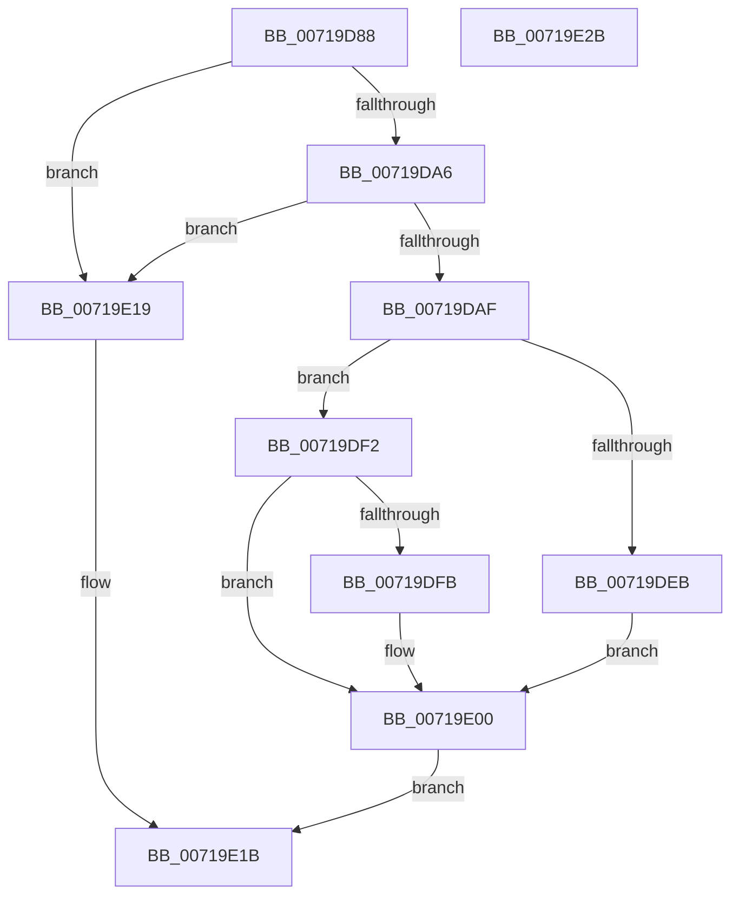

# IoInitializeCrashDump

- RVA: `0x00719D88`–`0x00719E2C` (길이 `164` bytes)
- VA: `0x0000000140719D88`
- 실행 섹션: `PAGE`
- PDB 이름 있음: `예`; PDB Function 태그: `아니요`
- unwind 정보 RVA: `0x000794E0`
- 디코드: `42`개 명령, `164/164` bytes 표시
- 미해석 바이트: `0` (있으면 어셈블리에 `.byte`로 보존)

> 이 문서는 커널 이미지의 기계어와 PDB 기호를 분석해 생성했습니다. 4번과 5번은 함수 원형과 자료형을 바이너리 사용 방식에서 추정한 C 해석이며 원본 소스 복구 결과는 아닙니다.

## 1. Dependencies

- 직접 호출 지점: **6**; 고유 호출 대상: **6**
- 직접 호출자로 확인된 함수: **2**
- RIP 상대 이미지 참조: **4**

### Outgoing calls
- `0x00719DC9` → [ExAcquireResourceExclusiveLite](../../text/21/ExAcquireResourceExclusiveLite_function_00214E20.md) (function, `0x00214E20`)
- `0x00719DDF` → [IopInitializeCrashDump](IopInitializeCrashDump_function_0071A270.md) (function, `0x0071A270`)
- `0x00719DEB` → [IopRemoveDumpCapsuleSupport](../../text/59/IopRemoveDumpCapsuleSupport_function_00595E6C.md) (function, `0x00595E6C`)
- `0x00719DFB` → [IopInitDumpCapsuleSupport](../../text/59/IopInitDumpCapsuleSupport_function_0059578C.md) (function, `0x0059578C`)
- `0x00719E07` → [ExReleaseResourceLite](../../text/25/ExReleaseResourceLite_function_0025FA10.md) (function, `0x0025FA10`)
- `0x00719E0F` → [KiLeaveCriticalRegionUnsafe](../../text/25/KiLeaveCriticalRegionUnsafe_function_0025F010.md) (function, `0x0025F010`)

### Direct callers
- [MiCreatePagingFile](../7F/MiCreatePagingFile_function_007FEFF4.md) at `0x007FF796`
- [IopInitCrashDumpDuringSysInit](../../init/C2/IopInitCrashDumpDuringSysInit_function_00C2CAE4.md) at `0x00C2CC1D`

### Static image references
- `0x00719D97` → RVA `0x00E660BC` (`.data`; read)
- `0x00719DA6` → RVA `0x00E0A9BA` (`.data`; read)
- `0x00719DB8` → RVA `0x00F8E900` (`.data`; read)
- `0x00719DF2` → RVA `0x00E0A9B9` (`.data`; read)

## 2. Other-region calls and transfers

- 다른 실행 섹션으로 향하는 call: **5**
  - `0x00719DC9` → [ExAcquireResourceExclusiveLite](../../text/21/ExAcquireResourceExclusiveLite_function_00214E20.md) (`PAGE` → `.text`)
  - `0x00719DEB` → [IopRemoveDumpCapsuleSupport](../../text/59/IopRemoveDumpCapsuleSupport_function_00595E6C.md) (`PAGE` → `.text`)
  - `0x00719DFB` → [IopInitDumpCapsuleSupport](../../text/59/IopInitDumpCapsuleSupport_function_0059578C.md) (`PAGE` → `.text`)
  - `0x00719E07` → [ExReleaseResourceLite](../../text/25/ExReleaseResourceLite_function_0025FA10.md) (`PAGE` → `.text`)
  - `0x00719E0F` → [KiLeaveCriticalRegionUnsafe](../../text/25/KiLeaveCriticalRegionUnsafe_function_0025F010.md) (`PAGE` → `.text`)
- 별도 외부 분기/꼬리 이동을 확인하지 못했습니다.

## 3. Assembly (complete function range)

```asm
00719D88  48 89 5C 24 08                  mov qword ptr [rsp + 8], rbx
00719D8D  48 89 74 24 10                  mov qword ptr [rsp + 0x10], rsi
00719D92  57                              push rdi
00719D93  48 83 EC 30                     sub rsp, 0x30
00719D97  80 3D 1E C3 74 00 00            cmp byte ptr [rip + 0x74c31e], 0
00719D9E  48 8B FA                        mov rdi, rdx
00719DA1  48 8B F1                        mov rsi, rcx
00719DA4  75 73                           jne 0x140719e19
00719DA6  80 3D 0D 0C 6F 00 00            cmp byte ptr [rip + 0x6f0c0d], 0
00719DAD  74 6A                           je 0x140719e19
00719DAF  65 48 8B 1C 25 88 01 00 00      mov rbx, qword ptr gs:[0x188]
00719DB8  48 8D 0D 41 4B 87 00            lea rcx, [rip + 0x874b41]
00719DBF  B2 01                           mov dl, 1
00719DC1  66 FF 8B E4 01 00 00            dec word ptr [rbx + 0x1e4]
00719DC8  90                              nop
00719DC9  E8 52 B0 AF FF                  call 0x140214e20
00719DCE  0F 28 07                        movaps xmm0, xmmword ptr [rdi]
00719DD1  48 8D 54 24 20                  lea rdx, [rsp + 0x20]
00719DD6  48 8B CE                        mov rcx, rsi
00719DD9  66 0F 7F 44 24 20               movdqa xmmword ptr [rsp + 0x20], xmm0
00719DDF  E8 8C 04 00 00                  call 0x14071a270
00719DE4  40 8A F8                        mov dil, al
00719DE7  84 C0                           test al, al
00719DE9  74 07                           je 0x140719df2
00719DEB  E8 7C C0 E7 FF                  call 0x140595e6c
00719DF0  EB 0E                           jmp 0x140719e00
00719DF2  80 3D C0 0B 6F 00 00            cmp byte ptr [rip + 0x6f0bc0], 0
00719DF9  74 05                           je 0x140719e00
00719DFB  E8 8C B9 E7 FF                  call 0x14059578c
00719E00  48 8D 0D F9 4A 87 00            lea rcx, [rip + 0x874af9]
00719E07  E8 04 5C B4 FF                  call 0x14025fa10
00719E0C  48 8B CB                        mov rcx, rbx
00719E0F  E8 FC 51 B4 FF                  call 0x14025f010
00719E14  40 8A C7                        mov al, dil
00719E17  EB 02                           jmp 0x140719e1b
00719E19  32 C0                           xor al, al
00719E1B  48 8B 5C 24 40                  mov rbx, qword ptr [rsp + 0x40]
00719E20  48 8B 74 24 48                  mov rsi, qword ptr [rsp + 0x48]
00719E25  48 83 C4 30                     add rsp, 0x30
00719E29  5F                              pop rdi
00719E2A  C3                              ret
00719E2B  CC                              int3
```

## 4. C-style interpretation (structured pseudocode)

```c
__int64 __fastcall IoInitializeCrashDump(__int64 a1, __int64 a2)
{
    __int64 result;
    __int64 v_rsp;
    unsigned __int64 v_stack_m18;
    unsigned __int64 v_stack_p10;
    unsigned __int64 v_stack_p8;

    v_stack_p8 = v_rbx;
    v_stack_p10 = v_rsi;
    v_rsp = (v_rsp) - (48);
    if ((*(unsigned __int8 *)(v_rip + 7652126)) != 0) goto loc_00719E19;
    if ((*(unsigned __int8 *)(v_rip + 7277581)) == 0) goto loc_00719E19;
    result = ExAcquireResourceExclusiveLite(v_rip + 8866625, 1, a3, a4);
    v_stack_m18 = v_xmm0;
    result = IopInitializeCrashDump(a1, v_stack_m18, a3, a4);
    if ((unsigned __int8)(result) == 0) goto loc_00719DF2;
    result = IopRemoveDumpCapsuleSupport(a1, v_stack_m18, a3, a4);
    goto loc_00719E00;
loc_00719DF2:
    if ((*(unsigned __int8 *)(v_rip + 7277504)) != 0) {
        result = IopInitDumpCapsuleSupport(a1, v_stack_m18, a3, a4);
    }
    result = ExReleaseResourceLite(v_rip + 8866553, v_stack_m18, a3, a4);
    result = KiLeaveCriticalRegionUnsafe(*(unsigned __int64 *)(gs_base + (0 + 392)), v_stack_m18, a3, a4);
    goto loc_00719E1B;
loc_00719E19:
    result = 0;
loc_00719E1B:
    v_rsp = (v_rsp) + (48);
    return result;
}
```

## 5. (Beta) C Style

```c
int64_t IoInitializeCrashDump(int64_t Arg1, void *Arg2)
{
    uint8_t *arg2 = (uint8_t *)Arg2;

    int64_t result;
    int64_t local_rsp;
    uint64_t v_stack_m18;
    uint64_t v_stack_p10;
    uint64_t v_stack_p8;

    v_stack_p8 = local_rbx;
    v_stack_p10 = local_rsi;
    local_rsp = (local_rsp) - (48);
    if ((*(uint8_t *)(v_rip + 0x74C31E)) != 0) goto loc_00719E19;
    if ((*(uint8_t *)(v_rip + 0x6F0C0D)) == 0) goto loc_00719E19;
    result = ExAcquireResourceExclusiveLite(v_rip + 8866625, 1, a3, a4);
    v_stack_m18 = v_xmm0;
    result = IopInitializeCrashDump(Arg1, v_stack_m18, a3, a4);
    if ((uint8_t)(result) == 0) goto loc_00719DF2;
    result = IopRemoveDumpCapsuleSupport(Arg1, v_stack_m18, a3, a4);
    goto loc_00719E00;
loc_00719DF2:
    if ((*(uint8_t *)(v_rip + 0x6F0BC0)) != 0) {
        result = IopInitDumpCapsuleSupport(Arg1, v_stack_m18, a3, a4);
    }
    result = ExReleaseResourceLite(v_rip + 8866553, v_stack_m18, a3, a4);
    result = KiLeaveCriticalRegionUnsafe(*(uint64_t *)(gs_base + (0 + 0x188)), v_stack_m18, a3, a4);
    goto loc_00719E1B;
loc_00719E19:
    result = 0;
loc_00719E1B:
    local_rsp = (local_rsp) + (48);
    return result;
}
```

### 관측된 메모리 오프셋

구조체 형식이 확인되지 않은 접근은 인자 기준의 오프셋으로만 기록했습니다.

| 기준 인자 | 오프셋 표현 | 폭 (bit) | 접근 |
|---|---:|---:|---|
| `Arg2` | `+ 0x0` | `128` | `R` |

## 6. Execution-region graph

[열기: 2D/3D 그래프와 함수 탐색 컨트롤 패널](../../../control-panel.html?section=page&rva=0x00719D88&view=graph)

- 2D 그래프는 위에서 아래로 흐르고, 3D 그래프는 빈 공간을 드래그해 회전합니다. Shift+드래그는 이동, 휠은 확대·축소, 함수 노드 선택은 대상 보고서 이동입니다.

### Static fallback


