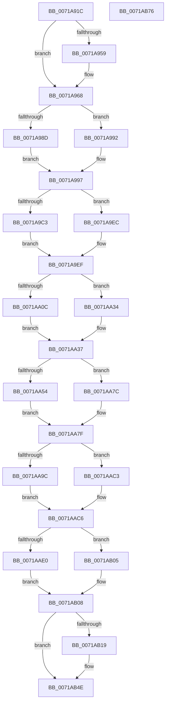

# IoInitializeProcessor

- RVA: `0x0071A91C`–`0x0071AB77` (길이 `603` bytes)
- VA: `0x000000014071A91C`
- 실행 섹션: `PAGE`
- PDB 이름 있음: `예`; PDB Function 태그: `아니요`
- unwind 정보 RVA: `0x000C7300`
- 디코드: `150`개 명령, `603/603` bytes 표시
- 미해석 바이트: `0` (있으면 어셈블리에 `.byte`로 보존)

> 이 문서는 커널 이미지의 기계어와 PDB 기호를 분석해 생성했습니다. 4번과 5번은 함수 원형과 자료형을 바이너리 사용 방식에서 추정한 C 해석이며 원본 소스 복구 결과는 아닙니다.

## 1. Dependencies

- 직접 호출 지점: **10**; 고유 호출 대상: **5**
- 직접 호출자로 확인된 함수: **2**
- RIP 상대 이미지 참조: **9**

### Outgoing calls
- `0x0071A95E` → [IopQueryProcessorInitValues](IopQueryProcessorInitValues_function_0071AB80.md) (function, `0x0071AB80`)
- `0x0071A978` → [ExAllocatePool2](../../poolcode/B8/ExAllocatePool2_function_00B820F0.md) (function, `0x00B820F0`)
- `0x0071A9E2` → [ExInitializeSystemLookasideList](../../pagelk/B7/ExInitializeSystemLookasideList_function_00B7E57C.md) (function, `0x00B7E57C`)
- `0x0071AA2A` → [ExInitializeSystemLookasideList](../../pagelk/B7/ExInitializeSystemLookasideList_function_00B7E57C.md) (function, `0x00B7E57C`)
- `0x0071AA72` → [ExInitializeSystemLookasideList](../../pagelk/B7/ExInitializeSystemLookasideList_function_00B7E57C.md) (function, `0x00B7E57C`)
- `0x0071AAB9` → [ExInitializeSystemLookasideList](../../pagelk/B7/ExInitializeSystemLookasideList_function_00B7E57C.md) (function, `0x00B7E57C`)
- `0x0071AAFE` → [ExInitializeSystemLookasideList](../../pagelk/B7/ExInitializeSystemLookasideList_function_00B7E57C.md) (function, `0x00B7E57C`)
- `0x0071AB2D` → [memset](../../text/6C/memset_function_006C6C40.md) (function, `0x006C6C40`)
- `0x0071AB45` → [memset](../../text/6C/memset_function_006C6C40.md) (function, `0x006C6C40`)
- `0x0071AB58` → [_security_check_cookie](../../text/6A/_security_check_cookie_function_006AC640.md) (function, `0x006AC640`)

### Direct callers
- [KiStartDynamicProcessor](../74/KiStartDynamicProcessor_function_007456C8.md) at `0x00745910`
- [IoInitSystemPreDrivers](../../init/C2/IoInitSystemPreDrivers_function_00C2AC3C.md) at `0x00C2B036`

### Static image references
- `0x0071A932` → RVA `0x00E0A740` (`.data`; read)
- `0x0071A97D` → RVA `0x00E660C0` (`.data`; read)
- `0x0071A99D` → RVA `0x00E12480` (`.data`; read)
- `0x0071A9AB` → RVA `0x00EFAC00` (`.data`; read)
- `0x0071A9F6` → RVA `0x00E12500` (`.data`; read)
- `0x0071AA3E` → RVA `0x00E12580` (`.data`; read)
- `0x0071AA86` → RVA `0x00E12600` (`.data`; read)
- `0x0071AACD` → RVA `0x00E12680` (`.data`; read)
- `0x0071AB0F` → RVA `0x00F8D210` (`.data`; read)

## 2. Other-region calls and transfers

- 다른 실행 섹션으로 향하는 call: **9**
  - `0x0071A978` → [ExAllocatePool2](../../poolcode/B8/ExAllocatePool2_function_00B820F0.md) (`PAGE` → `POOLCODE`)
  - `0x0071A9E2` → [ExInitializeSystemLookasideList](../../pagelk/B7/ExInitializeSystemLookasideList_function_00B7E57C.md) (`PAGE` → `PAGELK`)
  - `0x0071AA2A` → [ExInitializeSystemLookasideList](../../pagelk/B7/ExInitializeSystemLookasideList_function_00B7E57C.md) (`PAGE` → `PAGELK`)
  - `0x0071AA72` → [ExInitializeSystemLookasideList](../../pagelk/B7/ExInitializeSystemLookasideList_function_00B7E57C.md) (`PAGE` → `PAGELK`)
  - `0x0071AAB9` → [ExInitializeSystemLookasideList](../../pagelk/B7/ExInitializeSystemLookasideList_function_00B7E57C.md) (`PAGE` → `PAGELK`)
  - `0x0071AAFE` → [ExInitializeSystemLookasideList](../../pagelk/B7/ExInitializeSystemLookasideList_function_00B7E57C.md) (`PAGE` → `PAGELK`)
  - `0x0071AB2D` → [memset](../../text/6C/memset_function_006C6C40.md) (`PAGE` → `.text`)
  - `0x0071AB45` → [memset](../../text/6C/memset_function_006C6C40.md) (`PAGE` → `.text`)
  - `0x0071AB58` → [_security_check_cookie](../../text/6A/_security_check_cookie_function_006AC640.md) (`PAGE` → `.text`)
- 별도 외부 분기/꼬리 이동을 확인하지 못했습니다.

## 3. Assembly (complete function range)

```asm
0071A91C  48 89 5C 24 10                  mov qword ptr [rsp + 0x10], rbx
0071A921  48 89 6C 24 18                  mov qword ptr [rsp + 0x18], rbp
0071A926  56                              push rsi
0071A927  57                              push rdi
0071A928  41 54                           push r12
0071A92A  41 56                           push r14
0071A92C  41 57                           push r15
0071A92E  48 83 EC 60                     sub rsp, 0x60
0071A932  48 8B 05 07 FE 6E 00            mov rax, qword ptr [rip + 0x6efe07]
0071A939  48 33 C4                        xor rax, rsp
0071A93C  48 89 44 24 50                  mov qword ptr [rsp + 0x50], rax
0071A941  0F 57 C0                        xorps xmm0, xmm0
0071A944  48 8B F2                        mov rsi, rdx
0071A947  48 8B F9                        mov rdi, rcx
0071A94A  0F 11 44 24 30                  movups xmmword ptr [rsp + 0x30], xmm0
0071A94F  0F 11 44 24 40                  movups xmmword ptr [rsp + 0x40], xmm0
0071A954  48 85 D2                        test rdx, rdx
0071A957  75 0F                           jne 0x14071a968
0071A959  48 8D 4C 24 30                  lea rcx, [rsp + 0x30]
0071A95E  E8 1D 02 00 00                  call 0x14071ab80
0071A963  48 8D 74 24 30                  lea rsi, [rsp + 0x30]
0071A968  BA 80 02 00 00                  mov edx, 0x280
0071A96D  B9 40 00 00 00                  mov ecx, 0x40
0071A972  41 B8 49 6F 00 00               mov r8d, 0x6f49
0071A978  E8 73 77 46 00                  call 0x140b820f0
0071A97D  8B 0D 3D B7 74 00               mov ecx, dword ptr [rip + 0x74b73d]
0071A983  48 8B D8                        mov rbx, rax
0071A986  48 8B E8                        mov rbp, rax
0071A989  85 C9                           test ecx, ecx
0071A98B  7E 05                           jle 0x14071a992
0071A98D  8B 46 1C                        mov eax, dword ptr [rsi + 0x1c]
0071A990  EB 05                           jmp 0x14071a997
0071A992  B8 FF FF FF 7F                  mov eax, 0x7fffffff
0071A997  89 87 9C 2D 00 00               mov dword ptr [rdi + 0x2d9c], eax
0071A99D  48 8D 05 DC 7A 6F 00            lea rax, [rip + 0x6f7adc]
0071A9A4  48 89 87 78 08 00 00            mov qword ptr [rdi + 0x878], rax
0071A9AB  4C 8D 3D 4E 02 7E 00            lea r15, [rip + 0x7e024e]
0071A9B2  41 BE 00 02 00 00               mov r14d, 0x200
0071A9B8  41 BC 80 00 00 00               mov r12d, 0x80
0071A9BE  48 85 DB                        test rbx, rbx
0071A9C1  74 29                           je 0x14071a9ec
0071A9C3  0F B7 46 06                     movzx eax, word ptr [rsi + 6]
0071A9C7  45 8D 44 24 B8                  lea r8d, [r12 - 0x48]
0071A9CC  4C 89 7C 24 28                  mov qword ptr [rsp + 0x28], r15
0071A9D1  41 B9 49 63 70 50               mov r9d, 0x50706349
0071A9D7  41 8B D6                        mov edx, r14d
0071A9DA  66 89 44 24 20                  mov word ptr [rsp + 0x20], ax
0071A9DF  48 8B CB                        mov rcx, rbx
0071A9E2  E8 95 3B 46 00                  call 0x140b7e57c
0071A9E7  49 03 DC                        add rbx, r12
0071A9EA  EB 03                           jmp 0x14071a9ef
0071A9EC  48 8B E8                        mov rbp, rax
0071A9EF  48 89 AF 70 08 00 00            mov qword ptr [rdi + 0x870], rbp
0071A9F6  48 8D 05 03 7B 6F 00            lea rax, [rip + 0x6f7b03]
0071A9FD  48 89 87 28 08 00 00            mov qword ptr [rdi + 0x828], rax
0071AA04  48 8B EB                        mov rbp, rbx
0071AA07  48 85 DB                        test rbx, rbx
0071AA0A  74 28                           je 0x14071aa34
0071AA0C  0F B7 46 04                     movzx eax, word ptr [rsi + 4]
0071AA10  41 B9 49 72 70 4C               mov r9d, 0x4c707249
0071AA16  44 8B 46 14                     mov r8d, dword ptr [rsi + 0x14]
0071AA1A  41 8B D6                        mov edx, r14d
0071AA1D  4C 89 7C 24 28                  mov qword ptr [rsp + 0x28], r15
0071AA22  48 8B CB                        mov rcx, rbx
0071AA25  66 89 44 24 20                  mov word ptr [rsp + 0x20], ax
0071AA2A  E8 4D 3B 46 00                  call 0x140b7e57c
0071AA2F  49 03 DC                        add rbx, r12
0071AA32  EB 03                           jmp 0x14071aa37
0071AA34  48 8B E8                        mov rbp, rax
0071AA37  48 89 AF 20 08 00 00            mov qword ptr [rdi + 0x820], rbp
0071AA3E  48 8D 05 3B 7B 6F 00            lea rax, [rip + 0x6f7b3b]
0071AA45  48 89 87 18 08 00 00            mov qword ptr [rdi + 0x818], rax
0071AA4C  48 8B EB                        mov rbp, rbx
0071AA4F  48 85 DB                        test rbx, rbx
0071AA52  74 28                           je 0x14071aa7c
0071AA54  0F B7 46 02                     movzx eax, word ptr [rsi + 2]
0071AA58  41 B9 49 72 70 4D               mov r9d, 0x4d707249
0071AA5E  44 8B 46 10                     mov r8d, dword ptr [rsi + 0x10]
0071AA62  41 8B D6                        mov edx, r14d
0071AA65  4C 89 7C 24 28                  mov qword ptr [rsp + 0x28], r15
0071AA6A  48 8B CB                        mov rcx, rbx
0071AA6D  66 89 44 24 20                  mov word ptr [rsp + 0x20], ax
0071AA72  E8 05 3B 46 00                  call 0x140b7e57c
0071AA77  49 03 DC                        add rbx, r12
0071AA7A  EB 03                           jmp 0x14071aa7f
0071AA7C  48 8B E8                        mov rbp, rax
0071AA7F  48 89 AF 10 08 00 00            mov qword ptr [rdi + 0x810], rbp
0071AA86  48 8D 05 73 7B 6F 00            lea rax, [rip + 0x6f7b73]
0071AA8D  48 89 87 08 08 00 00            mov qword ptr [rdi + 0x808], rax
0071AA94  48 8B EB                        mov rbp, rbx
0071AA97  48 85 DB                        test rbx, rbx
0071AA9A  74 27                           je 0x14071aac3
0071AA9C  0F B7 06                        movzx eax, word ptr [rsi]
0071AA9F  41 B9 49 72 70 53               mov r9d, 0x53707249
0071AAA5  44 8B 46 0C                     mov r8d, dword ptr [rsi + 0xc]
0071AAA9  41 8B D6                        mov edx, r14d
0071AAAC  4C 89 7C 24 28                  mov qword ptr [rsp + 0x28], r15
0071AAB1  48 8B CB                        mov rcx, rbx
0071AAB4  66 89 44 24 20                  mov word ptr [rsp + 0x20], ax
0071AAB9  E8 BE 3A 46 00                  call 0x140b7e57c
0071AABE  49 03 DC                        add rbx, r12
0071AAC1  EB 03                           jmp 0x14071aac6
0071AAC3  48 8B E8                        mov rbp, rax
0071AAC6  48 89 AF 00 08 00 00            mov qword ptr [rdi + 0x800], rbp
0071AACD  48 8D 05 AC 7B 6F 00            lea rax, [rip + 0x6f7bac]
0071AAD4  48 89 87 38 08 00 00            mov qword ptr [rdi + 0x838], rax
0071AADB  48 85 DB                        test rbx, rbx
0071AADE  74 25                           je 0x14071ab05
0071AAE0  0F B7 46 08                     movzx eax, word ptr [rsi + 8]
0071AAE4  41 B9 4D 64 6C 50               mov r9d, 0x506c644d
0071AAEA  44 8B 46 18                     mov r8d, dword ptr [rsi + 0x18]
0071AAEE  41 8B D6                        mov edx, r14d
0071AAF1  4C 89 7C 24 28                  mov qword ptr [rsp + 0x28], r15
0071AAF6  48 8B CB                        mov rcx, rbx
0071AAF9  66 89 44 24 20                  mov word ptr [rsp + 0x20], ax
0071AAFE  E8 79 3A 46 00                  call 0x140b7e57c
0071AB03  EB 03                           jmp 0x14071ab08
0071AB05  48 8B D8                        mov rbx, rax
0071AB08  48 89 9F 30 08 00 00            mov qword ptr [rdi + 0x830], rbx
0071AB0F  8B 05 FB 26 87 00               mov eax, dword ptr [rip + 0x8726fb]
0071AB15  A8 03                           test al, 3
0071AB17  74 35                           je 0x14071ab4e
0071AB19  48 8D 9F 40 93 00 00            lea rbx, [rdi + 0x9340]
0071AB20  BE 50 00 00 00                  mov esi, 0x50
0071AB25  44 8B C6                        mov r8d, esi
0071AB28  48 8B CB                        mov rcx, rbx
0071AB2B  33 D2                           xor edx, edx
0071AB2D  E8 0E C1 FA FF                  call 0x1406c6c40
0071AB32  83 63 50 00                     and dword ptr [rbx + 0x50], 0
0071AB36  44 8B C6                        mov r8d, esi
0071AB39  48 8D 9F 94 93 00 00            lea rbx, [rdi + 0x9394]
0071AB40  33 D2                           xor edx, edx
0071AB42  48 8B CB                        mov rcx, rbx
0071AB45  E8 F6 C0 FA FF                  call 0x1406c6c40
0071AB4A  83 63 50 00                     and dword ptr [rbx + 0x50], 0
0071AB4E  33 C0                           xor eax, eax
0071AB50  48 8B 4C 24 50                  mov rcx, qword ptr [rsp + 0x50]
0071AB55  48 33 CC                        xor rcx, rsp
0071AB58  E8 E3 1A F9 FF                  call 0x1406ac640
0071AB5D  4C 8D 5C 24 60                  lea r11, [rsp + 0x60]
0071AB62  49 8B 5B 38                     mov rbx, qword ptr [r11 + 0x38]
0071AB66  49 8B 6B 40                     mov rbp, qword ptr [r11 + 0x40]
0071AB6A  49 8B E3                        mov rsp, r11
0071AB6D  41 5F                           pop r15
0071AB6F  41 5E                           pop r14
0071AB71  41 5C                           pop r12
0071AB73  5F                              pop rdi
0071AB74  5E                              pop rsi
0071AB75  C3                              ret
0071AB76  CC                              int3
```

## 4. C-style interpretation (structured pseudocode)

```c
__int64 __fastcall IoInitializeProcessor(__int64 a1, __int64 a2)
{
    __int64 result;
    __int64 v_rbx;
    __int64 v_rsi;
    __int64 v_rsp;
    unsigned __int64 v_stack_m28;
    unsigned __int64 v_stack_m38;
    unsigned __int64 v_stack_m48;
    unsigned __int64 v_stack_m58;
    unsigned __int64 v_stack_m60;
    unsigned __int16 v_stack_m68;
    unsigned __int64 v_stack_p10;
    unsigned __int64 v_stack_p18;

    v_stack_p10 = v_rbx;
    v_stack_p18 = v_rbp;
    v_rsp = (v_rsp) - (96);
    result = (*(unsigned __int64 *)(v_rip + 7273991)) ^ (v_rsp);
    v_stack_m38 = result;
    v_stack_m58 = v_xmm0;
    v_stack_m48 = v_xmm0;
    v_rsi = a2;
    if (a2 == 0) {
        a1 = v_stack_m58;
        result = IopQueryProcessorInitValues(a1, a2, a3, a4);
        v_rsi = v_stack_m58;
    }
    result = ExAllocatePool2(64, 640, (unsigned int)(0x6F49ULL), a4);
    if (condition_is_less_or_equal) goto loc_0071A992;
    goto loc_0071A997;
loc_0071A992:
loc_0071A997:
    *(unsigned int *)(a1 + 11676) = (unsigned int)((unsigned int)(0x7FFFFFFFULL));
    *(unsigned __int64 *)(a1 + 2168) = v_rip + 7305948;
    if (result == 0) goto loc_0071A9EC;
    v_stack_m60 = v_rip + 8258126;
    v_stack_m68 = (unsigned __int16)(*(unsigned __int16 *)(v_rsi + 6));
    result = ExInitializeSystemLookasideList(result, 512, 128 - 72, (unsigned int)(0x50706349ULL));
    v_rbx = (result) + (128);
    goto loc_0071A9EF;
loc_0071A9EC:
loc_0071A9EF:
    *(unsigned __int64 *)(a1 + 2160) = result;
    *(unsigned __int64 *)(a1 + 2088) = v_rip + 7305987;
    if (v_rbx == 0) goto loc_0071AA34;
    v_stack_m60 = v_rip + 8258126;
    v_stack_m68 = (unsigned __int16)(*(unsigned __int16 *)(v_rsi + 4));
    result = ExInitializeSystemLookasideList(v_rbx, 512, (unsigned int)(*(unsigned int *)(v_rsi + 20)), (unsigned int)(0x4C707249ULL));
    v_rbx = (v_rbx) + (128);
    goto loc_0071AA37;
loc_0071AA34:
loc_0071AA37:
    *(unsigned __int64 *)(a1 + 2080) = result;
    *(unsigned __int64 *)(a1 + 2072) = v_rip + 7306043;
    if (v_rbx == 0) goto loc_0071AA7C;
    v_stack_m60 = v_rip + 8258126;
    v_stack_m68 = (unsigned __int16)(*(unsigned __int16 *)(v_rsi + 2));
    result = ExInitializeSystemLookasideList(v_rbx, 512, (unsigned int)(*(unsigned int *)(v_rsi + 16)), (unsigned int)(0x4D707249ULL));
    v_rbx = (v_rbx) + (128);
    goto loc_0071AA7F;
loc_0071AA7C:
loc_0071AA7F:
    *(unsigned __int64 *)(a1 + 2064) = result;
    *(unsigned __int64 *)(a1 + 2056) = v_rip + 7306099;
    if (v_rbx == 0) goto loc_0071AAC3;
    v_stack_m60 = v_rip + 8258126;
    v_stack_m68 = (unsigned __int16)(*(unsigned __int16 *)(v_rsi));
    result = ExInitializeSystemLookasideList(v_rbx, 512, (unsigned int)(*(unsigned int *)(v_rsi + 12)), (unsigned int)(0x53707249ULL));
    v_rbx = (v_rbx) + (128);
    goto loc_0071AAC6;
loc_0071AAC3:
loc_0071AAC6:
    *(unsigned __int64 *)(a1 + 2048) = result;
    *(unsigned __int64 *)(a1 + 2104) = v_rip + 7306156;
    if (v_rbx == 0) goto loc_0071AB05;
    v_stack_m60 = v_rip + 8258126;
    v_stack_m68 = (unsigned __int16)(*(unsigned __int16 *)(v_rsi + 8));
    result = ExInitializeSystemLookasideList(v_rbx, 512, (unsigned int)(*(unsigned int *)(v_rsi + 24)), (unsigned int)(0x506C644DULL));
    goto loc_0071AB08;
loc_0071AB05:
loc_0071AB08:
    *(unsigned __int64 *)(a1 + 2096) = result;
    result = (unsigned int)(*(unsigned int *)(v_rip + 8857339));
    v_rbx = result;
    if ((((unsigned __int8)((unsigned int)(*(unsigned int *)(v_rip + 8857339)))) & (3)) != 0) {
        v_rbx = a1 + 37696;
        v_rsi = 80;
        a3 = (unsigned int)(v_rsi);
        a1 = v_rbx;
        a2 = 0;
        result = memset(a1, a2, a3, (unsigned int)(0x506C644DULL));
        a3 = (unsigned int)(v_rsi);
        v_rbx = a1 + 37780;
        a2 = 0;
        a1 = v_rbx;
        result = memset(a1, a2, a3, (unsigned int)(0x506C644DULL));
    }
    result = 0;
    a1 = (v_stack_m38) ^ (v_rsp);
    result = _security_check_cookie(a1, a2, a3, (unsigned int)(0x506C644DULL));
    return result;
}
```

## 5. (Beta) C Style

```c
int64_t IoInitializeProcessor(void *Arg1, int64_t Arg2)
{
    uint8_t *arg1 = (uint8_t *)Arg1;

    int64_t result;
    int64_t local_rbx;
    int64_t local_rsi;
    int64_t local_rsp;
    uint64_t v_stack_m28;
    uint64_t v_stack_m38;
    uint64_t v_stack_m48;
    uint64_t v_stack_m58;
    uint64_t v_stack_m60;
    uint16_t v_stack_m68;
    uint64_t v_stack_p10;
    uint64_t v_stack_p18;

    v_stack_p10 = local_rbx;
    v_stack_p18 = local_rbp;
    local_rsp = (local_rsp) - (96);
    result = (*(uint64_t *)(v_rip + 0x6EFE07)) ^ (local_rsp);
    v_stack_m38 = result;
    v_stack_m58 = v_xmm0;
    v_stack_m48 = v_xmm0;
    local_rsi = Arg2;
    if (Arg2 == 0) {
        Arg1 = v_stack_m58;
        result = IopQueryProcessorInitValues(Arg1, Arg2, a3, a4);
        local_rsi = v_stack_m58;
    }
    result = ExAllocatePool2(64, 640, (uint32_t)(0x6F49ULL), a4);
    if (condition_is_less_or_equal) goto loc_0071A992;
    goto loc_0071A997;
loc_0071A992:
loc_0071A997:
    *(uint32_t *)(arg1 + 0x2D9C) = (uint32_t)((uint32_t)(0x7FFFFFFFULL));
    *(uint64_t *)(arg1 + 0x878) = v_rip + 7305948;
    if (result == 0) goto loc_0071A9EC;
    v_stack_m60 = v_rip + 8258126;
    v_stack_m68 = (uint16_t)(*(uint16_t *)(local_rsi + 0x6));
    result = ExInitializeSystemLookasideList(result, 512, 128 - 72, (uint32_t)(0x50706349ULL));
    local_rbx = (result) + (128);
    goto loc_0071A9EF;
loc_0071A9EC:
loc_0071A9EF:
    *(uint64_t *)(arg1 + 0x870) = result;
    *(uint64_t *)(arg1 + 0x828) = v_rip + 7305987;
    if (local_rbx == 0) goto loc_0071AA34;
    v_stack_m60 = v_rip + 8258126;
    v_stack_m68 = (uint16_t)(*(uint16_t *)(local_rsi + 0x4));
    result = ExInitializeSystemLookasideList(local_rbx, 512, (uint32_t)(*(uint32_t *)(local_rsi + 0x14)), (uint32_t)(0x4C707249ULL));
    local_rbx = (local_rbx) + (128);
    goto loc_0071AA37;
loc_0071AA34:
loc_0071AA37:
    *(uint64_t *)(arg1 + 0x820) = result;
    *(uint64_t *)(arg1 + 0x818) = v_rip + 7306043;
    if (local_rbx == 0) goto loc_0071AA7C;
    v_stack_m60 = v_rip + 8258126;
    v_stack_m68 = (uint16_t)(*(uint16_t *)(local_rsi + 0x2));
    result = ExInitializeSystemLookasideList(local_rbx, 512, (uint32_t)(*(uint32_t *)(local_rsi + 0x10)), (uint32_t)(0x4D707249ULL));
    local_rbx = (local_rbx) + (128);
    goto loc_0071AA7F;
loc_0071AA7C:
loc_0071AA7F:
    *(uint64_t *)(arg1 + 0x810) = result;
    *(uint64_t *)(arg1 + 0x808) = v_rip + 7306099;
    if (local_rbx == 0) goto loc_0071AAC3;
    v_stack_m60 = v_rip + 8258126;
    v_stack_m68 = (uint16_t)(*(uint16_t *)(local_rsi));
    result = ExInitializeSystemLookasideList(local_rbx, 512, (uint32_t)(*(uint32_t *)(local_rsi + 0xC)), (uint32_t)(0x53707249ULL));
    local_rbx = (local_rbx) + (128);
    goto loc_0071AAC6;
loc_0071AAC3:
loc_0071AAC6:
    *(uint64_t *)(arg1 + 0x800) = result;
    *(uint64_t *)(arg1 + 0x838) = v_rip + 7306156;
    if (local_rbx == 0) goto loc_0071AB05;
    v_stack_m60 = v_rip + 8258126;
    v_stack_m68 = (uint16_t)(*(uint16_t *)(local_rsi + 0x8));
    result = ExInitializeSystemLookasideList(local_rbx, 512, (uint32_t)(*(uint32_t *)(local_rsi + 0x18)), (uint32_t)(0x506C644DULL));
    goto loc_0071AB08;
loc_0071AB05:
loc_0071AB08:
    *(uint64_t *)(arg1 + 0x830) = result;
    result = (uint32_t)(*(uint32_t *)(v_rip + 0x8726FB));
    local_rbx = result;
    if ((((uint8_t)((uint32_t)(*(uint32_t *)(v_rip + 0x8726FB)))) & (3)) != 0) {
        local_rbx = Arg1 + 37696;
        local_rsi = 80;
        a3 = (uint32_t)(local_rsi);
        Arg1 = local_rbx;
        Arg2 = 0;
        result = memset(Arg1, Arg2, a3, (uint32_t)(0x506C644DULL));
        a3 = (uint32_t)(local_rsi);
        local_rbx = Arg1 + 37780;
        Arg2 = 0;
        Arg1 = local_rbx;
        result = memset(Arg1, Arg2, a3, (uint32_t)(0x506C644DULL));
    }
    result = 0;
    Arg1 = (v_stack_m38) ^ (local_rsp);
    result = _security_check_cookie(Arg1, Arg2, a3, (uint32_t)(0x506C644DULL));
    return result;
}
```

### 관측된 메모리 오프셋

구조체 형식이 확인되지 않은 접근은 인자 기준의 오프셋으로만 기록했습니다.

| 기준 인자 | 오프셋 표현 | 폭 (bit) | 접근 |
|---|---:|---:|---|
| `Arg1` | `+ 0x50` | `32` | `R/W` |
| `Arg1` | `+ 0x800` | `64` | `W` |
| `Arg1` | `+ 0x808` | `64` | `W` |
| `Arg1` | `+ 0x810` | `64` | `W` |
| `Arg1` | `+ 0x818` | `64` | `W` |
| `Arg1` | `+ 0x820` | `64` | `W` |
| `Arg1` | `+ 0x828` | `64` | `W` |
| `Arg1` | `+ 0x830` | `64` | `W` |
| `Arg1` | `+ 0x838` | `64` | `W` |
| `Arg1` | `+ 0x870` | `64` | `W` |
| `Arg1` | `+ 0x878` | `64` | `W` |
| `Arg1` | `+ 0x2D9C` | `32` | `W` |
| `Arg1` | `+ 0x9340` | `64` | `R` |
| `Arg1` | `+ 0x9394` | `64` | `R` |

## 6. Execution-region graph

[열기: 2D/3D 그래프와 함수 탐색 컨트롤 패널](../../../control-panel.html?section=page&rva=0x0071A91C&view=graph)

- 2D 그래프는 위에서 아래로 흐르고, 3D 그래프는 빈 공간을 드래그해 회전합니다. Shift+드래그는 이동, 휠은 확대·축소, 함수 노드 선택은 대상 보고서 이동입니다.

### Static fallback


