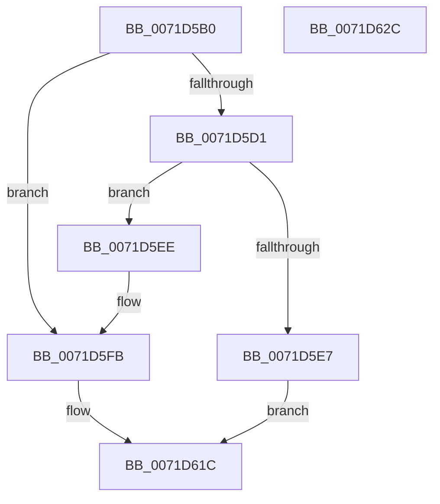

# IoInitializeTimer

- RVA: `0x0071D5B0`–`0x0071D62D` (길이 `125` bytes)
- VA: `0x000000014071D5B0`
- 실행 섹션: `PAGE`
- PDB 이름 있음: `예`; PDB Function 태그: `아니요`
- unwind 정보 RVA: `0x00060BC4`
- 디코드: `34`개 명령, `125/125` bytes 표시
- 미해석 바이트: `0` (있으면 어셈블리에 `.byte`로 보존)

> 이 문서는 커널 이미지의 기계어와 PDB 기호를 분석해 생성했습니다. 4번과 5번은 함수 원형과 자료형을 바이너리 사용 방식에서 추정한 C 해석이며 원본 소스 복구 결과는 아닙니다.

## 1. Dependencies

- 직접 호출 지점: **2**; 고유 호출 대상: **2**
- 직접 호출자로 확인된 함수: **1**
- RIP 상대 이미지 참조: **2**

### Outgoing calls
- `0x0071D5DD` → [ExAllocatePool2](../../poolcode/B8/ExAllocatePool2_function_00B820F0.md) (function, `0x00B820F0`)
- `0x0071D615` → [ExInterlockedInsertTailList](../../text/38/ExInterlockedInsertTailList_function_00386700.md) (function, `0x00386700`)

### Direct callers
- [DifIoInitializeTimerWrapper](../../text/62/DifIoInitializeTimerWrapper_function_0062B470.md) at `0x0062B555`

### Static image references
- `0x0071D603` → RVA `0x00FCF140` (`CACHEALI`; read)
- `0x0071D60E` → RVA `0x00F8D510` (`.data`; read)

## 2. Other-region calls and transfers

- 다른 실행 섹션으로 향하는 call: **2**
  - `0x0071D5DD` → [ExAllocatePool2](../../poolcode/B8/ExAllocatePool2_function_00B820F0.md) (`PAGE` → `POOLCODE`)
  - `0x0071D615` → [ExInterlockedInsertTailList](../../text/38/ExInterlockedInsertTailList_function_00386700.md) (`PAGE` → `.text`)
- 별도 외부 분기/꼬리 이동을 확인하지 못했습니다.

## 3. Assembly (complete function range)

```asm
0071D5B0  48 89 5C 24 08                  mov qword ptr [rsp + 8], rbx
0071D5B5  48 89 74 24 10                  mov qword ptr [rsp + 0x10], rsi
0071D5BA  57                              push rdi
0071D5BB  48 83 EC 20                     sub rsp, 0x20
0071D5BF  48 8B 41 28                     mov rax, qword ptr [rcx + 0x28]
0071D5C3  49 8B F8                        mov rdi, r8
0071D5C6  48 8B F2                        mov rsi, rdx
0071D5C9  48 8B D9                        mov rbx, rcx
0071D5CC  48 85 C0                        test rax, rax
0071D5CF  75 2A                           jne 0x14071d5fb
0071D5D1  8D 50 30                        lea edx, [rax + 0x30]
0071D5D4  41 B8 49 6F 54 69               mov r8d, 0x69546f49
0071D5DA  8D 48 40                        lea ecx, [rax + 0x40]
0071D5DD  E8 0E 4B 46 00                  call 0x140b820f0
0071D5E2  48 85 C0                        test rax, rax
0071D5E5  75 07                           jne 0x14071d5ee
0071D5E7  B8 9A 00 00 C0                  mov eax, 0xc000009a
0071D5EC  EB 2E                           jmp 0x14071d61c
0071D5EE  66 C7 00 09 00                  mov word ptr [rax], 9
0071D5F3  48 89 58 28                     mov qword ptr [rax + 0x28], rbx
0071D5F7  48 89 43 28                     mov qword ptr [rbx + 0x28], rax
0071D5FB  48 8D 50 08                     lea rdx, [rax + 8]
0071D5FF  48 89 70 18                     mov qword ptr [rax + 0x18], rsi
0071D603  4C 8D 05 36 1B 8B 00            lea r8, [rip + 0x8b1b36]
0071D60A  48 89 78 20                     mov qword ptr [rax + 0x20], rdi
0071D60E  48 8D 0D FB FE 86 00            lea rcx, [rip + 0x86fefb]
0071D615  E8 E6 90 C6 FF                  call 0x140386700
0071D61A  33 C0                           xor eax, eax
0071D61C  48 8B 5C 24 30                  mov rbx, qword ptr [rsp + 0x30]
0071D621  48 8B 74 24 38                  mov rsi, qword ptr [rsp + 0x38]
0071D626  48 83 C4 20                     add rsp, 0x20
0071D62A  5F                              pop rdi
0071D62B  C3                              ret
0071D62C  CC                              int3
```

## 4. C-style interpretation (structured pseudocode)

```c
__int64 __fastcall IoInitializeTimer(__int64 a1, __int64 a2, __int64 a3)
{
    __int64 result;
    __int64 v_rsp;
    unsigned __int64 v_stack_p10;
    unsigned __int64 v_stack_p8;

    v_stack_p8 = v_rbx;
    v_stack_p10 = v_rsi;
    v_rsp = (v_rsp) - (32);
    if (*(unsigned __int64 *)(a1 + 40) != 0) goto loc_0071D5FB;
    result = ExAllocatePool2(*(unsigned __int64 *)(a1 + 40) + 64, *(unsigned __int64 *)(a1 + 40) + 48, (unsigned int)(0x69546F49ULL), a4);
    if (result != 0) goto loc_0071D5EE;
    goto loc_0071D61C;
loc_0071D5EE:
    *(unsigned __int16 *)((unsigned int)(0xC000009AULL)) = 9;
    *(unsigned __int64 *)((unsigned int)(0xC000009AULL) + 40) = a1;
    *(unsigned __int64 *)(a1 + 40) = (unsigned int)(0xC000009AULL);
loc_0071D5FB:
    *(unsigned __int64 *)((unsigned int)(0xC000009AULL) + 24) = a2;
    *(unsigned __int64 *)((unsigned int)(0xC000009AULL) + 32) = a3;
    result = ExInterlockedInsertTailList(v_rip + 8847099, (unsigned int)(0xC000009AULL) + 8, v_rip + 9116470, a4);
    result = 0;
loc_0071D61C:
    v_rsp = (v_rsp) + (32);
    return result;
}
```

## 5. (Beta) C Style

```c
int64_t IoInitializeTimer(void *Arg1, int64_t Arg2, int64_t Arg3)
{
    uint8_t *arg1 = (uint8_t *)Arg1;

    int64_t result;
    int64_t local_rsp;
    uint64_t v_stack_p10;
    uint64_t v_stack_p8;

    v_stack_p8 = local_rbx;
    v_stack_p10 = local_rsi;
    local_rsp = (local_rsp) - (32);
    if (*(uint64_t *)(arg1 + 0x28) != 0) goto loc_0071D5FB;
    result = ExAllocatePool2(*(uint64_t *)(arg1 + 0x28) + 64, *(uint64_t *)(arg1 + 0x28) + 48, (uint32_t)(0x69546F49ULL), a4);
    if (result != 0) goto loc_0071D5EE;
    goto loc_0071D61C;
loc_0071D5EE:
    *(uint16_t *)((uint32_t)(0xC000009AULL)) = 9;
    *(void **)((uint32_t)(0xC000009AULL) + 0x28) = Arg1;
    *(uint64_t *)(arg1 + 0x28) = (uint32_t)(0xC000009AULL);
loc_0071D5FB:
    *(uint64_t *)((uint32_t)(0xC000009AULL) + 0x18) = Arg2;
    *(uint64_t *)((uint32_t)(0xC000009AULL) + 0x20) = Arg3;
    result = ExInterlockedInsertTailList(v_rip + 8847099, (uint32_t)(0xC000009AULL) + 8, v_rip + 9116470, a4);
    result = 0;
loc_0071D61C:
    local_rsp = (local_rsp) + (32);
    return result;
}
```

### 관측된 메모리 오프셋

구조체 형식이 확인되지 않은 접근은 인자 기준의 오프셋으로만 기록했습니다.

| 기준 인자 | 오프셋 표현 | 폭 (bit) | 접근 |
|---|---:|---:|---|
| `Arg1` | `+ 0x28` | `64` | `R` |
| `Arg1` | `+ 0x28` | `64` | `W` |

## 6. Execution-region graph

[열기: 2D/3D 그래프와 함수 탐색 컨트롤 패널](../../../control-panel.html?section=page&rva=0x0071D5B0&view=graph)

- 2D 그래프는 위에서 아래로 흐르고, 3D 그래프는 빈 공간을 드래그해 회전합니다. Shift+드래그는 이동, 휠은 확대·축소, 함수 노드 선택은 대상 보고서 이동입니다.

### Static fallback


