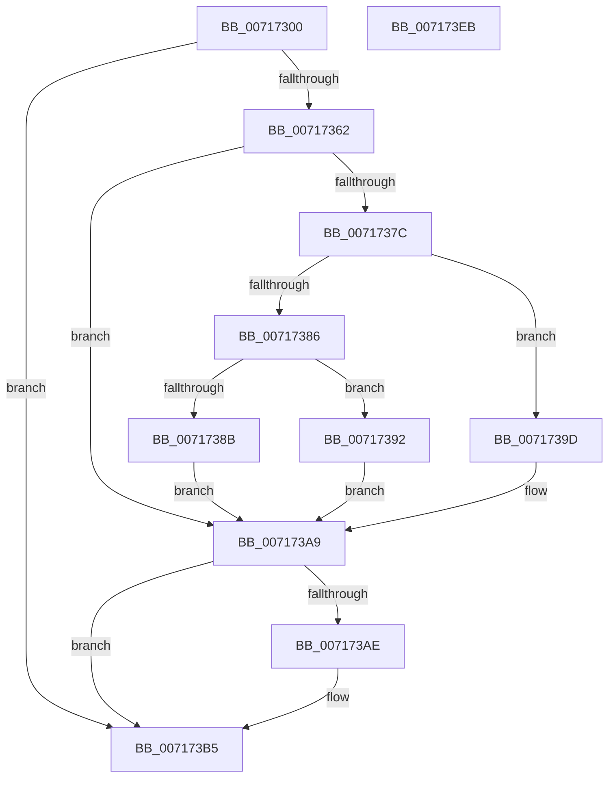

# IoReadDiskSignature

- RVA: `0x00717300`–`0x007173EC` (길이 `236` bytes)
- VA: `0x0000000140717300`
- 실행 섹션: `PAGE`
- PDB 이름 있음: `예`; PDB Function 태그: `아니요`
- unwind 정보 RVA: `0x000C6350`
- 디코드: `62`개 명령, `236/236` bytes 표시
- 미해석 바이트: `0` (있으면 어셈블리에 `.byte`로 보존)

> 이 문서는 커널 이미지의 기계어와 PDB 기호를 분석해 생성했습니다. 4번과 5번은 함수 원형과 자료형을 바이너리 사용 방식에서 추정한 C 해석이며 원본 소스 복구 결과는 아닙니다.

## 1. Dependencies

- 직접 호출 지점: **6**; 고유 호출 대상: **6**
- 직접 호출자로 확인된 함수: **0**
- RIP 상대 이미지 참조: **2**

### Outgoing calls
- `0x0071732F` → [SC_DISK::SC_DISK](../../text/6A/SC_DISK_SC_DISK_function_006A41DC.md) (function, `0x006A41DC`)
- `0x00717357` → [NT_DISK::Initialize](NT_DISK_Initialize_function_007170C8.md) (function, `0x007170C8`)
- `0x0071736C` → [SC_DISK::ReadPartitionTable](../../text/6A/SC_DISK_ReadPartitionTable_function_006A499C.md) (function, `0x006A499C`)
- `0x007173B0` → [ExFreePoolWithTag](../../poolcode/B8/ExFreePoolWithTag_function_00B82870.md) (function, `0x00B82870`)
- `0x007173BF` → [SC_DISK::~SC_DISK](../../text/6A/SC_DISK_SC_DISK_function_006A42C4.md) (function, `0x006A42C4`)
- `0x007173D1` → [_security_check_cookie](../../text/6A/_security_check_cookie_function_006AC640.md) (function, `0x006AC640`)

### Direct callers
- 이 함수 시작 RVA로 연결되는 직접 call은 확인되지 않았습니다. 간접 호출은 완전히 역산할 수 없습니다.

### Static image references
- `0x00717312` → RVA `0x00E0A740` (`.data`; read)
- `0x0071733D` → RVA `0x00007EB8` (`.rdata`; read)

## 2. Other-region calls and transfers

- 다른 실행 섹션으로 향하는 call: **5**
  - `0x0071732F` → [SC_DISK::SC_DISK](../../text/6A/SC_DISK_SC_DISK_function_006A41DC.md) (`PAGE` → `.text`)
  - `0x0071736C` → [SC_DISK::ReadPartitionTable](../../text/6A/SC_DISK_ReadPartitionTable_function_006A499C.md) (`PAGE` → `.text`)
  - `0x007173B0` → [ExFreePoolWithTag](../../poolcode/B8/ExFreePoolWithTag_function_00B82870.md) (`PAGE` → `POOLCODE`)
  - `0x007173BF` → [SC_DISK::~SC_DISK](../../text/6A/SC_DISK_SC_DISK_function_006A42C4.md) (`PAGE` → `.text`)
  - `0x007173D1` → [_security_check_cookie](../../text/6A/_security_check_cookie_function_006AC640.md) (`PAGE` → `.text`)
- 별도 외부 분기/꼬리 이동을 확인하지 못했습니다.

## 3. Assembly (complete function range)

```asm
00717300  48 89 5C 24 08                  mov qword ptr [rsp + 8], rbx
00717305  48 89 74 24 10                  mov qword ptr [rsp + 0x10], rsi
0071730A  57                              push rdi
0071730B  48 81 EC D0 01 00 00            sub rsp, 0x1d0
00717312  48 8B 05 27 34 6F 00            mov rax, qword ptr [rip + 0x6f3427]
00717319  48 33 C4                        xor rax, rsp
0071731C  48 89 84 24 C0 01 00 00         mov qword ptr [rsp + 0x1c0], rax
00717324  4C 8B C9                        mov r9, rcx
00717327  49 8B F8                        mov rdi, r8
0071732A  48 8D 4C 24 30                  lea rcx, [rsp + 0x30]
0071732F  E8 A8 CE F8 FF                  call 0x1406a41dc
00717334  48 83 A4 24 B8 01 00 00 00      and qword ptr [rsp + 0x1b8], 0
0071733D  48 8D 35 74 0B 8F FF            lea rsi, [rip - 0x70f48c]
00717344  48 83 64 24 20 00               and qword ptr [rsp + 0x20], 0
0071734A  48 8D 4C 24 30                  lea rcx, [rsp + 0x30]
0071734F  49 8B D1                        mov rdx, r9
00717352  48 89 74 24 30                  mov qword ptr [rsp + 0x30], rsi
00717357  E8 6C FD FF FF                  call 0x1407170c8
0071735C  8B D8                           mov ebx, eax
0071735E  85 C0                           test eax, eax
00717360  78 53                           js 0x1407173b5
00717362  48 8D 54 24 20                  lea rdx, [rsp + 0x20]
00717367  48 8D 4C 24 30                  lea rcx, [rsp + 0x30]
0071736C  E8 2B D6 F8 FF                  call 0x1406a499c
00717371  48 8B 4C 24 20                  mov rcx, qword ptr [rsp + 0x20]
00717376  8B D8                           mov ebx, eax
00717378  85 C0                           test eax, eax
0071737A  78 2D                           js 0x1407173a9
0071737C  8B 01                           mov eax, dword ptr [rcx]
0071737E  89 07                           mov dword ptr [rdi], eax
00717380  8B 11                           mov edx, dword ptr [rcx]
00717382  85 D2                           test edx, edx
00717384  74 17                           je 0x14071739d
00717386  83 FA 01                        cmp edx, 1
00717389  74 07                           je 0x140717392
0071738B  BB BB 00 00 C0                  mov ebx, 0xc00000bb
00717390  EB 17                           jmp 0x1407173a9
00717392  0F 10 41 08                     movups xmm0, xmmword ptr [rcx + 8]
00717396  F3 0F 7F 47 04                  movdqu xmmword ptr [rdi + 4], xmm0
0071739B  EB 0C                           jmp 0x1407173a9
0071739D  8B 41 08                        mov eax, dword ptr [rcx + 8]
007173A0  89 47 04                        mov dword ptr [rdi + 4], eax
007173A3  8B 41 0C                        mov eax, dword ptr [rcx + 0xc]
007173A6  89 47 08                        mov dword ptr [rdi + 8], eax
007173A9  48 85 C9                        test rcx, rcx
007173AC  74 07                           je 0x1407173b5
007173AE  33 D2                           xor edx, edx
007173B0  E8 BB B4 46 00                  call 0x140b82870
007173B5  48 8D 4C 24 30                  lea rcx, [rsp + 0x30]
007173BA  48 89 74 24 30                  mov qword ptr [rsp + 0x30], rsi
007173BF  E8 00 CF F8 FF                  call 0x1406a42c4
007173C4  8B C3                           mov eax, ebx
007173C6  48 8B 8C 24 C0 01 00 00         mov rcx, qword ptr [rsp + 0x1c0]
007173CE  48 33 CC                        xor rcx, rsp
007173D1  E8 6A 52 F9 FF                  call 0x1406ac640
007173D6  4C 8D 9C 24 D0 01 00 00         lea r11, [rsp + 0x1d0]
007173DE  49 8B 5B 10                     mov rbx, qword ptr [r11 + 0x10]
007173E2  49 8B 73 18                     mov rsi, qword ptr [r11 + 0x18]
007173E6  49 8B E3                        mov rsp, r11
007173E9  5F                              pop rdi
007173EA  C3                              ret
007173EB  CC                              int3
```

## 4. C-style interpretation (structured pseudocode)

```c
__int64 __fastcall IoReadDiskSignature(__int64 a1, __int64 a2, __int64 a3)
{
    __int64 result;
    __int64 v_rsp;
    unsigned __int64 v_stack_m18;
    unsigned __int64 v_stack_m1A8;
    unsigned __int64 v_stack_m1B8;
    unsigned __int64 v_stack_m20;
    unsigned __int64 v_stack_m8;
    unsigned __int64 v_stack_p10;
    unsigned __int64 v_stack_p8;

    v_stack_p8 = v_rbx;
    v_stack_p10 = v_rsi;
    v_rsp = (v_rsp) - (464);
    result = (*(unsigned __int64 *)(v_rip + 7287847)) ^ (v_rsp);
    v_stack_m18 = result;
    result = SC_DISK__SC_DISK(v_stack_m1A8, a2, a3, a1);
    v_stack_m1A8 = v_rip - 7402636;
    result = NT_DISK__Initialize(v_stack_m1A8, a1, a3, a1);
    if (sign_flag) goto loc_007173B5;
    result = SC_DISK__ReadPartitionTable(v_stack_m1A8, v_stack_m1B8, a3, a1);
    if (sign_flag) goto loc_007173A9;
    *(unsigned int *)(a3) = (unsigned int)((unsigned int)(*(unsigned int *)(v_stack_m1B8)));
    if ((unsigned int)((unsigned int)(*(unsigned int *)(v_stack_m1B8))) == 0) goto loc_0071739D;
    if (((unsigned int)((unsigned int)(*(unsigned int *)(v_stack_m1B8)))) == 1) goto loc_00717392;
    goto loc_007173A9;
loc_00717392:
    *(unsigned __int64 *)(a3 + 4) = v_xmm0;
    goto loc_007173A9;
loc_0071739D:
    *(unsigned int *)(a3 + 4) = (unsigned int)((unsigned int)(*(unsigned int *)(v_stack_m1B8 + 8)));
    *(unsigned int *)(a3 + 8) = (unsigned int)((unsigned int)(*(unsigned int *)(v_stack_m1B8 + 12)));
loc_007173A9:
    result = (unsigned int)(*(unsigned int *)(v_stack_m1B8 + 12));
    if (v_stack_m1B8 != 0) {
        a2 = 0;
        result = ExFreePoolWithTag(v_stack_m1B8, a2, a3, a1);
    }
    v_stack_m1A8 = v_rip - 7402636;
    result = SC_DISK___SC_DISK(v_stack_m1A8, a2, a3, a1);
    a1 = (v_stack_m18) ^ (v_rsp);
    result = _security_check_cookie(a1, a2, a3, a1);
    return result;
}
```

## 5. (Beta) C Style

```c
int64_t IoReadDiskSignature(int64_t Arg1, int64_t Arg2, void *Arg3)
{
    uint8_t *arg3 = (uint8_t *)Arg3;

    int64_t result;
    int64_t local_rsp;
    uint64_t v_stack_m18;
    uint64_t v_stack_m1A8;
    uint64_t v_stack_m1B8;
    uint64_t v_stack_m20;
    uint64_t v_stack_m8;
    uint64_t v_stack_p10;
    uint64_t v_stack_p8;

    v_stack_p8 = local_rbx;
    v_stack_p10 = local_rsi;
    local_rsp = (local_rsp) - (464);
    result = (*(uint64_t *)(v_rip + 0x6F3427)) ^ (local_rsp);
    v_stack_m18 = result;
    result = SC_DISK__SC_DISK(v_stack_m1A8, Arg2, Arg3, Arg1);
    v_stack_m1A8 = v_rip - 7402636;
    result = NT_DISK__Initialize(v_stack_m1A8, Arg1, Arg3, Arg1);
    if (sign_flag) goto loc_007173B5;
    result = SC_DISK__ReadPartitionTable(v_stack_m1A8, v_stack_m1B8, Arg3, Arg1);
    if (sign_flag) goto loc_007173A9;
    *(uint32_t *)(arg3) = (uint32_t)((uint32_t)(*(uint32_t *)(v_stack_m1B8)));
    if ((uint32_t)((uint32_t)(*(uint32_t *)(v_stack_m1B8))) == 0) goto loc_0071739D;
    if (((uint32_t)((uint32_t)(*(uint32_t *)(v_stack_m1B8)))) == 1) goto loc_00717392;
    goto loc_007173A9;
loc_00717392:
    *(uint64_t *)(arg3 + 0x4) = v_xmm0;
    goto loc_007173A9;
loc_0071739D:
    *(uint32_t *)(arg3 + 0x4) = (uint32_t)((uint32_t)(*(uint32_t *)(v_stack_m1B8 + 0x8)));
    *(uint32_t *)(arg3 + 0x8) = (uint32_t)((uint32_t)(*(uint32_t *)(v_stack_m1B8 + 0xC)));
loc_007173A9:
    result = (uint32_t)(*(uint32_t *)(v_stack_m1B8 + 0xC));
    if (v_stack_m1B8 != 0) {
        Arg2 = 0;
        result = ExFreePoolWithTag(v_stack_m1B8, Arg2, Arg3, Arg1);
    }
    v_stack_m1A8 = v_rip - 7402636;
    result = SC_DISK___SC_DISK(v_stack_m1A8, Arg2, Arg3, Arg1);
    Arg1 = (v_stack_m18) ^ (local_rsp);
    result = _security_check_cookie(Arg1, Arg2, Arg3, Arg1);
    return result;
}
```

### 관측된 메모리 오프셋

구조체 형식이 확인되지 않은 접근은 인자 기준의 오프셋으로만 기록했습니다.

| 기준 인자 | 오프셋 표현 | 폭 (bit) | 접근 |
|---|---:|---:|---|
| `Arg3` | `+ 0x0` | `32` | `W` |
| `Arg3` | `+ 0x4` | `32` | `W` |
| `Arg3` | `+ 0x4` | `128` | `W` |
| `Arg3` | `+ 0x8` | `32` | `W` |

## 6. Execution-region graph

[열기: 2D/3D 그래프와 함수 탐색 컨트롤 패널](../../../control-panel.html?section=page&rva=0x00717300&view=graph)

- 2D 그래프는 위에서 아래로 흐르고, 3D 그래프는 빈 공간을 드래그해 회전합니다. Shift+드래그는 이동, 휠은 확대·축소, 함수 노드 선택은 대상 보고서 이동입니다.

### Static fallback


