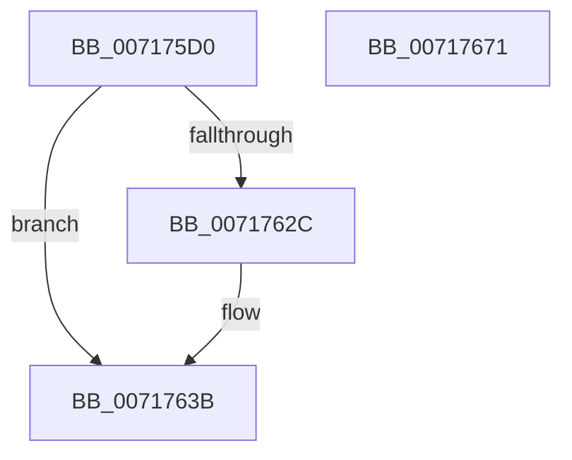

# IoReadPartitionTableEx

- RVA: `0x007175D0`–`0x00717672` (길이 `162` bytes)
- VA: `0x00000001407175D0`
- 실행 섹션: `PAGE`
- PDB 이름 있음: `예`; PDB Function 태그: `아니요`
- unwind 정보 RVA: `0x000C6330`
- 디코드: `38`개 명령, `162/162` bytes 표시
- 미해석 바이트: `0` (있으면 어셈블리에 `.byte`로 보존)

> 이 문서는 커널 이미지의 기계어와 PDB 기호를 분석해 생성했습니다. 4번과 5번은 함수 원형과 자료형을 바이너리 사용 방식에서 추정한 C 해석이며 원본 소스 복구 결과는 아닙니다.

## 1. Dependencies

- 직접 호출 지점: **5**; 고유 호출 대상: **5**
- 직접 호출자로 확인된 함수: **0**
- RIP 상대 이미지 참조: **2**

### Outgoing calls
- `0x007175FF` → [SC_DISK::SC_DISK](../../text/6A/SC_DISK_SC_DISK_function_006A41DC.md) (function, `0x006A41DC`)
- `0x00717621` → [NT_DISK::Initialize](NT_DISK_Initialize_function_007170C8.md) (function, `0x007170C8`)
- `0x00717634` → [SC_DISK::ReadPartitionTable](../../text/6A/SC_DISK_ReadPartitionTable_function_006A499C.md) (function, `0x006A499C`)
- `0x00717645` → [SC_DISK::~SC_DISK](../../text/6A/SC_DISK_SC_DISK_function_006A42C4.md) (function, `0x006A42C4`)
- `0x00717657` → [_security_check_cookie](../../text/6A/_security_check_cookie_function_006AC640.md) (function, `0x006AC640`)

### Direct callers
- 이 함수 시작 RVA로 연결되는 직접 call은 확인되지 않았습니다. 간접 호출은 완전히 역산할 수 없습니다.

### Static image references
- `0x007175E2` → RVA `0x00E0A740` (`.data`; read)
- `0x0071760D` → RVA `0x00007EB8` (`.rdata`; read)

## 2. Other-region calls and transfers

- 다른 실행 섹션으로 향하는 call: **4**
  - `0x007175FF` → [SC_DISK::SC_DISK](../../text/6A/SC_DISK_SC_DISK_function_006A41DC.md) (`PAGE` → `.text`)
  - `0x00717634` → [SC_DISK::ReadPartitionTable](../../text/6A/SC_DISK_ReadPartitionTable_function_006A499C.md) (`PAGE` → `.text`)
  - `0x00717645` → [SC_DISK::~SC_DISK](../../text/6A/SC_DISK_SC_DISK_function_006A42C4.md) (`PAGE` → `.text`)
  - `0x00717657` → [_security_check_cookie](../../text/6A/_security_check_cookie_function_006AC640.md) (`PAGE` → `.text`)
- 별도 외부 분기/꼬리 이동을 확인하지 못했습니다.

## 3. Assembly (complete function range)

```asm
007175D0  48 89 5C 24 08                  mov qword ptr [rsp + 8], rbx
007175D5  48 89 74 24 18                  mov qword ptr [rsp + 0x18], rsi
007175DA  57                              push rdi
007175DB  48 81 EC C0 01 00 00            sub rsp, 0x1c0
007175E2  48 8B 05 57 31 6F 00            mov rax, qword ptr [rip + 0x6f3157]
007175E9  48 33 C4                        xor rax, rsp
007175EC  48 89 84 24 B0 01 00 00         mov qword ptr [rsp + 0x1b0], rax
007175F4  4C 8B C1                        mov r8, rcx
007175F7  48 8B FA                        mov rdi, rdx
007175FA  48 8D 4C 24 20                  lea rcx, [rsp + 0x20]
007175FF  E8 D8 CB F8 FF                  call 0x1406a41dc
00717604  48 83 A4 24 A8 01 00 00 00      and qword ptr [rsp + 0x1a8], 0
0071760D  48 8D 35 A4 08 8F FF            lea rsi, [rip - 0x70f75c]
00717614  49 8B D0                        mov rdx, r8
00717617  48 89 74 24 20                  mov qword ptr [rsp + 0x20], rsi
0071761C  48 8D 4C 24 20                  lea rcx, [rsp + 0x20]
00717621  E8 A2 FA FF FF                  call 0x1407170c8
00717626  8B D8                           mov ebx, eax
00717628  85 C0                           test eax, eax
0071762A  78 0F                           js 0x14071763b
0071762C  48 8B D7                        mov rdx, rdi
0071762F  48 8D 4C 24 20                  lea rcx, [rsp + 0x20]
00717634  E8 63 D3 F8 FF                  call 0x1406a499c
00717639  8B D8                           mov ebx, eax
0071763B  48 8D 4C 24 20                  lea rcx, [rsp + 0x20]
00717640  48 89 74 24 20                  mov qword ptr [rsp + 0x20], rsi
00717645  E8 7A CC F8 FF                  call 0x1406a42c4
0071764A  8B C3                           mov eax, ebx
0071764C  48 8B 8C 24 B0 01 00 00         mov rcx, qword ptr [rsp + 0x1b0]
00717654  48 33 CC                        xor rcx, rsp
00717657  E8 E4 4F F9 FF                  call 0x1406ac640
0071765C  4C 8D 9C 24 C0 01 00 00         lea r11, [rsp + 0x1c0]
00717664  49 8B 5B 10                     mov rbx, qword ptr [r11 + 0x10]
00717668  49 8B 73 20                     mov rsi, qword ptr [r11 + 0x20]
0071766C  49 8B E3                        mov rsp, r11
0071766F  5F                              pop rdi
00717670  C3                              ret
00717671  CC                              int3
```

## 4. C-style interpretation (structured pseudocode)

```c
__int64 __fastcall IoReadPartitionTableEx(__int64 a1, __int64 a2)
{
    __int64 result;
    __int64 v_rbx;
    __int64 v_rsp;
    unsigned __int64 v_stack_m18;
    unsigned __int64 v_stack_m1A8;
    unsigned __int64 v_stack_m20;
    unsigned __int64 v_stack_m8;
    unsigned __int64 v_stack_p18;
    unsigned __int64 v_stack_p8;

    v_stack_p8 = v_rbx;
    v_stack_p18 = v_rsi;
    v_rsp = (v_rsp) - (448);
    result = (*(unsigned __int64 *)(v_rip + 7287127)) ^ (v_rsp);
    v_stack_m18 = result;
    result = SC_DISK__SC_DISK(v_stack_m1A8, a2, a1, a4);
    v_stack_m1A8 = v_rip - 7403356;
    result = NT_DISK__Initialize(v_stack_m1A8, a1, a1, a4);
    v_rbx = (unsigned int)((unsigned int)(result));
    if (!(sign_flag)) {
        a2 = a2;
        a1 = v_stack_m1A8;
        result = SC_DISK__ReadPartitionTable(a1, a2, a1, a4);
        v_rbx = (unsigned int)(result);
    }
    v_stack_m1A8 = v_rip - 7403356;
    result = SC_DISK___SC_DISK(v_stack_m1A8, a2, a1, a4);
    a1 = (v_stack_m18) ^ (v_rsp);
    result = _security_check_cookie(a1, a2, a1, a4);
    return result;
}
```

## 5. (Beta) C Style

```c
int64_t IoReadPartitionTableEx(int64_t Arg1, int64_t Arg2)
{
    int64_t result;
    int64_t local_rbx;
    int64_t local_rsp;
    uint64_t v_stack_m18;
    uint64_t v_stack_m1A8;
    uint64_t v_stack_m20;
    uint64_t v_stack_m8;
    uint64_t v_stack_p18;
    uint64_t v_stack_p8;

    v_stack_p8 = local_rbx;
    v_stack_p18 = local_rsi;
    local_rsp = (local_rsp) - (448);
    result = (*(uint64_t *)(v_rip + 0x6F3157)) ^ (local_rsp);
    v_stack_m18 = result;
    result = SC_DISK__SC_DISK(v_stack_m1A8, Arg2, Arg1, a4);
    v_stack_m1A8 = v_rip - 7403356;
    result = NT_DISK__Initialize(v_stack_m1A8, Arg1, Arg1, a4);
    local_rbx = (uint32_t)((uint32_t)(result));
    if (!(sign_flag)) {
        Arg2 = Arg2;
        Arg1 = v_stack_m1A8;
        result = SC_DISK__ReadPartitionTable(Arg1, Arg2, Arg1, a4);
        local_rbx = (uint32_t)(result);
    }
    v_stack_m1A8 = v_rip - 7403356;
    result = SC_DISK___SC_DISK(v_stack_m1A8, Arg2, Arg1, a4);
    Arg1 = (v_stack_m18) ^ (local_rsp);
    result = _security_check_cookie(Arg1, Arg2, Arg1, a4);
    return result;
}
```

## 6. Execution-region graph

[열기: 2D/3D 그래프와 함수 탐색 컨트롤 패널](../../../control-panel.html?section=page&rva=0x007175D0&view=graph)

- 2D 그래프는 위에서 아래로 흐르고, 3D 그래프는 빈 공간을 드래그해 회전합니다. Shift+드래그는 이동, 휠은 확대·축소, 함수 노드 선택은 대상 보고서 이동입니다.

### Static fallback


