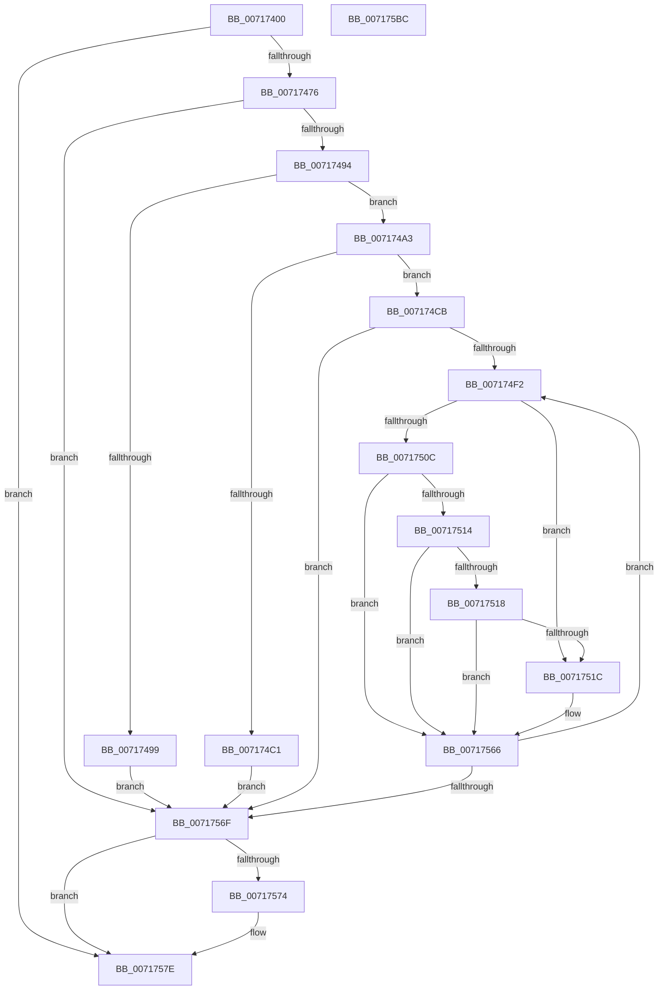

# IoReadPartitionTable

- RVA: `0x00717400`–`0x007175BD` (길이 `445` bytes)
- VA: `0x0000000140717400`
- 실행 섹션: `PAGE`
- PDB 이름 있음: `예`; PDB Function 태그: `아니요`
- unwind 정보 RVA: `0x000C6380`
- 디코드: `118`개 명령, `445/445` bytes 표시
- 미해석 바이트: `0` (있으면 어셈블리에 `.byte`로 보존)

> 이 문서는 커널 이미지의 기계어와 PDB 기호를 분석해 생성했습니다. 4번과 5번은 함수 원형과 자료형을 바이너리 사용 방식에서 추정한 C 해석이며 원본 소스 복구 결과는 아닙니다.

## 1. Dependencies

- 직접 호출 지점: **8**; 고유 호출 대상: **8**
- 직접 호출자로 확인된 함수: **1**
- RIP 상대 이미지 참조: **2**

### Outgoing calls
- `0x0071743B` → [SC_DISK::SC_DISK](../../text/6A/SC_DISK_SC_DISK_function_006A41DC.md) (function, `0x006A41DC`)
- `0x00717467` → [NT_DISK::Initialize](NT_DISK_Initialize_function_007170C8.md) (function, `0x007170C8`)
- `0x00717480` → [SC_DISK::ReadPartitionTable](../../text/6A/SC_DISK_ReadPartitionTable_function_006A499C.md) (function, `0x006A499C`)
- `0x007174B4` → [SC_ENV::Allocate](SC_ENV_Allocate_function_00716F90.md) (function, `0x00716F90`)
- `0x007174D3` → [memset](../../text/6C/memset_function_006C6C40.md) (function, `0x006C6C40`)
- `0x00717579` → [ExFreePoolWithTag](../../poolcode/B8/ExFreePoolWithTag_function_00B82870.md) (function, `0x00B82870`)
- `0x00717588` → [SC_DISK::~SC_DISK](../../text/6A/SC_DISK_SC_DISK_function_006A42C4.md) (function, `0x006A42C4`)
- `0x0071759A` → [_security_check_cookie](../../text/6A/_security_check_cookie_function_006AC640.md) (function, `0x006AC640`)

### Direct callers
- [DifIoReadPartitionTableWrapper](../../text/62/DifIoReadPartitionTableWrapper_function_0062C080.md) at `0x0062C177`

### Static image references
- `0x0071741B` → RVA `0x00E0A740` (`.data`; read)
- `0x00717449` → RVA `0x00007EB8` (`.rdata`; read)

## 2. Other-region calls and transfers

- 다른 실행 섹션으로 향하는 call: **6**
  - `0x0071743B` → [SC_DISK::SC_DISK](../../text/6A/SC_DISK_SC_DISK_function_006A41DC.md) (`PAGE` → `.text`)
  - `0x00717480` → [SC_DISK::ReadPartitionTable](../../text/6A/SC_DISK_ReadPartitionTable_function_006A499C.md) (`PAGE` → `.text`)
  - `0x007174D3` → [memset](../../text/6C/memset_function_006C6C40.md) (`PAGE` → `.text`)
  - `0x00717579` → [ExFreePoolWithTag](../../poolcode/B8/ExFreePoolWithTag_function_00B82870.md) (`PAGE` → `POOLCODE`)
  - `0x00717588` → [SC_DISK::~SC_DISK](../../text/6A/SC_DISK_SC_DISK_function_006A42C4.md) (`PAGE` → `.text`)
  - `0x0071759A` → [_security_check_cookie](../../text/6A/_security_check_cookie_function_006AC640.md) (`PAGE` → `.text`)
- 별도 외부 분기/꼬리 이동을 확인하지 못했습니다.

## 3. Assembly (complete function range)

```asm
00717400  48 89 5C 24 08                  mov qword ptr [rsp + 8], rbx
00717405  48 89 6C 24 10                  mov qword ptr [rsp + 0x10], rbp
0071740A  48 89 74 24 18                  mov qword ptr [rsp + 0x18], rsi
0071740F  57                              push rdi
00717410  41 54                           push r12
00717412  41 56                           push r14
00717414  48 81 EC D0 01 00 00            sub rsp, 0x1d0
0071741B  48 8B 05 1E 33 6F 00            mov rax, qword ptr [rip + 0x6f331e]
00717422  48 33 C4                        xor rax, rsp
00717425  48 89 84 24 C0 01 00 00         mov qword ptr [rsp + 0x1c0], rax
0071742D  4C 8B D1                        mov r10, rcx
00717430  49 8B F1                        mov rsi, r9
00717433  48 8D 4C 24 30                  lea rcx, [rsp + 0x30]
00717438  45 8A F0                        mov r14b, r8b
0071743B  E8 9C CD F8 FF                  call 0x1406a41dc
00717440  48 83 A4 24 B8 01 00 00 00      and qword ptr [rsp + 0x1b8], 0
00717449  4C 8D 25 68 0A 8F FF            lea r12, [rip - 0x70f598]
00717450  48 83 64 24 20 00               and qword ptr [rsp + 0x20], 0
00717456  48 8D 4C 24 30                  lea rcx, [rsp + 0x30]
0071745B  49 83 21 00                     and qword ptr [r9], 0
0071745F  49 8B D2                        mov rdx, r10
00717462  4C 89 64 24 30                  mov qword ptr [rsp + 0x30], r12
00717467  E8 5C FC FF FF                  call 0x1407170c8
0071746C  8B F8                           mov edi, eax
0071746E  85 C0                           test eax, eax
00717470  0F 88 08 01 00 00               js 0x14071757e
00717476  48 8D 54 24 20                  lea rdx, [rsp + 0x20]
0071747B  48 8D 4C 24 30                  lea rcx, [rsp + 0x30]
00717480  E8 17 D5 F8 FF                  call 0x1406a499c
00717485  48 8B 5C 24 20                  mov rbx, qword ptr [rsp + 0x20]
0071748A  8B F8                           mov edi, eax
0071748C  85 C0                           test eax, eax
0071748E  0F 88 DB 00 00 00               js 0x14071756f
00717494  83 3B 01                        cmp dword ptr [rbx], 1
00717497  75 0A                           jne 0x1407174a3
00717499  BF BB 00 00 C0                  mov edi, 0xc00000bb
0071749E  E9 CC 00 00 00                  jmp 0x14071756f
007174A3  8B 43 04                        mov eax, dword ptr [rbx + 4]
007174A6  45 33 C9                        xor r9d, r9d
007174A9  8D 0C C0                        lea ecx, [rax + rax*8]
007174AC  C1 E1 04                        shl ecx, 4
007174AF  83 C1 30                        add ecx, 0x30
007174B2  8B E9                           mov ebp, ecx
007174B4  E8 D7 FA FF FF                  call 0x140716f90
007174B9  48 89 06                        mov qword ptr [rsi], rax
007174BC  48 85 C0                        test rax, rax
007174BF  75 0A                           jne 0x1407174cb
007174C1  BF 9A 00 00 C0                  mov edi, 0xc000009a
007174C6  E9 A4 00 00 00                  jmp 0x14071756f
007174CB  4C 8B C5                        mov r8, rbp
007174CE  33 D2                           xor edx, edx
007174D0  48 8B C8                        mov rcx, rax
007174D3  E8 68 F7 FA FF                  call 0x1406c6c40
007174D8  48 8B 0E                        mov rcx, qword ptr [rsi]
007174DB  45 33 C0                        xor r8d, r8d
007174DE  8B 43 04                        mov eax, dword ptr [rbx + 4]
007174E1  89 01                           mov dword ptr [rcx], eax
007174E3  48 8B 0E                        mov rcx, qword ptr [rsi]
007174E6  8B 43 08                        mov eax, dword ptr [rbx + 8]
007174E9  89 41 04                        mov dword ptr [rcx + 4], eax
007174EC  44 39 43 04                     cmp dword ptr [rbx + 4], r8d
007174F0  76 7D                           jbe 0x14071756f
007174F2  4C 8B 16                        mov r10, qword ptr [rsi]
007174F5  4B 8D 14 C0                     lea rdx, [r8 + r8*8]
007174F9  48 03 D2                        add rdx, rdx
007174FC  41 8B C8                        mov ecx, r8d
007174FF  48 C1 E1 05                     shl rcx, 5
00717503  4C 8D 0C D3                     lea r9, [rbx + rdx*8]
00717507  45 84 F6                        test r14b, r14b
0071750A  74 10                           je 0x14071751c
0071750C  41 8A 41 50                     mov al, byte ptr [r9 + 0x50]
00717510  84 C0                           test al, al
00717512  74 52                           je 0x140717566
00717514  3C 05                           cmp al, 5
00717516  74 4E                           je 0x140717566
00717518  3C 0F                           cmp al, 0xf
0071751A  74 4A                           je 0x140717566
0071751C  48 8B 44 D3 38                  mov rax, qword ptr [rbx + rdx*8 + 0x38]
00717521  4A 89 44 11 08                  mov qword ptr [rcx + r10 + 8], rax
00717526  48 8B 44 D3 40                  mov rax, qword ptr [rbx + rdx*8 + 0x40]
0071752B  4A 89 44 11 10                  mov qword ptr [rcx + r10 + 0x10], rax
00717530  8B 44 D3 54                     mov eax, dword ptr [rbx + rdx*8 + 0x54]
00717534  42 89 44 11 18                  mov dword ptr [rcx + r10 + 0x18], eax
00717539  8B 44 D3 48                     mov eax, dword ptr [rbx + rdx*8 + 0x48]
0071753D  42 89 44 11 1C                  mov dword ptr [rcx + r10 + 0x1c], eax
00717542  41 8A 41 50                     mov al, byte ptr [r9 + 0x50]
00717546  42 88 44 11 20                  mov byte ptr [rcx + r10 + 0x20], al
0071754B  8A 44 D3 51                     mov al, byte ptr [rbx + rdx*8 + 0x51]
0071754F  42 88 44 11 21                  mov byte ptr [rcx + r10 + 0x21], al
00717554  8A 44 D3 52                     mov al, byte ptr [rbx + rdx*8 + 0x52]
00717558  42 88 44 11 22                  mov byte ptr [rcx + r10 + 0x22], al
0071755D  8A 44 D3 4C                     mov al, byte ptr [rbx + rdx*8 + 0x4c]
00717561  42 88 44 11 23                  mov byte ptr [rcx + r10 + 0x23], al
00717566  41 FF C0                        inc r8d
00717569  44 3B 43 04                     cmp r8d, dword ptr [rbx + 4]
0071756D  72 83                           jb 0x1407174f2
0071756F  48 85 DB                        test rbx, rbx
00717572  74 0A                           je 0x14071757e
00717574  33 D2                           xor edx, edx
00717576  48 8B CB                        mov rcx, rbx
00717579  E8 F2 B2 46 00                  call 0x140b82870
0071757E  48 8D 4C 24 30                  lea rcx, [rsp + 0x30]
00717583  4C 89 64 24 30                  mov qword ptr [rsp + 0x30], r12
00717588  E8 37 CD F8 FF                  call 0x1406a42c4
0071758D  8B C7                           mov eax, edi
0071758F  48 8B 8C 24 C0 01 00 00         mov rcx, qword ptr [rsp + 0x1c0]
00717597  48 33 CC                        xor rcx, rsp
0071759A  E8 A1 50 F9 FF                  call 0x1406ac640
0071759F  4C 8D 9C 24 D0 01 00 00         lea r11, [rsp + 0x1d0]
007175A7  49 8B 5B 20                     mov rbx, qword ptr [r11 + 0x20]
007175AB  49 8B 6B 28                     mov rbp, qword ptr [r11 + 0x28]
007175AF  49 8B 73 30                     mov rsi, qword ptr [r11 + 0x30]
007175B3  49 8B E3                        mov rsp, r11
007175B6  41 5E                           pop r14
007175B8  41 5C                           pop r12
007175BA  5F                              pop rdi
007175BB  C3                              ret
007175BC  CC                              int3
```

## 4. C-style interpretation (structured pseudocode)

```c
__int64 __fastcall IoReadPartitionTable(__int64 a1, __int64 a2, unsigned __int8 a3, __int64 a4)
{
    __int64 result;
    __int64 v_rsp;
    unsigned __int64 v_stack_m18;
    unsigned __int64 v_stack_m1B8;
    unsigned __int64 v_stack_m1C8;
    unsigned __int64 v_stack_m28;
    unsigned __int64 v_stack_m30;
    unsigned __int64 v_stack_p10;
    unsigned __int64 v_stack_p18;
    unsigned __int64 v_stack_p8;

    v_stack_p8 = v_rbx;
    v_stack_p10 = v_rbp;
    v_stack_p18 = v_rsi;
    v_rsp = (v_rsp) - (464);
    result = (*(unsigned __int64 *)(v_rip + 7287582)) ^ (v_rsp);
    v_stack_m28 = result;
    result = SC_DISK__SC_DISK(v_stack_m1B8, a2, a3, a4);
    v_stack_m1B8 = v_rip - 7402904;
    result = NT_DISK__Initialize(v_stack_m1B8, a1, a3, a4);
    if (sign_flag) goto loc_0071757E;
    result = SC_DISK__ReadPartitionTable(v_stack_m1B8, v_stack_m1C8, a3, a4);
    if (sign_flag) goto loc_0071756F;
    if ((*(unsigned int *)(v_stack_m1C8)) != 1) goto loc_007174A3;
    goto loc_0071756F;
loc_007174A3:
    a4 = 0;
    a1 = (unsigned int)(((unsigned int)(*(unsigned int *)(v_stack_m1C8 + 4)) + (unsigned int)(*(unsigned int *)(v_stack_m1C8 + 4)) * 8) << (4));
    a1 = (unsigned int)((a1) + (48));
    result = SC_ENV__Allocate(a1, v_stack_m1C8, a3, a4);
    *(unsigned __int64 *)(a4) = result;
    if (result != 0) goto loc_007174CB;
    goto loc_0071756F;
loc_007174CB:
    a2 = 0;
    result = memset(result, a2, (unsigned int)((unsigned int)(a1)), a4);
    a3 = 0;
    *(unsigned int *)(*(unsigned __int64 *)(a4)) = (unsigned int)((unsigned int)(*(unsigned int *)(v_stack_m1C8 + 4)));
    *(unsigned int *)(*(unsigned __int64 *)(a4) + 4) = (unsigned int)((unsigned int)(*(unsigned int *)(v_stack_m1C8 + 8)));
    if ((*(unsigned int *)(v_stack_m1C8 + 4)) <= 0) goto loc_0071756F;
loc_007174F2:
    a2 = (a3 + a3 * 8) + (a3 + a3 * 8);
    a1 = (0) << (5);
    if (0 == 0) goto loc_0071751C;
    if ((unsigned __int8)(*(unsigned __int8 *)(v_stack_m1C8 + a2 * 8 + 80)) == 0) goto loc_00717566;
    if (((unsigned __int8)(*(unsigned __int8 *)(v_stack_m1C8 + a2 * 8 + 80))) == 5) goto loc_00717566;
    result = *(unsigned __int8 *)(v_stack_m1C8 + a2 * 8 + 80);
    if (((unsigned __int8)(*(unsigned __int8 *)(v_stack_m1C8 + a2 * 8 + 80))) != 15) {
        result = *(unsigned __int64 *)(v_stack_m1C8 + a2 * 8 + 56);
        *(unsigned __int64 *)(a1 + *(unsigned __int64 *)(a4) * 1 + 8) = result;
        result = *(unsigned __int64 *)(v_stack_m1C8 + a2 * 8 + 64);
        *(unsigned __int64 *)(a1 + *(unsigned __int64 *)(a4) * 1 + 16) = result;
        result = *(unsigned int *)(v_stack_m1C8 + a2 * 8 + 84);
        *(unsigned int *)(a1 + *(unsigned __int64 *)(a4) * 1 + 24) = (unsigned int)(result);
        result = *(unsigned int *)(v_stack_m1C8 + a2 * 8 + 72);
        *(unsigned int *)(a1 + *(unsigned __int64 *)(a4) * 1 + 28) = (unsigned int)(result);
        result = *(unsigned __int8 *)(v_stack_m1C8 + a2 * 8 + 80);
        *(unsigned __int8 *)(a1 + *(unsigned __int64 *)(a4) * 1 + 32) = (unsigned __int8)(result);
        result = *(unsigned __int8 *)(v_stack_m1C8 + a2 * 8 + 81);
        *(unsigned __int8 *)(a1 + *(unsigned __int64 *)(a4) * 1 + 33) = (unsigned __int8)(result);
        result = *(unsigned __int8 *)(v_stack_m1C8 + a2 * 8 + 82);
        *(unsigned __int8 *)(a1 + *(unsigned __int64 *)(a4) * 1 + 34) = (unsigned __int8)(result);
        result = *(unsigned __int8 *)(v_stack_m1C8 + a2 * 8 + 76);
        *(unsigned __int8 *)(a1 + *(unsigned __int64 *)(a4) * 1 + 35) = (unsigned __int8)(result);
    }
    a3 = (unsigned int)((a3) + 1);
    if (a3 < (*(unsigned int *)(v_stack_m1C8 + 4))) goto loc_007174F2;
loc_0071756F:
    if (v_stack_m1C8 != 0) {
        a2 = 0;
        a1 = v_stack_m1C8;
        result = ExFreePoolWithTag(a1, a2, a3, v_stack_m1C8 + a2 * 8);
    }
    v_stack_m1B8 = v_rip - 7402904;
    result = SC_DISK___SC_DISK(v_stack_m1B8, a2, a3, v_stack_m1C8 + a2 * 8);
    a1 = (v_stack_m28) ^ (v_rsp);
    result = _security_check_cookie(a1, a2, a3, v_stack_m1C8 + a2 * 8);
    return result;
}
```

## 5. (Beta) C Style

```c
int64_t IoReadPartitionTable(int64_t Arg1, int64_t Arg2, uint8_t Arg3, void *Arg4)
{
    uint8_t *arg4 = (uint8_t *)Arg4;

    int64_t result;
    int64_t local_rsp;
    uint64_t v_stack_m18;
    uint64_t v_stack_m1B8;
    uint64_t v_stack_m1C8;
    uint64_t v_stack_m28;
    uint64_t v_stack_m30;
    uint64_t v_stack_p10;
    uint64_t v_stack_p18;
    uint64_t v_stack_p8;

    v_stack_p8 = local_rbx;
    v_stack_p10 = local_rbp;
    v_stack_p18 = local_rsi;
    local_rsp = (local_rsp) - (464);
    result = (*(uint64_t *)(v_rip + 0x6F331E)) ^ (local_rsp);
    v_stack_m28 = result;
    result = SC_DISK__SC_DISK(v_stack_m1B8, Arg2, Arg3, Arg4);
    v_stack_m1B8 = v_rip - 7402904;
    result = NT_DISK__Initialize(v_stack_m1B8, Arg1, Arg3, Arg4);
    if (sign_flag) goto loc_0071757E;
    result = SC_DISK__ReadPartitionTable(v_stack_m1B8, v_stack_m1C8, Arg3, Arg4);
    if (sign_flag) goto loc_0071756F;
    if ((*(uint32_t *)(v_stack_m1C8)) != 1) goto loc_007174A3;
    goto loc_0071756F;
loc_007174A3:
    Arg4 = 0;
    Arg1 = (uint32_t)(((uint32_t)(*(uint32_t *)(v_stack_m1C8 + 0x4)) + (uint32_t)(*(uint32_t *)(v_stack_m1C8 + 0x4)) * 8) << (4));
    Arg1 = (uint32_t)((Arg1) + (48));
    result = SC_ENV__Allocate(Arg1, v_stack_m1C8, Arg3, Arg4);
    *(uint64_t *)(arg4) = result;
    if (result != 0) goto loc_007174CB;
    goto loc_0071756F;
loc_007174CB:
    Arg2 = 0;
    result = memset(result, Arg2, (uint32_t)((uint32_t)(Arg1)), Arg4);
    Arg3 = 0;
    *(uint32_t *)(*(uint64_t *)(arg4)) = (uint32_t)((uint32_t)(*(uint32_t *)(v_stack_m1C8 + 0x4)));
    *(uint32_t *)(*(uint64_t *)(arg4) + 0x4) = (uint32_t)((uint32_t)(*(uint32_t *)(v_stack_m1C8 + 0x8)));
    if ((*(uint32_t *)(v_stack_m1C8 + 0x4)) <= 0) goto loc_0071756F;
loc_007174F2:
    Arg2 = (Arg3 + Arg3 * 8) + (Arg3 + Arg3 * 8);
    Arg1 = (0) << (5);
    if (0 == 0) goto loc_0071751C;
    if ((uint8_t)(*(uint8_t *)(v_stack_m1C8 + Arg2 * 8 + 0x50)) == 0) goto loc_00717566;
    if (((uint8_t)(*(uint8_t *)(v_stack_m1C8 + Arg2 * 8 + 0x50))) == 5) goto loc_00717566;
    result = *(uint8_t *)(v_stack_m1C8 + Arg2 * 8 + 0x50);
    if (((uint8_t)(*(uint8_t *)(v_stack_m1C8 + Arg2 * 8 + 0x50))) != 15) {
        result = *(uint64_t *)(v_stack_m1C8 + Arg2 * 8 + 0x38);
        *(uint64_t *)(Arg1 + *(uint64_t *)(arg4) * 1 + 0x8) = result;
        result = *(uint64_t *)(v_stack_m1C8 + Arg2 * 8 + 0x40);
        *(uint64_t *)(Arg1 + *(uint64_t *)(arg4) * 1 + 0x10) = result;
        result = *(uint32_t *)(v_stack_m1C8 + Arg2 * 8 + 0x54);
        *(uint32_t *)(Arg1 + *(uint64_t *)(arg4) * 1 + 0x18) = (uint32_t)(result);
        result = *(uint32_t *)(v_stack_m1C8 + Arg2 * 8 + 0x48);
        *(uint32_t *)(Arg1 + *(uint64_t *)(arg4) * 1 + 0x1C) = (uint32_t)(result);
        result = *(uint8_t *)(v_stack_m1C8 + Arg2 * 8 + 0x50);
        *(uint8_t *)(Arg1 + *(uint64_t *)(arg4) * 1 + 0x20) = (uint8_t)(result);
        result = *(uint8_t *)(v_stack_m1C8 + Arg2 * 8 + 0x51);
        *(uint8_t *)(Arg1 + *(uint64_t *)(arg4) * 1 + 0x21) = (uint8_t)(result);
        result = *(uint8_t *)(v_stack_m1C8 + Arg2 * 8 + 0x52);
        *(uint8_t *)(Arg1 + *(uint64_t *)(arg4) * 1 + 0x22) = (uint8_t)(result);
        result = *(uint8_t *)(v_stack_m1C8 + Arg2 * 8 + 0x4C);
        *(uint8_t *)(Arg1 + *(uint64_t *)(arg4) * 1 + 0x23) = (uint8_t)(result);
    }
    Arg3 = (uint32_t)((Arg3) + 1);
    if (Arg3 < (*(uint32_t *)(v_stack_m1C8 + 0x4))) goto loc_007174F2;
loc_0071756F:
    if (v_stack_m1C8 != 0) {
        Arg2 = 0;
        Arg1 = v_stack_m1C8;
        result = ExFreePoolWithTag(Arg1, Arg2, Arg3, v_stack_m1C8 + Arg2 * 8);
    }
    v_stack_m1B8 = v_rip - 7402904;
    result = SC_DISK___SC_DISK(v_stack_m1B8, Arg2, Arg3, v_stack_m1C8 + Arg2 * 8);
    Arg1 = (v_stack_m28) ^ (local_rsp);
    result = _security_check_cookie(Arg1, Arg2, Arg3, v_stack_m1C8 + Arg2 * 8);
    return result;
}
```

### 관측된 메모리 오프셋

구조체 형식이 확인되지 않은 접근은 인자 기준의 오프셋으로만 기록했습니다.

| 기준 인자 | 오프셋 표현 | 폭 (bit) | 접근 |
|---|---:|---:|---|
| `Arg4` | `+ 0x0` | `64` | `R` |
| `Arg4` | `+ 0x0` | `64` | `W` |

## 6. Execution-region graph

[열기: 2D/3D 그래프와 함수 탐색 컨트롤 패널](../../../control-panel.html?section=page&rva=0x00717400&view=graph)

- 2D 그래프는 위에서 아래로 흐르고, 3D 그래프는 빈 공간을 드래그해 회전합니다. Shift+드래그는 이동, 휠은 확대·축소, 함수 노드 선택은 대상 보고서 이동입니다.

### Static fallback


