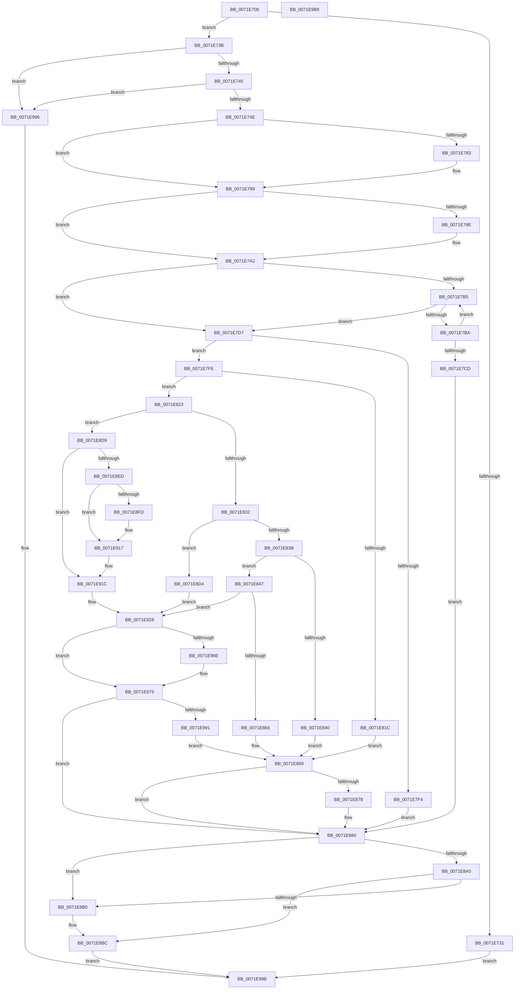

# IoRegisterContainerNotification

- RVA: `0x0071E700`–`0x0071E9B9` (길이 `697` bytes)
- VA: `0x000000014071E700`
- 실행 섹션: `PAGE`
- PDB 이름 있음: `예`; PDB Function 태그: `아니요`
- unwind 정보 RVA: `0x000BD610`
- 디코드: `176`개 명령, `697/697` bytes 표시
- 미해석 바이트: `0` (있으면 어셈블리에 `.byte`로 보존)

> 이 문서는 커널 이미지의 기계어와 PDB 기호를 분석해 생성했습니다. 4번과 5번은 함수 원형과 자료형을 바이너리 사용 방식에서 추정한 C 해석이며 원본 소스 복구 결과는 아닙니다.

## 1. Dependencies

- 직접 호출 지점: **15**; 고유 호출 대상: **15**
- 직접 호출자로 확인된 함수: **0**
- RIP 상대 이미지 참조: **7**

### Outgoing calls
- `0x0071E76F` → [KeAbPreAcquire](../../text/21/KeAbPreAcquire_function_00210230.md) (function, `0x00210230`)
- `0x0071E794` → [ExfAcquirePushLockExclusiveEx](../../text/20/ExfAcquirePushLockExclusiveEx_function_0020FC90.md) (function, `0x0020FC90`)
- `0x0071E7E7` → [ExAllocatePool2](../../poolcode/B8/ExAllocatePool2_function_00B820F0.md) (function, `0x00B820F0`)
- `0x0071E80F` → [ExRegisterCallback](../../text/4B/ExRegisterCallback_function_004BDFC0.md) (function, `0x004BDFC0`)
- `0x0071E857` → [IopSetFileObjectExtensionFlag](../../text/43/IopSetFileObjectExtensionFlag_function_0043D710.md) (function, `0x0043D710`)
- `0x0071E86E` → [ExFreePoolWithTag](../../poolcode/B8/ExFreePoolWithTag_function_00B82870.md) (function, `0x00B82870`)
- `0x0071E87B` → [ExUnregisterCallback](../../text/4B/ExUnregisterCallback_function_004B7F80.md) (function, `0x004B7F80`)
- `0x0071E8B7` → [ExfReleasePushLock](../../text/26/ExfReleasePushLock_function_002638D0.md) (function, `0x002638D0`)
- `0x0071E8C3` → [KeAbPostRelease](../../text/2E/KeAbPostRelease_function_002E1600.md) (function, `0x002E1600`)
- `0x0071E8C8` → [KeLeaveCriticalRegion](../../text/25/KeLeaveCriticalRegion_function_0025D8B0.md) (function, `0x0025D8B0`)
- `0x0071E8F0` → [IopGetDevicePDO](../../text/27/IopGetDevicePDO_function_002724D8.md) (function, `0x002724D8`)
- `0x0071E900` → [IopGetSessionIdFromPDO](../8F/IopGetSessionIdFromPDO_function_008FFDD8.md) (function, `0x008FFDD8`)
- `0x0071E907` → [PsGetSessionObjectById](../../text/22/PsGetSessionObjectById_function_002250C0.md) (function, `0x002250C0`)
- `0x0071E912` → [ObfDereferenceObject](../../text/2F/ObfDereferenceObject_function_002F9350.md) (function, `0x002F9350`)
- `0x0071E92B` → [ObfReferenceObject](../../text/20/ObfReferenceObject_function_0020FA20.md) (function, `0x0020FA20`)

### Direct callers
- 이 함수 시작 RVA로 연결되는 직접 call은 확인되지 않았습니다. 간접 호출은 완전히 역산할 수 없습니다.

### Static image references
- `0x0071E752` → RVA `0x00F8D160` (`.data`; read)
- `0x0071E774` → RVA `0x00F8D160` (`.data`; read/write)
- `0x0071E7A2` → RVA `0x00F8D150` (`.data`; read)
- `0x0071E7FE` → RVA `0x00F8D110` (`.data`; read)
- `0x0071E805` → RVA `0x0071EAE0` (`IopDispatchSessionNotifications`; read)
- `0x0071E962` → RVA `0x00F8D158` (`.data`; read)
- `0x0071E97F` → RVA `0x00F8D158` (`.data`; write)

## 2. Other-region calls and transfers

- 다른 실행 섹션으로 향하는 call: **14**
  - `0x0071E76F` → [KeAbPreAcquire](../../text/21/KeAbPreAcquire_function_00210230.md) (`PAGE` → `.text`)
  - `0x0071E794` → [ExfAcquirePushLockExclusiveEx](../../text/20/ExfAcquirePushLockExclusiveEx_function_0020FC90.md) (`PAGE` → `.text`)
  - `0x0071E7E7` → [ExAllocatePool2](../../poolcode/B8/ExAllocatePool2_function_00B820F0.md) (`PAGE` → `POOLCODE`)
  - `0x0071E80F` → [ExRegisterCallback](../../text/4B/ExRegisterCallback_function_004BDFC0.md) (`PAGE` → `.text`)
  - `0x0071E857` → [IopSetFileObjectExtensionFlag](../../text/43/IopSetFileObjectExtensionFlag_function_0043D710.md) (`PAGE` → `.text`)
  - `0x0071E86E` → [ExFreePoolWithTag](../../poolcode/B8/ExFreePoolWithTag_function_00B82870.md) (`PAGE` → `POOLCODE`)
  - `0x0071E87B` → [ExUnregisterCallback](../../text/4B/ExUnregisterCallback_function_004B7F80.md) (`PAGE` → `.text`)
  - `0x0071E8B7` → [ExfReleasePushLock](../../text/26/ExfReleasePushLock_function_002638D0.md) (`PAGE` → `.text`)
  - `0x0071E8C3` → [KeAbPostRelease](../../text/2E/KeAbPostRelease_function_002E1600.md) (`PAGE` → `.text`)
  - `0x0071E8C8` → [KeLeaveCriticalRegion](../../text/25/KeLeaveCriticalRegion_function_0025D8B0.md) (`PAGE` → `.text`)
  - `0x0071E8F0` → [IopGetDevicePDO](../../text/27/IopGetDevicePDO_function_002724D8.md) (`PAGE` → `.text`)
  - `0x0071E907` → [PsGetSessionObjectById](../../text/22/PsGetSessionObjectById_function_002250C0.md) (`PAGE` → `.text`)
  - `0x0071E912` → [ObfDereferenceObject](../../text/2F/ObfDereferenceObject_function_002F9350.md) (`PAGE` → `.text`)
  - `0x0071E92B` → [ObfReferenceObject](../../text/20/ObfReferenceObject_function_0020FA20.md) (`PAGE` → `.text`)
- 별도 외부 분기/꼬리 이동을 확인하지 못했습니다.

## 3. Assembly (complete function range)

```asm
0071E700  48 8B C4                        mov rax, rsp
0071E703  48 89 58 08                     mov qword ptr [rax + 8], rbx
0071E707  48 89 68 18                     mov qword ptr [rax + 0x18], rbp
0071E70B  48 89 70 20                     mov qword ptr [rax + 0x20], rsi
0071E70F  48 89 50 10                     mov qword ptr [rax + 0x10], rdx
0071E713  57                              push rdi
0071E714  41 54                           push r12
0071E716  41 55                           push r13
0071E718  41 56                           push r14
0071E71A  41 57                           push r15
0071E71C  48 83 EC 20                     sub rsp, 0x20
0071E720  45 33 F6                        xor r14d, r14d
0071E723  4D 8B E8                        mov r13, r8
0071E726  4C 8B FA                        mov r15, rdx
0071E729  41 8B DE                        mov ebx, r14d
0071E72C  83 F9 01                        cmp ecx, 1
0071E72F  7C 0A                           jl 0x14071e73b
0071E731  B8 EF 00 00 C0                  mov eax, 0xc00000ef
0071E736  E9 60 02 00 00                  jmp 0x14071e99b
0071E73B  41 83 F9 20                     cmp r9d, 0x20
0071E73F  0F 85 51 02 00 00               jne 0x14071e996
0071E745  45 39 08                        cmp dword ptr [r8], r9d
0071E748  0F 85 48 02 00 00               jne 0x14071e996
0071E74E  49 8B 70 08                     mov rsi, qword ptr [r8 + 8]
0071E752  48 8D 0D 07 EA 86 00            lea rcx, [rip + 0x86ea07]
0071E759  65 48 8B 04 25 88 01 00 00      mov rax, qword ptr gs:[0x188]
0071E762  45 33 C0                        xor r8d, r8d
0071E765  33 D2                           xor edx, edx
0071E767  66 FF 88 E4 01 00 00            dec word ptr [rax + 0x1e4]
0071E76E  90                              nop
0071E76F  E8 BC 1A AF FF                  call 0x140210230
0071E774  F0 48 0F BA 2D E2 E9 86 00 00   lock bts qword ptr [rip + 0x86e9e2], 0
0071E77E  48 8B F8                        mov rdi, rax
0071E781  73 16                           jae 0x14071e799
0071E783  4C 8D 05 D6 E9 86 00            lea r8, [rip + 0x86e9d6]
0071E78A  48 8B D0                        mov rdx, rax
0071E78D  48 8D 0D CC E9 86 00            lea rcx, [rip + 0x86e9cc]
0071E794  E8 F7 14 AF FF                  call 0x14020fc90
0071E799  48 85 FF                        test rdi, rdi
0071E79C  74 04                           je 0x14071e7a2
0071E79E  C6 47 0A 01                     mov byte ptr [rdi + 0xa], 1
0071E7A2  48 8B 0D A7 E9 86 00            mov rcx, qword ptr [rip + 0x86e9a7]
0071E7A9  48 8D 05 A0 E9 86 00            lea rax, [rip + 0x86e9a0]
0071E7B0  48 3B C8                        cmp rcx, rax
0071E7B3  74 22                           je 0x14071e7d7
0071E7B5  48 3B C8                        cmp rcx, rax
0071E7B8  74 1D                           je 0x14071e7d7
0071E7BA  48 8B C1                        mov rax, rcx
0071E7BD  48 8B 09                        mov rcx, qword ptr [rcx]
0071E7C0  48 39 70 28                     cmp qword ptr [rax + 0x28], rsi
0071E7C4  48 8D 05 85 E9 86 00            lea rax, [rip + 0x86e985]
0071E7CB  75 E8                           jne 0x14071e7b5
0071E7CD  BB 21 00 00 C0                  mov ebx, 0xc0000021
0071E7D2  E9 A9 00 00 00                  jmp 0x14071e880
0071E7D7  BA 48 00 00 00                  mov edx, 0x48
0071E7DC  B9 00 01 00 00                  mov ecx, 0x100
0071E7E1  41 B8 49 6F 53 6E               mov r8d, 0x6e536f49
0071E7E7  E8 04 39 46 00                  call 0x140b820f0
0071E7EC  48 8B F8                        mov rdi, rax
0071E7EF  48 85 C0                        test rax, rax
0071E7F2  75 0A                           jne 0x14071e7fe
0071E7F4  BB 9A 00 00 C0                  mov ebx, 0xc000009a
0071E7F9  E9 82 00 00 00                  jmp 0x14071e880
0071E7FE  48 8B 0D 0B E9 86 00            mov rcx, qword ptr [rip + 0x86e90b]
0071E805  48 8D 15 D4 02 00 00            lea rdx, [rip + 0x2d4]
0071E80C  4C 8B C7                        mov r8, rdi
0071E80F  E8 AC F7 D9 FF                  call 0x1404bdfc0
0071E814  48 8B E8                        mov rbp, rax
0071E817  48 85 C0                        test rax, rax
0071E81A  75 07                           jne 0x14071e823
0071E81C  BB 9A 00 00 C0                  mov ebx, 0xc000009a
0071E821  EB 46                           jmp 0x14071e869
0071E823  0F BF 0E                        movsx ecx, word ptr [rsi]
0071E826  4D 8B E6                        mov r12, r14
0071E829  83 E9 03                        sub ecx, 3
0071E82C  0F 84 A7 00 00 00               je 0x14071e8d9
0071E832  83 E9 01                        sub ecx, 1
0071E835  0F 84 99 00 00 00               je 0x14071e8d4
0071E83B  83 F9 01                        cmp ecx, 1
0071E83E  74 07                           je 0x14071e847
0071E840  BB F1 00 00 C0                  mov ebx, 0xc00000f1
0071E845  EB 22                           jmp 0x14071e869
0071E847  48 8B 46 08                     mov rax, qword ptr [rsi + 8]
0071E84B  BA 02 00 00 00                  mov edx, 2
0071E850  48 8B CE                        mov rcx, rsi
0071E853  4C 8B 70 08                     mov r14, qword ptr [rax + 8]
0071E857  E8 B4 EE D1 FF                  call 0x14043d710
0071E85C  8B D8                           mov ebx, eax
0071E85E  85 C0                           test eax, eax
0071E860  0F 89 C2 00 00 00               jns 0x14071e928
0071E866  45 33 F6                        xor r14d, r14d
0071E869  33 D2                           xor edx, edx
0071E86B  48 8B CF                        mov rcx, rdi
0071E86E  E8 FD 3F 46 00                  call 0x140b82870
0071E873  48 85 ED                        test rbp, rbp
0071E876  74 08                           je 0x14071e880
0071E878  48 8B CD                        mov rcx, rbp
0071E87B  E8 00 97 D9 FF                  call 0x1404b7f80
0071E880  0F 0D 0D D9 E8 86 00            prefetchw byte ptr [rip + 0x86e8d9]
0071E887  48 8B 05 D2 E8 86 00            mov rax, qword ptr [rip + 0x86e8d2]
0071E88E  48 8B C8                        mov rcx, rax
0071E891  48 83 E1 F0                     and rcx, 0xfffffffffffffff0
0071E895  48 83 F9 10                     cmp rcx, 0x10
0071E899  48 8D 50 F0                     lea rdx, [rax - 0x10]
0071E89D  49 0F 46 D6                     cmovbe rdx, r14
0071E8A1  A8 02                           test al, 2
0071E8A3  75 0B                           jne 0x14071e8b0
0071E8A5  F0 48 0F B1 15 B2 E8 86 00      lock cmpxchg qword ptr [rip + 0x86e8b2], rdx
0071E8AE  74 0C                           je 0x14071e8bc
0071E8B0  48 8D 0D A9 E8 86 00            lea rcx, [rip + 0x86e8a9]
0071E8B7  E8 14 50 B4 FF                  call 0x1402638d0
0071E8BC  48 8D 0D 9D E8 86 00            lea rcx, [rip + 0x86e89d]
0071E8C3  E8 38 2D BC FF                  call 0x1402e1600
0071E8C8  E8 E3 EF B3 FF                  call 0x14025d8b0
0071E8CD  8B C3                           mov eax, ebx
0071E8CF  E9 C7 00 00 00                  jmp 0x14071e99b
0071E8D4  4C 8B F6                        mov r14, rsi
0071E8D7  EB 4F                           jmp 0x14071e928
0071E8D9  48 8B 86 38 01 00 00            mov rax, qword ptr [rsi + 0x138]
0071E8E0  4C 8B 76 08                     mov r14, qword ptr [rsi + 8]
0071E8E4  F7 40 20 00 04 00 00            test dword ptr [rax + 0x20], 0x400
0071E8EB  74 2F                           je 0x14071e91c
0071E8ED  48 8B CE                        mov rcx, rsi
0071E8F0  E8 E3 3B B5 FF                  call 0x1402724d8
0071E8F5  4C 8B F8                        mov r15, rax
0071E8F8  48 85 C0                        test rax, rax
0071E8FB  74 1A                           je 0x14071e917
0071E8FD  48 8B C8                        mov rcx, rax
0071E900  E8 D3 14 1E 00                  call 0x1408ffdd8
0071E905  8B C8                           mov ecx, eax
0071E907  E8 B4 67 B0 FF                  call 0x1402250c0
0071E90C  49 8B CF                        mov rcx, r15
0071E90F  4C 8B E0                        mov r12, rax
0071E912  E8 39 AA BD FF                  call 0x1402f9350
0071E917  4C 8B 7C 24 58                  mov r15, qword ptr [rsp + 0x58]
0071E91C  48 8B 8E 38 01 00 00            mov rcx, qword ptr [rsi + 0x138]
0071E923  0F BA 69 20 0C                  bts dword ptr [rcx + 0x20], 0xc
0071E928  49 8B CE                        mov rcx, r14
0071E92B  E8 F0 10 AF FF                  call 0x14020fa20
0071E930  48 89 77 28                     mov qword ptr [rdi + 0x28], rsi
0071E934  48 8D 15 15 E8 86 00            lea rdx, [rip + 0x86e815]
0071E93B  4C 89 77 10                     mov qword ptr [rdi + 0x10], r14
0071E93F  48 89 6F 20                     mov qword ptr [rdi + 0x20], rbp
0071E943  49 8B 45 18                     mov rax, qword ptr [r13 + 0x18]
0071E947  48 89 47 40                     mov qword ptr [rdi + 0x40], rax
0071E94B  41 8B 45 10                     mov eax, dword ptr [r13 + 0x10]
0071E94F  89 47 38                        mov dword ptr [rdi + 0x38], eax
0071E952  48 8B 44 24 70                  mov rax, qword ptr [rsp + 0x70]
0071E957  4C 89 7F 18                     mov qword ptr [rdi + 0x18], r15
0071E95B  4C 89 67 30                     mov qword ptr [rdi + 0x30], r12
0071E95F  48 89 28                        mov qword ptr [rax], rbp
0071E962  48 8B 05 EF E7 86 00            mov rax, qword ptr [rip + 0x86e7ef]
0071E969  48 39 10                        cmp qword ptr [rax], rdx
0071E96C  74 07                           je 0x14071e975
0071E96E  B9 03 00 00 00                  mov ecx, 3
0071E973  CD 29                           int 0x29
0071E975  48 89 17                        mov qword ptr [rdi], rdx
0071E978  48 89 47 08                     mov qword ptr [rdi + 8], rax
0071E97C  48 89 38                        mov qword ptr [rax], rdi
0071E97F  48 89 3D D2 E7 86 00            mov qword ptr [rip + 0x86e7d2], rdi
0071E986  45 33 F6                        xor r14d, r14d
0071E989  85 DB                           test ebx, ebx
0071E98B  0F 89 EF FE FF FF               jns 0x14071e880
0071E991  E9 D3 FE FF FF                  jmp 0x14071e869
0071E996  B8 F2 00 00 C0                  mov eax, 0xc00000f2
0071E99B  48 8B 5C 24 50                  mov rbx, qword ptr [rsp + 0x50]
0071E9A0  48 8B 6C 24 60                  mov rbp, qword ptr [rsp + 0x60]
0071E9A5  48 8B 74 24 68                  mov rsi, qword ptr [rsp + 0x68]
0071E9AA  48 83 C4 20                     add rsp, 0x20
0071E9AE  41 5F                           pop r15
0071E9B0  41 5E                           pop r14
0071E9B2  41 5D                           pop r13
0071E9B4  41 5C                           pop r12
0071E9B6  5F                              pop rdi
0071E9B7  C3                              ret
0071E9B8  CC                              int3
```

## 4. C-style interpretation (structured pseudocode)

```c
__int64 __fastcall IoRegisterContainerNotification(int a1, __int64 a2, __int64 a3, int a4, __int64 a5)
{
    __int64 result;
    __int64 v_r12;
    __int64 v_r14;
    __int64 v_rsp;
    unsigned __int64 v_stack_p10;
    unsigned __int64 v_stack_p18;
    unsigned __int64 v_stack_p20;
    unsigned __int64 v_stack_p8;

    *(unsigned __int64 *)(v_rsp + 8) = v_rbx;
    *(unsigned __int64 *)(v_rsp + 24) = v_rbp;
    *(unsigned __int64 *)(v_rsp + 32) = v_rsi;
    *(unsigned __int64 *)(v_rsp + 16) = a2;
    v_rsp = (v_rsp) - (32);
    v_r14 = 0;
    if (a1 < 1) goto loc_0071E73B;
    goto loc_0071E99B;
loc_0071E73B:
    if (a4 != 32) goto loc_0071E996;
    if ((*(unsigned int *)(a3)) != a4) goto loc_0071E996;
    a3 = 0;
    a2 = 0;
    result = KeAbPreAcquire(v_rip + 8841735, a2, a3, a4);
    if (!(condition_is_above_or_equal)) {
        a3 = v_rip + 8841686;
        a2 = result;
        a1 = v_rip + 8841676;
        result = ExfAcquirePushLockExclusiveEx(a1, a2, a3, a4);
    }
    if (result != 0) {
        *(unsigned __int8 *)(result + 10) = 1;
    }
    if ((*(unsigned __int64 *)(v_rip + 8841639)) == (v_rip + 8841632)) goto loc_0071E7D7;
loc_0071E7B5:
    if ((*(unsigned __int64 *)(v_rip + 8841639)) == (v_rip + 8841632)) goto loc_0071E7D7;
    if ((*(unsigned __int64 *)(*(unsigned __int64 *)(v_rip + 8841639) + 40)) != (*(unsigned __int64 *)(a3 + 8))) goto loc_0071E7B5;
    goto loc_0071E880;
loc_0071E7D7:
    result = ExAllocatePool2(256, 72, (unsigned int)(0x6E536F49ULL), a4);
    if (result != 0) goto loc_0071E7FE;
    goto loc_0071E880;
loc_0071E7FE:
    result = ExRegisterCallback(*(unsigned __int64 *)(v_rip + 8841483), v_rip + 724, result, a4);
    if (result != 0) goto loc_0071E823;
    goto loc_0071E869;
loc_0071E823:
    a1 = (unsigned int)(((__int16)(*(unsigned __int16 *)(*(unsigned __int64 *)(a3 + 8)))) - (3));
    if (condition_is_equal) goto loc_0071E8D9;
    a1 = (unsigned int)((a1) - (1));
    if (condition_is_equal) goto loc_0071E8D4;
    if (a1 == 1) goto loc_0071E847;
    goto loc_0071E869;
loc_0071E847:
    result = IopSetFileObjectExtensionFlag(*(unsigned __int64 *)(a3 + 8), 2, result, a4);
    if (!sign_flag) goto loc_0071E928;
    v_r14 = 0;
loc_0071E869:
    a2 = 0;
    result = ExFreePoolWithTag(result, a2, result, a4);
    if (result != 0) {
        a1 = result;
        result = ExUnregisterCallback(a1, a2, result, a4);
    }
    a1 = (*(unsigned __int64 *)(v_rip + 8841426)) & (-16);
    a2 = *(unsigned __int64 *)(v_rip + 8841426) - 16;
    if (a1 <= 16) { a2 = 0; }
    if ((((unsigned __int8)(*(unsigned __int64 *)(v_rip + 8841426))) & (2)) != 0) goto loc_0071E8B0;
    result = *(unsigned __int64 *)(v_rip + 8841426);
    if ((((unsigned __int8)(*(unsigned __int64 *)(v_rip + 8841426))) & (2)) != 0) {
        a1 = v_rip + 8841385;
        result = ExfReleasePushLock(a1, a2, result, a4);
    }
    result = KeAbPostRelease(v_rip + 8841373, a2, result, a4);
    result = KeLeaveCriticalRegion(v_rip + 8841373, a2, result, a4);
    goto loc_0071E99B;
loc_0071E8D4:
    goto loc_0071E928;
loc_0071E8D9:
    if (((*(unsigned int *)(*(unsigned __int64 *)(*(unsigned __int64 *)(a3 + 8) + 312) + 32)) & (0x400ULL)) == 0) goto loc_0071E91C;
    result = IopGetDevicePDO(*(unsigned __int64 *)(a3 + 8), a2, result, a4);
    v_r12 = 0;
    if (result != 0) {
        a1 = result;
        result = IopGetSessionIdFromPDO(a1, a2, result, a4);
        a1 = (unsigned int)(result);
        result = PsGetSessionObjectById(a1, a2, result, a4);
        a1 = result;
        v_r12 = result;
        result = ObfDereferenceObject(a1, a2, result, a4);
    }
loc_0071E91C:
loc_0071E928:
    result = ObfReferenceObject(*(unsigned __int64 *)(*(unsigned __int64 *)(a3 + 8) + 8), a2, result, a4);
    *(unsigned __int64 *)(result + 40) = *(unsigned __int64 *)(a3 + 8);
    *(unsigned __int64 *)(result + 16) = *(unsigned __int64 *)(*(unsigned __int64 *)(a3 + 8) + 8);
    *(unsigned __int64 *)(result + 32) = result;
    *(unsigned __int64 *)(result + 64) = *(unsigned __int64 *)(a3 + 24);
    *(unsigned int *)(result + 56) = (unsigned int)((unsigned int)(*(unsigned int *)(a3 + 16)));
    *(unsigned __int64 *)(result + 24) = v_stack_p10;
    *(unsigned __int64 *)(result + 48) = v_r12;
    *(unsigned __int64 *)(a5) = result;
    if ((*(unsigned __int64 *)(*(unsigned __int64 *)(v_rip + 8841199))) != (v_rip + 8841237)) {
        a1 = 3;
    }
    *(unsigned __int64 *)(result) = v_rip + 8841237;
    *(unsigned __int64 *)(result + 8) = *(unsigned __int64 *)(v_rip + 8841199);
    *(unsigned __int64 *)(*(unsigned __int64 *)(v_rip + 8841199)) = result;
    *(unsigned __int64 *)(v_rip + 8841170) = result;
    v_r14 = 0;
    if (!sign_flag) goto loc_0071E880;
    goto loc_0071E869;
loc_0071E996:
loc_0071E99B:
    v_rsp = (v_rsp) + (32);
    return (unsigned int)(0xC00000F2ULL);
}
```

## 5. (Beta) C Style

```c
int64_t IoRegisterContainerNotification(int32_t Arg1, int64_t Arg2, void *Arg3, int32_t Arg4, void *Arg5)
{
    uint8_t *arg3 = (uint8_t *)Arg3;
    uint8_t *arg5 = (uint8_t *)Arg5;

    int64_t result;
    int64_t local_r12;
    int64_t local_r14;
    int64_t local_rsp;
    uint64_t v_stack_p10;
    uint64_t v_stack_p18;
    uint64_t v_stack_p20;
    uint64_t v_stack_p8;

    *(uint64_t *)(local_rsp + 0x8) = local_rbx;
    *(uint64_t *)(local_rsp + 0x18) = local_rbp;
    *(uint64_t *)(local_rsp + 0x20) = local_rsi;
    *(uint64_t *)(local_rsp + 0x10) = Arg2;
    local_rsp = (local_rsp) - (32);
    local_r14 = 0;
    if (Arg1 < 1) goto loc_0071E73B;
    goto loc_0071E99B;
loc_0071E73B:
    if (Arg4 != 32) goto loc_0071E996;
    if ((*(uint32_t *)(arg3)) != Arg4) goto loc_0071E996;
    Arg3 = 0;
    Arg2 = 0;
    result = KeAbPreAcquire(v_rip + 8841735, Arg2, Arg3, Arg4);
    if (!(condition_is_above_or_equal)) {
        Arg3 = v_rip + 8841686;
        Arg2 = result;
        Arg1 = v_rip + 8841676;
        result = ExfAcquirePushLockExclusiveEx(Arg1, Arg2, Arg3, Arg4);
    }
    if (result != 0) {
        *(uint8_t *)(result + 0xA) = 1;
    }
    if ((*(uint64_t *)(v_rip + 0x86E9A7)) == (v_rip + 8841632)) goto loc_0071E7D7;
loc_0071E7B5:
    if ((*(uint64_t *)(v_rip + 0x86E9A7)) == (v_rip + 8841632)) goto loc_0071E7D7;
    if ((*(uint64_t *)(*(uint64_t *)(v_rip + 0x86E9A7) + 0x28)) != (*(uint64_t *)(arg3 + 0x8))) goto loc_0071E7B5;
    goto loc_0071E880;
loc_0071E7D7:
    result = ExAllocatePool2(256, 72, (uint32_t)(0x6E536F49ULL), Arg4);
    if (result != 0) goto loc_0071E7FE;
    goto loc_0071E880;
loc_0071E7FE:
    result = ExRegisterCallback(*(uint64_t *)(v_rip + 0x86E90B), v_rip + 724, result, Arg4);
    if (result != 0) goto loc_0071E823;
    goto loc_0071E869;
loc_0071E823:
    Arg1 = (uint32_t)(((int16_t)(*(uint16_t *)(*(uint64_t *)(arg3 + 0x8)))) - (3));
    if (condition_is_equal) goto loc_0071E8D9;
    Arg1 = (uint32_t)((Arg1) - (1));
    if (condition_is_equal) goto loc_0071E8D4;
    if (Arg1 == 1) goto loc_0071E847;
    goto loc_0071E869;
loc_0071E847:
    result = IopSetFileObjectExtensionFlag(*(uint64_t *)(arg3 + 0x8), 2, result, Arg4);
    if (!sign_flag) goto loc_0071E928;
    local_r14 = 0;
loc_0071E869:
    Arg2 = 0;
    result = ExFreePoolWithTag(result, Arg2, result, Arg4);
    if (result != 0) {
        Arg1 = result;
        result = ExUnregisterCallback(Arg1, Arg2, result, Arg4);
    }
    Arg1 = (*(uint64_t *)(v_rip + 0x86E8D2)) & (-16);
    Arg2 = *(uint64_t *)(v_rip + 0x86E8D2) - 16;
    if (Arg1 <= 16) { Arg2 = 0; }
    if ((((uint8_t)(*(uint64_t *)(v_rip + 0x86E8D2))) & (2)) != 0) goto loc_0071E8B0;
    result = *(uint64_t *)(v_rip + 0x86E8D2);
    if ((((uint8_t)(*(uint64_t *)(v_rip + 0x86E8D2))) & (2)) != 0) {
        Arg1 = v_rip + 8841385;
        result = ExfReleasePushLock(Arg1, Arg2, result, Arg4);
    }
    result = KeAbPostRelease(v_rip + 8841373, Arg2, result, Arg4);
    result = KeLeaveCriticalRegion(v_rip + 8841373, Arg2, result, Arg4);
    goto loc_0071E99B;
loc_0071E8D4:
    goto loc_0071E928;
loc_0071E8D9:
    if (((*(uint32_t *)(*(uint64_t *)(*(uint64_t *)(arg3 + 0x8) + 0x138) + 0x20)) & (0x400ULL)) == 0) goto loc_0071E91C;
    result = IopGetDevicePDO(*(uint64_t *)(arg3 + 0x8), Arg2, result, Arg4);
    local_r12 = 0;
    if (result != 0) {
        Arg1 = result;
        result = IopGetSessionIdFromPDO(Arg1, Arg2, result, Arg4);
        Arg1 = (uint32_t)(result);
        result = PsGetSessionObjectById(Arg1, Arg2, result, Arg4);
        Arg1 = result;
        local_r12 = result;
        result = ObfDereferenceObject(Arg1, Arg2, result, Arg4);
    }
loc_0071E91C:
loc_0071E928:
    result = ObfReferenceObject(*(uint64_t *)(*(uint64_t *)(arg3 + 0x8) + 0x8), Arg2, result, Arg4);
    *(uint64_t *)(result + 0x28) = *(uint64_t *)(arg3 + 0x8);
    *(uint64_t *)(result + 0x10) = *(uint64_t *)(*(uint64_t *)(arg3 + 0x8) + 0x8);
    *(uint64_t *)(result + 0x20) = result;
    *(uint64_t *)(result + 0x40) = *(uint64_t *)(arg3 + 0x18);
    *(uint32_t *)(result + 0x38) = (uint32_t)((uint32_t)(*(uint32_t *)(arg3 + 0x10)));
    *(uint64_t *)(result + 0x18) = v_stack_p10;
    *(uint64_t *)(result + 0x30) = local_r12;
    *(uint64_t *)(arg5) = result;
    if ((*(uint64_t *)(*(uint64_t *)(v_rip + 0x86E7EF))) != (v_rip + 8841237)) {
        Arg1 = 3;
    }
    *(uint64_t *)(result) = v_rip + 8841237;
    *(uint64_t *)(result + 0x8) = *(uint64_t *)(v_rip + 0x86E7EF);
    *(uint64_t *)(*(uint64_t *)(v_rip + 0x86E7EF)) = result;
    *(uint64_t *)(v_rip + 0x86E7D2) = result;
    local_r14 = 0;
    if (!sign_flag) goto loc_0071E880;
    goto loc_0071E869;
loc_0071E996:
loc_0071E99B:
    local_rsp = (local_rsp) + (32);
    return (uint32_t)(0xC00000F2ULL);
}
```

### 관측된 메모리 오프셋

구조체 형식이 확인되지 않은 접근은 인자 기준의 오프셋으로만 기록했습니다.

| 기준 인자 | 오프셋 표현 | 폭 (bit) | 접근 |
|---|---:|---:|---|
| `Arg3` | `+ 0x0` | `32` | `R` |
| `Arg3` | `+ 0x8` | `64` | `R` |
| `Arg3` | `+ 0x10` | `32` | `R` |
| `Arg3` | `+ 0x18` | `64` | `R` |
| `Arg5` | `+ 0x0` | `64` | `W` |

## 6. Execution-region graph

[열기: 2D/3D 그래프와 함수 탐색 컨트롤 패널](../../../control-panel.html?section=page&rva=0x0071E700&view=graph)

- 2D 그래프는 위에서 아래로 흐르고, 3D 그래프는 빈 공간을 드래그해 회전합니다. Shift+드래그는 이동, 휠은 확대·축소, 함수 노드 선택은 대상 보고서 이동입니다.

### Static fallback


