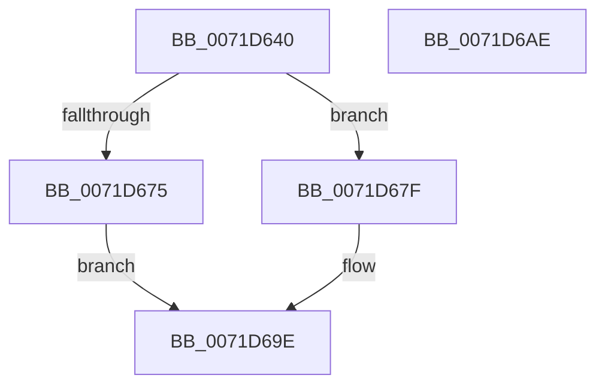

# IoRegisterDriverReinitialization

- RVA: `0x0071D640`–`0x0071D6AF` (길이 `111` bytes)
- VA: `0x000000014071D640`
- 실행 섹션: `PAGE`
- PDB 이름 있음: `예`; PDB Function 태그: `아니요`
- unwind 정보 RVA: `0x00060BC4`
- 디코드: `30`개 명령, `111/111` bytes 표시
- 미해석 바이트: `0` (있으면 어셈블리에 `.byte`로 보존)

> 이 문서는 커널 이미지의 기계어와 PDB 기호를 분석해 생성했습니다. 4번과 5번은 함수 원형과 자료형을 바이너리 사용 방식에서 추정한 C 해석이며 원본 소스 복구 결과는 아닙니다.

## 1. Dependencies

- 직접 호출 지점: **4**; 고유 호출 대상: **4**
- 직접 호출자로 확인된 함수: **1**
- RIP 상대 이미지 참조: **1**

### Outgoing calls
- `0x0071D658` → [ObfReferenceObject](../../text/20/ObfReferenceObject_function_0020FA20.md) (function, `0x0020FA20`)
- `0x0071D66B` → [ExAllocatePool2](../../poolcode/B8/ExAllocatePool2_function_00B820F0.md) (function, `0x00B820F0`)
- `0x0071D678` → [ObfDereferenceObject](../../text/2F/ObfDereferenceObject_function_002F9350.md) (function, `0x002F9350`)
- `0x0071D699` → [IopInterlockedInsertTailList](../../text/59/IopInterlockedInsertTailList_function_00597500.md) (function, `0x00597500`)

### Direct callers
- [DifIoRegisterDriverReinitializationWrapper](../../text/62/DifIoRegisterDriverReinitializationWrapper_function_0062C3A0.md) at `0x0062C484`

### Static image references
- `0x0071D683` → RVA `0x00F8D230` (`.data`; read)

## 2. Other-region calls and transfers

- 다른 실행 섹션으로 향하는 call: **4**
  - `0x0071D658` → [ObfReferenceObject](../../text/20/ObfReferenceObject_function_0020FA20.md) (`PAGE` → `.text`)
  - `0x0071D66B` → [ExAllocatePool2](../../poolcode/B8/ExAllocatePool2_function_00B820F0.md) (`PAGE` → `POOLCODE`)
  - `0x0071D678` → [ObfDereferenceObject](../../text/2F/ObfDereferenceObject_function_002F9350.md) (`PAGE` → `.text`)
  - `0x0071D699` → [IopInterlockedInsertTailList](../../text/59/IopInterlockedInsertTailList_function_00597500.md) (`PAGE` → `.text`)
- 별도 외부 분기/꼬리 이동을 확인하지 못했습니다.

## 3. Assembly (complete function range)

```asm
0071D640  48 89 5C 24 08                  mov qword ptr [rsp + 8], rbx
0071D645  48 89 74 24 10                  mov qword ptr [rsp + 0x10], rsi
0071D64A  57                              push rdi
0071D64B  48 83 EC 20                     sub rsp, 0x20
0071D64F  49 8B F8                        mov rdi, r8
0071D652  48 8B F2                        mov rsi, rdx
0071D655  48 8B D9                        mov rbx, rcx
0071D658  E8 C3 23 AF FF                  call 0x14020fa20
0071D65D  BA 28 00 00 00                  mov edx, 0x28
0071D662  41 B8 49 6F 52 69               mov r8d, 0x69526f49
0071D668  8D 4A 18                        lea ecx, [rdx + 0x18]
0071D66B  E8 80 4A 46 00                  call 0x140b820f0
0071D670  48 85 C0                        test rax, rax
0071D673  75 0A                           jne 0x14071d67f
0071D675  48 8B CB                        mov rcx, rbx
0071D678  E8 D3 BC BD FF                  call 0x1402f9350
0071D67D  EB 1F                           jmp 0x14071d69e
0071D67F  83 4B 10 08                     or dword ptr [rbx + 0x10], 8
0071D683  48 8D 0D A6 FB 86 00            lea rcx, [rip + 0x86fba6]
0071D68A  48 8B D0                        mov rdx, rax
0071D68D  48 89 58 10                     mov qword ptr [rax + 0x10], rbx
0071D691  48 89 70 18                     mov qword ptr [rax + 0x18], rsi
0071D695  48 89 78 20                     mov qword ptr [rax + 0x20], rdi
0071D699  E8 62 9E E7 FF                  call 0x140597500
0071D69E  48 8B 5C 24 30                  mov rbx, qword ptr [rsp + 0x30]
0071D6A3  48 8B 74 24 38                  mov rsi, qword ptr [rsp + 0x38]
0071D6A8  48 83 C4 20                     add rsp, 0x20
0071D6AC  5F                              pop rdi
0071D6AD  C3                              ret
0071D6AE  CC                              int3
```

## 4. C-style interpretation (structured pseudocode)

```c
__int64 __fastcall IoRegisterDriverReinitialization(__int64 a1, __int64 a2, __int64 a3)
{
    __int64 result;
    __int64 v_rsp;
    unsigned __int64 v_stack_p10;
    unsigned __int64 v_stack_p8;

    v_stack_p8 = v_rbx;
    v_stack_p10 = v_rsi;
    v_rsp = (v_rsp) - (32);
    result = ObfReferenceObject(a1, a2, a3, a4);
    result = ExAllocatePool2(40 + 24, 40, (unsigned int)(0x69526F49ULL), a4);
    if (result != 0) goto loc_0071D67F;
    result = ObfDereferenceObject(a1, 40, (unsigned int)(0x69526F49ULL), a4);
    goto loc_0071D69E;
loc_0071D67F:
    *(unsigned __int64 *)(result + 16) = a1;
    *(unsigned __int64 *)(result + 24) = a2;
    *(unsigned __int64 *)(result + 32) = a3;
    result = IopInterlockedInsertTailList(v_rip + 8846246, result, (unsigned int)(0x69526F49ULL), a4);
loc_0071D69E:
    v_rsp = (v_rsp) + (32);
    return result;
}
```

## 5. (Beta) C Style

```c
int64_t IoRegisterDriverReinitialization(void *Arg1, int64_t Arg2, int64_t Arg3)
{
    uint8_t *arg1 = (uint8_t *)Arg1;

    int64_t result;
    int64_t local_rsp;
    uint64_t v_stack_p10;
    uint64_t v_stack_p8;

    v_stack_p8 = local_rbx;
    v_stack_p10 = local_rsi;
    local_rsp = (local_rsp) - (32);
    result = ObfReferenceObject(Arg1, Arg2, Arg3, a4);
    result = ExAllocatePool2(40 + 24, 40, (uint32_t)(0x69526F49ULL), a4);
    if (result != 0) goto loc_0071D67F;
    result = ObfDereferenceObject(Arg1, 40, (uint32_t)(0x69526F49ULL), a4);
    goto loc_0071D69E;
loc_0071D67F:
    *(void **)(result + 0x10) = Arg1;
    *(uint64_t *)(result + 0x18) = Arg2;
    *(uint64_t *)(result + 0x20) = Arg3;
    result = IopInterlockedInsertTailList(v_rip + 8846246, result, (uint32_t)(0x69526F49ULL), a4);
loc_0071D69E:
    local_rsp = (local_rsp) + (32);
    return result;
}
```

### 관측된 메모리 오프셋

구조체 형식이 확인되지 않은 접근은 인자 기준의 오프셋으로만 기록했습니다.

| 기준 인자 | 오프셋 표현 | 폭 (bit) | 접근 |
|---|---:|---:|---|
| `Arg1` | `+ 0x10` | `32` | `R/W` |

## 6. Execution-region graph

[열기: 2D/3D 그래프와 함수 탐색 컨트롤 패널](../../../control-panel.html?section=page&rva=0x0071D640&view=graph)

- 2D 그래프는 위에서 아래로 흐르고, 3D 그래프는 빈 공간을 드래그해 회전합니다. Shift+드래그는 이동, 휠은 확대·축소, 함수 노드 선택은 대상 보고서 이동입니다.

### Static fallback


