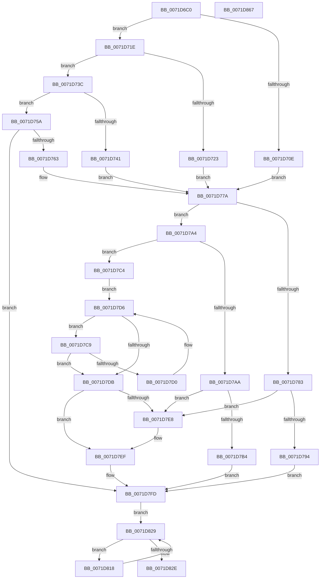

# IoRegisterFileSystem

- RVA: `0x0071D6C0`–`0x0071D868` (길이 `424` bytes)
- VA: `0x000000014071D6C0`
- 실행 섹션: `PAGE`
- PDB 이름 있음: `예`; PDB Function 태그: `아니요`
- unwind 정보 RVA: `0x00060BC4`
- 디코드: `111`개 명령, `424/424` bytes 표시
- 미해석 바이트: `0` (있으면 어셈블리에 `.byte`로 보존)

> 이 문서는 커널 이미지의 기계어와 PDB 기호를 분석해 생성했습니다. 4번과 5번은 함수 원형과 자료형을 바이너리 사용 방식에서 추정한 C 해석이며 원본 소스 복구 결과는 아닙니다.

## 1. Dependencies

- 직접 호출 지점: **9**; 고유 호출 대상: **7**
- 직접 호출자로 확인된 함수: **1**
- RIP 상대 이미지 참조: **7**

### Outgoing calls
- `0x0071D6DB` → [FsRtlSetDriverBacking](FsRtlSetDriverBacking_function_00716310.md) (function, `0x00716310`)
- `0x0071D6F3` → [IopSetFsRegistrationInProgress](../../text/59/IopSetFsRegistrationInProgress_function_00597FF0.md) (function, `0x00597FF0`)
- `0x0071D701` → [ExAcquireResourceExclusiveLite](../../text/21/ExAcquireResourceExclusiveLite_function_00214E20.md) (function, `0x00214E20`)
- `0x0071D824` → [guard_dispatch_icall](../../text/6B/guard_dispatch_icall_function_006BAAD0.md) (function, `0x006BAAD0`)
- `0x0071D830` → [IopSetFsRegistrationInProgress](../../text/59/IopSetFsRegistrationInProgress_function_00597FF0.md) (function, `0x00597FF0`)
- `0x0071D83C` → [ExReleaseResourceLite](../../text/25/ExReleaseResourceLite_function_0025FA10.md) (function, `0x0025FA10`)
- `0x0071D843` → [IopSetFsRegistrationInProgress](../../text/59/IopSetFsRegistrationInProgress_function_00597FF0.md) (function, `0x00597FF0`)
- `0x0071D848` → [KeLeaveCriticalRegion](../../text/25/KeLeaveCriticalRegion_function_0025D8B0.md) (function, `0x0025D8B0`)
- `0x0071D852` → [IopIncrementDeviceObjectRefCount](../../text/41/IopIncrementDeviceObjectRefCount_function_0041B1D0.md) (function, `0x0041B1D0`)

### Direct callers
- [RawInitialize](../../init/C4/RawInitialize_function_00C47090.md) at `0x00C47247`
- [RawInitialize](../../init/C4/RawInitialize_function_00C47090.md) at `0x00C47253`
- [RawInitialize](../../init/C4/RawInitialize_function_00C47090.md) at `0x00C4725F`

### Static image references
- `0x0071D6FA` → RVA `0x00F8D320` (`.data`; read)
- `0x0071D70E` → RVA `0x00F8D250` (`.data`; read)
- `0x0071D727` → RVA `0x00F8D270` (`.data`; read)
- `0x0071D745` → RVA `0x00F8D280` (`.data`; read)
- `0x0071D767` → RVA `0x00F8D260` (`.data`; read)
- `0x0071D7FD` → RVA `0x00F8D200` (`.data`; read/write)
- `0x0071D803` → RVA `0x00F8D450` (`.data`; read)

## 2. Other-region calls and transfers

- 다른 실행 섹션으로 향하는 call: **8**
  - `0x0071D6F3` → [IopSetFsRegistrationInProgress](../../text/59/IopSetFsRegistrationInProgress_function_00597FF0.md) (`PAGE` → `.text`)
  - `0x0071D701` → [ExAcquireResourceExclusiveLite](../../text/21/ExAcquireResourceExclusiveLite_function_00214E20.md) (`PAGE` → `.text`)
  - `0x0071D824` → [guard_dispatch_icall](../../text/6B/guard_dispatch_icall_function_006BAAD0.md) (`PAGE` → `.text`)
  - `0x0071D830` → [IopSetFsRegistrationInProgress](../../text/59/IopSetFsRegistrationInProgress_function_00597FF0.md) (`PAGE` → `.text`)
  - `0x0071D83C` → [ExReleaseResourceLite](../../text/25/ExReleaseResourceLite_function_0025FA10.md) (`PAGE` → `.text`)
  - `0x0071D843` → [IopSetFsRegistrationInProgress](../../text/59/IopSetFsRegistrationInProgress_function_00597FF0.md) (`PAGE` → `.text`)
  - `0x0071D848` → [KeLeaveCriticalRegion](../../text/25/KeLeaveCriticalRegion_function_0025D8B0.md) (`PAGE` → `.text`)
  - `0x0071D852` → [IopIncrementDeviceObjectRefCount](../../text/41/IopIncrementDeviceObjectRefCount_function_0041B1D0.md) (`PAGE` → `.text`)
- 별도 외부 분기/꼬리 이동을 확인하지 못했습니다.

## 3. Assembly (complete function range)

```asm
0071D6C0  48 89 5C 24 08                  mov qword ptr [rsp + 8], rbx
0071D6C5  48 89 74 24 10                  mov qword ptr [rsp + 0x10], rsi
0071D6CA  57                              push rdi
0071D6CB  48 83 EC 20                     sub rsp, 0x20
0071D6CF  48 8B D9                        mov rbx, rcx
0071D6D2  BA 01 00 00 00                  mov edx, 1
0071D6D7  48 8B 49 08                     mov rcx, qword ptr [rcx + 8]
0071D6DB  E8 30 8C FF FF                  call 0x140716310
0071D6E0  65 48 8B 04 25 88 01 00 00      mov rax, qword ptr gs:[0x188]
0071D6E9  B1 01                           mov cl, 1
0071D6EB  66 FF 88 E4 01 00 00            dec word ptr [rax + 0x1e4]
0071D6F2  90                              nop
0071D6F3  E8 F8 A8 E7 FF                  call 0x140597ff0
0071D6F8  B2 01                           mov dl, 1
0071D6FA  48 8D 0D 1F FC 86 00            lea rcx, [rip + 0x86fc1f]
0071D701  E8 1A 77 AF FF                  call 0x140214e20
0071D706  8B 43 48                        mov eax, dword ptr [rbx + 0x48]
0071D709  83 F8 14                        cmp eax, 0x14
0071D70C  75 10                           jne 0x14071d71e
0071D70E  48 8B 0D 3B FB 86 00            mov rcx, qword ptr [rip + 0x86fb3b]
0071D715  48 8D 15 34 FB 86 00            lea rdx, [rip + 0x86fb34]
0071D71C  EB 5C                           jmp 0x14071d77a
0071D71E  83 F8 03                        cmp eax, 3
0071D721  75 19                           jne 0x14071d73c
0071D723  48 8B 43 08                     mov rax, qword ptr [rbx + 8]
0071D727  48 8D 15 42 FB 86 00            lea rdx, [rip + 0x86fb42]
0071D72E  0F BA 68 10 07                  bts dword ptr [rax + 0x10], 7
0071D733  48 8B 0D 36 FB 86 00            mov rcx, qword ptr [rip + 0x86fb36]
0071D73A  EB 3E                           jmp 0x14071d77a
0071D73C  83 F8 08                        cmp eax, 8
0071D73F  75 19                           jne 0x14071d75a
0071D741  48 8B 43 08                     mov rax, qword ptr [rbx + 8]
0071D745  48 8D 15 34 FB 86 00            lea rdx, [rip + 0x86fb34]
0071D74C  0F BA 68 10 07                  bts dword ptr [rax + 0x10], 7
0071D751  48 8B 0D 28 FB 86 00            mov rcx, qword ptr [rip + 0x86fb28]
0071D758  EB 20                           jmp 0x14071d77a
0071D75A  83 F8 20                        cmp eax, 0x20
0071D75D  0F 85 9A 00 00 00               jne 0x14071d7fd
0071D763  48 8B 43 08                     mov rax, qword ptr [rbx + 8]
0071D767  48 8D 15 F2 FA 86 00            lea rdx, [rip + 0x86faf2]
0071D76E  0F BA 68 10 07                  bts dword ptr [rax + 0x10], 7
0071D773  48 8B 0D E6 FA 86 00            mov rcx, qword ptr [rip + 0x86fae6]
0071D77A  8B 43 30                        mov eax, dword ptr [rbx + 0x30]
0071D77D  0F BA E0 10                     bt eax, 0x10
0071D781  73 21                           jae 0x14071d7a4
0071D783  48 8B 4A 08                     mov rcx, qword ptr [rdx + 8]
0071D787  48 8D 43 50                     lea rax, [rbx + 0x50]
0071D78B  48 8B 51 08                     mov rdx, qword ptr [rcx + 8]
0071D78F  48 39 0A                        cmp qword ptr [rdx], rcx
0071D792  75 54                           jne 0x14071d7e8
0071D794  48 89 08                        mov qword ptr [rax], rcx
0071D797  48 89 50 08                     mov qword ptr [rax + 8], rdx
0071D79B  48 89 02                        mov qword ptr [rdx], rax
0071D79E  48 89 41 08                     mov qword ptr [rcx + 8], rax
0071D7A2  EB 59                           jmp 0x14071d7fd
0071D7A4  0F BA E0 09                     bt eax, 9
0071D7A8  73 1A                           jae 0x14071d7c4
0071D7AA  48 8D 43 50                     lea rax, [rbx + 0x50]
0071D7AE  48 39 51 08                     cmp qword ptr [rcx + 8], rdx
0071D7B2  75 34                           jne 0x14071d7e8
0071D7B4  48 89 08                        mov qword ptr [rax], rcx
0071D7B7  48 89 50 08                     mov qword ptr [rax + 8], rdx
0071D7BB  48 89 41 08                     mov qword ptr [rcx + 8], rax
0071D7BF  48 89 02                        mov qword ptr [rdx], rax
0071D7C2  EB 39                           jmp 0x14071d7fd
0071D7C4  4C 8B C2                        mov r8, rdx
0071D7C7  EB 0D                           jmp 0x14071d7d6
0071D7C9  0F BA 61 E0 09                  bt dword ptr [rcx - 0x20], 9
0071D7CE  73 0B                           jae 0x14071d7db
0071D7D0  4C 8B C1                        mov r8, rcx
0071D7D3  48 8B 09                        mov rcx, qword ptr [rcx]
0071D7D6  48 3B CA                        cmp rcx, rdx
0071D7D9  75 EE                           jne 0x14071d7c9
0071D7DB  49 8B 10                        mov rdx, qword ptr [r8]
0071D7DE  48 8D 43 50                     lea rax, [rbx + 0x50]
0071D7E2  4C 39 42 08                     cmp qword ptr [rdx + 8], r8
0071D7E6  74 07                           je 0x14071d7ef
0071D7E8  B9 03 00 00 00                  mov ecx, 3
0071D7ED  CD 29                           int 0x29
0071D7EF  48 89 10                        mov qword ptr [rax], rdx
0071D7F2  4C 89 40 08                     mov qword ptr [rax + 8], r8
0071D7F6  48 89 42 08                     mov qword ptr [rdx + 8], rax
0071D7FA  49 89 00                        mov qword ptr [r8], rax
0071D7FD  FF 05 FD F9 86 00               inc dword ptr [rip + 0x86f9fd]
0071D803  48 8D 35 46 FC 86 00            lea rsi, [rip + 0x86fc46]
0071D80A  0F BA 73 30 07                  btr dword ptr [rbx + 0x30], 7
0071D80F  48 8B 3D 3A FC 86 00            mov rdi, qword ptr [rip + 0x86fc3a]
0071D816  EB 11                           jmp 0x14071d829
0071D818  48 8B 47 18                     mov rax, qword ptr [rdi + 0x18]
0071D81C  B2 01                           mov dl, 1
0071D81E  48 8B 3F                        mov rdi, qword ptr [rdi]
0071D821  48 8B CB                        mov rcx, rbx
0071D824  E8 A7 D2 F9 FF                  call 0x1406baad0
0071D829  48 3B FE                        cmp rdi, rsi
0071D82C  75 EA                           jne 0x14071d818
0071D82E  33 C9                           xor ecx, ecx
0071D830  E8 BB A7 E7 FF                  call 0x140597ff0
0071D835  48 8D 0D E4 FA 86 00            lea rcx, [rip + 0x86fae4]
0071D83C  E8 CF 21 B4 FF                  call 0x14025fa10
0071D841  33 C9                           xor ecx, ecx
0071D843  E8 A8 A7 E7 FF                  call 0x140597ff0
0071D848  E8 63 00 B4 FF                  call 0x14025d8b0
0071D84D  B2 01                           mov dl, 1
0071D84F  48 8B CB                        mov rcx, rbx
0071D852  E8 79 D9 CF FF                  call 0x14041b1d0
0071D857  48 8B 5C 24 30                  mov rbx, qword ptr [rsp + 0x30]
0071D85C  48 8B 74 24 38                  mov rsi, qword ptr [rsp + 0x38]
0071D861  48 83 C4 20                     add rsp, 0x20
0071D865  5F                              pop rdi
0071D866  C3                              ret
0071D867  CC                              int3
```

## 4. C-style interpretation (structured pseudocode)

```c
__int64 __fastcall IoRegisterFileSystem(__int64 a1)
{
    __int64 result;
    __int64 v_rsp;
    unsigned __int64 v_stack_p10;
    unsigned __int64 v_stack_p8;

    v_stack_p8 = v_rbx;
    v_stack_p10 = v_rsi;
    v_rsp = (v_rsp) - (32);
    result = FsRtlSetDriverBacking(*(unsigned __int64 *)(a1 + 8), 1, a3, a4);
    result = IopSetFsRegistrationInProgress(1, 1, a3, a4);
    result = ExAcquireResourceExclusiveLite(v_rip + 8846367, 1, a3, a4);
    if (((unsigned int)((unsigned int)(*(unsigned int *)(a1 + 72)))) != 20) goto loc_0071D71E;
    goto loc_0071D77A;
loc_0071D71E:
    if (((unsigned int)((unsigned int)(*(unsigned int *)(a1 + 72)))) != 3) goto loc_0071D73C;
    goto loc_0071D77A;
loc_0071D73C:
    if (((unsigned int)(*(unsigned __int64 *)(a1 + 8))) != 8) goto loc_0071D75A;
    goto loc_0071D77A;
loc_0071D75A:
    if (((unsigned int)(*(unsigned __int64 *)(a1 + 8))) != 32) goto loc_0071D7FD;
loc_0071D77A:
    if (((unsigned int)(*(unsigned __int64 *)(a1 + 8))) >= 32) goto loc_0071D7A4;
    if ((*(unsigned __int64 *)(*(unsigned __int64 *)(*(unsigned __int64 *)(v_rip + 8846066 + 8) + 8))) != (*(unsigned __int64 *)(v_rip + 8846066 + 8))) goto loc_0071D7E8;
    *(unsigned __int64 *)(a1 + 80) = *(unsigned __int64 *)(v_rip + 8846066 + 8);
    *(unsigned __int64 *)(a1 + 80 + 8) = *(unsigned __int64 *)(*(unsigned __int64 *)(v_rip + 8846066 + 8) + 8);
    *(unsigned __int64 *)(*(unsigned __int64 *)(*(unsigned __int64 *)(v_rip + 8846066 + 8) + 8)) = a1 + 80;
    *(unsigned __int64 *)(*(unsigned __int64 *)(v_rip + 8846066 + 8) + 8) = a1 + 80;
    goto loc_0071D7FD;
loc_0071D7A4:
    if ((*(unsigned __int64 *)(*(unsigned __int64 *)(*(unsigned __int64 *)(v_rip + 8846066 + 8) + 8))) >= (*(unsigned __int64 *)(v_rip + 8846066 + 8))) goto loc_0071D7C4;
    if ((*(unsigned __int64 *)(*(unsigned __int64 *)(v_rip + 8846066 + 8) + 8)) != (*(unsigned __int64 *)(*(unsigned __int64 *)(v_rip + 8846066 + 8) + 8))) goto loc_0071D7E8;
    *(unsigned __int64 *)(a1 + 80) = *(unsigned __int64 *)(v_rip + 8846066 + 8);
    *(unsigned __int64 *)(a1 + 80 + 8) = *(unsigned __int64 *)(*(unsigned __int64 *)(v_rip + 8846066 + 8) + 8);
    *(unsigned __int64 *)(*(unsigned __int64 *)(v_rip + 8846066 + 8) + 8) = a1 + 80;
    *(unsigned __int64 *)(*(unsigned __int64 *)(*(unsigned __int64 *)(v_rip + 8846066 + 8) + 8)) = a1 + 80;
    goto loc_0071D7FD;
loc_0071D7C4:
    goto loc_0071D7D6;
loc_0071D7C9:
    if ((*(unsigned __int64 *)(*(unsigned __int64 *)(v_rip + 8846066 + 8) + 8)) >= (*(unsigned __int64 *)(*(unsigned __int64 *)(v_rip + 8846066 + 8) + 8))) goto loc_0071D7DB;
loc_0071D7D6:
    if ((*(unsigned __int64 *)(*(unsigned __int64 *)(v_rip + 8846066 + 8))) != (*(unsigned __int64 *)(*(unsigned __int64 *)(v_rip + 8846066 + 8) + 8))) goto loc_0071D7C9;
loc_0071D7DB:
    if ((*(unsigned __int64 *)(*(unsigned __int64 *)(*(unsigned __int64 *)(v_rip + 8846066 + 8)) + 8)) != (*(unsigned __int64 *)(v_rip + 8846066 + 8))) {
        a1 = 3;
    }
    *(unsigned __int64 *)(a1 + 80) = *(unsigned __int64 *)(*(unsigned __int64 *)(v_rip + 8846066 + 8));
    *(unsigned __int64 *)(a1 + 80 + 8) = *(unsigned __int64 *)(v_rip + 8846066 + 8);
    *(unsigned __int64 *)(*(unsigned __int64 *)(*(unsigned __int64 *)(v_rip + 8846066 + 8)) + 8) = a1 + 80;
    *(unsigned __int64 *)(*(unsigned __int64 *)(v_rip + 8846066 + 8)) = a1 + 80;
loc_0071D7FD:
    goto loc_0071D829;
loc_0071D818:
    result = guard_dispatch_icall(a1, 1, *(unsigned __int64 *)(v_rip + 8846066 + 8), a4);
loc_0071D829:
    if ((*(unsigned __int64 *)(*(unsigned __int64 *)(v_rip + 8846394))) != (v_rip + 8846406)) goto loc_0071D818;
    a1 = 0;
    result = IopSetFsRegistrationInProgress(a1, 1, *(unsigned __int64 *)(v_rip + 8846066 + 8), a4);
    result = ExReleaseResourceLite(v_rip + 8846052, 1, *(unsigned __int64 *)(v_rip + 8846066 + 8), a4);
    a1 = 0;
    result = IopSetFsRegistrationInProgress(a1, 1, *(unsigned __int64 *)(v_rip + 8846066 + 8), a4);
    result = KeLeaveCriticalRegion(a1, 1, *(unsigned __int64 *)(v_rip + 8846066 + 8), a4);
    result = IopIncrementDeviceObjectRefCount(0, 1, *(unsigned __int64 *)(v_rip + 8846066 + 8), a4);
    v_rsp = (v_rsp) + (32);
    return result;
}
```

## 5. (Beta) C Style

```c
int64_t IoRegisterFileSystem(void *Arg1)
{
    uint8_t *arg1 = (uint8_t *)Arg1;

    int64_t result;
    int64_t local_rsp;
    uint64_t v_stack_p10;
    uint64_t v_stack_p8;

    v_stack_p8 = local_rbx;
    v_stack_p10 = local_rsi;
    local_rsp = (local_rsp) - (32);
    result = FsRtlSetDriverBacking(*(uint64_t *)(arg1 + 0x8), 1, a3, a4);
    result = IopSetFsRegistrationInProgress(1, 1, a3, a4);
    result = ExAcquireResourceExclusiveLite(v_rip + 8846367, 1, a3, a4);
    if (((uint32_t)((uint32_t)(*(uint32_t *)(arg1 + 0x48)))) != 20) goto loc_0071D71E;
    goto loc_0071D77A;
loc_0071D71E:
    if (((uint32_t)((uint32_t)(*(uint32_t *)(arg1 + 0x48)))) != 3) goto loc_0071D73C;
    goto loc_0071D77A;
loc_0071D73C:
    if (((uint32_t)(*(uint64_t *)(arg1 + 0x8))) != 8) goto loc_0071D75A;
    goto loc_0071D77A;
loc_0071D75A:
    if (((uint32_t)(*(uint64_t *)(arg1 + 0x8))) != 32) goto loc_0071D7FD;
loc_0071D77A:
    if (((uint32_t)(*(uint64_t *)(arg1 + 0x8))) >= 32) goto loc_0071D7A4;
    if ((*(uint64_t *)(*(uint64_t *)(*(uint64_t *)(v_rip + 0x86FAF2 + 0x8) + 0x8))) != (*(uint64_t *)(v_rip + 0x86FAF2 + 0x8))) goto loc_0071D7E8;
    *(uint64_t *)(arg1 + 0x50) = *(uint64_t *)(v_rip + 0x86FAF2 + 0x8);
    *(uint64_t *)(arg1 + 0x50 + 0x8) = *(uint64_t *)(*(uint64_t *)(v_rip + 0x86FAF2 + 0x8) + 0x8);
    *(void **)(*(uint64_t *)(*(uint64_t *)(v_rip + 0x86FAF2 + 0x8) + 0x8)) = Arg1 + 80;
    *(void **)(*(uint64_t *)(v_rip + 0x86FAF2 + 0x8) + 0x8) = Arg1 + 80;
    goto loc_0071D7FD;
loc_0071D7A4:
    if ((*(uint64_t *)(*(uint64_t *)(*(uint64_t *)(v_rip + 0x86FAF2 + 0x8) + 0x8))) >= (*(uint64_t *)(v_rip + 0x86FAF2 + 0x8))) goto loc_0071D7C4;
    if ((*(uint64_t *)(*(uint64_t *)(v_rip + 0x86FAF2 + 0x8) + 0x8)) != (*(uint64_t *)(*(uint64_t *)(v_rip + 0x86FAF2 + 0x8) + 0x8))) goto loc_0071D7E8;
    *(uint64_t *)(arg1 + 0x50) = *(uint64_t *)(v_rip + 0x86FAF2 + 0x8);
    *(uint64_t *)(arg1 + 0x50 + 0x8) = *(uint64_t *)(*(uint64_t *)(v_rip + 0x86FAF2 + 0x8) + 0x8);
    *(void **)(*(uint64_t *)(v_rip + 0x86FAF2 + 0x8) + 0x8) = Arg1 + 80;
    *(void **)(*(uint64_t *)(*(uint64_t *)(v_rip + 0x86FAF2 + 0x8) + 0x8)) = Arg1 + 80;
    goto loc_0071D7FD;
loc_0071D7C4:
    goto loc_0071D7D6;
loc_0071D7C9:
    if ((*(uint64_t *)(*(uint64_t *)(v_rip + 0x86FAF2 + 0x8) + 0x8)) >= (*(uint64_t *)(*(uint64_t *)(v_rip + 0x86FAF2 + 0x8) + 0x8))) goto loc_0071D7DB;
loc_0071D7D6:
    if ((*(uint64_t *)(*(uint64_t *)(v_rip + 0x86FAF2 + 0x8))) != (*(uint64_t *)(*(uint64_t *)(v_rip + 0x86FAF2 + 0x8) + 0x8))) goto loc_0071D7C9;
loc_0071D7DB:
    if ((*(uint64_t *)(*(uint64_t *)(*(uint64_t *)(v_rip + 0x86FAF2 + 0x8)) + 0x8)) != (*(uint64_t *)(v_rip + 0x86FAF2 + 0x8))) {
        Arg1 = 3;
    }
    *(uint64_t *)(arg1 + 0x50) = *(uint64_t *)(*(uint64_t *)(v_rip + 0x86FAF2 + 0x8));
    *(uint64_t *)(arg1 + 0x50 + 0x8) = *(uint64_t *)(v_rip + 0x86FAF2 + 0x8);
    *(void **)(*(uint64_t *)(*(uint64_t *)(v_rip + 0x86FAF2 + 0x8)) + 0x8) = Arg1 + 80;
    *(void **)(*(uint64_t *)(v_rip + 0x86FAF2 + 0x8)) = Arg1 + 80;
loc_0071D7FD:
    goto loc_0071D829;
loc_0071D818:
    result = guard_dispatch_icall(Arg1, 1, *(uint64_t *)(v_rip + 0x86FAF2 + 0x8), a4);
loc_0071D829:
    if ((*(uint64_t *)(*(uint64_t *)(v_rip + 0x86FC3A))) != (v_rip + 8846406)) goto loc_0071D818;
    Arg1 = 0;
    result = IopSetFsRegistrationInProgress(Arg1, 1, *(uint64_t *)(v_rip + 0x86FAF2 + 0x8), a4);
    result = ExReleaseResourceLite(v_rip + 8846052, 1, *(uint64_t *)(v_rip + 0x86FAF2 + 0x8), a4);
    Arg1 = 0;
    result = IopSetFsRegistrationInProgress(Arg1, 1, *(uint64_t *)(v_rip + 0x86FAF2 + 0x8), a4);
    result = KeLeaveCriticalRegion(Arg1, 1, *(uint64_t *)(v_rip + 0x86FAF2 + 0x8), a4);
    result = IopIncrementDeviceObjectRefCount(0, 1, *(uint64_t *)(v_rip + 0x86FAF2 + 0x8), a4);
    local_rsp = (local_rsp) + (32);
    return result;
}
```

### 관측된 메모리 오프셋

구조체 형식이 확인되지 않은 접근은 인자 기준의 오프셋으로만 기록했습니다.

| 기준 인자 | 오프셋 표현 | 폭 (bit) | 접근 |
|---|---:|---:|---|
| `Arg1` | `+ 0x0` | `64` | `W` |
| `Arg1` | `+ 0x8` | `64` | `R` |
| `Arg1` | `+ 0x8` | `64` | `W` |
| `Arg1` | `+ 0x30` | `32` | `R` |
| `Arg1` | `+ 0x30` | `32` | `R/W` |
| `Arg1` | `+ 0x48` | `32` | `R` |
| `Arg1` | `+ 0x50` | `64` | `R` |

## 6. Execution-region graph

[열기: 2D/3D 그래프와 함수 탐색 컨트롤 패널](../../../control-panel.html?section=page&rva=0x0071D6C0&view=graph)

- 2D 그래프는 위에서 아래로 흐르고, 3D 그래프는 빈 공간을 드래그해 회전합니다. Shift+드래그는 이동, 휠은 확대·축소, 함수 노드 선택은 대상 보고서 이동입니다.

### Static fallback


