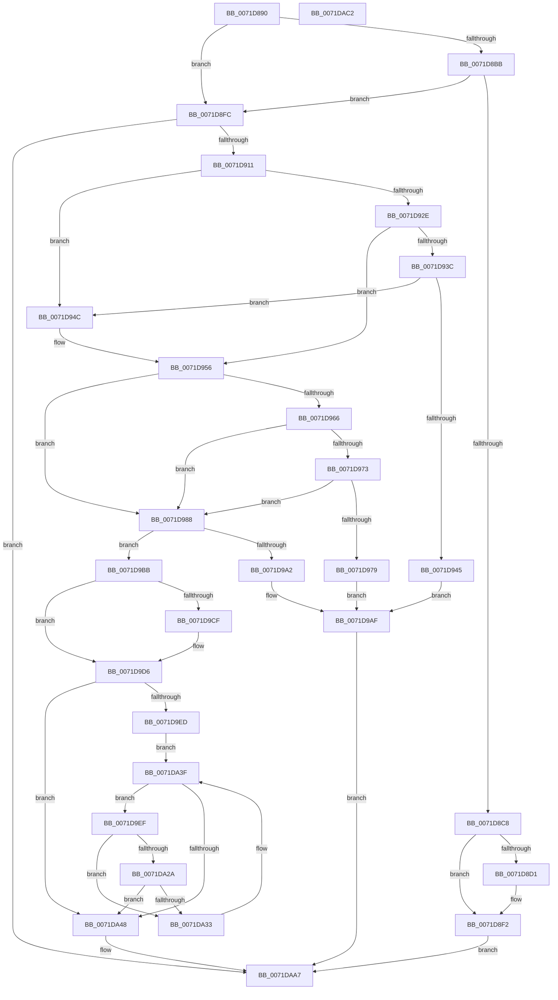

# IoRegisterFsRegistrationChangeMountAware

- RVA: `0x0071D890`–`0x0071DAC3` (길이 `563` bytes)
- VA: `0x000000014071D890`
- 실행 섹션: `PAGE`
- PDB 이름 있음: `예`; PDB Function 태그: `아니요`
- unwind 정보 RVA: `0x000C5A00`
- 디코드: `140`개 명령, `563/563` bytes 표시
- 미해석 바이트: `0` (있으면 어셈블리에 `.byte`로 보존)

> 이 문서는 커널 이미지의 기계어와 PDB 기호를 분석해 생성했습니다. 4번과 5번은 함수 원형과 자료형을 바이너리 사용 방식에서 추정한 C 해석이며 원본 소스 복구 결과는 아닙니다.

## 1. Dependencies

- 직접 호출 지점: **22**; 고유 호출 대상: **13**
- 직접 호출자로 확인된 함수: **1**
- RIP 상대 이미지 참조: **13**

### Outgoing calls
- `0x0071D8BF` → [IopIsKnownGoodLegacyFsFilter](../../text/41/IopIsKnownGoodLegacyFsFilter_function_004108A0.md) (function, `0x004108A0`)
- `0x0071D8D8` → [IoGetActivityIdThread](../../text/44/IoGetActivityIdThread_function_00445030.md) (function, `0x00445030`)
- `0x0071D8ED` → [McTemplateK0hzr0_EtwWriteTransfer](../../text/59/McTemplateK0hzr0_EtwWriteTransfer_function_00598024.md) (function, `0x00598024`)
- `0x0071D904` → [FsRtlSetDriverBacking](FsRtlSetDriverBacking_function_00716310.md) (function, `0x00716310`)
- `0x0071D933` → [ExAcquireResourceExclusiveLite](../../text/21/ExAcquireResourceExclusiveLite_function_00214E20.md) (function, `0x00214E20`)
- `0x0071D93C` → [IopGetFsRegistrationInProgress](../../text/59/IopGetFsRegistrationInProgress_function_00597F58.md) (function, `0x00597F58`)
- `0x0071D951` → [ExAcquireResourceExclusiveLite](../../text/21/ExAcquireResourceExclusiveLite_function_00214E20.md) (function, `0x00214E20`)
- `0x0071D97C` → [ExReleaseResourceLite](../../text/25/ExReleaseResourceLite_function_0025FA10.md) (function, `0x0025FA10`)
- `0x0071D998` → [ExAllocatePool2](../../poolcode/B8/ExAllocatePool2_function_00B820F0.md) (function, `0x00B820F0`)
- `0x0071D9A5` → [ExReleaseResourceLite](../../text/25/ExReleaseResourceLite_function_0025FA10.md) (function, `0x0025FA10`)
- `0x0071D9AF` → [KeLeaveCriticalRegion](../../text/25/KeLeaveCriticalRegion_function_0025D8B0.md) (function, `0x0025D8B0`)
- `0x0071D9F8` → [ExReleaseResourceLite](../../text/25/ExReleaseResourceLite_function_0025FA10.md) (function, `0x0025FA10`)
- `0x0071DA12` → [KeWaitForSingleObject](../../text/20/KeWaitForSingleObject_function_0020E6B0.md) (function, `0x0020E6B0`)
- `0x0071DA1C` → [ExAcquireResourceExclusiveLite](../../text/21/ExAcquireResourceExclusiveLite_function_00214E20.md) (function, `0x00214E20`)
- `0x0071DA3A` → [KeResetEvent](../../text/24/KeResetEvent_function_00248350.md) (function, `0x00248350`)
- `0x0071DA55` → [IopNotifyAlreadyRegisteredFileSystems](IopNotifyAlreadyRegisteredFileSystems_function_0071E3B0.md) (function, `0x0071E3B0`)
- `0x0071DA67` → [IopNotifyAlreadyRegisteredFileSystems](IopNotifyAlreadyRegisteredFileSystems_function_0071E3B0.md) (function, `0x0071E3B0`)
- `0x0071DA79` → [IopNotifyAlreadyRegisteredFileSystems](IopNotifyAlreadyRegisteredFileSystems_function_0071E3B0.md) (function, `0x0071E3B0`)
- `0x0071DA8B` → [IopNotifyAlreadyRegisteredFileSystems](IopNotifyAlreadyRegisteredFileSystems_function_0071E3B0.md) (function, `0x0071E3B0`)
- `0x0071DA93` → [ExReleaseResourceLite](../../text/25/ExReleaseResourceLite_function_0025FA10.md) (function, `0x0025FA10`)
- `0x0071DA98` → [KeLeaveCriticalRegion](../../text/25/KeLeaveCriticalRegion_function_0025D8B0.md) (function, `0x0025D8B0`)
- `0x0071DAA0` → [ObfReferenceObject](../../text/20/ObfReferenceObject_function_0020FA20.md) (function, `0x0020FA20`)

### Direct callers
- [IoRegisterFsRegistrationChange](IoRegisterFsRegistrationChange_function_0071D870.md) at `0x0071D877`

### Static image references
- `0x0071D8A9` → RVA `0x00E6612C` (`.data`; read)
- `0x0071D8C8` → RVA `0x00F8D8D4` (`.data`; read)
- `0x0071D91A` → RVA `0x00F8D320` (`.data`; read)
- `0x0071D956` → RVA `0x00F8D450` (`.data`; read)
- `0x0071D966` → RVA `0x00F8D458` (`.data`; read)
- `0x0071D9E0` → RVA `0x00F8D458` (`.data`; write)
- `0x0071D9EF` → RVA `0x00E6611C` (`.data`; read/write)
- `0x0071DA03` → RVA `0x00F8D6E0` (`.data`; read)
- `0x0071DA2A` → RVA `0x00E66118` (`.data`; read)
- `0x0071DA4B` → RVA `0x00F8D250` (`.data`; read)
- `0x0071DA5D` → RVA `0x00F8D270` (`.data`; read)
- `0x0071DA6F` → RVA `0x00F8D280` (`.data`; read)
- `0x0071DA81` → RVA `0x00F8D260` (`.data`; read)

## 2. Other-region calls and transfers

- 다른 실행 섹션으로 향하는 call: **17**
  - `0x0071D8BF` → [IopIsKnownGoodLegacyFsFilter](../../text/41/IopIsKnownGoodLegacyFsFilter_function_004108A0.md) (`PAGE` → `.text`)
  - `0x0071D8D8` → [IoGetActivityIdThread](../../text/44/IoGetActivityIdThread_function_00445030.md) (`PAGE` → `.text`)
  - `0x0071D8ED` → [McTemplateK0hzr0_EtwWriteTransfer](../../text/59/McTemplateK0hzr0_EtwWriteTransfer_function_00598024.md) (`PAGE` → `.text`)
  - `0x0071D933` → [ExAcquireResourceExclusiveLite](../../text/21/ExAcquireResourceExclusiveLite_function_00214E20.md) (`PAGE` → `.text`)
  - `0x0071D93C` → [IopGetFsRegistrationInProgress](../../text/59/IopGetFsRegistrationInProgress_function_00597F58.md) (`PAGE` → `.text`)
  - `0x0071D951` → [ExAcquireResourceExclusiveLite](../../text/21/ExAcquireResourceExclusiveLite_function_00214E20.md) (`PAGE` → `.text`)
  - `0x0071D97C` → [ExReleaseResourceLite](../../text/25/ExReleaseResourceLite_function_0025FA10.md) (`PAGE` → `.text`)
  - `0x0071D998` → [ExAllocatePool2](../../poolcode/B8/ExAllocatePool2_function_00B820F0.md) (`PAGE` → `POOLCODE`)
  - `0x0071D9A5` → [ExReleaseResourceLite](../../text/25/ExReleaseResourceLite_function_0025FA10.md) (`PAGE` → `.text`)
  - `0x0071D9AF` → [KeLeaveCriticalRegion](../../text/25/KeLeaveCriticalRegion_function_0025D8B0.md) (`PAGE` → `.text`)
  - `0x0071D9F8` → [ExReleaseResourceLite](../../text/25/ExReleaseResourceLite_function_0025FA10.md) (`PAGE` → `.text`)
  - `0x0071DA12` → [KeWaitForSingleObject](../../text/20/KeWaitForSingleObject_function_0020E6B0.md) (`PAGE` → `.text`)
  - `0x0071DA1C` → [ExAcquireResourceExclusiveLite](../../text/21/ExAcquireResourceExclusiveLite_function_00214E20.md) (`PAGE` → `.text`)
  - `0x0071DA3A` → [KeResetEvent](../../text/24/KeResetEvent_function_00248350.md) (`PAGE` → `.text`)
  - `0x0071DA93` → [ExReleaseResourceLite](../../text/25/ExReleaseResourceLite_function_0025FA10.md) (`PAGE` → `.text`)
  - `0x0071DA98` → [KeLeaveCriticalRegion](../../text/25/KeLeaveCriticalRegion_function_0025D8B0.md) (`PAGE` → `.text`)
  - `0x0071DAA0` → [ObfReferenceObject](../../text/20/ObfReferenceObject_function_0020FA20.md) (`PAGE` → `.text`)
- 별도 외부 분기/꼬리 이동을 확인하지 못했습니다.

## 3. Assembly (complete function range)

```asm
0071D890  48 8B C4                        mov rax, rsp
0071D893  48 89 58 08                     mov qword ptr [rax + 8], rbx
0071D897  48 89 68 10                     mov qword ptr [rax + 0x10], rbp
0071D89B  48 89 70 18                     mov qword ptr [rax + 0x18], rsi
0071D89F  48 89 78 20                     mov qword ptr [rax + 0x20], rdi
0071D8A3  41 57                           push r15
0071D8A5  48 83 EC 30                     sub rsp, 0x30
0071D8A9  83 3D 7C 88 74 00 00            cmp dword ptr [rip + 0x74887c], 0
0071D8B0  41 8A E8                        mov bpl, r8b
0071D8B3  48 8B F2                        mov rsi, rdx
0071D8B6  48 8B F9                        mov rdi, rcx
0071D8B9  74 41                           je 0x14071d8fc
0071D8BB  48 83 C1 38                     add rcx, 0x38
0071D8BF  E8 DC 2F CF FF                  call 0x1404108a0
0071D8C4  84 C0                           test al, al
0071D8C6  75 34                           jne 0x14071d8fc
0071D8C8  F6 05 05 00 87 00 04            test byte ptr [rip + 0x870005], 4
0071D8CF  74 21                           je 0x14071d8f2
0071D8D1  0F B7 5F 38                     movzx ebx, word ptr [rdi + 0x38]
0071D8D5  66 D1 EB                        shr bx, 1
0071D8D8  E8 53 77 D2 FF                  call 0x140445030
0071D8DD  4C 8B C0                        mov r8, rax
0071D8E0  44 0F B7 CB                     movzx r9d, bx
0071D8E4  48 8B 47 40                     mov rax, qword ptr [rdi + 0x40]
0071D8E8  48 89 44 24 20                  mov qword ptr [rsp + 0x20], rax
0071D8ED  E8 32 A7 E7 FF                  call 0x140598024
0071D8F2  B8 BB 00 00 C0                  mov eax, 0xc00000bb
0071D8F7  E9 AB 01 00 00                  jmp 0x14071daa7
0071D8FC  BA 01 00 00 00                  mov edx, 1
0071D901  48 8B CF                        mov rcx, rdi
0071D904  E8 07 8A FF FF                  call 0x140716310
0071D909  85 C0                           test eax, eax
0071D90B  0F 88 96 01 00 00               js 0x14071daa7
0071D911  65 48 8B 04 25 88 01 00 00      mov rax, qword ptr gs:[0x188]
0071D91A  48 8D 1D FF F9 86 00            lea rbx, [rip + 0x86f9ff]
0071D921  66 FF 88 E4 01 00 00            dec word ptr [rax + 0x1e4]
0071D928  90                              nop
0071D929  40 84 ED                        test bpl, bpl
0071D92C  74 1E                           je 0x14071d94c
0071D92E  33 D2                           xor edx, edx
0071D930  48 8B CB                        mov rcx, rbx
0071D933  E8 E8 74 AF FF                  call 0x140214e20
0071D938  84 C0                           test al, al
0071D93A  75 1A                           jne 0x14071d956
0071D93C  E8 17 A6 E7 FF                  call 0x140597f58
0071D941  84 C0                           test al, al
0071D943  74 07                           je 0x14071d94c
0071D945  BB 2D 02 00 C0                  mov ebx, 0xc000022d
0071D94A  EB 63                           jmp 0x14071d9af
0071D94C  B2 01                           mov dl, 1
0071D94E  48 8B CB                        mov rcx, rbx
0071D951  E8 CA 74 AF FF                  call 0x140214e20
0071D956  4C 8D 3D F3 FA 86 00            lea r15, [rip + 0x86faf3]
0071D95D  4C 39 3D EC FA 86 00            cmp qword ptr [rip + 0x86faec], r15
0071D964  74 22                           je 0x14071d988
0071D966  48 8B 05 EB FA 86 00            mov rax, qword ptr [rip + 0x86faeb]
0071D96D  48 39 78 10                     cmp qword ptr [rax + 0x10], rdi
0071D971  75 15                           jne 0x14071d988
0071D973  48 39 70 18                     cmp qword ptr [rax + 0x18], rsi
0071D977  75 0F                           jne 0x14071d988
0071D979  48 8B CB                        mov rcx, rbx
0071D97C  E8 8F 20 B4 FF                  call 0x14025fa10
0071D981  BB 38 00 00 C0                  mov ebx, 0xc0000038
0071D986  EB 27                           jmp 0x14071d9af
0071D988  BA 20 00 00 00                  mov edx, 0x20
0071D98D  B9 00 01 00 00                  mov ecx, 0x100
0071D992  41 B8 49 6F 46 73               mov r8d, 0x73466f49
0071D998  E8 53 47 46 00                  call 0x140b820f0
0071D99D  48 85 C0                        test rax, rax
0071D9A0  75 19                           jne 0x14071d9bb
0071D9A2  48 8B CB                        mov rcx, rbx
0071D9A5  E8 66 20 B4 FF                  call 0x14025fa10
0071D9AA  BB 9A 00 00 C0                  mov ebx, 0xc000009a
0071D9AF  E8 FC FE B3 FF                  call 0x14025d8b0
0071D9B4  8B C3                           mov eax, ebx
0071D9B6  E9 EC 00 00 00                  jmp 0x14071daa7
0071D9BB  48 89 78 10                     mov qword ptr [rax + 0x10], rdi
0071D9BF  48 89 70 18                     mov qword ptr [rax + 0x18], rsi
0071D9C3  48 8B 0D 8E FA 86 00            mov rcx, qword ptr [rip + 0x86fa8e]
0071D9CA  4C 39 39                        cmp qword ptr [rcx], r15
0071D9CD  74 07                           je 0x14071d9d6
0071D9CF  B9 03 00 00 00                  mov ecx, 3
0071D9D4  CD 29                           int 0x29
0071D9D6  4C 89 38                        mov qword ptr [rax], r15
0071D9D9  48 89 48 08                     mov qword ptr [rax + 8], rcx
0071D9DD  48 89 01                        mov qword ptr [rcx], rax
0071D9E0  48 89 05 71 FA 86 00            mov qword ptr [rip + 0x86fa71], rax
0071D9E7  40 80 FD 01                     cmp bpl, 1
0071D9EB  75 5B                           jne 0x14071da48
0071D9ED  EB 50                           jmp 0x14071da3f
0071D9EF  FF 05 27 87 74 00               inc dword ptr [rip + 0x748727]
0071D9F5  48 8B CB                        mov rcx, rbx
0071D9F8  E8 13 20 B4 FF                  call 0x14025fa10
0071D9FD  48 83 64 24 20 00               and qword ptr [rsp + 0x20], 0
0071DA03  48 8D 0D D6 FC 86 00            lea rcx, [rip + 0x86fcd6]
0071DA0A  45 33 C9                        xor r9d, r9d
0071DA0D  45 33 C0                        xor r8d, r8d
0071DA10  33 D2                           xor edx, edx
0071DA12  E8 99 0C AF FF                  call 0x14020e6b0
0071DA17  B2 01                           mov dl, 1
0071DA19  48 8B CB                        mov rcx, rbx
0071DA1C  E8 FF 73 AF FF                  call 0x140214e20
0071DA21  83 05 F4 86 74 00 FF            add dword ptr [rip + 0x7486f4], -1
0071DA28  74 09                           je 0x14071da33
0071DA2A  83 3D E7 86 74 00 00            cmp dword ptr [rip + 0x7486e7], 0
0071DA31  74 15                           je 0x14071da48
0071DA33  48 8D 0D A6 FC 86 00            lea rcx, [rip + 0x86fca6]
0071DA3A  E8 11 A9 B2 FF                  call 0x140248350
0071DA3F  83 3D D2 86 74 00 00            cmp dword ptr [rip + 0x7486d2], 0
0071DA46  75 A7                           jne 0x14071d9ef
0071DA48  45 33 C0                        xor r8d, r8d
0071DA4B  48 8D 0D FE F7 86 00            lea rcx, [rip + 0x86f7fe]
0071DA52  48 8B D6                        mov rdx, rsi
0071DA55  E8 56 09 00 00                  call 0x14071e3b0
0071DA5A  41 B0 01                        mov r8b, 1
0071DA5D  48 8D 0D 0C F8 86 00            lea rcx, [rip + 0x86f80c]
0071DA64  48 8B D6                        mov rdx, rsi
0071DA67  E8 44 09 00 00                  call 0x14071e3b0
0071DA6C  41 B0 01                        mov r8b, 1
0071DA6F  48 8D 0D 0A F8 86 00            lea rcx, [rip + 0x86f80a]
0071DA76  48 8B D6                        mov rdx, rsi
0071DA79  E8 32 09 00 00                  call 0x14071e3b0
0071DA7E  41 B0 01                        mov r8b, 1
0071DA81  48 8D 0D D8 F7 86 00            lea rcx, [rip + 0x86f7d8]
0071DA88  48 8B D6                        mov rdx, rsi
0071DA8B  E8 20 09 00 00                  call 0x14071e3b0
0071DA90  48 8B CB                        mov rcx, rbx
0071DA93  E8 78 1F B4 FF                  call 0x14025fa10
0071DA98  E8 13 FE B3 FF                  call 0x14025d8b0
0071DA9D  48 8B CF                        mov rcx, rdi
0071DAA0  E8 7B 1F AF FF                  call 0x14020fa20
0071DAA5  33 C0                           xor eax, eax
0071DAA7  48 8B 5C 24 40                  mov rbx, qword ptr [rsp + 0x40]
0071DAAC  48 8B 6C 24 48                  mov rbp, qword ptr [rsp + 0x48]
0071DAB1  48 8B 74 24 50                  mov rsi, qword ptr [rsp + 0x50]
0071DAB6  48 8B 7C 24 58                  mov rdi, qword ptr [rsp + 0x58]
0071DABB  48 83 C4 30                     add rsp, 0x30
0071DABF  41 5F                           pop r15
0071DAC1  C3                              ret
0071DAC2  CC                              int3
```

## 4. C-style interpretation (structured pseudocode)

```c
__int64 __fastcall IoRegisterFsRegistrationChangeMountAware(__int64 a1, __int64 a2, unsigned __int8 a3)
{
    __int64 result;
    __int64 v_rbx;
    __int64 v_rsp;
    unsigned __int64 v_stack_m18;
    unsigned __int64 v_stack_p10;
    unsigned __int64 v_stack_p18;
    unsigned __int64 v_stack_p20;
    unsigned __int64 v_stack_p8;

    *(unsigned __int64 *)(v_rsp + 8) = v_rbx;
    *(unsigned __int64 *)(v_rsp + 16) = v_rbp;
    *(unsigned __int64 *)(v_rsp + 24) = v_rsi;
    *(unsigned __int64 *)(v_rsp + 32) = v_rdi;
    v_rsp = (v_rsp) - (48);
    if ((*(unsigned int *)(v_rip + 7637116)) == 0) goto loc_0071D8FC;
    a1 = (a1) + (56);
    result = IopIsKnownGoodLegacyFsFilter(a1, a2, a3, a4);
    if ((unsigned __int8)(result) != 0) goto loc_0071D8FC;
    if (((*(unsigned __int8 *)(v_rip + 8847365)) & (4)) != 0) {
        v_rbx = *(unsigned __int16 *)(a1 + 56);
        v_rbx = (unsigned __int16)((v_rbx) >> (1));
        result = IoGetActivityIdThread(a1, a2, a3, a4);
        a3 = result;
        a4 = (unsigned __int16)(v_rbx);
        result = *(unsigned __int64 *)(a1 + 64);
        v_stack_m18 = result;
        result = McTemplateK0hzr0_EtwWriteTransfer(a1, a2, a3, a4);
    }
    goto loc_0071DAA7;
loc_0071D8FC:
    result = FsRtlSetDriverBacking(a1, 1, a3, a4);
    if (sign_flag) goto loc_0071DAA7;
    if (a3 == 0) goto loc_0071D94C;
    a2 = 0;
    result = ExAcquireResourceExclusiveLite(v_rip + 8845823, a2, a3, a4);
    if ((unsigned __int8)(result) != 0) goto loc_0071D956;
    result = IopGetFsRegistrationInProgress(v_rip + 8845823, a2, a3, a4);
    if ((unsigned __int8)(result) == 0) goto loc_0071D94C;
    goto loc_0071D9AF;
loc_0071D94C:
    result = ExAcquireResourceExclusiveLite((unsigned int)(0xC000022DULL), 1, a3, a4);
loc_0071D956:
    if ((*(unsigned __int64 *)(v_rip + 8846060)) == (v_rip + 8846067)) goto loc_0071D988;
    if ((*(unsigned __int64 *)(*(unsigned __int64 *)(v_rip + 8846059) + 16)) != a1) goto loc_0071D988;
    if ((*(unsigned __int64 *)(*(unsigned __int64 *)(v_rip + 8846059) + 24)) != 0) goto loc_0071D988;
    result = ExReleaseResourceLite((unsigned int)(0xC000022DULL), 1, a3, a4);
    goto loc_0071D9AF;
loc_0071D988:
    result = ExAllocatePool2(256, 32, (unsigned int)(0x73466F49ULL), a4);
    if (result != 0) goto loc_0071D9BB;
    result = ExReleaseResourceLite((unsigned int)(0xC0000038ULL), 32, (unsigned int)(0x73466F49ULL), a4);
loc_0071D9AF:
    result = KeLeaveCriticalRegion((unsigned int)(0xC0000038ULL), 32, (unsigned int)(0x73466F49ULL), a4);
    goto loc_0071DAA7;
loc_0071D9BB:
    *(unsigned __int64 *)((unsigned int)((unsigned int)((unsigned int)(0xC000009AULL))) + 16) = a1;
    *(unsigned __int64 *)((unsigned int)((unsigned int)((unsigned int)(0xC000009AULL))) + 24) = 0;
    if ((*(unsigned __int64 *)(*(unsigned __int64 *)(v_rip + 8845966))) != (v_rip + 8846067)) {
        a1 = 3;
    }
    *(unsigned __int64 *)((unsigned int)((unsigned int)((unsigned int)(0xC000009AULL)))) = v_rip + 8846067;
    *(unsigned __int64 *)((unsigned int)((unsigned int)((unsigned int)(0xC000009AULL))) + 8) = a1;
    *(unsigned __int64 *)(a1) = (unsigned int)((unsigned int)((unsigned int)(0xC000009AULL)));
    *(unsigned __int64 *)(v_rip + 8845937) = (unsigned int)((unsigned int)((unsigned int)(0xC000009AULL)));
    if (a3 != 1) goto loc_0071DA48;
    goto loc_0071DA3F;
loc_0071D9EF:
    result = ExReleaseResourceLite((unsigned int)(0xC000009AULL), 32, (unsigned int)(0x73466F49ULL), a4);
    a4 = 0;
    a3 = 0;
    a2 = 0;
    result = KeWaitForSingleObject(v_rip + 8846550, a2, a3, a4);
    result = ExAcquireResourceExclusiveLite((unsigned int)(0xC000009AULL), 1, a3, a4);
    if (condition_is_equal) goto loc_0071DA33;
    if ((*(unsigned int *)(v_rip + 7636711)) == 0) goto loc_0071DA48;
loc_0071DA33:
    result = KeResetEvent(v_rip + 8846502, 1, a3, a4);
loc_0071DA3F:
    if ((*(unsigned int *)(v_rip + 7636690)) != 0) goto loc_0071D9EF;
loc_0071DA48:
    a3 = 0;
    result = IopNotifyAlreadyRegisteredFileSystems(v_rip + 8845310, 0, a3, a4);
    result = IopNotifyAlreadyRegisteredFileSystems(v_rip + 8845324, 0, 1, a4);
    result = IopNotifyAlreadyRegisteredFileSystems(v_rip + 8845322, 0, 1, a4);
    result = IopNotifyAlreadyRegisteredFileSystems(v_rip + 8845272, 0, 1, a4);
    result = ExReleaseResourceLite((unsigned int)(0xC000009AULL), 0, 1, a4);
    result = KeLeaveCriticalRegion((unsigned int)(0xC000009AULL), 0, 1, a4);
    result = ObfReferenceObject(a1, 0, 1, a4);
    result = 0;
loc_0071DAA7:
    v_rsp = (v_rsp) + (48);
    return result;
}
```

## 5. (Beta) C Style

```c
int64_t IoRegisterFsRegistrationChangeMountAware(void *Arg1, int64_t Arg2, uint8_t Arg3)
{
    uint8_t *arg1 = (uint8_t *)Arg1;

    int64_t result;
    int64_t local_rbx;
    int64_t local_rsp;
    uint64_t v_stack_m18;
    uint64_t v_stack_p10;
    uint64_t v_stack_p18;
    uint64_t v_stack_p20;
    uint64_t v_stack_p8;

    *(uint64_t *)(local_rsp + 0x8) = local_rbx;
    *(uint64_t *)(local_rsp + 0x10) = local_rbp;
    *(uint64_t *)(local_rsp + 0x18) = local_rsi;
    *(uint64_t *)(local_rsp + 0x20) = local_rdi;
    local_rsp = (local_rsp) - (48);
    if ((*(uint32_t *)(v_rip + 0x74887C)) == 0) goto loc_0071D8FC;
    Arg1 = (Arg1) + (56);
    result = IopIsKnownGoodLegacyFsFilter(Arg1, Arg2, Arg3, a4);
    if ((uint8_t)(result) != 0) goto loc_0071D8FC;
    if (((*(uint8_t *)(v_rip + 0x870005)) & (4)) != 0) {
        local_rbx = *(uint16_t *)(arg1 + 0x38);
        local_rbx = (uint16_t)((local_rbx) >> (1));
        result = IoGetActivityIdThread(Arg1, Arg2, Arg3, a4);
        Arg3 = result;
        a4 = (uint16_t)(local_rbx);
        result = *(uint64_t *)(arg1 + 0x40);
        v_stack_m18 = result;
        result = McTemplateK0hzr0_EtwWriteTransfer(Arg1, Arg2, Arg3, a4);
    }
    goto loc_0071DAA7;
loc_0071D8FC:
    result = FsRtlSetDriverBacking(Arg1, 1, Arg3, a4);
    if (sign_flag) goto loc_0071DAA7;
    if (Arg3 == 0) goto loc_0071D94C;
    Arg2 = 0;
    result = ExAcquireResourceExclusiveLite(v_rip + 8845823, Arg2, Arg3, a4);
    if ((uint8_t)(result) != 0) goto loc_0071D956;
    result = IopGetFsRegistrationInProgress(v_rip + 8845823, Arg2, Arg3, a4);
    if ((uint8_t)(result) == 0) goto loc_0071D94C;
    goto loc_0071D9AF;
loc_0071D94C:
    result = ExAcquireResourceExclusiveLite((uint32_t)(0xC000022DULL), 1, Arg3, a4);
loc_0071D956:
    if ((*(uint64_t *)(v_rip + 0x86FAEC)) == (v_rip + 8846067)) goto loc_0071D988;
    if ((*(uint64_t *)(*(uint64_t *)(v_rip + 0x86FAEB) + 0x10)) != Arg1) goto loc_0071D988;
    if ((*(uint64_t *)(*(uint64_t *)(v_rip + 0x86FAEB) + 0x18)) != 0) goto loc_0071D988;
    result = ExReleaseResourceLite((uint32_t)(0xC000022DULL), 1, Arg3, a4);
    goto loc_0071D9AF;
loc_0071D988:
    result = ExAllocatePool2(256, 32, (uint32_t)(0x73466F49ULL), a4);
    if (result != 0) goto loc_0071D9BB;
    result = ExReleaseResourceLite((uint32_t)(0xC0000038ULL), 32, (uint32_t)(0x73466F49ULL), a4);
loc_0071D9AF:
    result = KeLeaveCriticalRegion((uint32_t)(0xC0000038ULL), 32, (uint32_t)(0x73466F49ULL), a4);
    goto loc_0071DAA7;
loc_0071D9BB:
    *(void **)((uint32_t)((uint32_t)((uint32_t)(0xC000009AULL))) + 0x10) = Arg1;
    *(uint64_t *)((uint32_t)((uint32_t)((uint32_t)(0xC000009AULL))) + 0x18) = 0;
    if ((*(uint64_t *)(*(uint64_t *)(v_rip + 0x86FA8E))) != (v_rip + 8846067)) {
        Arg1 = 3;
    }
    *(uint64_t *)((uint32_t)((uint32_t)((uint32_t)(0xC000009AULL)))) = v_rip + 8846067;
    *(void **)((uint32_t)((uint32_t)((uint32_t)(0xC000009AULL))) + 0x8) = Arg1;
    *(uint64_t *)(arg1) = (uint32_t)((uint32_t)((uint32_t)(0xC000009AULL)));
    *(uint64_t *)(v_rip + 0x86FA71) = (uint32_t)((uint32_t)((uint32_t)(0xC000009AULL)));
    if (Arg3 != 1) goto loc_0071DA48;
    goto loc_0071DA3F;
loc_0071D9EF:
    result = ExReleaseResourceLite((uint32_t)(0xC000009AULL), 32, (uint32_t)(0x73466F49ULL), a4);
    a4 = 0;
    Arg3 = 0;
    Arg2 = 0;
    result = KeWaitForSingleObject(v_rip + 8846550, Arg2, Arg3, a4);
    result = ExAcquireResourceExclusiveLite((uint32_t)(0xC000009AULL), 1, Arg3, a4);
    if (condition_is_equal) goto loc_0071DA33;
    if ((*(uint32_t *)(v_rip + 0x7486E7)) == 0) goto loc_0071DA48;
loc_0071DA33:
    result = KeResetEvent(v_rip + 8846502, 1, Arg3, a4);
loc_0071DA3F:
    if ((*(uint32_t *)(v_rip + 0x7486D2)) != 0) goto loc_0071D9EF;
loc_0071DA48:
    Arg3 = 0;
    result = IopNotifyAlreadyRegisteredFileSystems(v_rip + 8845310, 0, Arg3, a4);
    result = IopNotifyAlreadyRegisteredFileSystems(v_rip + 8845324, 0, 1, a4);
    result = IopNotifyAlreadyRegisteredFileSystems(v_rip + 8845322, 0, 1, a4);
    result = IopNotifyAlreadyRegisteredFileSystems(v_rip + 8845272, 0, 1, a4);
    result = ExReleaseResourceLite((uint32_t)(0xC000009AULL), 0, 1, a4);
    result = KeLeaveCriticalRegion((uint32_t)(0xC000009AULL), 0, 1, a4);
    result = ObfReferenceObject(Arg1, 0, 1, a4);
    result = 0;
loc_0071DAA7:
    local_rsp = (local_rsp) + (48);
    return result;
}
```

### 관측된 메모리 오프셋

구조체 형식이 확인되지 않은 접근은 인자 기준의 오프셋으로만 기록했습니다.

| 기준 인자 | 오프셋 표현 | 폭 (bit) | 접근 |
|---|---:|---:|---|
| `Arg1` | `+ 0x38` | `16` | `R` |
| `Arg1` | `+ 0x40` | `64` | `R` |

## 6. Execution-region graph

[열기: 2D/3D 그래프와 함수 탐색 컨트롤 패널](../../../control-panel.html?section=page&rva=0x0071D890&view=graph)

- 2D 그래프는 위에서 아래로 흐르고, 3D 그래프는 빈 공간을 드래그해 회전합니다. Shift+드래그는 이동, 휠은 확대·축소, 함수 노드 선택은 대상 보고서 이동입니다.

### Static fallback


