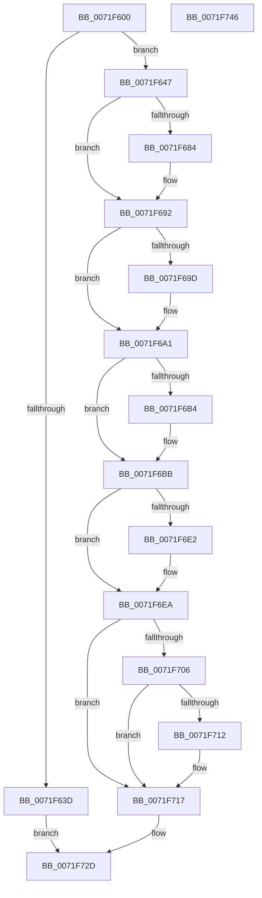

# IoRegisterIoTracking

- RVA: `0x0071F600`–`0x0071F747` (길이 `327` bytes)
- VA: `0x000000014071F600`
- 실행 섹션: `PAGE`
- PDB 이름 있음: `예`; PDB Function 태그: `아니요`
- unwind 정보 RVA: `0x00060300`
- 디코드: `85`개 명령, `327/327` bytes 표시
- 미해석 바이트: `0` (있으면 어셈블리에 `.byte`로 보존)

> 이 문서는 커널 이미지의 기계어와 PDB 기호를 분석해 생성했습니다. 4번과 5번은 함수 원형과 자료형을 바이너리 사용 방식에서 추정한 C 해석이며 원본 소스 복구 결과는 아닙니다.

## 1. Dependencies

- 직접 호출 지점: **8**; 고유 호출 대상: **8**
- 직접 호출자로 확인된 함수: **0**
- RIP 상대 이미지 참조: **5**

### Outgoing calls
- `0x0071F630` → [ExAllocatePool2](../../poolcode/B8/ExAllocatePool2_function_00B820F0.md) (function, `0x00B820F0`)
- `0x0071F673` → [KeAbPreAcquire](../../text/21/KeAbPreAcquire_function_00210230.md) (function, `0x00210230`)
- `0x0071F68D` → [ExfAcquirePushLockExclusiveEx](../../text/20/ExfAcquirePushLockExclusiveEx_function_0020FC90.md) (function, `0x0020FC90`)
- `0x0071F6E5` → [ExfTryToWakePushLock](../../text/26/ExfTryToWakePushLock_function_00265DD0.md) (function, `0x00265DD0`)
- `0x0071F6ED` → [KeAbPostRelease](../../text/2E/KeAbPostRelease_function_002E1600.md) (function, `0x002E1600`)
- `0x0071F712` → [KiCheckForKernelApcDelivery](../../text/2E/KiCheckForKernelApcDelivery_function_002E2C80.md) (function, `0x002E2C80`)
- `0x0071F71C` → [IopIrpExtensionControl](../../text/59/IopIrpExtensionControl_function_00597558.md) (function, `0x00597558`)
- `0x0071F723` → [IoPerfInit](../../text/4D/IoPerfInit_function_004DC338.md) (function, `0x004DC338`)

### Direct callers
- 이 함수 시작 RVA로 연결되는 직접 call은 확인되지 않았습니다. 간접 호출은 완전히 역산할 수 없습니다.

### Static image references
- `0x0071F64B` → RVA `0x00F8D438` (`.data`; read)
- `0x0071F6A1` → RVA `0x00F8D448` (`.data`; read)
- `0x0071F6A8` → RVA `0x00F8D440` (`.data`; read)
- `0x0071F6C5` → RVA `0x00F8D448` (`.data`; write)
- `0x0071F6CC` → RVA `0x00F8D438` (`.data`; read/write)

## 2. Other-region calls and transfers

- 다른 실행 섹션으로 향하는 call: **8**
  - `0x0071F630` → [ExAllocatePool2](../../poolcode/B8/ExAllocatePool2_function_00B820F0.md) (`PAGE` → `POOLCODE`)
  - `0x0071F673` → [KeAbPreAcquire](../../text/21/KeAbPreAcquire_function_00210230.md) (`PAGE` → `.text`)
  - `0x0071F68D` → [ExfAcquirePushLockExclusiveEx](../../text/20/ExfAcquirePushLockExclusiveEx_function_0020FC90.md) (`PAGE` → `.text`)
  - `0x0071F6E5` → [ExfTryToWakePushLock](../../text/26/ExfTryToWakePushLock_function_00265DD0.md) (`PAGE` → `.text`)
  - `0x0071F6ED` → [KeAbPostRelease](../../text/2E/KeAbPostRelease_function_002E1600.md) (`PAGE` → `.text`)
  - `0x0071F712` → [KiCheckForKernelApcDelivery](../../text/2E/KiCheckForKernelApcDelivery_function_002E2C80.md) (`PAGE` → `.text`)
  - `0x0071F71C` → [IopIrpExtensionControl](../../text/59/IopIrpExtensionControl_function_00597558.md) (`PAGE` → `.text`)
  - `0x0071F723` → [IoPerfInit](../../text/4D/IoPerfInit_function_004DC338.md) (`PAGE` → `.text`)
- 별도 외부 분기/꼬리 이동을 확인하지 못했습니다.

## 3. Assembly (complete function range)

```asm
0071F600  48 89 5C 24 08                  mov qword ptr [rsp + 8], rbx
0071F605  48 89 6C 24 10                  mov qword ptr [rsp + 0x10], rbp
0071F60A  48 89 74 24 18                  mov qword ptr [rsp + 0x18], rsi
0071F60F  57                              push rdi
0071F610  41 56                           push r14
0071F612  41 57                           push r15
0071F614  48 83 EC 20                     sub rsp, 0x20
0071F618  48 83 22 00                     and qword ptr [rdx], 0
0071F61C  4C 8B F2                        mov r14, rdx
0071F61F  BA 18 00 00 00                  mov edx, 0x18
0071F624  48 8B D9                        mov rbx, rcx
0071F627  41 B8 49 6F 54 72               mov r8d, 0x72546f49
0071F62D  8D 4A 28                        lea ecx, [rdx + 0x28]
0071F630  E8 BB 2A 46 00                  call 0x140b820f0
0071F635  48 8B F8                        mov rdi, rax
0071F638  48 85 C0                        test rax, rax
0071F63B  75 0A                           jne 0x14071f647
0071F63D  B8 9A 00 00 C0                  mov eax, 0xc000009a
0071F642  E9 E6 00 00 00                  jmp 0x14071f72d
0071F647  48 8B 43 08                     mov rax, qword ptr [rbx + 8]
0071F64B  48 8D 2D E6 DD 86 00            lea rbp, [rip + 0x86dde6]
0071F652  48 89 47 10                     mov qword ptr [rdi + 0x10], rax
0071F656  48 83 CB FF                     or rbx, 0xffffffffffffffff
0071F65A  65 48 8B 04 25 88 01 00 00      mov rax, qword ptr gs:[0x188]
0071F663  45 33 C0                        xor r8d, r8d
0071F666  33 D2                           xor edx, edx
0071F668  48 8B CD                        mov rcx, rbp
0071F66B  66 01 98 E6 01 00 00            add word ptr [rax + 0x1e6], bx
0071F672  90                              nop
0071F673  E8 B8 0B AF FF                  call 0x140210230
0071F678  F0 48 0F BA 6D 00 00            lock bts qword ptr [rbp], 0
0071F67F  48 8B F0                        mov rsi, rax
0071F682  73 0E                           jae 0x14071f692
0071F684  4C 8B C5                        mov r8, rbp
0071F687  48 8B D0                        mov rdx, rax
0071F68A  48 8B CD                        mov rcx, rbp
0071F68D  E8 FE 05 AF FF                  call 0x14020fc90
0071F692  41 BF 01 00 00 00               mov r15d, 1
0071F698  48 85 F6                        test rsi, rsi
0071F69B  74 04                           je 0x14071f6a1
0071F69D  44 88 7E 0A                     mov byte ptr [rsi + 0xa], r15b
0071F6A1  48 8B 05 A0 DD 86 00            mov rax, qword ptr [rip + 0x86dda0]
0071F6A8  48 8D 0D 91 DD 86 00            lea rcx, [rip + 0x86dd91]
0071F6AF  48 39 08                        cmp qword ptr [rax], rcx
0071F6B2  74 07                           je 0x14071f6bb
0071F6B4  B9 03 00 00 00                  mov ecx, 3
0071F6B9  CD 29                           int 0x29
0071F6BB  48 89 0F                        mov qword ptr [rdi], rcx
0071F6BE  48 89 47 08                     mov qword ptr [rdi + 8], rax
0071F6C2  48 89 38                        mov qword ptr [rax], rdi
0071F6C5  48 89 3D 7C DD 86 00            mov qword ptr [rip + 0x86dd7c], rdi
0071F6CC  F0 48 0F C1 1D 63 DD 86 00      lock xadd qword ptr [rip + 0x86dd63], rbx
0071F6D5  80 E3 06                        and bl, 6
0071F6D8  BE 02 00 00 00                  mov esi, 2
0071F6DD  40 3A DE                        cmp bl, sil
0071F6E0  75 08                           jne 0x14071f6ea
0071F6E2  48 8B CD                        mov rcx, rbp
0071F6E5  E8 E6 66 B4 FF                  call 0x140265dd0
0071F6EA  48 8B CD                        mov rcx, rbp
0071F6ED  E8 0E 1F BC FF                  call 0x1402e1600
0071F6F2  65 48 8B 04 25 88 01 00 00      mov rax, qword ptr gs:[0x188]
0071F6FB  90                              nop
0071F6FC  66 44 01 B8 E6 01 00 00         add word ptr [rax + 0x1e6], r15w
0071F704  75 11                           jne 0x14071f717
0071F706  48 05 98 00 00 00               add rax, 0x98
0071F70C  90                              nop
0071F70D  48 39 00                        cmp qword ptr [rax], rax
0071F710  74 05                           je 0x14071f717
0071F712  E8 69 35 BC FF                  call 0x1402e2c80
0071F717  41 8B D7                        mov edx, r15d
0071F71A  8B CE                           mov ecx, esi
0071F71C  E8 37 7E E7 FF                  call 0x140597558
0071F721  8B CE                           mov ecx, esi
0071F723  E8 10 CC DB FF                  call 0x1404dc338
0071F728  33 C0                           xor eax, eax
0071F72A  49 89 3E                        mov qword ptr [r14], rdi
0071F72D  48 8B 5C 24 40                  mov rbx, qword ptr [rsp + 0x40]
0071F732  48 8B 6C 24 48                  mov rbp, qword ptr [rsp + 0x48]
0071F737  48 8B 74 24 50                  mov rsi, qword ptr [rsp + 0x50]
0071F73C  48 83 C4 20                     add rsp, 0x20
0071F740  41 5F                           pop r15
0071F742  41 5E                           pop r14
0071F744  5F                              pop rdi
0071F745  C3                              ret
0071F746  CC                              int3
```

## 4. C-style interpretation (structured pseudocode)

```c
__int64 __fastcall IoRegisterIoTracking(__int64 a1, __int64 a2)
{
    __int64 result;
    __int64 v_rbx;
    __int64 v_rsp;
    unsigned __int64 v_stack_p10;
    unsigned __int64 v_stack_p18;
    unsigned __int64 v_stack_p8;

    v_stack_p8 = v_rbx;
    v_stack_p10 = v_rbp;
    v_stack_p18 = v_rsi;
    v_rsp = (v_rsp) - (32);
    result = ExAllocatePool2(24 + 40, 24, (unsigned int)(0x72546F49ULL), a4);
    if (result != 0) goto loc_0071F647;
    goto loc_0071F72D;
loc_0071F647:
    *(unsigned __int64 *)(result + 16) = *(unsigned __int64 *)(a1 + 8);
    v_rbx = (a1) | (-1);
    a3 = 0;
    a2 = 0;
    result = KeAbPreAcquire(v_rip + 8838630, a2, a3, a4);
    if (!(condition_is_above_or_equal)) {
        a3 = v_rip + 8838630;
        a2 = result;
        a1 = v_rip + 8838630;
        result = ExfAcquirePushLockExclusiveEx(a1, a2, a3, a4);
    }
    if (result != 0) {
        *(unsigned __int8 *)(result + 10) = 1;
    }
    if ((*(unsigned __int64 *)(*(unsigned __int64 *)(v_rip + 8838560))) != (v_rip + 8838545)) {
        a1 = 3;
    }
    *(unsigned __int64 *)(result) = a1;
    *(unsigned __int64 *)(result + 8) = *(unsigned __int64 *)(v_rip + 8838560);
    *(unsigned __int64 *)(*(unsigned __int64 *)(v_rip + 8838560)) = result;
    *(unsigned __int64 *)(v_rip + 8838524) = result;
    v_rbx = (unsigned __int8)((v_rbx) & (6));
    result = *(unsigned __int64 *)(v_rip + 8838560);
    if (((unsigned __int8)(v_rbx)) == 2) {
        a1 = v_rip + 8838630;
        result = ExfTryToWakePushLock(a1, a2, a3, a4);
    }
    result = KeAbPostRelease(v_rip + 8838630, a2, a3, a4);
    if (((unsigned __int8)(v_rbx)) != 2) goto loc_0071F717;
    result = (*(unsigned __int64 *)(gs_base + (0 + 392))) + (152);
    if ((*(unsigned __int64 *)(result)) != result) {
        result = KiCheckForKernelApcDelivery(v_rip + 8838630, a2, a3, a4);
    }
    result = IopIrpExtensionControl(2, 1, a3, a4);
    result = IoPerfInit(2, 1, a3, a4);
    result = 0;
    *(unsigned __int64 *)(a2) = 0;
loc_0071F72D:
    v_rsp = (v_rsp) + (32);
    return result;
}
```

## 5. (Beta) C Style

```c
int64_t IoRegisterIoTracking(void *Arg1, void *Arg2)
{
    uint8_t *arg1 = (uint8_t *)Arg1;
    uint8_t *arg2 = (uint8_t *)Arg2;

    int64_t result;
    int64_t local_rbx;
    int64_t local_rsp;
    uint64_t v_stack_p10;
    uint64_t v_stack_p18;
    uint64_t v_stack_p8;

    v_stack_p8 = local_rbx;
    v_stack_p10 = local_rbp;
    v_stack_p18 = local_rsi;
    local_rsp = (local_rsp) - (32);
    result = ExAllocatePool2(24 + 40, 24, (uint32_t)(0x72546F49ULL), a4);
    if (result != 0) goto loc_0071F647;
    goto loc_0071F72D;
loc_0071F647:
    *(uint64_t *)(result + 0x10) = *(uint64_t *)(arg1 + 0x8);
    local_rbx = (Arg1) | (-1);
    a3 = 0;
    Arg2 = 0;
    result = KeAbPreAcquire(v_rip + 8838630, Arg2, a3, a4);
    if (!(condition_is_above_or_equal)) {
        a3 = v_rip + 8838630;
        Arg2 = result;
        Arg1 = v_rip + 8838630;
        result = ExfAcquirePushLockExclusiveEx(Arg1, Arg2, a3, a4);
    }
    if (result != 0) {
        *(uint8_t *)(result + 0xA) = 1;
    }
    if ((*(uint64_t *)(*(uint64_t *)(v_rip + 0x86DDA0))) != (v_rip + 8838545)) {
        Arg1 = 3;
    }
    *(void **)(result) = Arg1;
    *(uint64_t *)(result + 0x8) = *(uint64_t *)(v_rip + 0x86DDA0);
    *(uint64_t *)(*(uint64_t *)(v_rip + 0x86DDA0)) = result;
    *(uint64_t *)(v_rip + 0x86DD7C) = result;
    local_rbx = (uint8_t)((local_rbx) & (6));
    result = *(uint64_t *)(v_rip + 0x86DDA0);
    if (((uint8_t)(local_rbx)) == 2) {
        Arg1 = v_rip + 8838630;
        result = ExfTryToWakePushLock(Arg1, Arg2, a3, a4);
    }
    result = KeAbPostRelease(v_rip + 8838630, Arg2, a3, a4);
    if (((uint8_t)(local_rbx)) != 2) goto loc_0071F717;
    result = (*(uint64_t *)(gs_base + (0 + 0x188))) + (152);
    if ((*(uint64_t *)(result)) != result) {
        result = KiCheckForKernelApcDelivery(v_rip + 8838630, Arg2, a3, a4);
    }
    result = IopIrpExtensionControl(2, 1, a3, a4);
    result = IoPerfInit(2, 1, a3, a4);
    result = 0;
    *(uint64_t *)(arg2) = 0;
loc_0071F72D:
    local_rsp = (local_rsp) + (32);
    return result;
}
```

### 관측된 메모리 오프셋

구조체 형식이 확인되지 않은 접근은 인자 기준의 오프셋으로만 기록했습니다.

| 기준 인자 | 오프셋 표현 | 폭 (bit) | 접근 |
|---|---:|---:|---|
| `Arg1` | `+ 0x8` | `64` | `R` |
| `Arg2` | `+ 0x0` | `64` | `R/W` |
| `Arg2` | `+ 0x0` | `64` | `W` |

## 6. Execution-region graph

[열기: 2D/3D 그래프와 함수 탐색 컨트롤 패널](../../../control-panel.html?section=page&rva=0x0071F600&view=graph)

- 2D 그래프는 위에서 아래로 흐르고, 3D 그래프는 빈 공간을 드래그해 회전합니다. Shift+드래그는 이동, 휠은 확대·축소, 함수 노드 선택은 대상 보고서 이동입니다.

### Static fallback


