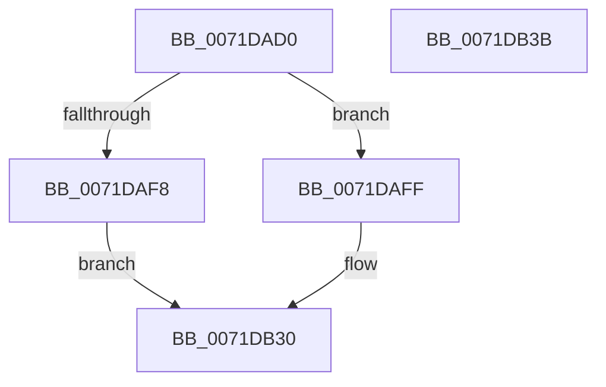

# IoRegisterLastChanceShutdownNotification

- RVA: `0x0071DAD0`–`0x0071DB3C` (길이 `108` bytes)
- VA: `0x000000014071DAD0`
- 실행 섹션: `PAGE`
- PDB 이름 있음: `예`; PDB Function 태그: `아니요`
- unwind 정보 RVA: `0x0005CAAC`
- 디코드: `29`개 명령, `108/108` bytes 표시
- 미해석 바이트: `0` (있으면 어셈블리에 `.byte`로 보존)

> 이 문서는 커널 이미지의 기계어와 PDB 기호를 분석해 생성했습니다. 4번과 5번은 함수 원형과 자료형을 바이너리 사용 방식에서 추정한 C 해석이며 원본 소스 복구 결과는 아닙니다.

## 1. Dependencies

- 직접 호출 지점: **4**; 고유 호출 대상: **4**
- 직접 호출자로 확인된 함수: **0**
- RIP 상대 이미지 참조: **2**

### Outgoing calls
- `0x0071DAEB` → [ExAllocatePool2](../../poolcode/B8/ExAllocatePool2_function_00B820F0.md) (function, `0x00B820F0`)
- `0x0071DB02` → [ObfReferenceObject](../../text/20/ObfReferenceObject_function_0020FA20.md) (function, `0x0020FA20`)
- `0x0071DB15` → [IopInterlockedInsertHeadList](../../text/59/IopInterlockedInsertHeadList_function_005974A8.md) (function, `0x005974A8`)
- `0x0071DB29` → [IopLogAuditIoRegisterNotificationEvent](IopLogAuditIoRegisterNotificationEvent_function_0071E2E8.md) (function, `0x0071E2E8`)

### Direct callers
- 이 함수 시작 RVA로 연결되는 직접 call은 확인되지 않았습니다. 간접 호출은 완전히 역산할 수 없습니다.

### Static image references
- `0x0071DB0E` → RVA `0x00F8D460` (`.data`; read)
- `0x0071DB1F` → RVA `0x00021AA8` (`.rdata`; read)

## 2. Other-region calls and transfers

- 다른 실행 섹션으로 향하는 call: **3**
  - `0x0071DAEB` → [ExAllocatePool2](../../poolcode/B8/ExAllocatePool2_function_00B820F0.md) (`PAGE` → `POOLCODE`)
  - `0x0071DB02` → [ObfReferenceObject](../../text/20/ObfReferenceObject_function_0020FA20.md) (`PAGE` → `.text`)
  - `0x0071DB15` → [IopInterlockedInsertHeadList](../../text/59/IopInterlockedInsertHeadList_function_005974A8.md) (`PAGE` → `.text`)
- 별도 외부 분기/꼬리 이동을 확인하지 못했습니다.

## 3. Assembly (complete function range)

```asm
0071DAD0  48 89 5C 24 08                  mov qword ptr [rsp + 8], rbx
0071DAD5  57                              push rdi
0071DAD6  48 83 EC 20                     sub rsp, 0x20
0071DADA  BA 18 00 00 00                  mov edx, 0x18
0071DADF  48 8B D9                        mov rbx, rcx
0071DAE2  41 B8 49 6F 53 68               mov r8d, 0x68536f49
0071DAE8  8D 4A 28                        lea ecx, [rdx + 0x28]
0071DAEB  E8 00 46 46 00                  call 0x140b820f0
0071DAF0  48 8B F8                        mov rdi, rax
0071DAF3  48 85 C0                        test rax, rax
0071DAF6  75 07                           jne 0x14071daff
0071DAF8  B8 9A 00 00 C0                  mov eax, 0xc000009a
0071DAFD  EB 31                           jmp 0x14071db30
0071DAFF  48 8B CB                        mov rcx, rbx
0071DB02  E8 19 1F AF FF                  call 0x14020fa20
0071DB07  48 8B D7                        mov rdx, rdi
0071DB0A  48 89 5F 10                     mov qword ptr [rdi + 0x10], rbx
0071DB0E  48 8D 0D 4B F9 86 00            lea rcx, [rip + 0x86f94b]
0071DB15  E8 8E 99 E7 FF                  call 0x1405974a8
0071DB1A  0F BA 6B 30 0B                  bts dword ptr [rbx + 0x30], 0xb
0071DB1F  48 8D 0D 82 3F 90 FF            lea rcx, [rip - 0x6fc07e]
0071DB26  48 8B D3                        mov rdx, rbx
0071DB29  E8 BA 07 00 00                  call 0x14071e2e8
0071DB2E  33 C0                           xor eax, eax
0071DB30  48 8B 5C 24 30                  mov rbx, qword ptr [rsp + 0x30]
0071DB35  48 83 C4 20                     add rsp, 0x20
0071DB39  5F                              pop rdi
0071DB3A  C3                              ret
0071DB3B  CC                              int3
```

## 4. C-style interpretation (structured pseudocode)

```c
__int64 __fastcall IoRegisterLastChanceShutdownNotification(__int64 a1)
{
    __int64 result;
    __int64 v_rsp;
    unsigned __int64 v_stack_p8;

    v_stack_p8 = v_rbx;
    v_rsp = (v_rsp) - (32);
    result = ExAllocatePool2(24 + 40, 24, (unsigned int)(0x68536F49ULL), a4);
    if (result != 0) goto loc_0071DAFF;
    goto loc_0071DB30;
loc_0071DAFF:
    result = ObfReferenceObject(a1, 24, (unsigned int)(0x68536F49ULL), a4);
    *(unsigned __int64 *)(result + 16) = a1;
    result = IopInterlockedInsertHeadList(v_rip + 8845643, result, (unsigned int)(0x68536F49ULL), a4);
    result = IopLogAuditIoRegisterNotificationEvent(v_rip - 7323774, a1, (unsigned int)(0x68536F49ULL), a4);
    result = 0;
loc_0071DB30:
    v_rsp = (v_rsp) + (32);
    return result;
}
```

## 5. (Beta) C Style

```c
int64_t IoRegisterLastChanceShutdownNotification(void *Arg1)
{
    uint8_t *arg1 = (uint8_t *)Arg1;

    int64_t result;
    int64_t local_rsp;
    uint64_t v_stack_p8;

    v_stack_p8 = local_rbx;
    local_rsp = (local_rsp) - (32);
    result = ExAllocatePool2(24 + 40, 24, (uint32_t)(0x68536F49ULL), a4);
    if (result != 0) goto loc_0071DAFF;
    goto loc_0071DB30;
loc_0071DAFF:
    result = ObfReferenceObject(Arg1, 24, (uint32_t)(0x68536F49ULL), a4);
    *(void **)(result + 0x10) = Arg1;
    result = IopInterlockedInsertHeadList(v_rip + 8845643, result, (uint32_t)(0x68536F49ULL), a4);
    result = IopLogAuditIoRegisterNotificationEvent(v_rip - 7323774, Arg1, (uint32_t)(0x68536F49ULL), a4);
    result = 0;
loc_0071DB30:
    local_rsp = (local_rsp) + (32);
    return result;
}
```

### 관측된 메모리 오프셋

구조체 형식이 확인되지 않은 접근은 인자 기준의 오프셋으로만 기록했습니다.

| 기준 인자 | 오프셋 표현 | 폭 (bit) | 접근 |
|---|---:|---:|---|
| `Arg1` | `+ 0x30` | `32` | `R/W` |

## 6. Execution-region graph

[열기: 2D/3D 그래프와 함수 탐색 컨트롤 패널](../../../control-panel.html?section=page&rva=0x0071DAD0&view=graph)

- 2D 그래프는 위에서 아래로 흐르고, 3D 그래프는 빈 공간을 드래그해 회전합니다. Shift+드래그는 이동, 휠은 확대·축소, 함수 노드 선택은 대상 보고서 이동입니다.

### Static fallback


