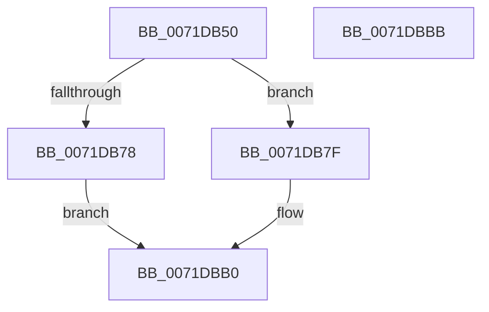

# IoRegisterShutdownNotification

- RVA: `0x0071DB50`–`0x0071DBBC` (길이 `108` bytes)
- VA: `0x000000014071DB50`
- 실행 섹션: `PAGE`
- PDB 이름 있음: `예`; PDB Function 태그: `아니요`
- unwind 정보 RVA: `0x0005CAAC`
- 디코드: `29`개 명령, `108/108` bytes 표시
- 미해석 바이트: `0` (있으면 어셈블리에 `.byte`로 보존)

> 이 문서는 커널 이미지의 기계어와 PDB 기호를 분석해 생성했습니다. 4번과 5번은 함수 원형과 자료형을 바이너리 사용 방식에서 추정한 C 해석이며 원본 소스 복구 결과는 아닙니다.

## 1. Dependencies

- 직접 호출 지점: **4**; 고유 호출 대상: **4**
- 직접 호출자로 확인된 함수: **3**
- RIP 상대 이미지 참조: **2**

### Outgoing calls
- `0x0071DB6B` → [ExAllocatePool2](../../poolcode/B8/ExAllocatePool2_function_00B820F0.md) (function, `0x00B820F0`)
- `0x0071DB86` → [ObfReferenceObject](../../text/20/ObfReferenceObject_function_0020FA20.md) (function, `0x0020FA20`)
- `0x0071DB95` → [IopInterlockedInsertHeadList](../../text/59/IopInterlockedInsertHeadList_function_005974A8.md) (function, `0x005974A8`)
- `0x0071DBA9` → [IopLogAuditIoRegisterNotificationEvent](IopLogAuditIoRegisterNotificationEvent_function_0071E2E8.md) (function, `0x0071E2E8`)

### Direct callers
- [DifIoRegisterShutdownNotificationWrapper](../../text/62/DifIoRegisterShutdownNotificationWrapper_function_0062C520.md) at `0x0062C5ED`
- [RawInitialize](../../init/C4/RawInitialize_function_00C47090.md) at `0x00C471A0`
- [WmipDriverEntry](../../init/C4/WmipDriverEntry_function_00C4D490.md) at `0x00C4D610`

### Static image references
- `0x0071DB8E` → RVA `0x00F8D220` (`.data`; read)
- `0x0071DB9F` → RVA `0x000227B8` (`.rdata`; read)

## 2. Other-region calls and transfers

- 다른 실행 섹션으로 향하는 call: **3**
  - `0x0071DB6B` → [ExAllocatePool2](../../poolcode/B8/ExAllocatePool2_function_00B820F0.md) (`PAGE` → `POOLCODE`)
  - `0x0071DB86` → [ObfReferenceObject](../../text/20/ObfReferenceObject_function_0020FA20.md) (`PAGE` → `.text`)
  - `0x0071DB95` → [IopInterlockedInsertHeadList](../../text/59/IopInterlockedInsertHeadList_function_005974A8.md) (`PAGE` → `.text`)
- 별도 외부 분기/꼬리 이동을 확인하지 못했습니다.

## 3. Assembly (complete function range)

```asm
0071DB50  48 89 5C 24 08                  mov qword ptr [rsp + 8], rbx
0071DB55  57                              push rdi
0071DB56  48 83 EC 20                     sub rsp, 0x20
0071DB5A  BA 18 00 00 00                  mov edx, 0x18
0071DB5F  48 8B D9                        mov rbx, rcx
0071DB62  41 B8 49 6F 53 68               mov r8d, 0x68536f49
0071DB68  8D 4A 28                        lea ecx, [rdx + 0x28]
0071DB6B  E8 80 45 46 00                  call 0x140b820f0
0071DB70  48 8B F8                        mov rdi, rax
0071DB73  48 85 C0                        test rax, rax
0071DB76  75 07                           jne 0x14071db7f
0071DB78  B8 9A 00 00 C0                  mov eax, 0xc000009a
0071DB7D  EB 31                           jmp 0x14071dbb0
0071DB7F  48 8B CB                        mov rcx, rbx
0071DB82  48 89 58 10                     mov qword ptr [rax + 0x10], rbx
0071DB86  E8 95 1E AF FF                  call 0x14020fa20
0071DB8B  48 8B D7                        mov rdx, rdi
0071DB8E  48 8D 0D 8B F6 86 00            lea rcx, [rip + 0x86f68b]
0071DB95  E8 0E 99 E7 FF                  call 0x1405974a8
0071DB9A  0F BA 6B 30 0B                  bts dword ptr [rbx + 0x30], 0xb
0071DB9F  48 8D 0D 12 4C 90 FF            lea rcx, [rip - 0x6fb3ee]
0071DBA6  48 8B D3                        mov rdx, rbx
0071DBA9  E8 3A 07 00 00                  call 0x14071e2e8
0071DBAE  33 C0                           xor eax, eax
0071DBB0  48 8B 5C 24 30                  mov rbx, qword ptr [rsp + 0x30]
0071DBB5  48 83 C4 20                     add rsp, 0x20
0071DBB9  5F                              pop rdi
0071DBBA  C3                              ret
0071DBBB  CC                              int3
```

## 4. C-style interpretation (structured pseudocode)

```c
__int64 __fastcall IoRegisterShutdownNotification(__int64 a1)
{
    __int64 result;
    __int64 v_rsp;
    unsigned __int64 v_stack_p8;

    v_stack_p8 = v_rbx;
    v_rsp = (v_rsp) - (32);
    result = ExAllocatePool2(24 + 40, 24, (unsigned int)(0x68536F49ULL), a4);
    if (result != 0) goto loc_0071DB7F;
    goto loc_0071DBB0;
loc_0071DB7F:
    *(unsigned __int64 *)((unsigned int)(0xC000009AULL) + 16) = a1;
    result = ObfReferenceObject(a1, 24, (unsigned int)(0x68536F49ULL), a4);
    result = IopInterlockedInsertHeadList(v_rip + 8844939, result, (unsigned int)(0x68536F49ULL), a4);
    result = IopLogAuditIoRegisterNotificationEvent(v_rip - 7320558, a1, (unsigned int)(0x68536F49ULL), a4);
    result = 0;
loc_0071DBB0:
    v_rsp = (v_rsp) + (32);
    return result;
}
```

## 5. (Beta) C Style

```c
int64_t IoRegisterShutdownNotification(void *Arg1)
{
    uint8_t *arg1 = (uint8_t *)Arg1;

    int64_t result;
    int64_t local_rsp;
    uint64_t v_stack_p8;

    v_stack_p8 = local_rbx;
    local_rsp = (local_rsp) - (32);
    result = ExAllocatePool2(24 + 40, 24, (uint32_t)(0x68536F49ULL), a4);
    if (result != 0) goto loc_0071DB7F;
    goto loc_0071DBB0;
loc_0071DB7F:
    *(void **)((uint32_t)(0xC000009AULL) + 0x10) = Arg1;
    result = ObfReferenceObject(Arg1, 24, (uint32_t)(0x68536F49ULL), a4);
    result = IopInterlockedInsertHeadList(v_rip + 8844939, result, (uint32_t)(0x68536F49ULL), a4);
    result = IopLogAuditIoRegisterNotificationEvent(v_rip - 7320558, Arg1, (uint32_t)(0x68536F49ULL), a4);
    result = 0;
loc_0071DBB0:
    local_rsp = (local_rsp) + (32);
    return result;
}
```

### 관측된 메모리 오프셋

구조체 형식이 확인되지 않은 접근은 인자 기준의 오프셋으로만 기록했습니다.

| 기준 인자 | 오프셋 표현 | 폭 (bit) | 접근 |
|---|---:|---:|---|
| `Arg1` | `+ 0x30` | `32` | `R/W` |

## 6. Execution-region graph

[열기: 2D/3D 그래프와 함수 탐색 컨트롤 패널](../../../control-panel.html?section=page&rva=0x0071DB50&view=graph)

- 2D 그래프는 위에서 아래로 흐르고, 3D 그래프는 빈 공간을 드래그해 회전합니다. Shift+드래그는 이동, 휠은 확대·축소, 함수 노드 선택은 대상 보고서 이동입니다.

### Static fallback


