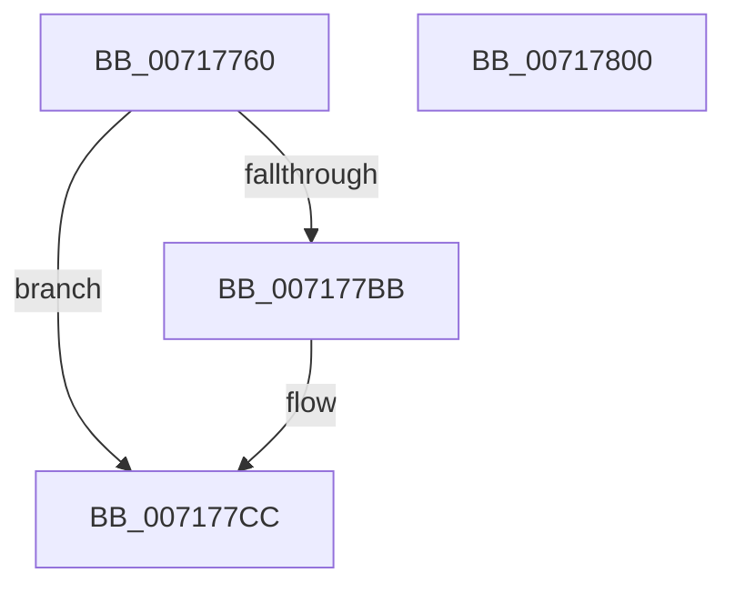

# IoSetPartitionInformationEx

- RVA: `0x00717760`–`0x00717801` (길이 `161` bytes)
- VA: `0x0000000140717760`
- 실행 섹션: `PAGE`
- PDB 이름 있음: `예`; PDB Function 태그: `아니요`
- unwind 정보 RVA: `0x000C62F0`
- 디코드: `41`개 명령, `161/161` bytes 표시
- 미해석 바이트: `0` (있으면 어셈블리에 `.byte`로 보존)

> 이 문서는 커널 이미지의 기계어와 PDB 기호를 분석해 생성했습니다. 4번과 5번은 함수 원형과 자료형을 바이너리 사용 방식에서 추정한 C 해석이며 원본 소스 복구 결과는 아닙니다.

## 1. Dependencies

- 직접 호출 지점: **5**; 고유 호출 대상: **5**
- 직접 호출자로 확인된 함수: **0**
- RIP 상대 이미지 참조: **2**

### Outgoing calls
- `0x0071778E` → [SC_DISK::SC_DISK](../../text/6A/SC_DISK_SC_DISK_function_006A41DC.md) (function, `0x006A41DC`)
- `0x007177B0` → [NT_DISK::Initialize](NT_DISK_Initialize_function_007170C8.md) (function, `0x007170C8`)
- `0x007177C5` → [SC_DISK::SetPartition](../../text/6A/SC_DISK_SetPartition_function_006A4BDC.md) (function, `0x006A4BDC`)
- `0x007177D6` → [SC_DISK::~SC_DISK](../../text/6A/SC_DISK_SC_DISK_function_006A42C4.md) (function, `0x006A42C4`)
- `0x007177E8` → [_security_check_cookie](../../text/6A/_security_check_cookie_function_006AC640.md) (function, `0x006AC640`)

### Direct callers
- 이 함수 시작 RVA로 연결되는 직접 call은 확인되지 않았습니다. 간접 호출은 완전히 역산할 수 없습니다.

### Static image references
- `0x0071776F` → RVA `0x00E0A740` (`.data`; read)
- `0x0071779C` → RVA `0x00007EB8` (`.rdata`; read)

## 2. Other-region calls and transfers

- 다른 실행 섹션으로 향하는 call: **4**
  - `0x0071778E` → [SC_DISK::SC_DISK](../../text/6A/SC_DISK_SC_DISK_function_006A41DC.md) (`PAGE` → `.text`)
  - `0x007177C5` → [SC_DISK::SetPartition](../../text/6A/SC_DISK_SetPartition_function_006A4BDC.md) (`PAGE` → `.text`)
  - `0x007177D6` → [SC_DISK::~SC_DISK](../../text/6A/SC_DISK_SC_DISK_function_006A42C4.md) (`PAGE` → `.text`)
  - `0x007177E8` → [_security_check_cookie](../../text/6A/_security_check_cookie_function_006AC640.md) (`PAGE` → `.text`)
- 별도 외부 분기/꼬리 이동을 확인하지 못했습니다.

## 3. Assembly (complete function range)

```asm
00717760  48 89 5C 24 08                  mov qword ptr [rsp + 8], rbx
00717765  55                              push rbp
00717766  56                              push rsi
00717767  57                              push rdi
00717768  48 81 EC C0 01 00 00            sub rsp, 0x1c0
0071776F  48 8B 05 CA 2F 6F 00            mov rax, qword ptr [rip + 0x6f2fca]
00717776  48 33 C4                        xor rax, rsp
00717779  48 89 84 24 B0 01 00 00         mov qword ptr [rsp + 0x1b0], rax
00717781  4C 8B C9                        mov r9, rcx
00717784  49 8B F0                        mov rsi, r8
00717787  48 8D 4C 24 20                  lea rcx, [rsp + 0x20]
0071778C  8B FA                           mov edi, edx
0071778E  E8 49 CA F8 FF                  call 0x1406a41dc
00717793  48 83 A4 24 A8 01 00 00 00      and qword ptr [rsp + 0x1a8], 0
0071779C  48 8D 2D 15 07 8F FF            lea rbp, [rip - 0x70f8eb]
007177A3  49 8B D1                        mov rdx, r9
007177A6  48 89 6C 24 20                  mov qword ptr [rsp + 0x20], rbp
007177AB  48 8D 4C 24 20                  lea rcx, [rsp + 0x20]
007177B0  E8 13 F9 FF FF                  call 0x1407170c8
007177B5  8B D8                           mov ebx, eax
007177B7  85 C0                           test eax, eax
007177B9  78 11                           js 0x1407177cc
007177BB  4C 8B C6                        mov r8, rsi
007177BE  48 8D 4C 24 20                  lea rcx, [rsp + 0x20]
007177C3  8B D7                           mov edx, edi
007177C5  E8 12 D4 F8 FF                  call 0x1406a4bdc
007177CA  8B D8                           mov ebx, eax
007177CC  48 8D 4C 24 20                  lea rcx, [rsp + 0x20]
007177D1  48 89 6C 24 20                  mov qword ptr [rsp + 0x20], rbp
007177D6  E8 E9 CA F8 FF                  call 0x1406a42c4
007177DB  8B C3                           mov eax, ebx
007177DD  48 8B 8C 24 B0 01 00 00         mov rcx, qword ptr [rsp + 0x1b0]
007177E5  48 33 CC                        xor rcx, rsp
007177E8  E8 53 4E F9 FF                  call 0x1406ac640
007177ED  48 8B 9C 24 E0 01 00 00         mov rbx, qword ptr [rsp + 0x1e0]
007177F5  48 81 C4 C0 01 00 00            add rsp, 0x1c0
007177FC  5F                              pop rdi
007177FD  5E                              pop rsi
007177FE  5D                              pop rbp
007177FF  C3                              ret
00717800  CC                              int3
```

## 4. C-style interpretation (structured pseudocode)

```c
__int64 __fastcall IoSetPartitionInformationEx(__int64 a1, int a2, __int64 a3)
{
    __int64 result;
    __int64 v_rbx;
    __int64 v_rsp;
    unsigned __int64 v_stack_m1B8;
    unsigned __int64 v_stack_m28;
    unsigned __int64 v_stack_m30;
    unsigned __int64 v_stack_p8;

    v_stack_p8 = v_rbx;
    v_rsp = (v_rsp) - (448);
    result = (*(unsigned __int64 *)(v_rip + 7286730)) ^ (v_rsp);
    v_stack_m28 = result;
    result = SC_DISK__SC_DISK(v_stack_m1B8, a2, a3, a1);
    v_stack_m1B8 = v_rip - 7403755;
    result = NT_DISK__Initialize(v_stack_m1B8, a1, a3, a1);
    v_rbx = (unsigned int)((unsigned int)(result));
    if (!(sign_flag)) {
        a3 = a3;
        a1 = v_stack_m1B8;
        a2 = (unsigned int)((unsigned int)(a2));
        result = SC_DISK__SetPartition(a1, a2, a3, a1);
        v_rbx = (unsigned int)(result);
    }
    v_stack_m1B8 = v_rip - 7403755;
    result = SC_DISK___SC_DISK(v_stack_m1B8, a2, a3, a1);
    a1 = (v_stack_m28) ^ (v_rsp);
    result = _security_check_cookie(a1, a2, a3, a1);
    v_rsp = (v_rsp) + (448);
    return result;
}
```

## 5. (Beta) C Style

```c
int64_t IoSetPartitionInformationEx(int64_t Arg1, int32_t Arg2, int64_t Arg3)
{
    int64_t result;
    int64_t local_rbx;
    int64_t local_rsp;
    uint64_t v_stack_m1B8;
    uint64_t v_stack_m28;
    uint64_t v_stack_m30;
    uint64_t v_stack_p8;

    v_stack_p8 = local_rbx;
    local_rsp = (local_rsp) - (448);
    result = (*(uint64_t *)(v_rip + 0x6F2FCA)) ^ (local_rsp);
    v_stack_m28 = result;
    result = SC_DISK__SC_DISK(v_stack_m1B8, Arg2, Arg3, Arg1);
    v_stack_m1B8 = v_rip - 7403755;
    result = NT_DISK__Initialize(v_stack_m1B8, Arg1, Arg3, Arg1);
    local_rbx = (uint32_t)((uint32_t)(result));
    if (!(sign_flag)) {
        Arg3 = Arg3;
        Arg1 = v_stack_m1B8;
        Arg2 = (uint32_t)((uint32_t)(Arg2));
        result = SC_DISK__SetPartition(Arg1, Arg2, Arg3, Arg1);
        local_rbx = (uint32_t)(result);
    }
    v_stack_m1B8 = v_rip - 7403755;
    result = SC_DISK___SC_DISK(v_stack_m1B8, Arg2, Arg3, Arg1);
    Arg1 = (v_stack_m28) ^ (local_rsp);
    result = _security_check_cookie(Arg1, Arg2, Arg3, Arg1);
    local_rsp = (local_rsp) + (448);
    return result;
}
```

## 6. Execution-region graph

[열기: 2D/3D 그래프와 함수 탐색 컨트롤 패널](../../../control-panel.html?section=page&rva=0x00717760&view=graph)

- 2D 그래프는 위에서 아래로 흐르고, 3D 그래프는 빈 공간을 드래그해 회전합니다. Shift+드래그는 이동, 휠은 확대·축소, 함수 노드 선택은 대상 보고서 이동입니다.

### Static fallback


