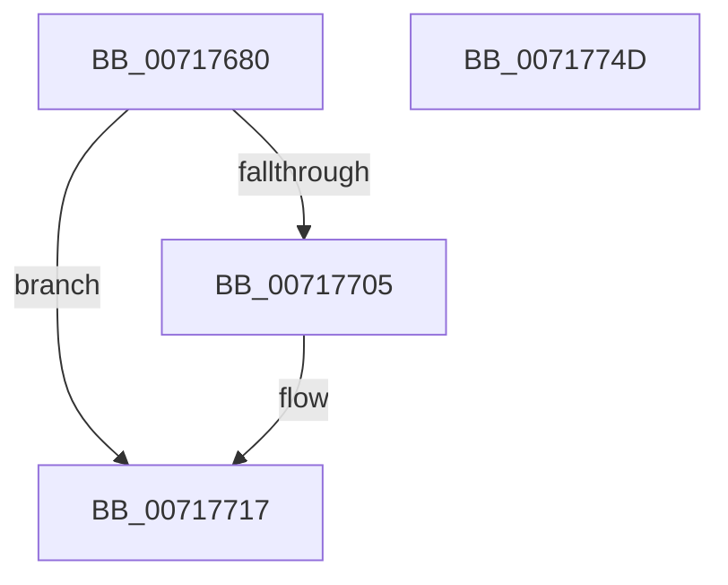

# IoSetPartitionInformation

- RVA: `0x00717680`–`0x0071774E` (길이 `206` bytes)
- VA: `0x0000000140717680`
- 실행 섹션: `PAGE`
- PDB 이름 있음: `예`; PDB Function 태그: `아니요`
- unwind 정보 RVA: `0x000C63A8`
- 디코드: `53`개 명령, `206/206` bytes 표시
- 미해석 바이트: `0` (있으면 어셈블리에 `.byte`로 보존)

> 이 문서는 커널 이미지의 기계어와 PDB 기호를 분석해 생성했습니다. 4번과 5번은 함수 원형과 자료형을 바이너리 사용 방식에서 추정한 C 해석이며 원본 소스 복구 결과는 아닙니다.

## 1. Dependencies

- 직접 호출 지점: **6**; 고유 호출 대상: **6**
- 직접 호출자로 확인된 함수: **1**
- RIP 상대 이미지 참조: **2**

### Outgoing calls
- `0x007176BB` → [SC_DISK::SC_DISK](../../text/6A/SC_DISK_SC_DISK_function_006A41DC.md) (function, `0x006A41DC`)
- `0x007176E4` → [memset](../../text/6C/memset_function_006C6C40.md) (function, `0x006C6C40`)
- `0x007176FA` → [NT_DISK::Initialize](NT_DISK_Initialize_function_007170C8.md) (function, `0x007170C8`)
- `0x00717710` → [SC_DISK::SetPartition](../../text/6A/SC_DISK_SetPartition_function_006A4BDC.md) (function, `0x006A4BDC`)
- `0x0071771F` → [SC_DISK::~SC_DISK](../../text/6A/SC_DISK_SC_DISK_function_006A42C4.md) (function, `0x006A42C4`)
- `0x00717730` → [_security_check_cookie](../../text/6A/_security_check_cookie_function_006AC640.md) (function, `0x006AC640`)

### Direct callers
- [DifIoSetPartitionInformationWrapper](../../text/62/DifIoSetPartitionInformationWrapper_function_0062CFA0.md) at `0x0062D097`

### Static image references
- `0x0071769D` → RVA `0x00E0A740` (`.data`; read)
- `0x007176C8` → RVA `0x00007EB8` (`.rdata`; read)

## 2. Other-region calls and transfers

- 다른 실행 섹션으로 향하는 call: **5**
  - `0x007176BB` → [SC_DISK::SC_DISK](../../text/6A/SC_DISK_SC_DISK_function_006A41DC.md) (`PAGE` → `.text`)
  - `0x007176E4` → [memset](../../text/6C/memset_function_006C6C40.md) (`PAGE` → `.text`)
  - `0x00717710` → [SC_DISK::SetPartition](../../text/6A/SC_DISK_SetPartition_function_006A4BDC.md) (`PAGE` → `.text`)
  - `0x0071771F` → [SC_DISK::~SC_DISK](../../text/6A/SC_DISK_SC_DISK_function_006A42C4.md) (`PAGE` → `.text`)
  - `0x00717730` → [_security_check_cookie](../../text/6A/_security_check_cookie_function_006AC640.md) (`PAGE` → `.text`)
- 별도 외부 분기/꼬리 이동을 확인하지 못했습니다.

## 3. Assembly (complete function range)

```asm
00717680  48 89 5C 24 08                  mov qword ptr [rsp + 8], rbx
00717685  48 89 74 24 10                  mov qword ptr [rsp + 0x10], rsi
0071768A  55                              push rbp
0071768B  57                              push rdi
0071768C  41 56                           push r14
0071768E  48 8D AC 24 C0 FE FF FF         lea rbp, [rsp - 0x140]
00717696  48 81 EC 40 02 00 00            sub rsp, 0x240
0071769D  48 8B 05 9C 30 6F 00            mov rax, qword ptr [rip + 0x6f309c]
007176A4  48 33 C4                        xor rax, rsp
007176A7  48 89 85 30 01 00 00            mov qword ptr [rbp + 0x130], rax
007176AE  48 8B D9                        mov rbx, rcx
007176B1  41 8B F9                        mov edi, r9d
007176B4  48 8D 4D A0                     lea rcx, [rbp - 0x60]
007176B8  41 8B F0                        mov esi, r8d
007176BB  E8 1C CB F8 FF                  call 0x1406a41dc
007176C0  48 83 A5 28 01 00 00 00         and qword ptr [rbp + 0x128], 0
007176C8  4C 8D 35 E9 07 8F FF            lea r14, [rip - 0x70f817]
007176CF  33 C0                           xor eax, eax
007176D1  4C 89 75 A0                     mov qword ptr [rbp - 0x60], r14
007176D5  33 D2                           xor edx, edx
007176D7  89 44 24 24                     mov dword ptr [rsp + 0x24], eax
007176DB  48 8D 4C 24 29                  lea rcx, [rsp + 0x29]
007176E0  44 8D 40 6F                     lea r8d, [rax + 0x6f]
007176E4  E8 57 F5 FA FF                  call 0x1406c6c40
007176E9  83 64 24 20 00                  and dword ptr [rsp + 0x20], 0
007176EE  48 8D 4D A0                     lea rcx, [rbp - 0x60]
007176F2  48 8B D3                        mov rdx, rbx
007176F5  40 88 7C 24 28                  mov byte ptr [rsp + 0x28], dil
007176FA  E8 C9 F9 FF FF                  call 0x1407170c8
007176FF  8B D8                           mov ebx, eax
00717701  85 C0                           test eax, eax
00717703  78 12                           js 0x140717717
00717705  4C 8D 44 24 20                  lea r8, [rsp + 0x20]
0071770A  8B D6                           mov edx, esi
0071770C  48 8D 4D A0                     lea rcx, [rbp - 0x60]
00717710  E8 C7 D4 F8 FF                  call 0x1406a4bdc
00717715  8B D8                           mov ebx, eax
00717717  48 8D 4D A0                     lea rcx, [rbp - 0x60]
0071771B  4C 89 75 A0                     mov qword ptr [rbp - 0x60], r14
0071771F  E8 A0 CB F8 FF                  call 0x1406a42c4
00717724  8B C3                           mov eax, ebx
00717726  48 8B 8D 30 01 00 00            mov rcx, qword ptr [rbp + 0x130]
0071772D  48 33 CC                        xor rcx, rsp
00717730  E8 0B 4F F9 FF                  call 0x1406ac640
00717735  4C 8D 9C 24 40 02 00 00         lea r11, [rsp + 0x240]
0071773D  49 8B 5B 20                     mov rbx, qword ptr [r11 + 0x20]
00717741  49 8B 73 28                     mov rsi, qword ptr [r11 + 0x28]
00717745  49 8B E3                        mov rsp, r11
00717748  41 5E                           pop r14
0071774A  5F                              pop rdi
0071774B  5D                              pop rbp
0071774C  C3                              ret
0071774D  CC                              int3
```

## 4. C-style interpretation (structured pseudocode)

```c
__int64 __fastcall IoSetPartitionInformation(__int64 a1, int a2, int a3, int a4)
{
    __int64 result;
    __int64 v_rbx;
    __int64 v_rsp;
    unsigned __int64 v_stack_m158;
    unsigned __int64 v_stack_m18;
    unsigned __int64 v_stack_m1B8;
    unsigned __int64 v_stack_m22F;
    unsigned __int8 v_stack_m230;
    unsigned int v_stack_m234;
    unsigned int v_stack_m238;
    unsigned __int64 v_stack_m28;
    unsigned __int64 v_stack_m30;
    unsigned __int64 v_stack_p10;
    unsigned __int64 v_stack_p8;

    v_stack_p8 = v_rbx;
    v_stack_p10 = v_rsi;
    v_rsp = (v_rsp) - (576);
    result = (*(unsigned __int64 *)(v_rip + 7286940)) ^ (v_rsp);
    v_stack_m28 = result;
    result = SC_DISK__SC_DISK(v_stack_m1B8, a2, a3, a4);
    result = 0;
    v_stack_m1B8 = v_rip - 7403543;
    a2 = 0;
    v_stack_m234 = 0;
    result = memset(v_stack_m22F, a2, result + 111, a4);
    v_stack_m230 = (unsigned __int8)((unsigned int)(a4));
    result = NT_DISK__Initialize(v_stack_m1B8, a1, result + 111, a4);
    v_rbx = (unsigned int)((unsigned int)(result));
    if (!(sign_flag)) {
        a3 = v_stack_m238;
        a2 = (unsigned int)((unsigned int)(a3));
        a1 = v_stack_m1B8;
        result = SC_DISK__SetPartition(a1, a2, a3, a4);
        v_rbx = (unsigned int)(result);
    }
    v_stack_m1B8 = v_rip - 7403543;
    result = SC_DISK___SC_DISK(v_stack_m1B8, a2, a3, a4);
    a1 = (v_stack_m28) ^ (v_rsp);
    result = _security_check_cookie(a1, a2, a3, a4);
    return result;
}
```

## 5. (Beta) C Style

```c
int64_t IoSetPartitionInformation(int64_t Arg1, int32_t Arg2, int32_t Arg3, int32_t Arg4)
{
    int64_t result;
    int64_t local_rbx;
    int64_t local_rsp;
    uint64_t v_stack_m158;
    uint64_t v_stack_m18;
    uint64_t v_stack_m1B8;
    uint64_t v_stack_m22F;
    uint8_t v_stack_m230;
    uint32_t v_stack_m234;
    uint32_t v_stack_m238;
    uint64_t v_stack_m28;
    uint64_t v_stack_m30;
    uint64_t v_stack_p10;
    uint64_t v_stack_p8;

    v_stack_p8 = local_rbx;
    v_stack_p10 = local_rsi;
    local_rsp = (local_rsp) - (576);
    result = (*(uint64_t *)(v_rip + 0x6F309C)) ^ (local_rsp);
    v_stack_m28 = result;
    result = SC_DISK__SC_DISK(v_stack_m1B8, Arg2, Arg3, Arg4);
    result = 0;
    v_stack_m1B8 = v_rip - 7403543;
    Arg2 = 0;
    v_stack_m234 = 0;
    result = memset(v_stack_m22F, Arg2, result + 111, Arg4);
    v_stack_m230 = (uint8_t)((uint32_t)(Arg4));
    result = NT_DISK__Initialize(v_stack_m1B8, Arg1, result + 111, Arg4);
    local_rbx = (uint32_t)((uint32_t)(result));
    if (!(sign_flag)) {
        Arg3 = v_stack_m238;
        Arg2 = (uint32_t)((uint32_t)(Arg3));
        Arg1 = v_stack_m1B8;
        result = SC_DISK__SetPartition(Arg1, Arg2, Arg3, Arg4);
        local_rbx = (uint32_t)(result);
    }
    v_stack_m1B8 = v_rip - 7403543;
    result = SC_DISK___SC_DISK(v_stack_m1B8, Arg2, Arg3, Arg4);
    Arg1 = (v_stack_m28) ^ (local_rsp);
    result = _security_check_cookie(Arg1, Arg2, Arg3, Arg4);
    return result;
}
```

## 6. Execution-region graph

[열기: 2D/3D 그래프와 함수 탐색 컨트롤 패널](../../../control-panel.html?section=page&rva=0x00717680&view=graph)

- 2D 그래프는 위에서 아래로 흐르고, 3D 그래프는 빈 공간을 드래그해 회전합니다. Shift+드래그는 이동, 휠은 확대·축소, 함수 노드 선택은 대상 보고서 이동입니다.

### Static fallback


