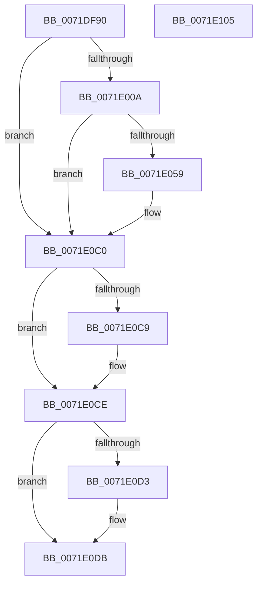

# IoSetSystemPartition

- RVA: `0x0071DF90`–`0x0071E106` (길이 `374` bytes)
- VA: `0x000000014071DF90`
- 실행 섹션: `PAGE`
- PDB 이름 있음: `예`; PDB Function 태그: `아니요`
- unwind 정보 RVA: `0x000C7570`
- 디코드: `92`개 명령, `374/374` bytes 표시
- 미해석 바이트: `0` (있으면 어셈블리에 `.byte`로 보존)

> 이 문서는 커널 이미지의 기계어와 PDB 기호를 분석해 생성했습니다. 4번과 5번은 함수 원형과 자료형을 바이너리 사용 방식에서 추정한 C 해석이며 원본 소스 복구 결과는 아닙니다.

## 1. Dependencies

- 직접 호출 지점: **7**; 고유 호출 대상: **6**
- 직접 호출자로 확인된 함수: **0**
- RIP 상대 이미지 참조: **2**

### Outgoing calls
- `0x0071DFE6` → [RtlInitUnicodeString](../../text/42/RtlInitUnicodeString_function_0042A780.md) (function, `0x0042A780`)
- `0x0071DFFB` → [IopOpenRegistryKeyEx](../A5/IopOpenRegistryKeyEx_function_00A51B44.md) (function, `0x00A51B44`)
- `0x0071E04A` → [IopCreateRegistryKeyEx](../A8/IopCreateRegistryKeyEx_function_00A89038.md) (function, `0x00A89038`)
- `0x0071E0B9` → [ZwSetValueKey](../../text/6A/ZwSetValueKey_function_006ADCD0.md) (function, `0x006ADCD0`)
- `0x0071E0C9` → [ZwClose](../../text/6A/ZwClose_function_006AD2B0.md) (function, `0x006AD2B0`)
- `0x0071E0D6` → [ZwClose](../../text/6A/ZwClose_function_006AD2B0.md) (function, `0x006AD2B0`)
- `0x0071E0E4` → [_security_check_cookie](../../text/6A/_security_check_cookie_function_006AC640.md) (function, `0x006AC640`)

### Direct callers
- 이 함수 시작 RVA로 연결되는 직접 call은 확인되지 않았습니다. 간접 호출은 완전히 역산할 수 없습니다.

### Static image references
- `0x0071DFAE` → RVA `0x00E0A740` (`.data`; read)
- `0x0071DFBF` → RVA `0x00AFCB50` (` ?? ::NNGAKEGL::`string'`; read)

## 2. Other-region calls and transfers

- 다른 실행 섹션으로 향하는 call: **5**
  - `0x0071DFE6` → [RtlInitUnicodeString](../../text/42/RtlInitUnicodeString_function_0042A780.md) (`PAGE` → `.text`)
  - `0x0071E0B9` → [ZwSetValueKey](../../text/6A/ZwSetValueKey_function_006ADCD0.md) (`PAGE` → `.text`)
  - `0x0071E0C9` → [ZwClose](../../text/6A/ZwClose_function_006AD2B0.md) (`PAGE` → `.text`)
  - `0x0071E0D6` → [ZwClose](../../text/6A/ZwClose_function_006AD2B0.md) (`PAGE` → `.text`)
  - `0x0071E0E4` → [_security_check_cookie](../../text/6A/_security_check_cookie_function_006AC640.md) (`PAGE` → `.text`)
- 별도 외부 분기/꼬리 이동을 확인하지 못했습니다.

## 3. Assembly (complete function range)

```asm
0071DF90  48 89 5C 24 10                  mov qword ptr [rsp + 0x10], rbx
0071DF95  48 89 74 24 18                  mov qword ptr [rsp + 0x18], rsi
0071DF9A  55                              push rbp
0071DF9B  57                              push rdi
0071DF9C  41 54                           push r12
0071DF9E  41 55                           push r13
0071DFA0  41 56                           push r14
0071DFA2  48 8D 6C 24 C9                  lea rbp, [rsp - 0x37]
0071DFA7  48 81 EC 90 00 00 00            sub rsp, 0x90
0071DFAE  48 8B 05 8B C7 6E 00            mov rax, qword ptr [rip + 0x6ec78b]
0071DFB5  48 33 C4                        xor rax, rsp
0071DFB8  48 89 45 27                     mov qword ptr [rbp + 0x27], rax
0071DFBC  45 33 F6                        xor r14d, r14d
0071DFBF  48 8D 15 8A EB 3D 00            lea rdx, [rip + 0x3deb8a]
0071DFC6  48 8B F1                        mov rsi, rcx
0071DFC9  4C 89 75 DF                     mov qword ptr [rbp - 0x21], r14
0071DFCD  0F 57 C0                        xorps xmm0, xmm0
0071DFD0  48 8D 4D F7                     lea rcx, [rbp - 9]
0071DFD4  0F 57 C9                        xorps xmm1, xmm1
0071DFD7  41 8B DE                        mov ebx, r14d
0071DFDA  48 89 5D D7                     mov qword ptr [rbp - 0x29], rbx
0071DFDE  0F 11 45 E7                     movups xmmword ptr [rbp - 0x19], xmm0
0071DFE2  0F 11 4D F7                     movups xmmword ptr [rbp - 9], xmm1
0071DFE6  E8 95 C7 D0 FF                  call 0x14042a780
0071DFEB  41 B9 3F 00 0F 00               mov r9d, 0xf003f
0071DFF1  4C 8D 45 F7                     lea r8, [rbp - 9]
0071DFF5  33 D2                           xor edx, edx
0071DFF7  48 8D 4D DF                     lea rcx, [rbp - 0x21]
0071DFFB  E8 44 3B 33 00                  call 0x140a51b44
0071E000  8B F8                           mov edi, eax
0071E002  85 C0                           test eax, eax
0071E004  0F 88 B6 00 00 00               js 0x14071e0c0
0071E00A  48 8B 55 DF                     mov rdx, qword ptr [rbp - 0x21]
0071E00E  48 8D 45 07                     lea rax, [rbp + 7]
0071E012  4C 89 74 24 28                  mov qword ptr [rsp + 0x28], r14
0071E017  4C 8D 45 E7                     lea r8, [rbp - 0x19]
0071E01B  41 B9 3F 00 0F 00               mov r9d, 0xf003f
0071E021  48 89 45 EF                     mov qword ptr [rbp - 0x11], rax
0071E025  48 8D 4D D7                     lea rcx, [rbp - 0x29]
0071E029  C7 45 07 53 00 65 00            mov dword ptr [rbp + 7], 0x650053
0071E030  C7 45 0B 74 00 75 00            mov dword ptr [rbp + 0xb], 0x750074
0071E037  C7 45 0F 70 00 00 00            mov dword ptr [rbp + 0xf], 0x70
0071E03E  C7 45 E7 0A 00 0C 00            mov dword ptr [rbp - 0x19], 0xc000a
0071E045  44 89 74 24 20                  mov dword ptr [rsp + 0x20], r14d
0071E04A  E8 E9 AF 36 00                  call 0x140a89038
0071E04F  48 8B 5D D7                     mov rbx, qword ptr [rbp - 0x29]
0071E053  8B F8                           mov edi, eax
0071E055  85 C0                           test eax, eax
0071E057  78 67                           js 0x14071e0c0
0071E059  0F B7 06                        movzx eax, word ptr [rsi]
0071E05C  45 8D 4E 01                     lea r9d, [r14 + 1]
0071E060  83 C0 02                        add eax, 2
0071E063  C7 45 07 53 00 79 00            mov dword ptr [rbp + 7], 0x790053
0071E06A  89 44 24 28                     mov dword ptr [rsp + 0x28], eax
0071E06E  48 8D 55 E7                     lea rdx, [rbp - 0x19]
0071E072  48 8B 46 08                     mov rax, qword ptr [rsi + 8]
0071E076  45 33 C0                        xor r8d, r8d
0071E079  48 8B CB                        mov rcx, rbx
0071E07C  48 89 44 24 20                  mov qword ptr [rsp + 0x20], rax
0071E081  C7 45 0B 73 00 74 00            mov dword ptr [rbp + 0xb], 0x740073
0071E088  C7 45 0F 65 00 6D 00            mov dword ptr [rbp + 0xf], 0x6d0065
0071E08F  C7 45 13 50 00 61 00            mov dword ptr [rbp + 0x13], 0x610050
0071E096  C7 45 17 72 00 74 00            mov dword ptr [rbp + 0x17], 0x740072
0071E09D  C7 45 1B 69 00 74 00            mov dword ptr [rbp + 0x1b], 0x740069
0071E0A4  C7 45 1F 69 00 6F 00            mov dword ptr [rbp + 0x1f], 0x6f0069
0071E0AB  C7 45 23 6E 00 00 00            mov dword ptr [rbp + 0x23], 0x6e
0071E0B2  C7 45 E7 1E 00 20 00            mov dword ptr [rbp - 0x19], 0x20001e
0071E0B9  E8 12 FC F8 FF                  call 0x1406adcd0
0071E0BE  8B F8                           mov edi, eax
0071E0C0  48 8B 4D DF                     mov rcx, qword ptr [rbp - 0x21]
0071E0C4  48 85 C9                        test rcx, rcx
0071E0C7  74 05                           je 0x14071e0ce
0071E0C9  E8 E2 F1 F8 FF                  call 0x1406ad2b0
0071E0CE  48 85 DB                        test rbx, rbx
0071E0D1  74 08                           je 0x14071e0db
0071E0D3  48 8B CB                        mov rcx, rbx
0071E0D6  E8 D5 F1 F8 FF                  call 0x1406ad2b0
0071E0DB  8B C7                           mov eax, edi
0071E0DD  48 8B 4D 27                     mov rcx, qword ptr [rbp + 0x27]
0071E0E1  48 33 CC                        xor rcx, rsp
0071E0E4  E8 57 E5 F8 FF                  call 0x1406ac640
0071E0E9  4C 8D 9C 24 90 00 00 00         lea r11, [rsp + 0x90]
0071E0F1  49 8B 5B 38                     mov rbx, qword ptr [r11 + 0x38]
0071E0F5  49 8B 73 40                     mov rsi, qword ptr [r11 + 0x40]
0071E0F9  49 8B E3                        mov rsp, r11
0071E0FC  41 5E                           pop r14
0071E0FE  41 5D                           pop r13
0071E100  41 5C                           pop r12
0071E102  5F                              pop rdi
0071E103  5D                              pop rbp
0071E104  C3                              ret
0071E105  CC                              int3
```

## 4. C-style interpretation (structured pseudocode)

```c
__int64 __fastcall IoSetSystemPartition(__int64 a1)
{
    __int64 result;
    __int64 v_r14;
    __int64 v_rdi;
    __int64 v_rsp;
    unsigned __int64 v_stack_m28;
    unsigned __int64 v_stack_m38;
    unsigned int v_stack_m3C;
    unsigned int v_stack_m40;
    unsigned int v_stack_m44;
    unsigned int v_stack_m48;
    unsigned int v_stack_m4C;
    unsigned int v_stack_m50;
    unsigned int v_stack_m54;
    unsigned __int64 v_stack_m58;
    unsigned __int64 v_stack_m5F;
    unsigned __int64 v_stack_m68;
    unsigned __int64 v_stack_m70;
    unsigned __int64 v_stack_m78;
    unsigned __int64 v_stack_m80;
    unsigned __int64 v_stack_m88;
    unsigned __int64 v_stack_m90;
    unsigned int v_stack_m98;
    unsigned __int64 v_stack_p10;
    unsigned __int64 v_stack_p18;

    v_stack_p10 = v_rbx;
    v_stack_p18 = v_rsi;
    v_rsp = (v_rsp) - (144);
    result = (*(unsigned __int64 *)(v_rip + 7260043)) ^ (v_rsp);
    v_stack_m38 = result;
    v_r14 = 0;
    v_stack_m80 = 0;
    v_stack_m88 = 0;
    v_stack_m78 = v_xmm0;
    v_stack_m68 = v_xmm1;
    result = RtlInitUnicodeString(v_stack_m68, v_rip + 4057994, a3, a4);
    a2 = 0;
    result = IopOpenRegistryKeyEx(v_stack_m80, a2, v_stack_m68, (unsigned int)(0xF003FULL));
    if (sign_flag) goto loc_0071E0C0;
    v_stack_m90 = 0;
    v_stack_m70 = v_stack_m58;
    v_stack_m58 = 0x650053ULL;
    v_stack_m54 = 0x750074ULL;
    v_stack_m50 = 112;
    v_stack_m78 = 0xC000AULL;
    v_stack_m98 = 0;
    result = IopCreateRegistryKeyEx(v_stack_m88, v_stack_m80, v_stack_m78, (unsigned int)(0xF003FULL));
    v_rdi = (unsigned int)((unsigned int)(result));
    if (!(sign_flag)) {
        result = *(unsigned __int16 *)(a1);
        a4 = v_r14 + 1;
        result = (unsigned int)((result) + (2));
        v_stack_m58 = 0x790053ULL;
        v_stack_m90 = (unsigned int)(result);
        a2 = v_stack_m78;
        result = *(unsigned __int64 *)(a1 + 8);
        a3 = 0;
        a1 = v_stack_m88;
        v_stack_m98 = result;
        v_stack_m54 = 0x740073ULL;
        v_stack_m50 = 0x6D0065ULL;
        v_stack_m4C = 0x610050ULL;
        v_stack_m48 = 0x740072ULL;
        v_stack_m44 = 0x740069ULL;
        v_stack_m40 = 0x6F0069ULL;
        v_stack_m3C = 110;
        v_stack_m78 = 0x20001EULL;
        result = ZwSetValueKey(a1, a2, a3, a4);
        v_rdi = (unsigned int)(result);
    }
    if (v_stack_m80 != 0) {
        result = ZwClose(v_stack_m80, a2, a3, a4);
    }
    if (v_stack_m88 != 0) {
        a1 = v_stack_m88;
        result = ZwClose(a1, a2, a3, a4);
    }
    a1 = (v_stack_m38) ^ (v_rsp);
    result = _security_check_cookie(a1, a2, a3, a4);
    return result;
}
```

## 5. (Beta) C Style

```c
int64_t IoSetSystemPartition(void *Arg1)
{
    uint8_t *arg1 = (uint8_t *)Arg1;

    int64_t result;
    int64_t local_r14;
    int64_t local_rdi;
    int64_t local_rsp;
    uint64_t v_stack_m28;
    uint64_t v_stack_m38;
    uint32_t v_stack_m3C;
    uint32_t v_stack_m40;
    uint32_t v_stack_m44;
    uint32_t v_stack_m48;
    uint32_t v_stack_m4C;
    uint32_t v_stack_m50;
    uint32_t v_stack_m54;
    uint64_t v_stack_m58;
    uint64_t v_stack_m5F;
    uint64_t v_stack_m68;
    uint64_t v_stack_m70;
    uint64_t v_stack_m78;
    uint64_t v_stack_m80;
    uint64_t v_stack_m88;
    uint64_t v_stack_m90;
    uint32_t v_stack_m98;
    uint64_t v_stack_p10;
    uint64_t v_stack_p18;

    v_stack_p10 = local_rbx;
    v_stack_p18 = local_rsi;
    local_rsp = (local_rsp) - (144);
    result = (*(uint64_t *)(v_rip + 0x6EC78B)) ^ (local_rsp);
    v_stack_m38 = result;
    local_r14 = 0;
    v_stack_m80 = 0;
    v_stack_m88 = 0;
    v_stack_m78 = v_xmm0;
    v_stack_m68 = v_xmm1;
    result = RtlInitUnicodeString(v_stack_m68, v_rip + 4057994, a3, a4);
    a2 = 0;
    result = IopOpenRegistryKeyEx(v_stack_m80, a2, v_stack_m68, (uint32_t)(0xF003FULL));
    if (sign_flag) goto loc_0071E0C0;
    v_stack_m90 = 0;
    v_stack_m70 = v_stack_m58;
    v_stack_m58 = 0x650053ULL;
    v_stack_m54 = 0x750074ULL;
    v_stack_m50 = 112;
    v_stack_m78 = 0xC000AULL;
    v_stack_m98 = 0;
    result = IopCreateRegistryKeyEx(v_stack_m88, v_stack_m80, v_stack_m78, (uint32_t)(0xF003FULL));
    local_rdi = (uint32_t)((uint32_t)(result));
    if (!(sign_flag)) {
        result = *(uint16_t *)(arg1);
        a4 = local_r14 + 1;
        result = (uint32_t)((result) + (2));
        v_stack_m58 = 0x790053ULL;
        v_stack_m90 = (uint32_t)(result);
        a2 = v_stack_m78;
        result = *(uint64_t *)(arg1 + 0x8);
        a3 = 0;
        Arg1 = v_stack_m88;
        v_stack_m98 = result;
        v_stack_m54 = 0x740073ULL;
        v_stack_m50 = 0x6D0065ULL;
        v_stack_m4C = 0x610050ULL;
        v_stack_m48 = 0x740072ULL;
        v_stack_m44 = 0x740069ULL;
        v_stack_m40 = 0x6F0069ULL;
        v_stack_m3C = 110;
        v_stack_m78 = 0x20001EULL;
        result = ZwSetValueKey(Arg1, a2, a3, a4);
        local_rdi = (uint32_t)(result);
    }
    if (v_stack_m80 != 0) {
        result = ZwClose(v_stack_m80, a2, a3, a4);
    }
    if (v_stack_m88 != 0) {
        Arg1 = v_stack_m88;
        result = ZwClose(Arg1, a2, a3, a4);
    }
    Arg1 = (v_stack_m38) ^ (local_rsp);
    result = _security_check_cookie(Arg1, a2, a3, a4);
    return result;
}
```

### 관측된 메모리 오프셋

구조체 형식이 확인되지 않은 접근은 인자 기준의 오프셋으로만 기록했습니다.

| 기준 인자 | 오프셋 표현 | 폭 (bit) | 접근 |
|---|---:|---:|---|
| `Arg1` | `+ 0x0` | `16` | `R` |
| `Arg1` | `+ 0x8` | `64` | `R` |

## 6. Execution-region graph

[열기: 2D/3D 그래프와 함수 탐색 컨트롤 패널](../../../control-panel.html?section=page&rva=0x0071DF90&view=graph)

- 2D 그래프는 위에서 아래로 흐르고, 3D 그래프는 빈 공간을 드래그해 회전합니다. Shift+드래그는 이동, 휠은 확대·축소, 함수 노드 선택은 대상 보고서 이동입니다.

### Static fallback


