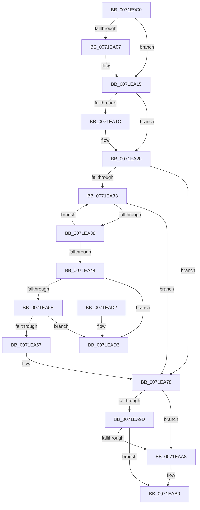

# IoUnregisterContainerNotification

- RVA: `0x0071E9C0`–`0x0071EADA` (길이 `282` bytes)
- VA: `0x000000014071E9C0`
- 실행 섹션: `PAGE`
- PDB 이름 있음: `예`; PDB Function 태그: `아니요`
- unwind 정보 RVA: `0x00069AD0`
- 디코드: `75`개 명령, `282/282` bytes 표시
- 미해석 바이트: `0` (있으면 어셈블리에 `.byte`로 보존)

> 이 문서는 커널 이미지의 기계어와 PDB 기호를 분석해 생성했습니다. 4번과 5번은 함수 원형과 자료형을 바이너리 사용 방식에서 추정한 C 해석이며 원본 소스 복구 결과는 아닙니다.

## 1. Dependencies

- 직접 호출 지점: **8**; 고유 호출 대상: **8**
- 직접 호출자로 확인된 함수: **0**
- RIP 상대 이미지 참조: **2**

### Outgoing calls
- `0x0071E9F7` → [KeAbPreAcquire](../../text/21/KeAbPreAcquire_function_00210230.md) (function, `0x00210230`)
- `0x0071EA10` → [ExfAcquirePushLockExclusiveEx](../../text/20/ExfAcquirePushLockExclusiveEx_function_0020FC90.md) (function, `0x0020FC90`)
- `0x0071EA48` → [ObfDereferenceObject](../../text/2F/ObfDereferenceObject_function_002F9350.md) (function, `0x002F9350`)
- `0x0071EA50` → [ExUnregisterCallback](../../text/4B/ExUnregisterCallback_function_004B7F80.md) (function, `0x004B7F80`)
- `0x0071EA73` → [ExFreePoolWithTag](../../poolcode/B8/ExFreePoolWithTag_function_00B82870.md) (function, `0x00B82870`)
- `0x0071EAAB` → [ExfReleasePushLock](../../text/26/ExfReleasePushLock_function_002638D0.md) (function, `0x002638D0`)
- `0x0071EAB3` → [KeAbPostRelease](../../text/2E/KeAbPostRelease_function_002E1600.md) (function, `0x002E1600`)
- `0x0071EAB8` → [KeLeaveCriticalRegion](../../text/25/KeLeaveCriticalRegion_function_0025D8B0.md) (function, `0x0025D8B0`)

### Direct callers
- 이 함수 시작 RVA로 연결되는 직접 call은 확인되지 않았습니다. 간접 호출은 완전히 역산할 수 없습니다.

### Static image references
- `0x0071E9DD` → RVA `0x00F8D160` (`.data`; read)
- `0x0071EA20` → RVA `0x00F8D150` (`.data`; read)

## 2. Other-region calls and transfers

- 다른 실행 섹션으로 향하는 call: **8**
  - `0x0071E9F7` → [KeAbPreAcquire](../../text/21/KeAbPreAcquire_function_00210230.md) (`PAGE` → `.text`)
  - `0x0071EA10` → [ExfAcquirePushLockExclusiveEx](../../text/20/ExfAcquirePushLockExclusiveEx_function_0020FC90.md) (`PAGE` → `.text`)
  - `0x0071EA48` → [ObfDereferenceObject](../../text/2F/ObfDereferenceObject_function_002F9350.md) (`PAGE` → `.text`)
  - `0x0071EA50` → [ExUnregisterCallback](../../text/4B/ExUnregisterCallback_function_004B7F80.md) (`PAGE` → `.text`)
  - `0x0071EA73` → [ExFreePoolWithTag](../../poolcode/B8/ExFreePoolWithTag_function_00B82870.md) (`PAGE` → `POOLCODE`)
  - `0x0071EAAB` → [ExfReleasePushLock](../../text/26/ExfReleasePushLock_function_002638D0.md) (`PAGE` → `.text`)
  - `0x0071EAB3` → [KeAbPostRelease](../../text/2E/KeAbPostRelease_function_002E1600.md) (`PAGE` → `.text`)
  - `0x0071EAB8` → [KeLeaveCriticalRegion](../../text/25/KeLeaveCriticalRegion_function_0025D8B0.md) (`PAGE` → `.text`)
- 별도 외부 분기/꼬리 이동을 확인하지 못했습니다.

## 3. Assembly (complete function range)

```asm
0071E9C0  48 89 5C 24 08                  mov qword ptr [rsp + 8], rbx
0071E9C5  48 89 6C 24 10                  mov qword ptr [rsp + 0x10], rbp
0071E9CA  48 89 74 24 18                  mov qword ptr [rsp + 0x18], rsi
0071E9CF  57                              push rdi
0071E9D0  48 83 EC 20                     sub rsp, 0x20
0071E9D4  65 48 8B 04 25 88 01 00 00      mov rax, qword ptr gs:[0x188]
0071E9DD  48 8D 35 7C E7 86 00            lea rsi, [rip + 0x86e77c]
0071E9E4  48 8B F9                        mov rdi, rcx
0071E9E7  45 33 C0                        xor r8d, r8d
0071E9EA  33 D2                           xor edx, edx
0071E9EC  48 8B CE                        mov rcx, rsi
0071E9EF  66 FF 88 E4 01 00 00            dec word ptr [rax + 0x1e4]
0071E9F6  90                              nop
0071E9F7  E8 34 18 AF FF                  call 0x140210230
0071E9FC  F0 48 0F BA 2E 00               lock bts qword ptr [rsi], 0
0071EA02  48 8B D8                        mov rbx, rax
0071EA05  73 0E                           jae 0x14071ea15
0071EA07  4C 8B C6                        mov r8, rsi
0071EA0A  48 8B D0                        mov rdx, rax
0071EA0D  48 8B CE                        mov rcx, rsi
0071EA10  E8 7B 12 AF FF                  call 0x14020fc90
0071EA15  33 ED                           xor ebp, ebp
0071EA17  48 85 DB                        test rbx, rbx
0071EA1A  74 04                           je 0x14071ea20
0071EA1C  C6 43 0A 01                     mov byte ptr [rbx + 0xa], 1
0071EA20  48 8B 05 29 E7 86 00            mov rax, qword ptr [rip + 0x86e729]
0071EA27  48 8D 0D 22 E7 86 00            lea rcx, [rip + 0x86e722]
0071EA2E  48 3B C1                        cmp rax, rcx
0071EA31  74 45                           je 0x14071ea78
0071EA33  48 3B C1                        cmp rax, rcx
0071EA36  74 40                           je 0x14071ea78
0071EA38  48 8B D8                        mov rbx, rax
0071EA3B  48 8B 00                        mov rax, qword ptr [rax]
0071EA3E  48 39 7B 20                     cmp qword ptr [rbx + 0x20], rdi
0071EA42  75 EF                           jne 0x14071ea33
0071EA44  48 8B 4B 10                     mov rcx, qword ptr [rbx + 0x10]
0071EA48  E8 03 A9 BD FF                  call 0x1402f9350
0071EA4D  48 8B CF                        mov rcx, rdi
0071EA50  E8 2B 95 D9 FF                  call 0x1404b7f80
0071EA55  48 8B 0B                        mov rcx, qword ptr [rbx]
0071EA58  48 39 59 08                     cmp qword ptr [rcx + 8], rbx
0071EA5C  75 75                           jne 0x14071ead3
0071EA5E  48 8B 43 08                     mov rax, qword ptr [rbx + 8]
0071EA62  48 39 18                        cmp qword ptr [rax], rbx
0071EA65  75 6C                           jne 0x14071ead3
0071EA67  48 89 08                        mov qword ptr [rax], rcx
0071EA6A  33 D2                           xor edx, edx
0071EA6C  48 89 41 08                     mov qword ptr [rcx + 8], rax
0071EA70  48 8B CB                        mov rcx, rbx
0071EA73  E8 F8 3D 46 00                  call 0x140b82870
0071EA78  0F 0D 0D E1 E6 86 00            prefetchw byte ptr [rip + 0x86e6e1]
0071EA7F  48 8B 05 DA E6 86 00            mov rax, qword ptr [rip + 0x86e6da]
0071EA86  48 8B C8                        mov rcx, rax
0071EA89  48 83 E1 F0                     and rcx, 0xfffffffffffffff0
0071EA8D  48 83 F9 10                     cmp rcx, 0x10
0071EA91  48 8D 50 F0                     lea rdx, [rax - 0x10]
0071EA95  48 0F 46 D5                     cmovbe rdx, rbp
0071EA99  A8 02                           test al, 2
0071EA9B  75 0B                           jne 0x14071eaa8
0071EA9D  F0 48 0F B1 15 BA E6 86 00      lock cmpxchg qword ptr [rip + 0x86e6ba], rdx
0071EAA6  74 08                           je 0x14071eab0
0071EAA8  48 8B CE                        mov rcx, rsi
0071EAAB  E8 20 4E B4 FF                  call 0x1402638d0
0071EAB0  48 8B CE                        mov rcx, rsi
0071EAB3  E8 48 2B BC FF                  call 0x1402e1600
0071EAB8  E8 F3 ED B3 FF                  call 0x14025d8b0
0071EABD  48 8B 5C 24 30                  mov rbx, qword ptr [rsp + 0x30]
0071EAC2  48 8B 6C 24 38                  mov rbp, qword ptr [rsp + 0x38]
0071EAC7  48 8B 74 24 40                  mov rsi, qword ptr [rsp + 0x40]
0071EACC  48 83 C4 20                     add rsp, 0x20
0071EAD0  5F                              pop rdi
0071EAD1  C3                              ret
0071EAD2  CC                              int3
0071EAD3  B9 03 00 00 00                  mov ecx, 3
0071EAD8  CD 29                           int 0x29
```

## 4. C-style interpretation (structured pseudocode)

```c
__int64 __fastcall IoUnregisterContainerNotification(__int64 a1, int a2, int a3)
{
    __int64 result;
    __int64 v_rbp;
    __int64 v_rsp;
    unsigned __int64 v_stack_p10;
    unsigned __int64 v_stack_p18;
    unsigned __int64 v_stack_p8;

    v_stack_p8 = v_rbx;
    v_stack_p10 = v_rbp;
    v_stack_p18 = v_rsi;
    v_rsp = (v_rsp) - (32);
    a3 = 0;
    a2 = 0;
    result = KeAbPreAcquire(v_rip + 8841084, a2, a3, a4);
    if (!(condition_is_above_or_equal)) {
        a3 = v_rip + 8841084;
        a2 = result;
        a1 = v_rip + 8841084;
        result = ExfAcquirePushLockExclusiveEx(a1, a2, a3, a4);
    }
    v_rbp = 0;
    if (result != 0) {
        *(unsigned __int8 *)(result + 10) = 1;
    }
    if ((*(unsigned __int64 *)(v_rip + 8841001)) == (v_rip + 8840994)) goto loc_0071EA78;
loc_0071EA33:
    if ((*(unsigned __int64 *)(v_rip + 8841001)) == (v_rip + 8840994)) goto loc_0071EA78;
    if ((*(unsigned __int64 *)(*(unsigned __int64 *)(v_rip + 8841001) + 32)) != a1) goto loc_0071EA33;
    result = ObfDereferenceObject(*(unsigned __int64 *)(*(unsigned __int64 *)(v_rip + 8841001) + 16), a2, a3, a4);
    result = ExUnregisterCallback(a1, a2, a3, a4);
    if ((*(unsigned __int64 *)(*(unsigned __int64 *)(*(unsigned __int64 *)(v_rip + 8841001)) + 8)) != (*(unsigned __int64 *)(v_rip + 8841001))) goto loc_0071EAD3;
    if ((*(unsigned __int64 *)(*(unsigned __int64 *)(*(unsigned __int64 *)(v_rip + 8841001) + 8))) != (*(unsigned __int64 *)(v_rip + 8841001))) goto loc_0071EAD3;
    *(unsigned __int64 *)(*(unsigned __int64 *)(*(unsigned __int64 *)(v_rip + 8841001) + 8)) = *(unsigned __int64 *)(*(unsigned __int64 *)(v_rip + 8841001));
    a2 = 0;
    *(unsigned __int64 *)(*(unsigned __int64 *)(*(unsigned __int64 *)(v_rip + 8841001)) + 8) = *(unsigned __int64 *)(*(unsigned __int64 *)(v_rip + 8841001) + 8);
    result = ExFreePoolWithTag(*(unsigned __int64 *)(v_rip + 8841001), a2, a3, a4);
loc_0071EA78:
    a1 = (*(unsigned __int64 *)(v_rip + 8840922)) & (-16);
    a2 = *(unsigned __int64 *)(v_rip + 8840922) - 16;
    if (a1 <= 16) { a2 = 0; }
    if ((((unsigned __int8)(*(unsigned __int64 *)(v_rip + 8840922))) & (2)) != 0) goto loc_0071EAA8;
    result = *(unsigned __int64 *)(v_rip + 8840922);
    if ((((unsigned __int8)(*(unsigned __int64 *)(v_rip + 8840922))) & (2)) != 0) {
        a1 = v_rip + 8841084;
        result = ExfReleasePushLock(a1, a2, a3, a4);
    }
    result = KeAbPostRelease(v_rip + 8841084, a2, a3, a4);
    result = KeLeaveCriticalRegion(v_rip + 8841084, a2, a3, a4);
    v_rsp = (v_rsp) + (32);
    return result;
loc_0071EAD3:
    return result;
}
```

## 5. (Beta) C Style

```c
int64_t IoUnregisterContainerNotification(int64_t Arg1, int32_t Arg2, int32_t Arg3)
{
    int64_t result;
    int64_t local_rbp;
    int64_t local_rsp;
    uint64_t v_stack_p10;
    uint64_t v_stack_p18;
    uint64_t v_stack_p8;

    v_stack_p8 = local_rbx;
    v_stack_p10 = local_rbp;
    v_stack_p18 = local_rsi;
    local_rsp = (local_rsp) - (32);
    Arg3 = 0;
    Arg2 = 0;
    result = KeAbPreAcquire(v_rip + 8841084, Arg2, Arg3, a4);
    if (!(condition_is_above_or_equal)) {
        Arg3 = v_rip + 8841084;
        Arg2 = result;
        Arg1 = v_rip + 8841084;
        result = ExfAcquirePushLockExclusiveEx(Arg1, Arg2, Arg3, a4);
    }
    local_rbp = 0;
    if (result != 0) {
        *(uint8_t *)(result + 0xA) = 1;
    }
    if ((*(uint64_t *)(v_rip + 0x86E729)) == (v_rip + 8840994)) goto loc_0071EA78;
loc_0071EA33:
    if ((*(uint64_t *)(v_rip + 0x86E729)) == (v_rip + 8840994)) goto loc_0071EA78;
    if ((*(uint64_t *)(*(uint64_t *)(v_rip + 0x86E729) + 0x20)) != Arg1) goto loc_0071EA33;
    result = ObfDereferenceObject(*(uint64_t *)(*(uint64_t *)(v_rip + 0x86E729) + 0x10), Arg2, Arg3, a4);
    result = ExUnregisterCallback(Arg1, Arg2, Arg3, a4);
    if ((*(uint64_t *)(*(uint64_t *)(*(uint64_t *)(v_rip + 0x86E729)) + 0x8)) != (*(uint64_t *)(v_rip + 0x86E729))) goto loc_0071EAD3;
    if ((*(uint64_t *)(*(uint64_t *)(*(uint64_t *)(v_rip + 0x86E729) + 0x8))) != (*(uint64_t *)(v_rip + 0x86E729))) goto loc_0071EAD3;
    *(uint64_t *)(*(uint64_t *)(*(uint64_t *)(v_rip + 0x86E729) + 0x8)) = *(uint64_t *)(*(uint64_t *)(v_rip + 0x86E729));
    Arg2 = 0;
    *(uint64_t *)(*(uint64_t *)(*(uint64_t *)(v_rip + 0x86E729)) + 0x8) = *(uint64_t *)(*(uint64_t *)(v_rip + 0x86E729) + 0x8);
    result = ExFreePoolWithTag(*(uint64_t *)(v_rip + 0x86E729), Arg2, Arg3, a4);
loc_0071EA78:
    Arg1 = (*(uint64_t *)(v_rip + 0x86E6DA)) & (-16);
    Arg2 = *(uint64_t *)(v_rip + 0x86E6DA) - 16;
    if (Arg1 <= 16) { Arg2 = 0; }
    if ((((uint8_t)(*(uint64_t *)(v_rip + 0x86E6DA))) & (2)) != 0) goto loc_0071EAA8;
    result = *(uint64_t *)(v_rip + 0x86E6DA);
    if ((((uint8_t)(*(uint64_t *)(v_rip + 0x86E6DA))) & (2)) != 0) {
        Arg1 = v_rip + 8841084;
        result = ExfReleasePushLock(Arg1, Arg2, Arg3, a4);
    }
    result = KeAbPostRelease(v_rip + 8841084, Arg2, Arg3, a4);
    result = KeLeaveCriticalRegion(v_rip + 8841084, Arg2, Arg3, a4);
    local_rsp = (local_rsp) + (32);
    return result;
loc_0071EAD3:
    return result;
}
```

## 6. Execution-region graph

[열기: 2D/3D 그래프와 함수 탐색 컨트롤 패널](../../../control-panel.html?section=page&rva=0x0071E9C0&view=graph)

- 2D 그래프는 위에서 아래로 흐르고, 3D 그래프는 빈 공간을 드래그해 회전합니다. Shift+드래그는 이동, 휠은 확대·축소, 함수 노드 선택은 대상 보고서 이동입니다.

### Static fallback


