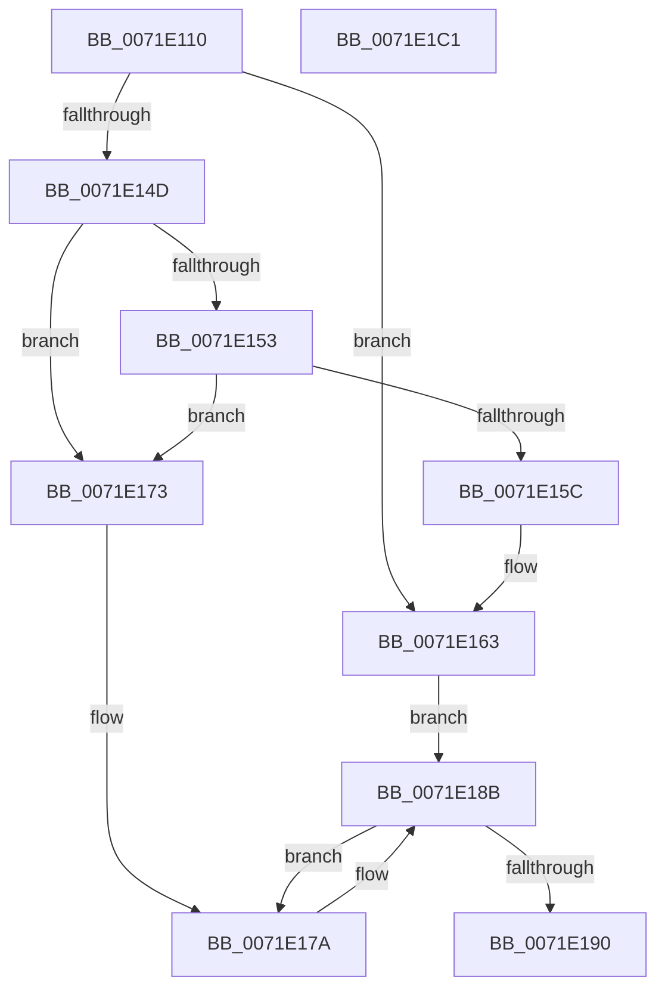

# IoUnregisterFileSystem

- RVA: `0x0071E110`–`0x0071E1C2` (길이 `178` bytes)
- VA: `0x000000014071E110`
- 실행 섹션: `PAGE`
- PDB 이름 있음: `예`; PDB Function 태그: `아니요`
- unwind 정보 RVA: `0x00060BC4`
- 디코드: `47`개 명령, `178/178` bytes 표시
- 미해석 바이트: `0` (있으면 어셈블리에 `.byte`로 보존)

> 이 문서는 커널 이미지의 기계어와 PDB 기호를 분석해 생성했습니다. 4번과 5번은 함수 원형과 자료형을 바이너리 사용 방식에서 추정한 C 해석이며 원본 소스 복구 결과는 아닙니다.

## 1. Dependencies

- 직접 호출 지점: **5**; 고유 호출 대상: **5**
- 직접 호출자로 확인된 함수: **1**
- RIP 상대 이미지 참조: **3**

### Outgoing calls
- `0x0071E13C` → [ExAcquireResourceExclusiveLite](../../text/21/ExAcquireResourceExclusiveLite_function_00214E20.md) (function, `0x00214E20`)
- `0x0071E186` → [guard_dispatch_icall](../../text/6B/guard_dispatch_icall_function_006BAAD0.md) (function, `0x006BAAD0`)
- `0x0071E19D` → [ExReleaseResourceLite](../../text/25/ExReleaseResourceLite_function_0025FA10.md) (function, `0x0025FA10`)
- `0x0071E1A2` → [KeLeaveCriticalRegion](../../text/25/KeLeaveCriticalRegion_function_0025D8B0.md) (function, `0x0025D8B0`)
- `0x0071E1AC` → [IopDecrementDeviceObjectRefCount](../../text/42/IopDecrementDeviceObjectRefCount_function_00428220.md) (function, `0x00428220`)

### Direct callers
- [RawShutdown](../78/RawShutdown_function_0078A0A0.md) at `0x0078A0B5`
- [RawShutdown](../78/RawShutdown_function_0078A0A0.md) at `0x0078A0C1`
- [RawShutdown](../78/RawShutdown_function_0078A0A0.md) at `0x0078A0CD`

### Static image references
- `0x0071E12D` → RVA `0x00F8D320` (`.data`; read)
- `0x0071E163` → RVA `0x00F8D450` (`.data`; read)
- `0x0071E190` → RVA `0x00F8D200` (`.data`; read/write)

## 2. Other-region calls and transfers

- 다른 실행 섹션으로 향하는 call: **5**
  - `0x0071E13C` → [ExAcquireResourceExclusiveLite](../../text/21/ExAcquireResourceExclusiveLite_function_00214E20.md) (`PAGE` → `.text`)
  - `0x0071E186` → [guard_dispatch_icall](../../text/6B/guard_dispatch_icall_function_006BAAD0.md) (`PAGE` → `.text`)
  - `0x0071E19D` → [ExReleaseResourceLite](../../text/25/ExReleaseResourceLite_function_0025FA10.md) (`PAGE` → `.text`)
  - `0x0071E1A2` → [KeLeaveCriticalRegion](../../text/25/KeLeaveCriticalRegion_function_0025D8B0.md) (`PAGE` → `.text`)
  - `0x0071E1AC` → [IopDecrementDeviceObjectRefCount](../../text/42/IopDecrementDeviceObjectRefCount_function_00428220.md) (`PAGE` → `.text`)
- 별도 외부 분기/꼬리 이동을 확인하지 못했습니다.

## 3. Assembly (complete function range)

```asm
0071E110  48 89 5C 24 08                  mov qword ptr [rsp + 8], rbx
0071E115  48 89 74 24 10                  mov qword ptr [rsp + 0x10], rsi
0071E11A  57                              push rdi
0071E11B  48 83 EC 20                     sub rsp, 0x20
0071E11F  65 48 8B 04 25 88 01 00 00      mov rax, qword ptr gs:[0x188]
0071E128  48 8B F9                        mov rdi, rcx
0071E12B  B2 01                           mov dl, 1
0071E12D  48 8D 0D EC F1 86 00            lea rcx, [rip + 0x86f1ec]
0071E134  66 FF 88 E4 01 00 00            dec word ptr [rax + 0x1e4]
0071E13B  90                              nop
0071E13C  E8 DF 6C AF FF                  call 0x140214e20
0071E141  4C 8D 47 50                     lea r8, [rdi + 0x50]
0071E145  49 8B 10                        mov rdx, qword ptr [r8]
0071E148  48 85 D2                        test rdx, rdx
0071E14B  74 16                           je 0x14071e163
0071E14D  4C 39 42 08                     cmp qword ptr [rdx + 8], r8
0071E151  75 20                           jne 0x14071e173
0071E153  49 8B 40 08                     mov rax, qword ptr [r8 + 8]
0071E157  4C 39 00                        cmp qword ptr [rax], r8
0071E15A  75 17                           jne 0x14071e173
0071E15C  48 89 10                        mov qword ptr [rax], rdx
0071E15F  48 89 42 08                     mov qword ptr [rdx + 8], rax
0071E163  48 8B 1D E6 F2 86 00            mov rbx, qword ptr [rip + 0x86f2e6]
0071E16A  48 8D 35 DF F2 86 00            lea rsi, [rip + 0x86f2df]
0071E171  EB 18                           jmp 0x14071e18b
0071E173  B9 03 00 00 00                  mov ecx, 3
0071E178  CD 29                           int 0x29
0071E17A  48 8B 43 18                     mov rax, qword ptr [rbx + 0x18]
0071E17E  33 D2                           xor edx, edx
0071E180  48 8B 1B                        mov rbx, qword ptr [rbx]
0071E183  48 8B CF                        mov rcx, rdi
0071E186  E8 45 C9 F9 FF                  call 0x1406baad0
0071E18B  48 3B DE                        cmp rbx, rsi
0071E18E  75 EA                           jne 0x14071e17a
0071E190  FF 05 6A F0 86 00               inc dword ptr [rip + 0x86f06a]
0071E196  48 8D 0D 83 F1 86 00            lea rcx, [rip + 0x86f183]
0071E19D  E8 6E 18 B4 FF                  call 0x14025fa10
0071E1A2  E8 09 F7 B3 FF                  call 0x14025d8b0
0071E1A7  B2 01                           mov dl, 1
0071E1A9  48 8B CF                        mov rcx, rdi
0071E1AC  E8 6F A0 D0 FF                  call 0x140428220
0071E1B1  48 8B 5C 24 30                  mov rbx, qword ptr [rsp + 0x30]
0071E1B6  48 8B 74 24 38                  mov rsi, qword ptr [rsp + 0x38]
0071E1BB  48 83 C4 20                     add rsp, 0x20
0071E1BF  5F                              pop rdi
0071E1C0  C3                              ret
0071E1C1  CC                              int3
```

## 4. C-style interpretation (structured pseudocode)

```c
__int64 __fastcall IoUnregisterFileSystem(__int64 a1)
{
    __int64 result;
    __int64 v_rsp;
    unsigned __int64 v_stack_p10;
    unsigned __int64 v_stack_p8;

    v_stack_p8 = v_rbx;
    v_stack_p10 = v_rsi;
    v_rsp = (v_rsp) - (32);
    result = ExAcquireResourceExclusiveLite(v_rip + 8843756, 1, a3, a4);
    if (*(unsigned __int64 *)(a1 + 80) == 0) goto loc_0071E163;
    if ((*(unsigned __int64 *)(*(unsigned __int64 *)(a1 + 80) + 8)) != (a1 + 80)) goto loc_0071E173;
    if ((*(unsigned __int64 *)(*(unsigned __int64 *)(a1 + 80 + 8))) != (a1 + 80)) goto loc_0071E173;
    *(unsigned __int64 *)(*(unsigned __int64 *)(a1 + 80 + 8)) = *(unsigned __int64 *)(a1 + 80);
    *(unsigned __int64 *)(*(unsigned __int64 *)(a1 + 80) + 8) = *(unsigned __int64 *)(a1 + 80 + 8);
loc_0071E163:
    goto loc_0071E18B;
loc_0071E173:
loc_0071E17A:
    a2 = 0;
    result = guard_dispatch_icall(a1, a2, a1 + 80, a4);
loc_0071E18B:
    if ((*(unsigned __int64 *)(*(unsigned __int64 *)(v_rip + 8844006))) != (v_rip + 8843999)) goto loc_0071E17A;
    result = ExReleaseResourceLite(v_rip + 8843651, a2, a1 + 80, a4);
    result = KeLeaveCriticalRegion(v_rip + 8843651, a2, a1 + 80, a4);
    result = IopDecrementDeviceObjectRefCount(a1, 1, a1 + 80, a4);
    v_rsp = (v_rsp) + (32);
    return result;
}
```

## 5. (Beta) C Style

```c
int64_t IoUnregisterFileSystem(void *Arg1)
{
    uint8_t *arg1 = (uint8_t *)Arg1;

    int64_t result;
    int64_t local_rsp;
    uint64_t v_stack_p10;
    uint64_t v_stack_p8;

    v_stack_p8 = local_rbx;
    v_stack_p10 = local_rsi;
    local_rsp = (local_rsp) - (32);
    result = ExAcquireResourceExclusiveLite(v_rip + 8843756, 1, a3, a4);
    if (*(uint64_t *)(arg1 + 0x50) == 0) goto loc_0071E163;
    if ((*(uint64_t *)(*(uint64_t *)(arg1 + 0x50) + 0x8)) != (Arg1 + 80)) goto loc_0071E173;
    if ((*(uint64_t *)(*(uint64_t *)(arg1 + 0x50 + 0x8))) != (Arg1 + 80)) goto loc_0071E173;
    *(uint64_t *)(*(uint64_t *)(arg1 + 0x50 + 0x8)) = *(uint64_t *)(arg1 + 0x50);
    *(uint64_t *)(*(uint64_t *)(arg1 + 0x50) + 0x8) = *(uint64_t *)(arg1 + 0x50 + 0x8);
loc_0071E163:
    goto loc_0071E18B;
loc_0071E173:
loc_0071E17A:
    a2 = 0;
    result = guard_dispatch_icall(Arg1, a2, Arg1 + 80, a4);
loc_0071E18B:
    if ((*(uint64_t *)(*(uint64_t *)(v_rip + 0x86F2E6))) != (v_rip + 8843999)) goto loc_0071E17A;
    result = ExReleaseResourceLite(v_rip + 8843651, a2, Arg1 + 80, a4);
    result = KeLeaveCriticalRegion(v_rip + 8843651, a2, Arg1 + 80, a4);
    result = IopDecrementDeviceObjectRefCount(Arg1, 1, Arg1 + 80, a4);
    local_rsp = (local_rsp) + (32);
    return result;
}
```

### 관측된 메모리 오프셋

구조체 형식이 확인되지 않은 접근은 인자 기준의 오프셋으로만 기록했습니다.

| 기준 인자 | 오프셋 표현 | 폭 (bit) | 접근 |
|---|---:|---:|---|
| `Arg1` | `+ 0x0` | `64` | `R` |
| `Arg1` | `+ 0x8` | `64` | `R` |
| `Arg1` | `+ 0x50` | `64` | `R` |

## 6. Execution-region graph

[열기: 2D/3D 그래프와 함수 탐색 컨트롤 패널](../../../control-panel.html?section=page&rva=0x0071E110&view=graph)

- 2D 그래프는 위에서 아래로 흐르고, 3D 그래프는 빈 공간을 드래그해 회전합니다. Shift+드래그는 이동, 휠은 확대·축소, 함수 노드 선택은 대상 보고서 이동입니다.

### Static fallback


