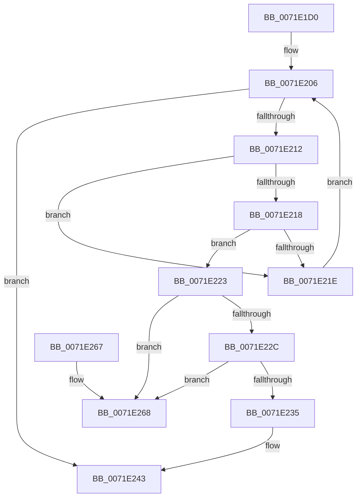

# IoUnregisterFsRegistrationChange

- RVA: `0x0071E1D0`–`0x0071E26F` (길이 `159` bytes)
- VA: `0x000000014071E1D0`
- 실행 섹션: `PAGE`
- PDB 이름 있음: `예`; PDB Function 태그: `아니요`
- unwind 정보 RVA: `0x0006CF28`
- 디코드: `43`개 명령, `159/159` bytes 표시
- 미해석 바이트: `0` (있으면 어셈블리에 `.byte`로 보존)

> 이 문서는 커널 이미지의 기계어와 PDB 기호를 분석해 생성했습니다. 4번과 5번은 함수 원형과 자료형을 바이너리 사용 방식에서 추정한 C 해석이며 원본 소스 복구 결과는 아닙니다.

## 1. Dependencies

- 직접 호출 지점: **5**; 고유 호출 대상: **5**
- 직접 호출자로 확인된 함수: **0**
- RIP 상대 이미지 참조: **2**

### Outgoing calls
- `0x0071E1FA` → [ExAcquireResourceExclusiveLite](../../text/21/ExAcquireResourceExclusiveLite_function_00214E20.md) (function, `0x00214E20`)
- `0x0071E23E` → [ExFreePoolWithTag](../../poolcode/B8/ExFreePoolWithTag_function_00B82870.md) (function, `0x00B82870`)
- `0x0071E24A` → [ExReleaseResourceLite](../../text/25/ExReleaseResourceLite_function_0025FA10.md) (function, `0x0025FA10`)
- `0x0071E24F` → [KeLeaveCriticalRegion](../../text/25/KeLeaveCriticalRegion_function_0025D8B0.md) (function, `0x0025D8B0`)
- `0x0071E257` → [ObfDereferenceObject](../../text/2F/ObfDereferenceObject_function_002F9350.md) (function, `0x002F9350`)

### Direct callers
- 이 함수 시작 RVA로 연결되는 직접 call은 확인되지 않았습니다. 간접 호출은 완전히 역산할 수 없습니다.

### Static image references
- `0x0071E1EB` → RVA `0x00F8D320` (`.data`; read)
- `0x0071E1FF` → RVA `0x00F8D450` (`.data`; read)

## 2. Other-region calls and transfers

- 다른 실행 섹션으로 향하는 call: **5**
  - `0x0071E1FA` → [ExAcquireResourceExclusiveLite](../../text/21/ExAcquireResourceExclusiveLite_function_00214E20.md) (`PAGE` → `.text`)
  - `0x0071E23E` → [ExFreePoolWithTag](../../poolcode/B8/ExFreePoolWithTag_function_00B82870.md) (`PAGE` → `POOLCODE`)
  - `0x0071E24A` → [ExReleaseResourceLite](../../text/25/ExReleaseResourceLite_function_0025FA10.md) (`PAGE` → `.text`)
  - `0x0071E24F` → [KeLeaveCriticalRegion](../../text/25/KeLeaveCriticalRegion_function_0025D8B0.md) (`PAGE` → `.text`)
  - `0x0071E257` → [ObfDereferenceObject](../../text/2F/ObfDereferenceObject_function_002F9350.md) (`PAGE` → `.text`)
- 별도 외부 분기/꼬리 이동을 확인하지 못했습니다.

## 3. Assembly (complete function range)

```asm
0071E1D0  48 89 5C 24 08                  mov qword ptr [rsp + 8], rbx
0071E1D5  57                              push rdi
0071E1D6  48 83 EC 20                     sub rsp, 0x20
0071E1DA  65 48 8B 04 25 88 01 00 00      mov rax, qword ptr gs:[0x188]
0071E1E3  48 8B FA                        mov rdi, rdx
0071E1E6  48 8B D9                        mov rbx, rcx
0071E1E9  B2 01                           mov dl, 1
0071E1EB  48 8D 0D 2E F1 86 00            lea rcx, [rip + 0x86f12e]
0071E1F2  66 FF 88 E4 01 00 00            dec word ptr [rax + 0x1e4]
0071E1F9  90                              nop
0071E1FA  E8 21 6C AF FF                  call 0x140214e20
0071E1FF  48 8B 0D 4A F2 86 00            mov rcx, qword ptr [rip + 0x86f24a]
0071E206  48 8D 05 43 F2 86 00            lea rax, [rip + 0x86f243]
0071E20D  48 3B C8                        cmp rcx, rax
0071E210  74 31                           je 0x14071e243
0071E212  48 39 59 10                     cmp qword ptr [rcx + 0x10], rbx
0071E216  75 06                           jne 0x14071e21e
0071E218  48 39 79 18                     cmp qword ptr [rcx + 0x18], rdi
0071E21C  74 05                           je 0x14071e223
0071E21E  48 8B 09                        mov rcx, qword ptr [rcx]
0071E221  EB E3                           jmp 0x14071e206
0071E223  48 8B 11                        mov rdx, qword ptr [rcx]
0071E226  48 39 4A 08                     cmp qword ptr [rdx + 8], rcx
0071E22A  75 3C                           jne 0x14071e268
0071E22C  48 8B 41 08                     mov rax, qword ptr [rcx + 8]
0071E230  48 39 08                        cmp qword ptr [rax], rcx
0071E233  75 33                           jne 0x14071e268
0071E235  48 89 10                        mov qword ptr [rax], rdx
0071E238  48 89 42 08                     mov qword ptr [rdx + 8], rax
0071E23C  33 D2                           xor edx, edx
0071E23E  E8 2D 46 46 00                  call 0x140b82870
0071E243  48 8D 0D D6 F0 86 00            lea rcx, [rip + 0x86f0d6]
0071E24A  E8 C1 17 B4 FF                  call 0x14025fa10
0071E24F  E8 5C F6 B3 FF                  call 0x14025d8b0
0071E254  48 8B CB                        mov rcx, rbx
0071E257  E8 F4 B0 BD FF                  call 0x1402f9350
0071E25C  48 8B 5C 24 30                  mov rbx, qword ptr [rsp + 0x30]
0071E261  48 83 C4 20                     add rsp, 0x20
0071E265  5F                              pop rdi
0071E266  C3                              ret
0071E267  CC                              int3
0071E268  B9 03 00 00 00                  mov ecx, 3
0071E26D  CD 29                           int 0x29
```

## 4. C-style interpretation (structured pseudocode)

```c
__int64 __fastcall IoUnregisterFsRegistrationChange(__int64 a1, __int64 a2)
{
    __int64 result;
    __int64 v_rsp;
    unsigned __int64 v_stack_p8;

    v_stack_p8 = v_rbx;
    v_rsp = (v_rsp) - (32);
    result = ExAcquireResourceExclusiveLite(v_rip + 8843566, 1, a3, a4);
loc_0071E206:
    if ((*(unsigned __int64 *)(v_rip + 8843850)) == (v_rip + 8843843)) goto loc_0071E243;
    if ((*(unsigned __int64 *)(*(unsigned __int64 *)(v_rip + 8843850) + 16)) != a1) goto loc_0071E21E;
    if ((*(unsigned __int64 *)(*(unsigned __int64 *)(v_rip + 8843850) + 24)) == a2) goto loc_0071E223;
loc_0071E21E:
    goto loc_0071E206;
loc_0071E223:
    if ((*(unsigned __int64 *)(*(unsigned __int64 *)(*(unsigned __int64 *)(*(unsigned __int64 *)(v_rip + 8843850))) + 8)) != (*(unsigned __int64 *)(*(unsigned __int64 *)(v_rip + 8843850)))) goto loc_0071E268;
    if ((*(unsigned __int64 *)(*(unsigned __int64 *)(*(unsigned __int64 *)(*(unsigned __int64 *)(v_rip + 8843850)) + 8))) != (*(unsigned __int64 *)(*(unsigned __int64 *)(v_rip + 8843850)))) goto loc_0071E268;
    *(unsigned __int64 *)(*(unsigned __int64 *)(*(unsigned __int64 *)(*(unsigned __int64 *)(v_rip + 8843850)) + 8)) = *(unsigned __int64 *)(*(unsigned __int64 *)(*(unsigned __int64 *)(v_rip + 8843850)));
    *(unsigned __int64 *)(*(unsigned __int64 *)(*(unsigned __int64 *)(*(unsigned __int64 *)(v_rip + 8843850))) + 8) = *(unsigned __int64 *)(*(unsigned __int64 *)(*(unsigned __int64 *)(v_rip + 8843850)) + 8);
    a2 = 0;
    result = ExFreePoolWithTag(*(unsigned __int64 *)(*(unsigned __int64 *)(v_rip + 8843850)), a2, a3, a4);
loc_0071E243:
    result = ExReleaseResourceLite(v_rip + 8843478, a2, a3, a4);
    result = KeLeaveCriticalRegion(v_rip + 8843478, a2, a3, a4);
    result = ObfDereferenceObject(a1, a2, a3, a4);
    v_rsp = (v_rsp) + (32);
    return result;
loc_0071E268:
    return result;
}
```

## 5. (Beta) C Style

```c
int64_t IoUnregisterFsRegistrationChange(int64_t Arg1, int64_t Arg2)
{
    int64_t result;
    int64_t local_rsp;
    uint64_t v_stack_p8;

    v_stack_p8 = local_rbx;
    local_rsp = (local_rsp) - (32);
    result = ExAcquireResourceExclusiveLite(v_rip + 8843566, 1, a3, a4);
loc_0071E206:
    if ((*(uint64_t *)(v_rip + 0x86F24A)) == (v_rip + 8843843)) goto loc_0071E243;
    if ((*(uint64_t *)(*(uint64_t *)(v_rip + 0x86F24A) + 0x10)) != Arg1) goto loc_0071E21E;
    if ((*(uint64_t *)(*(uint64_t *)(v_rip + 0x86F24A) + 0x18)) == Arg2) goto loc_0071E223;
loc_0071E21E:
    goto loc_0071E206;
loc_0071E223:
    if ((*(uint64_t *)(*(uint64_t *)(*(uint64_t *)(*(uint64_t *)(v_rip + 0x86F24A))) + 0x8)) != (*(uint64_t *)(*(uint64_t *)(v_rip + 0x86F24A)))) goto loc_0071E268;
    if ((*(uint64_t *)(*(uint64_t *)(*(uint64_t *)(*(uint64_t *)(v_rip + 0x86F24A)) + 0x8))) != (*(uint64_t *)(*(uint64_t *)(v_rip + 0x86F24A)))) goto loc_0071E268;
    *(uint64_t *)(*(uint64_t *)(*(uint64_t *)(*(uint64_t *)(v_rip + 0x86F24A)) + 0x8)) = *(uint64_t *)(*(uint64_t *)(*(uint64_t *)(v_rip + 0x86F24A)));
    *(uint64_t *)(*(uint64_t *)(*(uint64_t *)(*(uint64_t *)(v_rip + 0x86F24A))) + 0x8) = *(uint64_t *)(*(uint64_t *)(*(uint64_t *)(v_rip + 0x86F24A)) + 0x8);
    Arg2 = 0;
    result = ExFreePoolWithTag(*(uint64_t *)(*(uint64_t *)(v_rip + 0x86F24A)), Arg2, a3, a4);
loc_0071E243:
    result = ExReleaseResourceLite(v_rip + 8843478, Arg2, a3, a4);
    result = KeLeaveCriticalRegion(v_rip + 8843478, Arg2, a3, a4);
    result = ObfDereferenceObject(Arg1, Arg2, a3, a4);
    local_rsp = (local_rsp) + (32);
    return result;
loc_0071E268:
    return result;
}
```

## 6. Execution-region graph

[열기: 2D/3D 그래프와 함수 탐색 컨트롤 패널](../../../control-panel.html?section=page&rva=0x0071E1D0&view=graph)

- 2D 그래프는 위에서 아래로 흐르고, 3D 그래프는 빈 공간을 드래그해 회전합니다. Shift+드래그는 이동, 휠은 확대·축소, 함수 노드 선택은 대상 보고서 이동입니다.

### Static fallback


