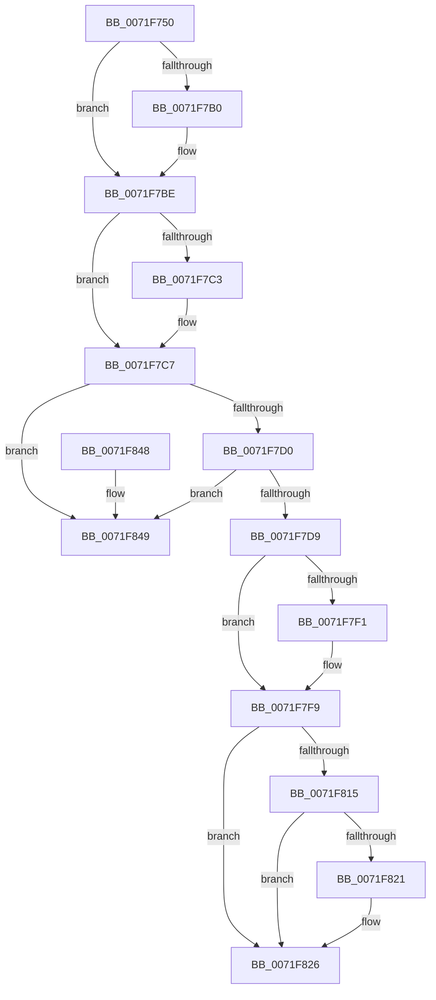

# IoUnregisterIoTracking

- RVA: `0x0071F750`–`0x0071F850` (길이 `256` bytes)
- VA: `0x000000014071F750`
- 실행 섹션: `PAGE`
- PDB 이름 있음: `예`; PDB Function 태그: `아니요`
- unwind 정보 RVA: `0x00069AD0`
- 디코드: `67`개 명령, `256/256` bytes 표시
- 미해석 바이트: `0` (있으면 어셈블리에 `.byte`로 보존)

> 이 문서는 커널 이미지의 기계어와 PDB 기호를 분석해 생성했습니다. 4번과 5번은 함수 원형과 자료형을 바이너리 사용 방식에서 추정한 C 해석이며 원본 소스 복구 결과는 아닙니다.

## 1. Dependencies

- 직접 호출 지점: **8**; 고유 호출 대상: **8**
- 직접 호출자로 확인된 함수: **0**
- RIP 상대 이미지 참조: **2**

### Outgoing calls
- `0x0071F76C` → [IoPerfReset](../../text/59/IoPerfReset_function_0059863C.md) (function, `0x0059863C`)
- `0x0071F776` → [IopIrpExtensionControl](../../text/59/IopIrpExtensionControl_function_00597558.md) (function, `0x00597558`)
- `0x0071F79F` → [KeAbPreAcquire](../../text/21/KeAbPreAcquire_function_00210230.md) (function, `0x00210230`)
- `0x0071F7B9` → [ExfAcquirePushLockExclusiveEx](../../text/20/ExfAcquirePushLockExclusiveEx_function_0020FC90.md) (function, `0x0020FC90`)
- `0x0071F7F4` → [ExfTryToWakePushLock](../../text/26/ExfTryToWakePushLock_function_00265DD0.md) (function, `0x00265DD0`)
- `0x0071F7FC` → [KeAbPostRelease](../../text/2E/KeAbPostRelease_function_002E1600.md) (function, `0x002E1600`)
- `0x0071F821` → [KiCheckForKernelApcDelivery](../../text/2E/KiCheckForKernelApcDelivery_function_002E2C80.md) (function, `0x002E2C80`)
- `0x0071F82E` → [ExFreePoolWithTag](../../poolcode/B8/ExFreePoolWithTag_function_00B82870.md) (function, `0x00B82870`)

### Direct callers
- 이 함수 시작 RVA로 연결되는 직접 call은 확인되지 않았습니다. 간접 호출은 완전히 역산할 수 없습니다.

### Static image references
- `0x0071F784` → RVA `0x00F8D438` (`.data`; read)
- `0x0071F7E0` → RVA `0x00F8D438` (`.data`; read/write)

## 2. Other-region calls and transfers

- 다른 실행 섹션으로 향하는 call: **8**
  - `0x0071F76C` → [IoPerfReset](../../text/59/IoPerfReset_function_0059863C.md) (`PAGE` → `.text`)
  - `0x0071F776` → [IopIrpExtensionControl](../../text/59/IopIrpExtensionControl_function_00597558.md) (`PAGE` → `.text`)
  - `0x0071F79F` → [KeAbPreAcquire](../../text/21/KeAbPreAcquire_function_00210230.md) (`PAGE` → `.text`)
  - `0x0071F7B9` → [ExfAcquirePushLockExclusiveEx](../../text/20/ExfAcquirePushLockExclusiveEx_function_0020FC90.md) (`PAGE` → `.text`)
  - `0x0071F7F4` → [ExfTryToWakePushLock](../../text/26/ExfTryToWakePushLock_function_00265DD0.md) (`PAGE` → `.text`)
  - `0x0071F7FC` → [KeAbPostRelease](../../text/2E/KeAbPostRelease_function_002E1600.md) (`PAGE` → `.text`)
  - `0x0071F821` → [KiCheckForKernelApcDelivery](../../text/2E/KiCheckForKernelApcDelivery_function_002E2C80.md) (`PAGE` → `.text`)
  - `0x0071F82E` → [ExFreePoolWithTag](../../poolcode/B8/ExFreePoolWithTag_function_00B82870.md) (`PAGE` → `POOLCODE`)
- 별도 외부 분기/꼬리 이동을 확인하지 못했습니다.

## 3. Assembly (complete function range)

```asm
0071F750  48 89 5C 24 08                  mov qword ptr [rsp + 8], rbx
0071F755  48 89 6C 24 10                  mov qword ptr [rsp + 0x10], rbp
0071F75A  48 89 74 24 18                  mov qword ptr [rsp + 0x18], rsi
0071F75F  57                              push rdi
0071F760  48 83 EC 20                     sub rsp, 0x20
0071F764  48 8B F9                        mov rdi, rcx
0071F767  B9 02 00 00 00                  mov ecx, 2
0071F76C  E8 CB 8E E7 FF                  call 0x14059863c
0071F771  33 D2                           xor edx, edx
0071F773  8D 4A 02                        lea ecx, [rdx + 2]
0071F776  E8 DD 7D E7 FF                  call 0x140597558
0071F77B  65 48 8B 04 25 88 01 00 00      mov rax, qword ptr gs:[0x188]
0071F784  48 8D 2D AD DC 86 00            lea rbp, [rip + 0x86dcad]
0071F78B  48 83 CB FF                     or rbx, 0xffffffffffffffff
0071F78F  45 33 C0                        xor r8d, r8d
0071F792  33 D2                           xor edx, edx
0071F794  48 8B CD                        mov rcx, rbp
0071F797  66 01 98 E6 01 00 00            add word ptr [rax + 0x1e6], bx
0071F79E  90                              nop
0071F79F  E8 8C 0A AF FF                  call 0x140210230
0071F7A4  F0 48 0F BA 6D 00 00            lock bts qword ptr [rbp], 0
0071F7AB  48 8B F0                        mov rsi, rax
0071F7AE  73 0E                           jae 0x14071f7be
0071F7B0  4C 8B C5                        mov r8, rbp
0071F7B3  48 8B D0                        mov rdx, rax
0071F7B6  48 8B CD                        mov rcx, rbp
0071F7B9  E8 D2 04 AF FF                  call 0x14020fc90
0071F7BE  48 85 F6                        test rsi, rsi
0071F7C1  74 04                           je 0x14071f7c7
0071F7C3  C6 46 0A 01                     mov byte ptr [rsi + 0xa], 1
0071F7C7  48 8B 17                        mov rdx, qword ptr [rdi]
0071F7CA  48 39 7A 08                     cmp qword ptr [rdx + 8], rdi
0071F7CE  75 79                           jne 0x14071f849
0071F7D0  48 8B 47 08                     mov rax, qword ptr [rdi + 8]
0071F7D4  48 39 38                        cmp qword ptr [rax], rdi
0071F7D7  75 70                           jne 0x14071f849
0071F7D9  48 89 10                        mov qword ptr [rax], rdx
0071F7DC  48 89 42 08                     mov qword ptr [rdx + 8], rax
0071F7E0  F0 48 0F C1 1D 4F DC 86 00      lock xadd qword ptr [rip + 0x86dc4f], rbx
0071F7E9  80 E3 06                        and bl, 6
0071F7EC  80 FB 02                        cmp bl, 2
0071F7EF  75 08                           jne 0x14071f7f9
0071F7F1  48 8B CD                        mov rcx, rbp
0071F7F4  E8 D7 65 B4 FF                  call 0x140265dd0
0071F7F9  48 8B CD                        mov rcx, rbp
0071F7FC  E8 FF 1D BC FF                  call 0x1402e1600
0071F801  65 48 8B 04 25 88 01 00 00      mov rax, qword ptr gs:[0x188]
0071F80A  90                              nop
0071F80B  66 83 80 E6 01 00 00 01         add word ptr [rax + 0x1e6], 1
0071F813  75 11                           jne 0x14071f826
0071F815  48 05 98 00 00 00               add rax, 0x98
0071F81B  90                              nop
0071F81C  48 39 00                        cmp qword ptr [rax], rax
0071F81F  74 05                           je 0x14071f826
0071F821  E8 5A 34 BC FF                  call 0x1402e2c80
0071F826  BA 49 6F 54 72                  mov edx, 0x72546f49
0071F82B  48 8B CF                        mov rcx, rdi
0071F82E  E8 3D 30 46 00                  call 0x140b82870
0071F833  48 8B 5C 24 30                  mov rbx, qword ptr [rsp + 0x30]
0071F838  48 8B 6C 24 38                  mov rbp, qword ptr [rsp + 0x38]
0071F83D  48 8B 74 24 40                  mov rsi, qword ptr [rsp + 0x40]
0071F842  48 83 C4 20                     add rsp, 0x20
0071F846  5F                              pop rdi
0071F847  C3                              ret
0071F848  CC                              int3
0071F849  B9 03 00 00 00                  mov ecx, 3
0071F84E  CD 29                           int 0x29
```

## 4. C-style interpretation (structured pseudocode)

```c
__int64 __fastcall IoUnregisterIoTracking(__int64 a1, int a2, int a3)
{
    __int64 result;
    __int64 v_rbx;
    __int64 v_rsp;
    unsigned __int64 v_stack_p10;
    unsigned __int64 v_stack_p18;
    unsigned __int64 v_stack_p8;

    v_stack_p8 = v_rbx;
    v_stack_p10 = v_rbp;
    v_stack_p18 = v_rsi;
    v_rsp = (v_rsp) - (32);
    result = IoPerfReset(2, a2, a3, a4);
    a2 = 0;
    result = IopIrpExtensionControl(a2 + 2, a2, a3, a4);
    v_rbx = (v_rbx) | (-1);
    a3 = 0;
    a2 = 0;
    result = KeAbPreAcquire(v_rip + 8838317, a2, a3, a4);
    if (!(condition_is_above_or_equal)) {
        a3 = v_rip + 8838317;
        a2 = result;
        a1 = v_rip + 8838317;
        result = ExfAcquirePushLockExclusiveEx(a1, a2, a3, a4);
    }
    if (result != 0) {
        *(unsigned __int8 *)(result + 10) = 1;
    }
    if ((*(unsigned __int64 *)(*(unsigned __int64 *)(a1) + 8)) != a1) goto loc_0071F849;
    if ((*(unsigned __int64 *)(*(unsigned __int64 *)(a1 + 8))) != a1) goto loc_0071F849;
    *(unsigned __int64 *)(*(unsigned __int64 *)(a1 + 8)) = *(unsigned __int64 *)(a1);
    *(unsigned __int64 *)(*(unsigned __int64 *)(a1) + 8) = *(unsigned __int64 *)(a1 + 8);
    v_rbx = (unsigned __int8)((v_rbx) & (6));
    result = *(unsigned __int64 *)(a1 + 8);
    if (((unsigned __int8)(v_rbx)) == 2) {
        a1 = v_rip + 8838317;
        result = ExfTryToWakePushLock(a1, *(unsigned __int64 *)(a1), a3, a4);
    }
    result = KeAbPostRelease(v_rip + 8838317, *(unsigned __int64 *)(a1), a3, a4);
    if (((unsigned __int8)(v_rbx)) != 2) goto loc_0071F826;
    result = (*(unsigned __int64 *)(gs_base + (0 + 392))) + (152);
    if ((*(unsigned __int64 *)(result)) != result) {
        result = KiCheckForKernelApcDelivery(v_rip + 8838317, *(unsigned __int64 *)(a1), a3, a4);
    }
    result = ExFreePoolWithTag(a1, (unsigned int)(0x72546F49ULL), a3, a4);
    v_rsp = (v_rsp) + (32);
    return result;
loc_0071F849:
    return result;
}
```

## 5. (Beta) C Style

```c
int64_t IoUnregisterIoTracking(void *Arg1, int32_t Arg2, int32_t Arg3)
{
    uint8_t *arg1 = (uint8_t *)Arg1;

    int64_t result;
    int64_t local_rbx;
    int64_t local_rsp;
    uint64_t v_stack_p10;
    uint64_t v_stack_p18;
    uint64_t v_stack_p8;

    v_stack_p8 = local_rbx;
    v_stack_p10 = local_rbp;
    v_stack_p18 = local_rsi;
    local_rsp = (local_rsp) - (32);
    result = IoPerfReset(2, Arg2, Arg3, a4);
    Arg2 = 0;
    result = IopIrpExtensionControl(Arg2 + 2, Arg2, Arg3, a4);
    local_rbx = (local_rbx) | (-1);
    Arg3 = 0;
    Arg2 = 0;
    result = KeAbPreAcquire(v_rip + 8838317, Arg2, Arg3, a4);
    if (!(condition_is_above_or_equal)) {
        Arg3 = v_rip + 8838317;
        Arg2 = result;
        Arg1 = v_rip + 8838317;
        result = ExfAcquirePushLockExclusiveEx(Arg1, Arg2, Arg3, a4);
    }
    if (result != 0) {
        *(uint8_t *)(result + 0xA) = 1;
    }
    if ((*(uint64_t *)(*(uint64_t *)(arg1) + 0x8)) != Arg1) goto loc_0071F849;
    if ((*(uint64_t *)(*(uint64_t *)(arg1 + 0x8))) != Arg1) goto loc_0071F849;
    *(uint64_t *)(*(uint64_t *)(arg1 + 0x8)) = *(uint64_t *)(arg1);
    *(uint64_t *)(*(uint64_t *)(arg1) + 0x8) = *(uint64_t *)(arg1 + 0x8);
    local_rbx = (uint8_t)((local_rbx) & (6));
    result = *(uint64_t *)(arg1 + 0x8);
    if (((uint8_t)(local_rbx)) == 2) {
        Arg1 = v_rip + 8838317;
        result = ExfTryToWakePushLock(Arg1, *(uint64_t *)(arg1), Arg3, a4);
    }
    result = KeAbPostRelease(v_rip + 8838317, *(uint64_t *)(arg1), Arg3, a4);
    if (((uint8_t)(local_rbx)) != 2) goto loc_0071F826;
    result = (*(uint64_t *)(gs_base + (0 + 0x188))) + (152);
    if ((*(uint64_t *)(result)) != result) {
        result = KiCheckForKernelApcDelivery(v_rip + 8838317, *(uint64_t *)(arg1), Arg3, a4);
    }
    result = ExFreePoolWithTag(Arg1, (uint32_t)(0x72546F49ULL), Arg3, a4);
    local_rsp = (local_rsp) + (32);
    return result;
loc_0071F849:
    return result;
}
```

### 관측된 메모리 오프셋

구조체 형식이 확인되지 않은 접근은 인자 기준의 오프셋으로만 기록했습니다.

| 기준 인자 | 오프셋 표현 | 폭 (bit) | 접근 |
|---|---:|---:|---|
| `Arg1` | `+ 0x0` | `64` | `R` |
| `Arg1` | `+ 0x8` | `64` | `R` |

## 6. Execution-region graph

[열기: 2D/3D 그래프와 함수 탐색 컨트롤 패널](../../../control-panel.html?section=page&rva=0x0071F750&view=graph)

- 2D 그래프는 위에서 아래로 흐르고, 3D 그래프는 빈 공간을 드래그해 회전합니다. Shift+드래그는 이동, 휠은 확대·축소, 함수 노드 선택은 대상 보고서 이동입니다.

### Static fallback


