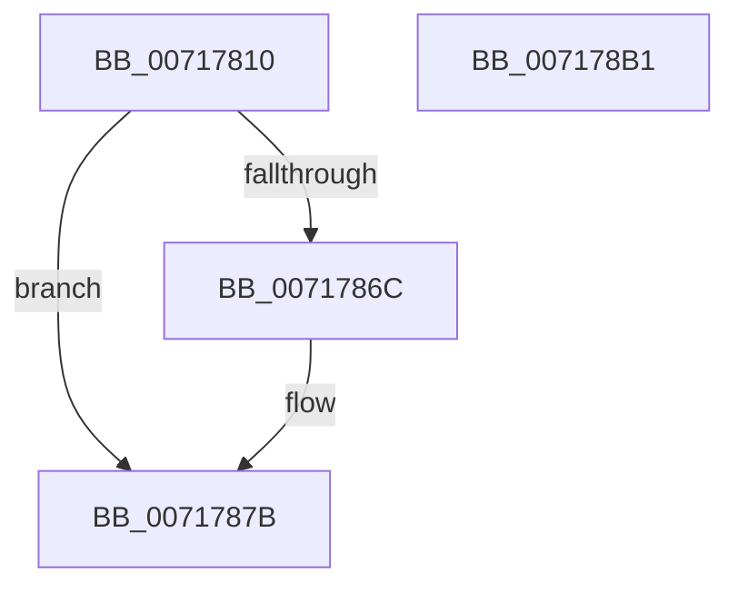

# IoVerifyPartitionTable

- RVA: `0x00717810`–`0x007178B2` (길이 `162` bytes)
- VA: `0x0000000140717810`
- 실행 섹션: `PAGE`
- PDB 이름 있음: `예`; PDB Function 태그: `아니요`
- unwind 정보 RVA: `0x000C6310`
- 디코드: `38`개 명령, `162/162` bytes 표시
- 미해석 바이트: `0` (있으면 어셈블리에 `.byte`로 보존)

> 이 문서는 커널 이미지의 기계어와 PDB 기호를 분석해 생성했습니다. 4번과 5번은 함수 원형과 자료형을 바이너리 사용 방식에서 추정한 C 해석이며 원본 소스 복구 결과는 아닙니다.

## 1. Dependencies

- 직접 호출 지점: **5**; 고유 호출 대상: **5**
- 직접 호출자로 확인된 함수: **0**
- RIP 상대 이미지 참조: **2**

### Outgoing calls
- `0x0071783F` → [SC_DISK::SC_DISK](../../text/6A/SC_DISK_SC_DISK_function_006A41DC.md) (function, `0x006A41DC`)
- `0x00717861` → [NT_DISK::Initialize](NT_DISK_Initialize_function_007170C8.md) (function, `0x007170C8`)
- `0x00717874` → [SC_DISK::VerifyPartitionTable](../../text/6A/SC_DISK_VerifyPartitionTable_function_006A4D10.md) (function, `0x006A4D10`)
- `0x00717885` → [SC_DISK::~SC_DISK](../../text/6A/SC_DISK_SC_DISK_function_006A42C4.md) (function, `0x006A42C4`)
- `0x00717897` → [_security_check_cookie](../../text/6A/_security_check_cookie_function_006AC640.md) (function, `0x006AC640`)

### Direct callers
- 이 함수 시작 RVA로 연결되는 직접 call은 확인되지 않았습니다. 간접 호출은 완전히 역산할 수 없습니다.

### Static image references
- `0x00717822` → RVA `0x00E0A740` (`.data`; read)
- `0x0071784D` → RVA `0x00007EB8` (`.rdata`; read)

## 2. Other-region calls and transfers

- 다른 실행 섹션으로 향하는 call: **4**
  - `0x0071783F` → [SC_DISK::SC_DISK](../../text/6A/SC_DISK_SC_DISK_function_006A41DC.md) (`PAGE` → `.text`)
  - `0x00717874` → [SC_DISK::VerifyPartitionTable](../../text/6A/SC_DISK_VerifyPartitionTable_function_006A4D10.md) (`PAGE` → `.text`)
  - `0x00717885` → [SC_DISK::~SC_DISK](../../text/6A/SC_DISK_SC_DISK_function_006A42C4.md) (`PAGE` → `.text`)
  - `0x00717897` → [_security_check_cookie](../../text/6A/_security_check_cookie_function_006AC640.md) (`PAGE` → `.text`)
- 별도 외부 분기/꼬리 이동을 확인하지 못했습니다.

## 3. Assembly (complete function range)

```asm
00717810  48 89 5C 24 08                  mov qword ptr [rsp + 8], rbx
00717815  48 89 74 24 10                  mov qword ptr [rsp + 0x10], rsi
0071781A  57                              push rdi
0071781B  48 81 EC C0 01 00 00            sub rsp, 0x1c0
00717822  48 8B 05 17 2F 6F 00            mov rax, qword ptr [rip + 0x6f2f17]
00717829  48 33 C4                        xor rax, rsp
0071782C  48 89 84 24 B0 01 00 00         mov qword ptr [rsp + 0x1b0], rax
00717834  4C 8B C1                        mov r8, rcx
00717837  40 8A FA                        mov dil, dl
0071783A  48 8D 4C 24 20                  lea rcx, [rsp + 0x20]
0071783F  E8 98 C9 F8 FF                  call 0x1406a41dc
00717844  48 83 A4 24 A8 01 00 00 00      and qword ptr [rsp + 0x1a8], 0
0071784D  48 8D 35 64 06 8F FF            lea rsi, [rip - 0x70f99c]
00717854  49 8B D0                        mov rdx, r8
00717857  48 89 74 24 20                  mov qword ptr [rsp + 0x20], rsi
0071785C  48 8D 4C 24 20                  lea rcx, [rsp + 0x20]
00717861  E8 62 F8 FF FF                  call 0x1407170c8
00717866  8B D8                           mov ebx, eax
00717868  85 C0                           test eax, eax
0071786A  78 0F                           js 0x14071787b
0071786C  40 8A D7                        mov dl, dil
0071786F  48 8D 4C 24 20                  lea rcx, [rsp + 0x20]
00717874  E8 97 D4 F8 FF                  call 0x1406a4d10
00717879  8B D8                           mov ebx, eax
0071787B  48 8D 4C 24 20                  lea rcx, [rsp + 0x20]
00717880  48 89 74 24 20                  mov qword ptr [rsp + 0x20], rsi
00717885  E8 3A CA F8 FF                  call 0x1406a42c4
0071788A  8B C3                           mov eax, ebx
0071788C  48 8B 8C 24 B0 01 00 00         mov rcx, qword ptr [rsp + 0x1b0]
00717894  48 33 CC                        xor rcx, rsp
00717897  E8 A4 4D F9 FF                  call 0x1406ac640
0071789C  4C 8D 9C 24 C0 01 00 00         lea r11, [rsp + 0x1c0]
007178A4  49 8B 5B 10                     mov rbx, qword ptr [r11 + 0x10]
007178A8  49 8B 73 18                     mov rsi, qword ptr [r11 + 0x18]
007178AC  49 8B E3                        mov rsp, r11
007178AF  5F                              pop rdi
007178B0  C3                              ret
007178B1  CC                              int3
```

## 4. C-style interpretation (structured pseudocode)

```c
__int64 __fastcall IoVerifyPartitionTable(__int64 a1, unsigned __int8 a2)
{
    __int64 result;
    __int64 v_rbx;
    __int64 v_rsp;
    unsigned __int64 v_stack_m18;
    unsigned __int64 v_stack_m1A8;
    unsigned __int64 v_stack_m20;
    unsigned __int64 v_stack_m8;
    unsigned __int64 v_stack_p10;
    unsigned __int64 v_stack_p8;

    v_stack_p8 = v_rbx;
    v_stack_p10 = v_rsi;
    v_rsp = (v_rsp) - (448);
    result = (*(unsigned __int64 *)(v_rip + 7286551)) ^ (v_rsp);
    v_stack_m18 = result;
    result = SC_DISK__SC_DISK(v_stack_m1A8, a2, a1, a4);
    v_stack_m1A8 = v_rip - 7403932;
    result = NT_DISK__Initialize(v_stack_m1A8, a1, a1, a4);
    v_rbx = (unsigned int)((unsigned int)(result));
    if (!(sign_flag)) {
        a2 = a2;
        a1 = v_stack_m1A8;
        result = SC_DISK__VerifyPartitionTable(a1, a2, a1, a4);
        v_rbx = (unsigned int)(result);
    }
    v_stack_m1A8 = v_rip - 7403932;
    result = SC_DISK___SC_DISK(v_stack_m1A8, a2, a1, a4);
    a1 = (v_stack_m18) ^ (v_rsp);
    result = _security_check_cookie(a1, a2, a1, a4);
    return result;
}
```

## 5. (Beta) C Style

```c
int64_t IoVerifyPartitionTable(int64_t Arg1, uint8_t Arg2)
{
    int64_t result;
    int64_t local_rbx;
    int64_t local_rsp;
    uint64_t v_stack_m18;
    uint64_t v_stack_m1A8;
    uint64_t v_stack_m20;
    uint64_t v_stack_m8;
    uint64_t v_stack_p10;
    uint64_t v_stack_p8;

    v_stack_p8 = local_rbx;
    v_stack_p10 = local_rsi;
    local_rsp = (local_rsp) - (448);
    result = (*(uint64_t *)(v_rip + 0x6F2F17)) ^ (local_rsp);
    v_stack_m18 = result;
    result = SC_DISK__SC_DISK(v_stack_m1A8, Arg2, Arg1, a4);
    v_stack_m1A8 = v_rip - 7403932;
    result = NT_DISK__Initialize(v_stack_m1A8, Arg1, Arg1, a4);
    local_rbx = (uint32_t)((uint32_t)(result));
    if (!(sign_flag)) {
        Arg2 = Arg2;
        Arg1 = v_stack_m1A8;
        result = SC_DISK__VerifyPartitionTable(Arg1, Arg2, Arg1, a4);
        local_rbx = (uint32_t)(result);
    }
    v_stack_m1A8 = v_rip - 7403932;
    result = SC_DISK___SC_DISK(v_stack_m1A8, Arg2, Arg1, a4);
    Arg1 = (v_stack_m18) ^ (local_rsp);
    result = _security_check_cookie(Arg1, Arg2, Arg1, a4);
    return result;
}
```

## 6. Execution-region graph

[열기: 2D/3D 그래프와 함수 탐색 컨트롤 패널](../../../control-panel.html?section=page&rva=0x00717810&view=graph)

- 2D 그래프는 위에서 아래로 흐르고, 3D 그래프는 빈 공간을 드래그해 회전합니다. Shift+드래그는 이동, 휠은 확대·축소, 함수 노드 선택은 대상 보고서 이동입니다.

### Static fallback


