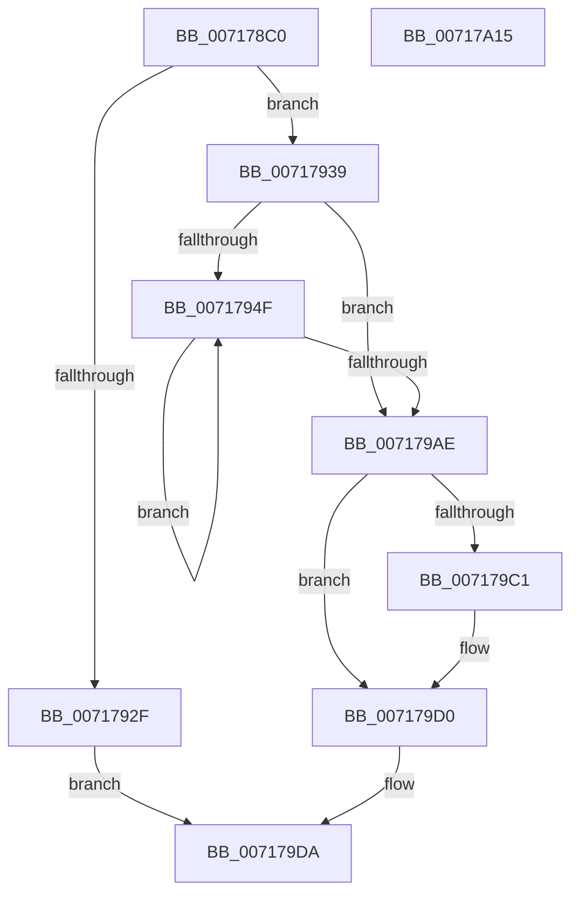

# IoWritePartitionTable

- RVA: `0x007178C0`–`0x00717A16` (길이 `342` bytes)
- VA: `0x00000001407178C0`
- 실행 섹션: `PAGE`
- PDB 이름 있음: `예`; PDB Function 태그: `아니요`
- unwind 정보 RVA: `0x000C63CC`
- 디코드: `86`개 명령, `342/342` bytes 표시
- 미해석 바이트: `0` (있으면 어셈블리에 `.byte`로 보존)

> 이 문서는 커널 이미지의 기계어와 PDB 기호를 분석해 생성했습니다. 4번과 5번은 함수 원형과 자료형을 바이너리 사용 방식에서 추정한 C 해석이며 원본 소스 복구 결과는 아닙니다.

## 1. Dependencies

- 직접 호출 지점: **7**; 고유 호출 대상: **7**
- 직접 호출자로 확인된 함수: **1**
- RIP 상대 이미지 참조: **2**

### Outgoing calls
- `0x007178FA` → [SC_DISK::SC_DISK](../../text/6A/SC_DISK_SC_DISK_function_006A41DC.md) (function, `0x006A41DC`)
- `0x00717922` → [SC_ENV::Allocate](SC_ENV_Allocate_function_00716F90.md) (function, `0x00716F90`)
- `0x007179B6` → [NT_DISK::Initialize](NT_DISK_Initialize_function_007170C8.md) (function, `0x007170C8`)
- `0x007179C9` → [SC_DISK::WritePartitionTable](../../text/6A/SC_DISK_WritePartitionTable_function_006A4D4C.md) (function, `0x006A4D4C`)
- `0x007179D5` → [ExFreePoolWithTag](../../poolcode/B8/ExFreePoolWithTag_function_00B82870.md) (function, `0x00B82870`)
- `0x007179E4` → [SC_DISK::~SC_DISK](../../text/6A/SC_DISK_SC_DISK_function_006A42C4.md) (function, `0x006A42C4`)
- `0x007179F6` → [_security_check_cookie](../../text/6A/_security_check_cookie_function_006AC640.md) (function, `0x006AC640`)

### Direct callers
- [DifIoWritePartitionTableWrapper](../../text/62/DifIoWritePartitionTableWrapper_function_0062DB50.md) at `0x0062DC54`

### Static image references
- `0x007178D8` → RVA `0x00E0A740` (`.data`; read)
- `0x00717901` → RVA `0x00007EB8` (`.rdata`; read)

## 2. Other-region calls and transfers

- 다른 실행 섹션으로 향하는 call: **5**
  - `0x007178FA` → [SC_DISK::SC_DISK](../../text/6A/SC_DISK_SC_DISK_function_006A41DC.md) (`PAGE` → `.text`)
  - `0x007179C9` → [SC_DISK::WritePartitionTable](../../text/6A/SC_DISK_WritePartitionTable_function_006A4D4C.md) (`PAGE` → `.text`)
  - `0x007179D5` → [ExFreePoolWithTag](../../poolcode/B8/ExFreePoolWithTag_function_00B82870.md) (`PAGE` → `POOLCODE`)
  - `0x007179E4` → [SC_DISK::~SC_DISK](../../text/6A/SC_DISK_SC_DISK_function_006A42C4.md) (`PAGE` → `.text`)
  - `0x007179F6` → [_security_check_cookie](../../text/6A/_security_check_cookie_function_006AC640.md) (`PAGE` → `.text`)
- 별도 외부 분기/꼬리 이동을 확인하지 못했습니다.

## 3. Assembly (complete function range)

```asm
007178C0  48 89 5C 24 08                  mov qword ptr [rsp + 8], rbx
007178C5  48 89 74 24 10                  mov qword ptr [rsp + 0x10], rsi
007178CA  48 89 7C 24 18                  mov qword ptr [rsp + 0x18], rdi
007178CF  41 56                           push r14
007178D1  48 81 EC C0 01 00 00            sub rsp, 0x1c0
007178D8  48 8B 05 61 2E 6F 00            mov rax, qword ptr [rip + 0x6f2e61]
007178DF  48 33 C4                        xor rax, rsp
007178E2  48 89 84 24 B0 01 00 00         mov qword ptr [rsp + 0x1b0], rax
007178EA  48 8B BC 24 F0 01 00 00         mov rdi, qword ptr [rsp + 0x1f0]
007178F2  48 8B F1                        mov rsi, rcx
007178F5  48 8D 4C 24 20                  lea rcx, [rsp + 0x20]
007178FA  E8 DD C8 F8 FF                  call 0x1406a41dc
007178FF  8B 07                           mov eax, dword ptr [rdi]
00717901  4C 8D 35 B0 05 8F FF            lea r14, [rip - 0x70fa50]
00717908  48 83 A4 24 A8 01 00 00 00      and qword ptr [rsp + 0x1a8], 0
00717911  45 33 C9                        xor r9d, r9d
00717914  4C 89 74 24 20                  mov qword ptr [rsp + 0x20], r14
00717919  8D 0C C0                        lea ecx, [rax + rax*8]
0071791C  C1 E1 04                        shl ecx, 4
0071791F  83 C1 30                        add ecx, 0x30
00717922  E8 69 F6 FF FF                  call 0x140716f90
00717927  48 8B D8                        mov rbx, rax
0071792A  48 85 C0                        test rax, rax
0071792D  75 0A                           jne 0x140717939
0071792F  BF 9A 00 00 C0                  mov edi, 0xc000009a
00717934  E9 A1 00 00 00                  jmp 0x1407179da
00717939  83 20 00                        and dword ptr [rax], 0
0071793C  45 33 C0                        xor r8d, r8d
0071793F  8B 07                           mov eax, dword ptr [rdi]
00717941  89 43 04                        mov dword ptr [rbx + 4], eax
00717944  8B 47 04                        mov eax, dword ptr [rdi + 4]
00717947  89 43 08                        mov dword ptr [rbx + 8], eax
0071794A  44 39 07                        cmp dword ptr [rdi], r8d
0071794D  76 5F                           jbe 0x1407179ae
0071794F  4B 8D 0C C0                     lea rcx, [r8 + r8*8]
00717953  41 8B D0                        mov edx, r8d
00717956  48 03 C9                        add rcx, rcx
00717959  48 C1 E2 05                     shl rdx, 5
0071795D  41 FF C0                        inc r8d
00717960  83 64 CB 30 00                  and dword ptr [rbx + rcx*8 + 0x30], 0
00717965  48 8B 44 3A 08                  mov rax, qword ptr [rdx + rdi + 8]
0071796A  48 89 44 CB 38                  mov qword ptr [rbx + rcx*8 + 0x38], rax
0071796F  48 8B 44 3A 10                  mov rax, qword ptr [rdx + rdi + 0x10]
00717974  48 89 44 CB 40                  mov qword ptr [rbx + rcx*8 + 0x40], rax
00717979  8B 44 3A 1C                     mov eax, dword ptr [rdx + rdi + 0x1c]
0071797D  89 44 CB 48                     mov dword ptr [rbx + rcx*8 + 0x48], eax
00717981  8A 44 3A 23                     mov al, byte ptr [rdx + rdi + 0x23]
00717985  88 44 CB 4C                     mov byte ptr [rbx + rcx*8 + 0x4c], al
00717989  8A 44 3A 20                     mov al, byte ptr [rdx + rdi + 0x20]
0071798D  88 44 CB 50                     mov byte ptr [rbx + rcx*8 + 0x50], al
00717991  8A 44 3A 21                     mov al, byte ptr [rdx + rdi + 0x21]
00717995  88 44 CB 51                     mov byte ptr [rbx + rcx*8 + 0x51], al
00717999  8A 44 3A 22                     mov al, byte ptr [rdx + rdi + 0x22]
0071799D  88 44 CB 52                     mov byte ptr [rbx + rcx*8 + 0x52], al
007179A1  8B 44 3A 18                     mov eax, dword ptr [rdx + rdi + 0x18]
007179A5  89 44 CB 54                     mov dword ptr [rbx + rcx*8 + 0x54], eax
007179A9  44 3B 07                        cmp r8d, dword ptr [rdi]
007179AC  72 A1                           jb 0x14071794f
007179AE  48 8B D6                        mov rdx, rsi
007179B1  48 8D 4C 24 20                  lea rcx, [rsp + 0x20]
007179B6  E8 0D F7 FF FF                  call 0x1407170c8
007179BB  8B F8                           mov edi, eax
007179BD  85 C0                           test eax, eax
007179BF  78 0F                           js 0x1407179d0
007179C1  48 8B D3                        mov rdx, rbx
007179C4  48 8D 4C 24 20                  lea rcx, [rsp + 0x20]
007179C9  E8 7E D3 F8 FF                  call 0x1406a4d4c
007179CE  8B F8                           mov edi, eax
007179D0  33 D2                           xor edx, edx
007179D2  48 8B CB                        mov rcx, rbx
007179D5  E8 96 AE 46 00                  call 0x140b82870
007179DA  48 8D 4C 24 20                  lea rcx, [rsp + 0x20]
007179DF  4C 89 74 24 20                  mov qword ptr [rsp + 0x20], r14
007179E4  E8 DB C8 F8 FF                  call 0x1406a42c4
007179E9  8B C7                           mov eax, edi
007179EB  48 8B 8C 24 B0 01 00 00         mov rcx, qword ptr [rsp + 0x1b0]
007179F3  48 33 CC                        xor rcx, rsp
007179F6  E8 45 4C F9 FF                  call 0x1406ac640
007179FB  4C 8D 9C 24 C0 01 00 00         lea r11, [rsp + 0x1c0]
00717A03  49 8B 5B 10                     mov rbx, qword ptr [r11 + 0x10]
00717A07  49 8B 73 18                     mov rsi, qword ptr [r11 + 0x18]
00717A0B  49 8B 7B 20                     mov rdi, qword ptr [r11 + 0x20]
00717A0F  49 8B E3                        mov rsp, r11
00717A12  41 5E                           pop r14
00717A14  C3                              ret
00717A15  CC                              int3
```

## 4. C-style interpretation (structured pseudocode)

```c
__int64 __fastcall IoWritePartitionTable(__int64 a1, __int64 a2, int a3, int a4, __int64 a5)
{
    __int64 result;
    __int64 v_rdi;
    __int64 v_rsp;
    unsigned __int64 v_stack_m18;
    unsigned __int64 v_stack_m1A8;
    unsigned __int64 v_stack_m20;
    unsigned __int64 v_stack_m8;
    unsigned __int64 v_stack_p10;
    unsigned __int64 v_stack_p18;
    unsigned __int64 v_stack_p8;

    v_stack_p8 = v_rbx;
    v_stack_p10 = v_rsi;
    v_stack_p18 = v_rdi;
    v_rsp = (v_rsp) - (448);
    result = (*(unsigned __int64 *)(v_rip + 7286369)) ^ (v_rsp);
    v_stack_m18 = result;
    result = SC_DISK__SC_DISK(v_stack_m1A8, a2, a3, a4);
    a4 = 0;
    v_stack_m1A8 = v_rip - 7404112;
    a1 = (unsigned int)(((unsigned int)(*(unsigned int *)(a5)) + (unsigned int)(*(unsigned int *)(a5)) * 8) << (4));
    a1 = (unsigned int)((a1) + (48));
    result = SC_ENV__Allocate(a1, a2, a3, a4);
    if (result != 0) goto loc_00717939;
    goto loc_007179DA;
loc_00717939:
    a3 = 0;
    *(unsigned int *)(result + 4) = (unsigned int)((unsigned int)(*(unsigned int *)((unsigned int)(0xC000009AULL))));
    *(unsigned int *)(result + 8) = (unsigned int)((unsigned int)(*(unsigned int *)((unsigned int)(0xC000009AULL) + 4)));
    if ((*(unsigned int *)((unsigned int)(0xC000009AULL))) <= 0) goto loc_007179AE;
loc_0071794F:
    a1 = (a3 + a3 * 8) + (a3 + a3 * 8);
    a2 = (0) << (5);
    a3 = (unsigned int)((a3) + 1);
    *(unsigned __int64 *)(result + a1 * 8 + 56) = *(unsigned __int64 *)(a2 + (unsigned int)(0xC000009AULL) * 1 + 8);
    *(unsigned __int64 *)(result + a1 * 8 + 64) = *(unsigned __int64 *)(a2 + (unsigned int)(0xC000009AULL) * 1 + 16);
    *(unsigned int *)(result + a1 * 8 + 72) = (unsigned int)((unsigned int)(*(unsigned int *)(a2 + (unsigned int)(0xC000009AULL) * 1 + 28)));
    *(unsigned __int8 *)(result + a1 * 8 + 76) = (unsigned __int8)(*(unsigned __int8 *)(a2 + (unsigned int)(0xC000009AULL) * 1 + 35));
    *(unsigned __int8 *)(result + a1 * 8 + 80) = (unsigned __int8)(*(unsigned __int8 *)(a2 + (unsigned int)(0xC000009AULL) * 1 + 32));
    *(unsigned __int8 *)(result + a1 * 8 + 81) = (unsigned __int8)(*(unsigned __int8 *)(a2 + (unsigned int)(0xC000009AULL) * 1 + 33));
    *(unsigned __int8 *)(result + a1 * 8 + 82) = (unsigned __int8)(*(unsigned __int8 *)(a2 + (unsigned int)(0xC000009AULL) * 1 + 34));
    *(unsigned int *)(result + a1 * 8 + 84) = (unsigned int)((unsigned int)(*(unsigned int *)(a2 + (unsigned int)(0xC000009AULL) * 1 + 24)));
    if (a3 < (*(unsigned int *)((unsigned int)(0xC000009AULL)))) goto loc_0071794F;
loc_007179AE:
    result = NT_DISK__Initialize(v_stack_m1A8, a1, a3, a4);
    v_rdi = (unsigned int)((unsigned int)(result));
    if (!(sign_flag)) {
        a2 = result;
        a1 = v_stack_m1A8;
        result = SC_DISK__WritePartitionTable(a1, a2, a3, a4);
        v_rdi = (unsigned int)(result);
    }
    a2 = 0;
    result = ExFreePoolWithTag(result, a2, a3, a4);
loc_007179DA:
    v_stack_m1A8 = v_rip - 7404112;
    result = SC_DISK___SC_DISK(v_stack_m1A8, a2, a3, a4);
    a1 = (v_stack_m18) ^ (v_rsp);
    result = _security_check_cookie(a1, a2, a3, a4);
    return result;
}
```

## 5. (Beta) C Style

```c
int64_t IoWritePartitionTable(int64_t Arg1, int64_t Arg2, int32_t Arg3, int32_t Arg4, void *Arg5)
{
    uint8_t *arg5 = (uint8_t *)Arg5;

    int64_t result;
    int64_t local_rdi;
    int64_t local_rsp;
    uint64_t v_stack_m18;
    uint64_t v_stack_m1A8;
    uint64_t v_stack_m20;
    uint64_t v_stack_m8;
    uint64_t v_stack_p10;
    uint64_t v_stack_p18;
    uint64_t v_stack_p8;

    v_stack_p8 = local_rbx;
    v_stack_p10 = local_rsi;
    v_stack_p18 = local_rdi;
    local_rsp = (local_rsp) - (448);
    result = (*(uint64_t *)(v_rip + 0x6F2E61)) ^ (local_rsp);
    v_stack_m18 = result;
    result = SC_DISK__SC_DISK(v_stack_m1A8, Arg2, Arg3, Arg4);
    Arg4 = 0;
    v_stack_m1A8 = v_rip - 7404112;
    Arg1 = (uint32_t)(((uint32_t)(*(uint32_t *)(arg5)) + (uint32_t)(*(uint32_t *)(arg5)) * 8) << (4));
    Arg1 = (uint32_t)((Arg1) + (48));
    result = SC_ENV__Allocate(Arg1, Arg2, Arg3, Arg4);
    if (result != 0) goto loc_00717939;
    goto loc_007179DA;
loc_00717939:
    Arg3 = 0;
    *(uint32_t *)(result + 0x4) = (uint32_t)((uint32_t)(*(uint32_t *)((uint32_t)(0xC000009AULL))));
    *(uint32_t *)(result + 0x8) = (uint32_t)((uint32_t)(*(uint32_t *)((uint32_t)(0xC000009AULL) + 0x4)));
    if ((*(uint32_t *)((uint32_t)(0xC000009AULL))) <= 0) goto loc_007179AE;
loc_0071794F:
    Arg1 = (Arg3 + Arg3 * 8) + (Arg3 + Arg3 * 8);
    Arg2 = (0) << (5);
    Arg3 = (uint32_t)((Arg3) + 1);
    *(uint64_t *)(result + Arg1 * 8 + 0x38) = *(uint64_t *)(Arg2 + (uint32_t)(0xC000009AULL) * 1 + 0x8);
    *(uint64_t *)(result + Arg1 * 8 + 0x40) = *(uint64_t *)(Arg2 + (uint32_t)(0xC000009AULL) * 1 + 0x10);
    *(uint32_t *)(result + Arg1 * 8 + 0x48) = (uint32_t)((uint32_t)(*(uint32_t *)(Arg2 + (uint32_t)(0xC000009AULL) * 1 + 0x1C)));
    *(uint8_t *)(result + Arg1 * 8 + 0x4C) = (uint8_t)(*(uint8_t *)(Arg2 + (uint32_t)(0xC000009AULL) * 1 + 0x23));
    *(uint8_t *)(result + Arg1 * 8 + 0x50) = (uint8_t)(*(uint8_t *)(Arg2 + (uint32_t)(0xC000009AULL) * 1 + 0x20));
    *(uint8_t *)(result + Arg1 * 8 + 0x51) = (uint8_t)(*(uint8_t *)(Arg2 + (uint32_t)(0xC000009AULL) * 1 + 0x21));
    *(uint8_t *)(result + Arg1 * 8 + 0x52) = (uint8_t)(*(uint8_t *)(Arg2 + (uint32_t)(0xC000009AULL) * 1 + 0x22));
    *(uint32_t *)(result + Arg1 * 8 + 0x54) = (uint32_t)((uint32_t)(*(uint32_t *)(Arg2 + (uint32_t)(0xC000009AULL) * 1 + 0x18)));
    if (Arg3 < (*(uint32_t *)((uint32_t)(0xC000009AULL)))) goto loc_0071794F;
loc_007179AE:
    result = NT_DISK__Initialize(v_stack_m1A8, Arg1, Arg3, Arg4);
    local_rdi = (uint32_t)((uint32_t)(result));
    if (!(sign_flag)) {
        Arg2 = result;
        Arg1 = v_stack_m1A8;
        result = SC_DISK__WritePartitionTable(Arg1, Arg2, Arg3, Arg4);
        local_rdi = (uint32_t)(result);
    }
    Arg2 = 0;
    result = ExFreePoolWithTag(result, Arg2, Arg3, Arg4);
loc_007179DA:
    v_stack_m1A8 = v_rip - 7404112;
    result = SC_DISK___SC_DISK(v_stack_m1A8, Arg2, Arg3, Arg4);
    Arg1 = (v_stack_m18) ^ (local_rsp);
    result = _security_check_cookie(Arg1, Arg2, Arg3, Arg4);
    return result;
}
```

### 관측된 메모리 오프셋

구조체 형식이 확인되지 않은 접근은 인자 기준의 오프셋으로만 기록했습니다.

| 기준 인자 | 오프셋 표현 | 폭 (bit) | 접근 |
|---|---:|---:|---|
| `Arg5` | `+ 0x0` | `32` | `R` |
| `Arg5` | `+ 0x4` | `32` | `R` |

## 6. Execution-region graph

[열기: 2D/3D 그래프와 함수 탐색 컨트롤 패널](../../../control-panel.html?section=page&rva=0x007178C0&view=graph)

- 2D 그래프는 위에서 아래로 흐르고, 3D 그래프는 빈 공간을 드래그해 회전합니다. Shift+드래그는 이동, 휠은 확대·축소, 함수 노드 선택은 대상 보고서 이동입니다.

### Static fallback


