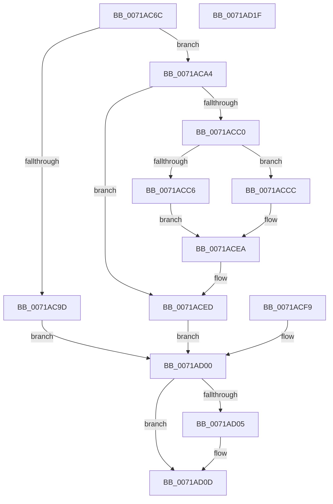

# IopAllocateAndLockMdl

- RVA: `0x0071AC6C`–`0x0071AD20` (길이 `180` bytes)
- VA: `0x000000014071AC6C`
- 실행 섹션: `PAGE`
- PDB 이름 있음: `예`; PDB Function 태그: `아니요`
- unwind 정보 RVA: `0x000C734C`
- 디코드: `53`개 명령, `180/180` bytes 표시
- 미해석 바이트: `0` (있으면 어셈블리에 `.byte`로 보존)

> 이 문서는 커널 이미지의 기계어와 PDB 기호를 분석해 생성했습니다. 4번과 5번은 함수 원형과 자료형을 바이너리 사용 방식에서 추정한 C 해석이며 원본 소스 복구 결과는 아닙니다.

## 1. Dependencies

- 직접 호출 지점: **4**; 고유 호출 대상: **4**
- 직접 호출자로 확인된 함수: **2**
- RIP 상대 이미지 참조: **0**

### Outgoing calls
- `0x0071AC8B` → [IoAllocateMdl](../../text/29/IoAllocateMdl_function_0029EBF0.md) (function, `0x0029EBF0`)
- `0x0071ACB0` → [MmProbeAndLockPages](../../text/23/MmProbeAndLockPages_function_0023B990.md) (function, `0x0023B990`)
- `0x0071ACE5` → [MmMapLockedPagesSpecifyCache](../../text/31/MmMapLockedPagesSpecifyCache_function_00318800.md) (function, `0x00318800`)
- `0x0071AD08` → [IopUnlockAndFreeMdl](../../text/29/IopUnlockAndFreeMdl_function_0029F200.md) (function, `0x0029F200`)

### Direct callers
- [NtCreateIoRing](../72/NtCreateIoRing_function_00720530.md) at `0x00720882`
- [IopMcCreateBufferEntryMdl](../72/IopMcCreateBufferEntryMdl_function_00722FA8.md) at `0x00722FDA`

### Static image references
- 디코드된 RIP-relative 메모리 참조가 없습니다.

## 2. Other-region calls and transfers

- 다른 실행 섹션으로 향하는 call: **4**
  - `0x0071AC8B` → [IoAllocateMdl](../../text/29/IoAllocateMdl_function_0029EBF0.md) (`PAGE` → `.text`)
  - `0x0071ACB0` → [MmProbeAndLockPages](../../text/23/MmProbeAndLockPages_function_0023B990.md) (`PAGE` → `.text`)
  - `0x0071ACE5` → [MmMapLockedPagesSpecifyCache](../../text/31/MmMapLockedPagesSpecifyCache_function_00318800.md) (`PAGE` → `.text`)
  - `0x0071AD08` → [IopUnlockAndFreeMdl](../../text/29/IopUnlockAndFreeMdl_function_0029F200.md) (`PAGE` → `.text`)
- 별도 외부 분기/꼬리 이동을 확인하지 못했습니다.

## 3. Assembly (complete function range)

```asm
0071AC6C  48 89 5C 24 08                  mov qword ptr [rsp + 8], rbx
0071AC71  48 89 74 24 10                  mov qword ptr [rsp + 0x10], rsi
0071AC76  57                              push rdi
0071AC77  48 83 EC 40                     sub rsp, 0x40
0071AC7B  41 8A F0                        mov sil, r8b
0071AC7E  33 FF                           xor edi, edi
0071AC80  48 21 7C 24 20                  and qword ptr [rsp + 0x20], rdi
0071AC85  45 33 C9                        xor r9d, r9d
0071AC88  45 33 C0                        xor r8d, r8d
0071AC8B  E8 60 3F B8 FF                  call 0x14029ebf0
0071AC90  48 8B D8                        mov rbx, rax
0071AC93  48 89 44 24 30                  mov qword ptr [rsp + 0x30], rax
0071AC98  48 85 C0                        test rax, rax
0071AC9B  75 07                           jne 0x14071aca4
0071AC9D  BF 9A 00 00 C0                  mov edi, 0xc000009a
0071ACA2  EB 5C                           jmp 0x14071ad00
0071ACA4  41 B8 01 00 00 00               mov r8d, 1
0071ACAA  40 8A D6                        mov dl, sil
0071ACAD  48 8B CB                        mov rcx, rbx
0071ACB0  E8 DB 0C B2 FF                  call 0x14023b990
0071ACB5  90                              nop
0071ACB6  48 8B 74 24 78                  mov rsi, qword ptr [rsp + 0x78]
0071ACBB  48 85 F6                        test rsi, rsi
0071ACBE  74 2D                           je 0x14071aced
0071ACC0  F6 43 0A 05                     test byte ptr [rbx + 0xa], 5
0071ACC4  74 06                           je 0x14071accc
0071ACC6  48 8B 43 18                     mov rax, qword ptr [rbx + 0x18]
0071ACCA  EB 1E                           jmp 0x14071acea
0071ACCC  C7 44 24 28 10 00 00 40         mov dword ptr [rsp + 0x28], 0x40000010
0071ACD4  83 64 24 20 00                  and dword ptr [rsp + 0x20], 0
0071ACD9  45 33 C9                        xor r9d, r9d
0071ACDC  33 D2                           xor edx, edx
0071ACDE  45 8D 41 01                     lea r8d, [r9 + 1]
0071ACE2  48 8B CB                        mov rcx, rbx
0071ACE5  E8 16 DB BF FF                  call 0x140318800
0071ACEA  48 89 06                        mov qword ptr [rsi], rax
0071ACED  48 8B 44 24 70                  mov rax, qword ptr [rsp + 0x70]
0071ACF2  48 89 18                        mov qword ptr [rax], rbx
0071ACF5  33 DB                           xor ebx, ebx
0071ACF7  EB 07                           jmp 0x14071ad00
0071ACF9  8B F8                           mov edi, eax
0071ACFB  48 8B 5C 24 30                  mov rbx, qword ptr [rsp + 0x30]
0071AD00  48 85 DB                        test rbx, rbx
0071AD03  74 08                           je 0x14071ad0d
0071AD05  48 8B CB                        mov rcx, rbx
0071AD08  E8 F3 44 B8 FF                  call 0x14029f200
0071AD0D  8B C7                           mov eax, edi
0071AD0F  48 8B 5C 24 50                  mov rbx, qword ptr [rsp + 0x50]
0071AD14  48 8B 74 24 58                  mov rsi, qword ptr [rsp + 0x58]
0071AD19  48 83 C4 40                     add rsp, 0x40
0071AD1D  5F                              pop rdi
0071AD1E  C3                              ret
0071AD1F  CC                              int3
```

## 4. C-style interpretation (structured pseudocode)

```c
__int64 __fastcall IopAllocateAndLockMdl(__int64 a1, __int64 a2, int a3, int a4, __int64 a5, __int64 a6)
{
    __int64 result;
    __int64 v_rbx;
    __int64 v_rdi;
    __int64 v_rsp;
    unsigned __int64 v_stack_m18;
    unsigned int v_stack_m20;
    unsigned __int64 v_stack_m28;
    unsigned __int64 v_stack_p10;
    unsigned __int64 v_stack_p8;

    v_stack_p8 = v_rbx;
    v_stack_p10 = v_rsi;
    v_rsp = (v_rsp) - (64);
    v_rdi = 0;
    a4 = 0;
    a3 = 0;
    result = IoAllocateMdl(a1, a2, a3, a4);
    v_stack_m18 = result;
    if (result != 0) goto loc_0071ACA4;
    goto loc_0071AD00;
loc_0071ACA4:
    result = MmProbeAndLockPages(result, (unsigned __int8)((unsigned __int8)(a3)), 1, a4);
    if (a6 == 0) goto loc_0071ACED;
    if (((*(unsigned __int8 *)(result + 10)) & (5)) == 0) goto loc_0071ACCC;
    goto loc_0071ACEA;
loc_0071ACCC:
    v_stack_m20 = 0x40000010ULL;
    a4 = 0;
    a2 = 0;
    result = MmMapLockedPagesSpecifyCache(result, a2, a4 + 1, a4);
loc_0071ACEA:
    *(unsigned __int64 *)(a6) = result;
loc_0071ACED:
    *(unsigned __int64 *)(a5) = result;
    v_rbx = 0;
    goto loc_0071AD00;
loc_0071AD00:
    result = a5;
    if (0 != 0) {
        a1 = 0;
        result = IopUnlockAndFreeMdl(a1, a2, a4 + 1, a4);
    }
    v_rsp = (v_rsp) + (64);
    return (unsigned int)((unsigned int)((unsigned int)(0xC000009AULL)));
}
```

## 5. (Beta) C Style

```c
int64_t IopAllocateAndLockMdl(int64_t Arg1, int64_t Arg2, int32_t Arg3, int32_t Arg4, void *Arg5, int64_t Arg6)
{
    uint8_t *arg5 = (uint8_t *)Arg5;

    int64_t result;
    int64_t local_rbx;
    int64_t local_rdi;
    int64_t local_rsp;
    uint64_t v_stack_m18;
    uint32_t v_stack_m20;
    uint64_t v_stack_m28;
    uint64_t v_stack_p10;
    uint64_t v_stack_p8;

    v_stack_p8 = local_rbx;
    v_stack_p10 = local_rsi;
    local_rsp = (local_rsp) - (64);
    local_rdi = 0;
    Arg4 = 0;
    Arg3 = 0;
    result = IoAllocateMdl(Arg1, Arg2, Arg3, Arg4);
    v_stack_m18 = result;
    if (result != 0) goto loc_0071ACA4;
    goto loc_0071AD00;
loc_0071ACA4:
    result = MmProbeAndLockPages(result, (uint8_t)((uint8_t)(Arg3)), 1, Arg4);
    if (Arg6 == 0) goto loc_0071ACED;
    if (((*(uint8_t *)(result + 0xA)) & (5)) == 0) goto loc_0071ACCC;
    goto loc_0071ACEA;
loc_0071ACCC:
    v_stack_m20 = 0x40000010ULL;
    Arg4 = 0;
    Arg2 = 0;
    result = MmMapLockedPagesSpecifyCache(result, Arg2, Arg4 + 1, Arg4);
loc_0071ACEA:
    *(uint64_t *)(Arg6) = result;
loc_0071ACED:
    *(uint64_t *)(arg5) = result;
    local_rbx = 0;
    goto loc_0071AD00;
loc_0071AD00:
    result = Arg5;
    if (0 != 0) {
        Arg1 = 0;
        result = IopUnlockAndFreeMdl(Arg1, Arg2, Arg4 + 1, Arg4);
    }
    local_rsp = (local_rsp) + (64);
    return (uint32_t)((uint32_t)((uint32_t)(0xC000009AULL)));
}
```

### 관측된 메모리 오프셋

구조체 형식이 확인되지 않은 접근은 인자 기준의 오프셋으로만 기록했습니다.

| 기준 인자 | 오프셋 표현 | 폭 (bit) | 접근 |
|---|---:|---:|---|
| `Arg5` | `+ 0x0` | `64` | `W` |

## 6. Execution-region graph

[열기: 2D/3D 그래프와 함수 탐색 컨트롤 패널](../../../control-panel.html?section=page&rva=0x0071AC6C&view=graph)

- 2D 그래프는 위에서 아래로 흐르고, 3D 그래프는 빈 공간을 드래그해 회전합니다. Shift+드래그는 이동, 휠은 확대·축소, 함수 노드 선택은 대상 보고서 이동입니다.

### Static fallback


