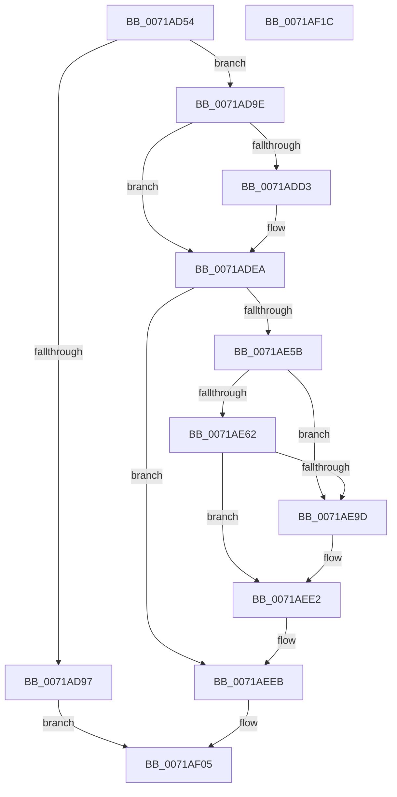

# IopBootLogToFile

- RVA: `0x0071AD54`–`0x0071AF1D` (길이 `457` bytes)
- VA: `0x000000014071AD54`
- 실행 섹션: `PAGE`
- PDB 이름 있음: `예`; PDB Function 태그: `아니요`
- unwind 정보 RVA: `0x000C73BC`
- 디코드: `109`개 명령, `457/457` bytes 표시
- 미해석 바이트: `0` (있으면 어셈블리에 `.byte`로 보존)

> 이 문서는 커널 이미지의 기계어와 PDB 기호를 분석해 생성했습니다. 4번과 5번은 함수 원형과 자료형을 바이너리 사용 방식에서 추정한 C 해석이며 원본 소스 복구 결과는 아닙니다.

## 1. Dependencies

- 직접 호출 지점: **8**; 고유 호출 대상: **7**
- 직접 호출자로 확인된 함수: **2**
- RIP 상대 이미지 참조: **2**

### Outgoing calls
- `0x0071ADC1` → [ExAcquireResourceExclusiveLite](../../text/21/ExAcquireResourceExclusiveLite_function_00214E20.md) (function, `0x00214E20`)
- `0x0071ADDE` → [RtlInitUnicodeString](../../text/42/RtlInitUnicodeString_function_0042A780.md) (function, `0x0042A780`)
- `0x0071AE4C` → [ZwCreateFile](../../text/6A/ZwCreateFile_function_006ADB70.md) (function, `0x006ADB70`)
- `0x0071AE92` → [ZwWriteFile](../../text/6A/ZwWriteFile_function_006AD1D0.md) (function, `0x006AD1D0`)
- `0x0071AEDB` → [ZwWriteFile](../../text/6A/ZwWriteFile_function_006AD1D0.md) (function, `0x006AD1D0`)
- `0x0071AEE6` → [ZwClose](../../text/6A/ZwClose_function_006AD2B0.md) (function, `0x006AD2B0`)
- `0x0071AEF6` → [ExReleaseResourceLite](../../text/25/ExReleaseResourceLite_function_0025FA10.md) (function, `0x0025FA10`)
- `0x0071AEFE` → [KeLeaveCriticalRegionThread](../../text/25/KeLeaveCriticalRegionThread_function_0025EFF0.md) (function, `0x0025EFF0`)

### Direct callers
- [IopCopyBootLogRegistryToFile](IopCopyBootLogRegistryToFile_function_0071B19C.md) at `0x0071B235`
- [IopCopyBootLogRegistryToFile](IopCopyBootLogRegistryToFile_function_0071B19C.md) at `0x0071B2D4`
- [IopCopyBootLogRegistryToFile](IopCopyBootLogRegistryToFile_function_0071B19C.md) at `0x0071B3A9`
- [sub_00B46996](../B4/Unknown_function_00B46996.md) at `0x00B46AFF`

### Static image references
- `0x0071AD72` → RVA `0x00FD8028` (`PAGEDATA`; read)
- `0x0071ADD7` → RVA `0x00AFCA70` (` ?? ::NNGAKEGL::`string'`; read)

## 2. Other-region calls and transfers

- 다른 실행 섹션으로 향하는 call: **8**
  - `0x0071ADC1` → [ExAcquireResourceExclusiveLite](../../text/21/ExAcquireResourceExclusiveLite_function_00214E20.md) (`PAGE` → `.text`)
  - `0x0071ADDE` → [RtlInitUnicodeString](../../text/42/RtlInitUnicodeString_function_0042A780.md) (`PAGE` → `.text`)
  - `0x0071AE4C` → [ZwCreateFile](../../text/6A/ZwCreateFile_function_006ADB70.md) (`PAGE` → `.text`)
  - `0x0071AE92` → [ZwWriteFile](../../text/6A/ZwWriteFile_function_006AD1D0.md) (`PAGE` → `.text`)
  - `0x0071AEDB` → [ZwWriteFile](../../text/6A/ZwWriteFile_function_006AD1D0.md) (`PAGE` → `.text`)
  - `0x0071AEE6` → [ZwClose](../../text/6A/ZwClose_function_006AD2B0.md) (`PAGE` → `.text`)
  - `0x0071AEF6` → [ExReleaseResourceLite](../../text/25/ExReleaseResourceLite_function_0025FA10.md) (`PAGE` → `.text`)
  - `0x0071AEFE` → [KeLeaveCriticalRegionThread](../../text/25/KeLeaveCriticalRegionThread_function_0025EFF0.md) (`PAGE` → `.text`)
- 별도 외부 분기/꼬리 이동을 확인하지 못했습니다.

## 3. Assembly (complete function range)

```asm
0071AD54  48 89 5C 24 08                  mov qword ptr [rsp + 8], rbx
0071AD59  55                              push rbp
0071AD5A  56                              push rsi
0071AD5B  57                              push rdi
0071AD5C  41 56                           push r14
0071AD5E  41 57                           push r15
0071AD60  48 8D 6C 24 C9                  lea rbp, [rsp - 0x37]
0071AD65  48 81 EC A0 00 00 00            sub rsp, 0xa0
0071AD6C  45 33 F6                        xor r14d, r14d
0071AD6F  0F 57 C0                        xorps xmm0, xmm0
0071AD72  4C 39 35 AF D2 8B 00            cmp qword ptr [rip + 0x8bd2af], r14
0071AD79  B8 FF FE 00 00                  mov eax, 0xfeff
0071AD7E  48 8B F1                        mov rsi, rcx
0071AD81  44 89 75 0B                     mov dword ptr [rbp + 0xb], r14d
0071AD85  44 89 75 23                     mov dword ptr [rbp + 0x23], r14d
0071AD89  0F 11 45 F7                     movups xmmword ptr [rbp - 9], xmm0
0071AD8D  4C 89 75 77                     mov qword ptr [rbp + 0x77], r14
0071AD91  66 89 45 6F                     mov word ptr [rbp + 0x6f], ax
0071AD95  75 07                           jne 0x14071ad9e
0071AD97  33 C0                           xor eax, eax
0071AD99  E9 67 01 00 00                  jmp 0x14071af05
0071AD9E  65 48 8B 3C 25 88 01 00 00      mov rdi, qword ptr gs:[0x188]
0071ADA7  41 83 CF FF                     or r15d, 0xffffffff
0071ADAB  B2 01                           mov dl, 1
0071ADAD  66 44 01 BF E4 01 00 00         add word ptr [rdi + 0x1e4], r15w
0071ADB5  90                              nop
0071ADB6  48 8B 0D 6B D2 8B 00            mov rcx, qword ptr [rip + 0x8bd26b]
0071ADBD  48 83 C1 40                     add rcx, 0x40
0071ADC1  E8 5A A0 AF FF                  call 0x140214e20
0071ADC6  48 8B 05 5B D2 8B 00            mov rax, qword ptr [rip + 0x8bd25b]
0071ADCD  4C 39 70 28                     cmp qword ptr [rax + 0x28], r14
0071ADD1  75 17                           jne 0x14071adea
0071ADD3  48 8D 48 20                     lea rcx, [rax + 0x20]
0071ADD7  48 8D 15 92 1C 3E 00            lea rdx, [rip + 0x3e1c92]
0071ADDE  E8 9D F9 D0 FF                  call 0x14042a780
0071ADE3  48 8B 05 3E D2 8B 00            mov rax, qword ptr [rip + 0x8bd23e]
0071ADEA  44 89 74 24 50                  mov dword ptr [rsp + 0x50], r14d
0071ADEF  4C 8D 4D F7                     lea r9, [rbp - 9]
0071ADF3  4C 89 74 24 48                  mov qword ptr [rsp + 0x48], r14
0071ADF8  4C 8D 45 07                     lea r8, [rbp + 7]
0071ADFC  C7 44 24 40 64 00 00 00         mov dword ptr [rsp + 0x40], 0x64
0071AE04  48 8D 4D 77                     lea rcx, [rbp + 0x77]
0071AE08  C7 44 24 38 03 00 00 00         mov dword ptr [rsp + 0x38], 3
0071AE10  48 83 C0 20                     add rax, 0x20
0071AE14  C7 44 24 30 01 00 00 00         mov dword ptr [rsp + 0x30], 1
0071AE1C  0F 57 C0                        xorps xmm0, xmm0
0071AE1F  C7 44 24 28 80 00 00 00         mov dword ptr [rsp + 0x28], 0x80
0071AE27  BA 00 00 00 40                  mov edx, 0x40000000
0071AE2C  4C 89 74 24 20                  mov qword ptr [rsp + 0x20], r14
0071AE31  C7 45 07 30 00 00 00            mov dword ptr [rbp + 7], 0x30
0071AE38  4C 89 75 0F                     mov qword ptr [rbp + 0xf], r14
0071AE3C  C7 45 1F 40 02 00 00            mov dword ptr [rbp + 0x1f], 0x240
0071AE43  48 89 45 17                     mov qword ptr [rbp + 0x17], rax
0071AE47  F3 0F 7F 45 27                  movdqu xmmword ptr [rbp + 0x27], xmm0
0071AE4C  E8 1F 2D F9 FF                  call 0x1406adb70
0071AE51  8B D8                           mov ebx, eax
0071AE53  85 C0                           test eax, eax
0071AE55  0F 88 90 00 00 00               js 0x14071aeeb
0071AE5B  48 83 7D FF 02                  cmp qword ptr [rbp - 1], 2
0071AE60  75 3B                           jne 0x14071ae9d
0071AE62  48 8B 4D 77                     mov rcx, qword ptr [rbp + 0x77]
0071AE66  48 8D 45 6F                     lea rax, [rbp + 0x6f]
0071AE6A  4C 89 74 24 40                  mov qword ptr [rsp + 0x40], r14
0071AE6F  45 33 C9                        xor r9d, r9d
0071AE72  4C 89 74 24 38                  mov qword ptr [rsp + 0x38], r14
0071AE77  45 33 C0                        xor r8d, r8d
0071AE7A  C7 44 24 30 02 00 00 00         mov dword ptr [rsp + 0x30], 2
0071AE82  33 D2                           xor edx, edx
0071AE84  48 89 44 24 28                  mov qword ptr [rsp + 0x28], rax
0071AE89  48 8D 45 F7                     lea rax, [rbp - 9]
0071AE8D  48 89 44 24 20                  mov qword ptr [rsp + 0x20], rax
0071AE92  E8 39 23 F9 FF                  call 0x1406ad1d0
0071AE97  8B D8                           mov ebx, eax
0071AE99  85 C0                           test eax, eax
0071AE9B  78 45                           js 0x14071aee2
0071AE9D  0F B7 06                        movzx eax, word ptr [rsi]
0071AEA0  48 8D 4D 7F                     lea rcx, [rbp + 0x7f]
0071AEA4  83 4D 7F FF                     or dword ptr [rbp + 0x7f], 0xffffffff
0071AEA8  45 33 C9                        xor r9d, r9d
0071AEAB  4C 89 74 24 40                  mov qword ptr [rsp + 0x40], r14
0071AEB0  45 33 C0                        xor r8d, r8d
0071AEB3  48 89 4C 24 38                  mov qword ptr [rsp + 0x38], rcx
0071AEB8  33 D2                           xor edx, edx
0071AEBA  48 8B 4D 77                     mov rcx, qword ptr [rbp + 0x77]
0071AEBE  89 44 24 30                     mov dword ptr [rsp + 0x30], eax
0071AEC2  48 8B 46 08                     mov rax, qword ptr [rsi + 8]
0071AEC6  48 89 44 24 28                  mov qword ptr [rsp + 0x28], rax
0071AECB  48 8D 45 F7                     lea rax, [rbp - 9]
0071AECF  48 89 44 24 20                  mov qword ptr [rsp + 0x20], rax
0071AED4  44 89 BD 83 00 00 00            mov dword ptr [rbp + 0x83], r15d
0071AEDB  E8 F0 22 F9 FF                  call 0x1406ad1d0
0071AEE0  8B D8                           mov ebx, eax
0071AEE2  48 8B 4D 77                     mov rcx, qword ptr [rbp + 0x77]
0071AEE6  E8 C5 23 F9 FF                  call 0x1406ad2b0
0071AEEB  48 8B 0D 36 D1 8B 00            mov rcx, qword ptr [rip + 0x8bd136]
0071AEF2  48 83 C1 40                     add rcx, 0x40
0071AEF6  E8 15 4B B4 FF                  call 0x14025fa10
0071AEFB  48 8B CF                        mov rcx, rdi
0071AEFE  E8 ED 40 B4 FF                  call 0x14025eff0
0071AF03  8B C3                           mov eax, ebx
0071AF05  48 8B 9C 24 D0 00 00 00         mov rbx, qword ptr [rsp + 0xd0]
0071AF0D  48 81 C4 A0 00 00 00            add rsp, 0xa0
0071AF14  41 5F                           pop r15
0071AF16  41 5E                           pop r14
0071AF18  5F                              pop rdi
0071AF19  5E                              pop rsi
0071AF1A  5D                              pop rbp
0071AF1B  C3                              ret
0071AF1C  CC                              int3
```

## 4. C-style interpretation (structured pseudocode)

```c
__int64 __fastcall IopBootLogToFile(__int64 a1)
{
    __int64 result;
    __int64 v_r14;
    __int64 v_r15;
    __int64 v_rbx;
    __int64 v_rsp;
    unsigned __int64 v_stack_m38;
    unsigned int v_stack_m3C;
    unsigned int v_stack_m40;
    unsigned __int64 v_stack_m48;
    unsigned __int64 v_stack_m50;
    unsigned int v_stack_m54;
    unsigned __int64 v_stack_m58;
    unsigned __int64 v_stack_m5F;
    unsigned __int64 v_stack_m60;
    unsigned __int64 v_stack_m68;
    unsigned int v_stack_m78;
    unsigned __int64 v_stack_m80;
    unsigned int v_stack_m88;
    unsigned int v_stack_m90;
    unsigned int v_stack_m98;
    unsigned int v_stack_mA0;
    unsigned __int64 v_stack_mA8;
    unsigned __int16 v_stack_p10;
    unsigned __int64 v_stack_p18;
    unsigned __int64 v_stack_p20;
    unsigned int v_stack_p24;
    unsigned __int64 v_stack_p8;

    v_stack_p8 = v_rbx;
    v_rsp = (v_rsp) - (160);
    v_r14 = 0;
    v_stack_m54 = 0;
    v_stack_m3C = 0;
    v_stack_m68 = v_xmm0;
    v_stack_p18 = 0;
    v_stack_p10 = (unsigned __int16)((unsigned int)(0xFEFFULL));
    if ((*(unsigned __int64 *)(v_rip + 9163439)) != 0) goto loc_0071AD9E;
    result = 0;
    goto loc_0071AF05;
loc_0071AD9E:
    v_r15 = (unsigned int)((v_r15) | (0xFFFFFFFFULL));
    a1 = (*(unsigned __int64 *)(v_rip + 9163371)) + (64);
    result = ExAcquireResourceExclusiveLite(a1, 1, a3, a4);
    result = *(unsigned __int64 *)(v_rip + 9163355);
    if ((*(unsigned __int64 *)(*(unsigned __int64 *)(v_rip + 9163355) + 40)) == 0) {
        a1 = *(unsigned __int64 *)(v_rip + 9163355) + 32;
        a2 = v_rip + 4070546;
        result = RtlInitUnicodeString(a1, a2, a3, a4);
        result = *(unsigned __int64 *)(v_rip + 9163326);
    }
    v_stack_m78 = 0;
    v_stack_m80 = 0;
    v_stack_m88 = 100;
    v_stack_m90 = 3;
    result = (result) + (32);
    v_stack_m98 = 1;
    v_stack_mA0 = 128;
    v_stack_mA8 = 0;
    v_stack_m58 = 48;
    v_stack_m50 = 0;
    v_stack_m40 = 576;
    v_stack_m48 = result;
    v_stack_m38 = v_xmm0;
    result = ZwCreateFile(v_stack_p18, (unsigned int)(0x40000000ULL), v_stack_m58, v_stack_m68);
    if (sign_flag) goto loc_0071AEEB;
    if (v_stack_m60 != 2) goto loc_0071AE9D;
    v_stack_m88 = 0;
    a4 = 0;
    v_stack_m90 = 0;
    a3 = 0;
    v_stack_m98 = 2;
    a2 = 0;
    v_stack_mA0 = v_stack_p10;
    v_stack_mA8 = v_stack_m68;
    result = ZwWriteFile(v_stack_p18, a2, a3, a4);
    v_rbx = (unsigned int)((unsigned int)(result));
    if (!(sign_flag)) {
        result = *(unsigned __int16 *)(a1);
        a1 = v_stack_p20;
        a4 = 0;
        v_stack_m88 = 0;
        a3 = 0;
        v_stack_m90 = a1;
        a2 = 0;
        a1 = v_stack_p18;
        v_stack_m98 = (unsigned int)(result);
        result = *(unsigned __int64 *)(a1 + 8);
        v_stack_mA0 = result;
        result = v_stack_m68;
        v_stack_mA8 = result;
        v_stack_p24 = (unsigned int)(v_r15);
        result = ZwWriteFile(a1, a2, a3, a4);
        v_rbx = (unsigned int)(result);
    }
    result = ZwClose(v_stack_p18, a2, a3, a4);
loc_0071AEEB:
    a1 = (*(unsigned __int64 *)(v_rip + 9163062)) + (64);
    result = ExReleaseResourceLite(a1, a2, a3, a4);
    result = KeLeaveCriticalRegionThread(*(unsigned __int64 *)(gs_base + (0 + 392)), a2, a3, a4);
loc_0071AF05:
    v_rsp = (v_rsp) + (160);
    return (unsigned int)((unsigned int)(v_rbx));
}
```

## 5. (Beta) C Style

```c
int64_t IopBootLogToFile(void *Arg1)
{
    uint8_t *arg1 = (uint8_t *)Arg1;

    int64_t result;
    int64_t local_r14;
    int64_t local_r15;
    int64_t local_rbx;
    int64_t local_rsp;
    uint64_t v_stack_m38;
    uint32_t v_stack_m3C;
    uint32_t v_stack_m40;
    uint64_t v_stack_m48;
    uint64_t v_stack_m50;
    uint32_t v_stack_m54;
    uint64_t v_stack_m58;
    uint64_t v_stack_m5F;
    uint64_t v_stack_m60;
    uint64_t v_stack_m68;
    uint32_t v_stack_m78;
    uint64_t v_stack_m80;
    uint32_t v_stack_m88;
    uint32_t v_stack_m90;
    uint32_t v_stack_m98;
    uint32_t v_stack_mA0;
    uint64_t v_stack_mA8;
    uint16_t v_stack_p10;
    uint64_t v_stack_p18;
    uint64_t v_stack_p20;
    uint32_t v_stack_p24;
    uint64_t v_stack_p8;

    v_stack_p8 = local_rbx;
    local_rsp = (local_rsp) - (160);
    local_r14 = 0;
    v_stack_m54 = 0;
    v_stack_m3C = 0;
    v_stack_m68 = v_xmm0;
    v_stack_p18 = 0;
    v_stack_p10 = (uint16_t)((uint32_t)(0xFEFFULL));
    if ((*(uint64_t *)(v_rip + 0x8BD2AF)) != 0) goto loc_0071AD9E;
    result = 0;
    goto loc_0071AF05;
loc_0071AD9E:
    local_r15 = (uint32_t)((local_r15) | (0xFFFFFFFFULL));
    Arg1 = (*(uint64_t *)(v_rip + 0x8BD26B)) + (64);
    result = ExAcquireResourceExclusiveLite(Arg1, 1, a3, a4);
    result = *(uint64_t *)(v_rip + 0x8BD25B);
    if ((*(uint64_t *)(*(uint64_t *)(v_rip + 0x8BD25B) + 0x28)) == 0) {
        Arg1 = *(uint64_t *)(v_rip + 0x8BD25B) + 32;
        a2 = v_rip + 4070546;
        result = RtlInitUnicodeString(Arg1, a2, a3, a4);
        result = *(uint64_t *)(v_rip + 0x8BD23E);
    }
    v_stack_m78 = 0;
    v_stack_m80 = 0;
    v_stack_m88 = 100;
    v_stack_m90 = 3;
    result = (result) + (32);
    v_stack_m98 = 1;
    v_stack_mA0 = 128;
    v_stack_mA8 = 0;
    v_stack_m58 = 48;
    v_stack_m50 = 0;
    v_stack_m40 = 576;
    v_stack_m48 = result;
    v_stack_m38 = v_xmm0;
    result = ZwCreateFile(v_stack_p18, (uint32_t)(0x40000000ULL), v_stack_m58, v_stack_m68);
    if (sign_flag) goto loc_0071AEEB;
    if (v_stack_m60 != 2) goto loc_0071AE9D;
    v_stack_m88 = 0;
    a4 = 0;
    v_stack_m90 = 0;
    a3 = 0;
    v_stack_m98 = 2;
    a2 = 0;
    v_stack_mA0 = v_stack_p10;
    v_stack_mA8 = v_stack_m68;
    result = ZwWriteFile(v_stack_p18, a2, a3, a4);
    local_rbx = (uint32_t)((uint32_t)(result));
    if (!(sign_flag)) {
        result = *(uint16_t *)(arg1);
        Arg1 = v_stack_p20;
        a4 = 0;
        v_stack_m88 = 0;
        a3 = 0;
        v_stack_m90 = Arg1;
        a2 = 0;
        Arg1 = v_stack_p18;
        v_stack_m98 = (uint32_t)(result);
        result = *(uint64_t *)(arg1 + 0x8);
        v_stack_mA0 = result;
        result = v_stack_m68;
        v_stack_mA8 = result;
        v_stack_p24 = (uint32_t)(local_r15);
        result = ZwWriteFile(Arg1, a2, a3, a4);
        local_rbx = (uint32_t)(result);
    }
    result = ZwClose(v_stack_p18, a2, a3, a4);
loc_0071AEEB:
    Arg1 = (*(uint64_t *)(v_rip + 0x8BD136)) + (64);
    result = ExReleaseResourceLite(Arg1, a2, a3, a4);
    result = KeLeaveCriticalRegionThread(*(uint64_t *)(gs_base + (0 + 0x188)), a2, a3, a4);
loc_0071AF05:
    local_rsp = (local_rsp) + (160);
    return (uint32_t)((uint32_t)(local_rbx));
}
```

### 관측된 메모리 오프셋

구조체 형식이 확인되지 않은 접근은 인자 기준의 오프셋으로만 기록했습니다.

| 기준 인자 | 오프셋 표현 | 폭 (bit) | 접근 |
|---|---:|---:|---|
| `Arg1` | `+ 0x0` | `16` | `R` |
| `Arg1` | `+ 0x8` | `64` | `R` |

## 6. Execution-region graph

[열기: 2D/3D 그래프와 함수 탐색 컨트롤 패널](../../../control-panel.html?section=page&rva=0x0071AD54&view=graph)

- 2D 그래프는 위에서 아래로 흐르고, 3D 그래프는 빈 공간을 드래그해 회전합니다. Shift+드래그는 이동, 휠은 확대·축소, 함수 노드 선택은 대상 보고서 이동입니다.

### Static fallback


