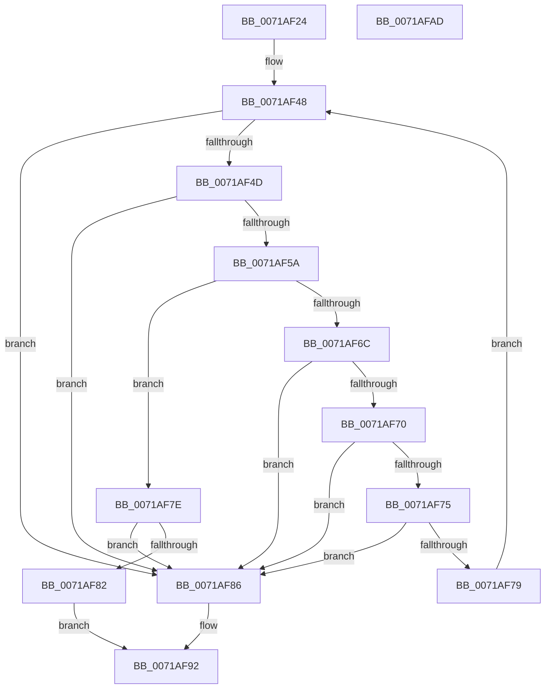

# IopCheckGetQuotaBufferValidity

- RVA: `0x0071AF24`–`0x0071AFAE` (길이 `138` bytes)
- VA: `0x000000014071AF24`
- 실행 섹션: `PAGE`
- PDB 이름 있음: `예`; PDB Function 태그: `아니요`
- unwind 정보 RVA: `0x0005E6B4`
- 디코드: `47`개 명령, `138/138` bytes 표시
- 미해석 바이트: `0` (있으면 어셈블리에 `.byte`로 보존)

> 이 문서는 커널 이미지의 기계어와 PDB 기호를 분석해 생성했습니다. 4번과 5번은 함수 원형과 자료형을 바이너리 사용 방식에서 추정한 C 해석이며 원본 소스 복구 결과는 아닙니다.

## 1. Dependencies

- 직접 호출 지점: **2**; 고유 호출 대상: **2**
- 직접 호출자로 확인된 함수: **1**
- RIP 상대 이미지 참조: **0**

### Outgoing calls
- `0x0071AF51` → [RtlValidSid](../92/RtlValidSid_function_00929710.md) (function, `0x00929710`)
- `0x0071AF5E` → [RtlLengthSid](../../text/45/RtlLengthSid_function_0045D270.md) (function, `0x0045D270`)

### Direct callers
- [NtQueryQuotaInformationFile](../72/NtQueryQuotaInformationFile_function_00720FE0.md) at `0x007212B8`

### Static image references
- 디코드된 RIP-relative 메모리 참조가 없습니다.

## 2. Other-region calls and transfers

- 다른 실행 섹션으로 향하는 call: **1**
  - `0x0071AF5E` → [RtlLengthSid](../../text/45/RtlLengthSid_function_0045D270.md) (`PAGE` → `.text`)
- 별도 외부 분기/꼬리 이동을 확인하지 못했습니다.

## 3. Assembly (complete function range)

```asm
0071AF24  48 8B C4                        mov rax, rsp
0071AF27  48 89 58 08                     mov qword ptr [rax + 8], rbx
0071AF2B  48 89 68 10                     mov qword ptr [rax + 0x10], rbp
0071AF2F  48 89 70 18                     mov qword ptr [rax + 0x18], rsi
0071AF33  48 89 78 20                     mov qword ptr [rax + 0x20], rdi
0071AF37  41 56                           push r14
0071AF39  48 83 EC 20                     sub rsp, 0x20
0071AF3D  4D 8B F0                        mov r14, r8
0071AF40  8B FA                           mov edi, edx
0071AF42  48 8B F1                        mov rsi, rcx
0071AF45  48 8B D9                        mov rbx, rcx
0071AF48  83 FF 14                        cmp edi, 0x14
0071AF4B  7C 39                           jl 0x14071af86
0071AF4D  48 8D 4B 08                     lea rcx, [rbx + 8]
0071AF51  E8 BA E7 20 00                  call 0x140929710
0071AF56  84 C0                           test al, al
0071AF58  74 2C                           je 0x14071af86
0071AF5A  48 8D 4B 08                     lea rcx, [rbx + 8]
0071AF5E  E8 0D 23 D4 FF                  call 0x14045d270
0071AF63  8B 0B                           mov ecx, dword ptr [rbx]
0071AF65  83 C0 08                        add eax, 8
0071AF68  85 C9                           test ecx, ecx
0071AF6A  74 12                           je 0x14071af7e
0071AF6C  3B C1                           cmp eax, ecx
0071AF6E  7F 16                           jg 0x14071af86
0071AF70  F6 C1 03                        test cl, 3
0071AF73  75 11                           jne 0x14071af86
0071AF75  2B F9                           sub edi, ecx
0071AF77  78 0D                           js 0x14071af86
0071AF79  48 03 D9                        add rbx, rcx
0071AF7C  EB CA                           jmp 0x14071af48
0071AF7E  3B F8                           cmp edi, eax
0071AF80  78 04                           js 0x14071af86
0071AF82  33 C0                           xor eax, eax
0071AF84  EB 0C                           jmp 0x14071af92
0071AF86  2B DE                           sub ebx, esi
0071AF88  8B C3                           mov eax, ebx
0071AF8A  49 89 06                        mov qword ptr [r14], rax
0071AF8D  B8 66 02 00 C0                  mov eax, 0xc0000266
0071AF92  48 8B 5C 24 30                  mov rbx, qword ptr [rsp + 0x30]
0071AF97  48 8B 6C 24 38                  mov rbp, qword ptr [rsp + 0x38]
0071AF9C  48 8B 74 24 40                  mov rsi, qword ptr [rsp + 0x40]
0071AFA1  48 8B 7C 24 48                  mov rdi, qword ptr [rsp + 0x48]
0071AFA6  48 83 C4 20                     add rsp, 0x20
0071AFAA  41 5E                           pop r14
0071AFAC  C3                              ret
0071AFAD  CC                              int3
```

## 4. C-style interpretation (structured pseudocode)

```c
__int64 __fastcall IopCheckGetQuotaBufferValidity(__int64 a1, int a2, __int64 a3)
{
    __int64 result;
    __int64 v_rbx;
    __int64 v_rdi;
    __int64 v_rsp;
    unsigned __int64 v_stack_p10;
    unsigned __int64 v_stack_p18;
    unsigned __int64 v_stack_p20;
    unsigned __int64 v_stack_p8;

    *(unsigned __int64 *)(v_rsp + 8) = v_rbx;
    *(unsigned __int64 *)(v_rsp + 16) = v_rbp;
    *(unsigned __int64 *)(v_rsp + 24) = v_rsi;
    *(unsigned __int64 *)(v_rsp + 32) = v_rdi;
    v_rsp = (v_rsp) - (32);
loc_0071AF48:
    if (((unsigned int)((unsigned int)(a2))) < 20) goto loc_0071AF86;
    result = RtlValidSid(a1 + 8, a2, a3, a4);
    if ((unsigned __int8)(result) == 0) goto loc_0071AF86;
    result = RtlLengthSid(a1 + 8, a2, a3, a4);
    result = (unsigned int)((result) + (8));
    if ((unsigned int)((unsigned int)(*(unsigned int *)(a1))) == 0) goto loc_0071AF7E;
    if (((unsigned int)(result)) > ((unsigned int)((unsigned int)(*(unsigned int *)(a1))))) goto loc_0071AF86;
    if ((((unsigned __int8)((unsigned int)(*(unsigned int *)(a1)))) & (3)) != 0) goto loc_0071AF86;
    v_rdi = (unsigned int)(((unsigned int)(a2)) - ((unsigned int)((unsigned int)(*(unsigned int *)(a1)))));
    if (sign_flag) goto loc_0071AF86;
    v_rbx = (a1) + ((unsigned int)(*(unsigned int *)(a1)));
    goto loc_0071AF48;
loc_0071AF7E:
    if (sign_flag) goto loc_0071AF86;
    result = 0;
    goto loc_0071AF92;
loc_0071AF86:
    v_rbx = (unsigned int)((v_rbx) - ((unsigned int)(a1)));
    *(unsigned __int64 *)(a3) = (unsigned int)((unsigned int)(v_rbx));
loc_0071AF92:
    v_rsp = (v_rsp) + (32);
    return (unsigned int)(0xC0000266ULL);
}
```

## 5. (Beta) C Style

```c
int64_t IopCheckGetQuotaBufferValidity(void *Arg1, int32_t Arg2, void *Arg3)
{
    uint8_t *arg1 = (uint8_t *)Arg1;
    uint8_t *arg3 = (uint8_t *)Arg3;

    int64_t result;
    int64_t local_rbx;
    int64_t local_rdi;
    int64_t local_rsp;
    uint64_t v_stack_p10;
    uint64_t v_stack_p18;
    uint64_t v_stack_p20;
    uint64_t v_stack_p8;

    *(uint64_t *)(local_rsp + 0x8) = local_rbx;
    *(uint64_t *)(local_rsp + 0x10) = local_rbp;
    *(uint64_t *)(local_rsp + 0x18) = local_rsi;
    *(uint64_t *)(local_rsp + 0x20) = local_rdi;
    local_rsp = (local_rsp) - (32);
loc_0071AF48:
    if (((uint32_t)((uint32_t)(Arg2))) < 20) goto loc_0071AF86;
    result = RtlValidSid(Arg1 + 8, Arg2, Arg3, a4);
    if ((uint8_t)(result) == 0) goto loc_0071AF86;
    result = RtlLengthSid(Arg1 + 8, Arg2, Arg3, a4);
    result = (uint32_t)((result) + (8));
    if ((uint32_t)((uint32_t)(*(uint32_t *)(arg1))) == 0) goto loc_0071AF7E;
    if (((uint32_t)(result)) > ((uint32_t)((uint32_t)(*(uint32_t *)(arg1))))) goto loc_0071AF86;
    if ((((uint8_t)((uint32_t)(*(uint32_t *)(arg1)))) & (3)) != 0) goto loc_0071AF86;
    local_rdi = (uint32_t)(((uint32_t)(Arg2)) - ((uint32_t)((uint32_t)(*(uint32_t *)(arg1)))));
    if (sign_flag) goto loc_0071AF86;
    local_rbx = (Arg1) + ((uint32_t)(*(uint32_t *)(arg1)));
    goto loc_0071AF48;
loc_0071AF7E:
    if (sign_flag) goto loc_0071AF86;
    result = 0;
    goto loc_0071AF92;
loc_0071AF86:
    local_rbx = (uint32_t)((local_rbx) - ((uint32_t)(Arg1)));
    *(uint64_t *)(arg3) = (uint32_t)((uint32_t)(local_rbx));
loc_0071AF92:
    local_rsp = (local_rsp) + (32);
    return (uint32_t)(0xC0000266ULL);
}
```

### 관측된 메모리 오프셋

구조체 형식이 확인되지 않은 접근은 인자 기준의 오프셋으로만 기록했습니다.

| 기준 인자 | 오프셋 표현 | 폭 (bit) | 접근 |
|---|---:|---:|---|
| `Arg1` | `+ 0x0` | `32` | `R` |
| `Arg1` | `+ 0x8` | `64` | `R` |
| `Arg3` | `+ 0x0` | `64` | `W` |

## 6. Execution-region graph

[열기: 2D/3D 그래프와 함수 탐색 컨트롤 패널](../../../control-panel.html?section=page&rva=0x0071AF24&view=graph)

- 2D 그래프는 위에서 아래로 흐르고, 3D 그래프는 빈 공간을 드래그해 회전합니다. Shift+드래그는 이동, 휠은 확대·축소, 함수 노드 선택은 대상 보고서 이동입니다.

### Static fallback


