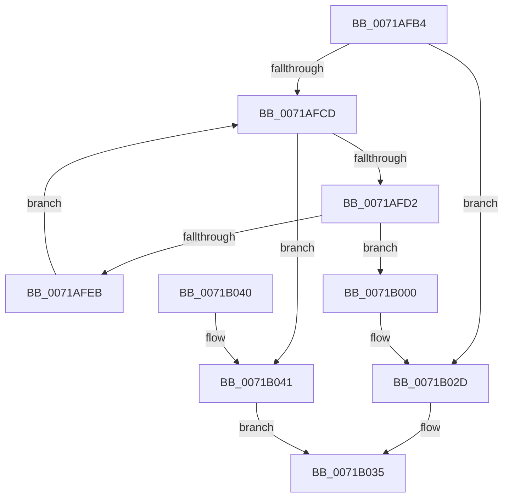

# IopCheckIfNotNativeDriver

- RVA: `0x0071AFB4`–`0x0071B045` (길이 `145` bytes)
- VA: `0x000000014071AFB4`
- 실행 섹션: `PAGE`
- PDB 이름 있음: `예`; PDB Function 태그: `아니요`
- unwind 정보 RVA: `0x00065BB8`
- 디코드: `39`개 명령, `145/145` bytes 표시
- 미해석 바이트: `0` (있으면 어셈블리에 `.byte`로 보존)

> 이 문서는 커널 이미지의 기계어와 PDB 기호를 분석해 생성했습니다. 4번과 5번은 함수 원형과 자료형을 바이너리 사용 방식에서 추정한 C 해석이며 원본 소스 복구 결과는 아닙니다.

## 1. Dependencies

- 직접 호출 지점: **4**; 고유 호출 대상: **4**
- 직접 호출자로 확인된 함수: **1**
- RIP 상대 이미지 참조: **3**

### Outgoing calls
- `0x0071AFE2` → [wcsnicmp](../../text/50/wcsnicmp_function_005001C0.md) (function, `0x005001C0`)
- `0x0071AFF6` → [wcsstr](../../text/50/wcsstr_function_00501F80.md) (function, `0x00501F80`)
- `0x0071B022` → [RtlStringCbCopyNW](../../text/39/RtlStringCbCopyNW_function_003905E8.md) (function, `0x003905E8`)
- `0x0071B030` → [IopIsNotNativeDriverImage](IopIsNotNativeDriverImage_function_0071B914.md) (function, `0x0071B914`)

### Direct callers
- [IopLoadDriver](../99/IopLoadDriver_function_00997B54.md) at `0x00998441`

### Static image references
- `0x0071AFD8` → RVA `0x00AFC8D0` (` ?? ::NNGAKEGL::`string'`; read)
- `0x0071AFEF` → RVA `0x00AFC990` (` ?? ::NNGAKEGL::`string'`; read)
- `0x0071B004` → RVA `0x00AFC8B0` (` ?? ::NNGAKEGL::`string'`; read)

## 2. Other-region calls and transfers

- 다른 실행 섹션으로 향하는 call: **3**
  - `0x0071AFE2` → [wcsnicmp](../../text/50/wcsnicmp_function_005001C0.md) (`PAGE` → `.text`)
  - `0x0071AFF6` → [wcsstr](../../text/50/wcsstr_function_00501F80.md) (`PAGE` → `.text`)
  - `0x0071B022` → [RtlStringCbCopyNW](../../text/39/RtlStringCbCopyNW_function_003905E8.md) (`PAGE` → `.text`)
- 별도 외부 분기/꼬리 이동을 확인하지 못했습니다.

## 3. Assembly (complete function range)

```asm
0071AFB4  48 89 5C 24 08                  mov qword ptr [rsp + 8], rbx
0071AFB9  57                              push rdi
0071AFBA  48 83 EC 20                     sub rsp, 0x20
0071AFBE  48 8B 5A 08                     mov rbx, qword ptr [rdx + 8]
0071AFC2  48 8B FA                        mov rdi, rdx
0071AFC5  81 F9 34 00 00 C0               cmp ecx, 0xc0000034
0071AFCB  75 60                           jne 0x14071b02d
0071AFCD  48 85 DB                        test rbx, rbx
0071AFD0  74 6F                           je 0x14071b041
0071AFD2  41 B8 12 00 00 00               mov r8d, 0x12
0071AFD8  48 8D 15 F1 18 3E 00            lea rdx, [rip + 0x3e18f1]
0071AFDF  48 8B CB                        mov rcx, rbx
0071AFE2  E8 D9 51 DE FF                  call 0x1405001c0
0071AFE7  85 C0                           test eax, eax
0071AFE9  74 15                           je 0x14071b000
0071AFEB  48 8D 4B 02                     lea rcx, [rbx + 2]
0071AFEF  48 8D 15 9A 19 3E 00            lea rdx, [rip + 0x3e199a]
0071AFF6  E8 85 6F DE FF                  call 0x140501f80
0071AFFB  48 8B D8                        mov rbx, rax
0071AFFE  EB CD                           jmp 0x14071afcd
0071B000  0F B7 57 02                     movzx edx, word ptr [rdi + 2]
0071B004  4C 8D 05 A5 18 3E 00            lea r8, [rip + 0x3e18a5]
0071B00B  0F B7 C3                        movzx eax, bx
0071B00E  41 B9 10 00 00 00               mov r9d, 0x10
0071B014  66 2B 47 08                     sub ax, word ptr [rdi + 8]
0071B018  0F B7 C8                        movzx ecx, ax
0071B01B  48 2B D1                        sub rdx, rcx
0071B01E  48 8D 4B 02                     lea rcx, [rbx + 2]
0071B022  E8 C1 55 C7 FF                  call 0x1403905e8
0071B027  66 C7 43 12 5C 00               mov word ptr [rbx + 0x12], 0x5c
0071B02D  48 8B CF                        mov rcx, rdi
0071B030  E8 DF 08 00 00                  call 0x14071b914
0071B035  48 8B 5C 24 30                  mov rbx, qword ptr [rsp + 0x30]
0071B03A  48 83 C4 20                     add rsp, 0x20
0071B03E  5F                              pop rdi
0071B03F  C3                              ret
0071B040  CC                              int3
0071B041  32 C0                           xor al, al
0071B043  EB F0                           jmp 0x14071b035
```

## 4. C-style interpretation (structured pseudocode)

```c
__int64 __fastcall IopCheckIfNotNativeDriver(int a1, __int64 a2)
{
    __int64 result;
    __int64 v_rsp;
    unsigned __int64 v_stack_p8;

    v_stack_p8 = v_rbx;
    v_rsp = (v_rsp) - (32);
    if (a1 != 0xC0000034ULL) goto loc_0071B02D;
loc_0071AFCD:
    if (*(unsigned __int64 *)(a2 + 8) == 0) goto loc_0071B041;
    result = wcsnicmp(*(unsigned __int64 *)(a2 + 8), v_rip + 4069617, 18, a4);
    if ((unsigned int)(result) == 0) goto loc_0071B000;
    result = wcsstr(*(unsigned __int64 *)(a2 + 8) + 2, v_rip + 4069786, 18, a4);
    goto loc_0071AFCD;
loc_0071B000:
    result = (unsigned __int16)(((unsigned __int16)(result)) - (*(unsigned __int16 *)(a2 + 8)));
    a2 = (*(unsigned __int16 *)(a2 + 2)) - ((unsigned __int16)(result));
    result = RtlStringCbCopyNW(result + 2, a2, v_rip + 4069541, 16);
    *(unsigned __int16 *)(result + 18) = 92;
loc_0071B02D:
    result = IopIsNotNativeDriverImage(a2, a2, v_rip + 4069541, 16);
loc_0071B035:
    v_rsp = (v_rsp) + (32);
    return result;
loc_0071B041:
    result = 0;
    goto loc_0071B035;
}
```

## 5. (Beta) C Style

```c
int64_t IopCheckIfNotNativeDriver(int32_t Arg1, void *Arg2)
{
    uint8_t *arg2 = (uint8_t *)Arg2;

    int64_t result;
    int64_t local_rsp;
    uint64_t v_stack_p8;

    v_stack_p8 = local_rbx;
    local_rsp = (local_rsp) - (32);
    if (Arg1 != 0xC0000034ULL) goto loc_0071B02D;
loc_0071AFCD:
    if (*(uint64_t *)(arg2 + 0x8) == 0) goto loc_0071B041;
    result = wcsnicmp(*(uint64_t *)(arg2 + 0x8), v_rip + 4069617, 18, a4);
    if ((uint32_t)(result) == 0) goto loc_0071B000;
    result = wcsstr(*(uint64_t *)(arg2 + 0x8) + 2, v_rip + 4069786, 18, a4);
    goto loc_0071AFCD;
loc_0071B000:
    result = (uint16_t)(((uint16_t)(result)) - (*(uint16_t *)(arg2 + 0x8)));
    Arg2 = (*(uint16_t *)(arg2 + 0x2)) - ((uint16_t)(result));
    result = RtlStringCbCopyNW(result + 2, Arg2, v_rip + 4069541, 16);
    *(uint16_t *)(result + 0x12) = 92;
loc_0071B02D:
    result = IopIsNotNativeDriverImage(Arg2, Arg2, v_rip + 4069541, 16);
loc_0071B035:
    local_rsp = (local_rsp) + (32);
    return result;
loc_0071B041:
    result = 0;
    goto loc_0071B035;
}
```

### 관측된 메모리 오프셋

구조체 형식이 확인되지 않은 접근은 인자 기준의 오프셋으로만 기록했습니다.

| 기준 인자 | 오프셋 표현 | 폭 (bit) | 접근 |
|---|---:|---:|---|
| `Arg2` | `+ 0x2` | `16` | `R` |
| `Arg2` | `+ 0x8` | `16` | `R` |
| `Arg2` | `+ 0x8` | `64` | `R` |

## 6. Execution-region graph

[열기: 2D/3D 그래프와 함수 탐색 컨트롤 패널](../../../control-panel.html?section=page&rva=0x0071AFB4&view=graph)

- 2D 그래프는 위에서 아래로 흐르고, 3D 그래프는 빈 공간을 드래그해 회전합니다. Shift+드래그는 이동, 휠은 확대·축소, 함수 노드 선택은 대상 보고서 이동입니다.

### Static fallback


