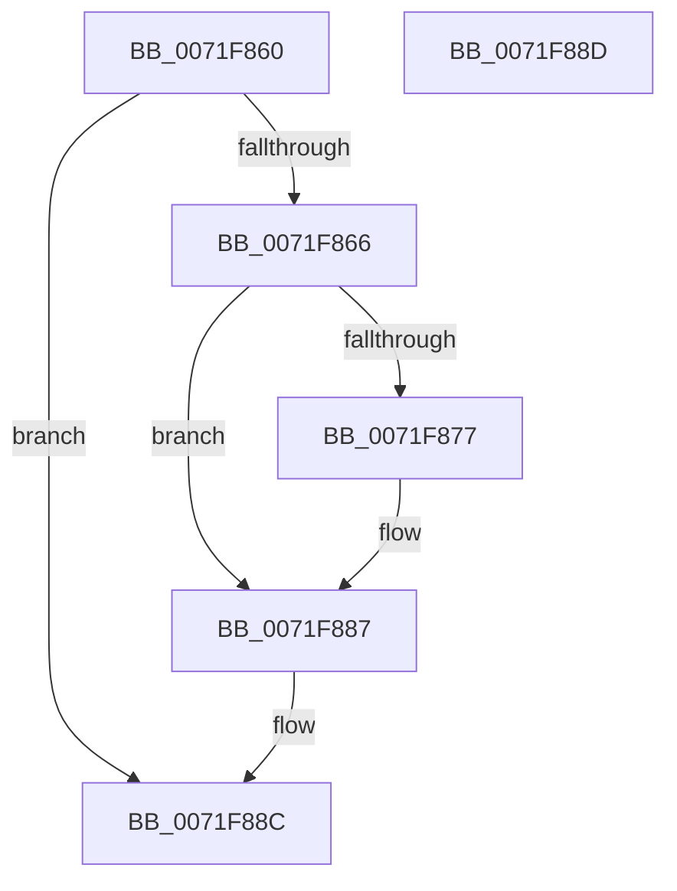

# IopCloseIoRing

- RVA: `0x0071F860`–`0x0071F88E` (길이 `46` bytes)
- VA: `0x000000014071F860`
- 실행 섹션: `PAGE`
- PDB 이름 있음: `예`; PDB Function 태그: `아니요`
- unwind 정보 RVA: `0x000C77EC`
- 디코드: `16`개 명령, `46/46` bytes 표시
- 미해석 바이트: `0` (있으면 어셈블리에 `.byte`로 보존)

> 이 문서는 커널 이미지의 기계어와 PDB 기호를 분석해 생성했습니다. 4번과 5번은 함수 원형과 자료형을 바이너리 사용 방식에서 추정한 C 해석이며 원본 소스 복구 결과는 아닙니다.

## 1. Dependencies

- 직접 호출 지점: **1**; 고유 호출 대상: **1**
- 직접 호출자로 확인된 함수: **0**
- RIP 상대 이미지 참조: **0**

### Outgoing calls
- `0x0071F87D` → [MiUnmapViewOfSection](../88/MiUnmapViewOfSection_function_0088A4C4.md) (function, `0x0088A4C4`)

### Direct callers
- 이 함수 시작 RVA로 연결되는 직접 call은 확인되지 않았습니다. 간접 호출은 완전히 역산할 수 없습니다.

### Static image references
- 디코드된 RIP-relative 메모리 참조가 없습니다.

## 2. Other-region calls and transfers

- 다른 실행 섹션으로 향하는 call: **0**
- 별도 외부 분기/꼬리 이동을 확인하지 못했습니다.

## 3. Assembly (complete function range)

```asm
0071F860  49 83 F9 01                     cmp r9, 1
0071F864  75 26                           jne 0x14071f88c
0071F866  53                              push rbx
0071F867  48 83 EC 20                     sub rsp, 0x20
0071F86B  48 8B DA                        mov rbx, rdx
0071F86E  48 8B 52 28                     mov rdx, qword ptr [rdx + 0x28]
0071F872  48 85 D2                        test rdx, rdx
0071F875  74 10                           je 0x14071f887
0071F877  45 33 C9                        xor r9d, r9d
0071F87A  45 33 C0                        xor r8d, r8d
0071F87D  E8 42 AC 16 00                  call 0x14088a4c4
0071F882  48 83 63 28 00                  and qword ptr [rbx + 0x28], 0
0071F887  48 83 C4 20                     add rsp, 0x20
0071F88B  5B                              pop rbx
0071F88C  C3                              ret
0071F88D  CC                              int3
```

## 4. C-style interpretation (structured pseudocode)

```c
__int64 __fastcall IopCloseIoRing(__int64 a1, __int64 a2, int a3, __int64 a4)
{
    __int64 result;
    __int64 v_rsp;

    if (a4 != 1) goto loc_0071F88C;
    v_rsp = (v_rsp) - (32);
    if (*(unsigned __int64 *)(a2 + 40) != 0) {
        a4 = 0;
        a3 = 0;
        result = MiUnmapViewOfSection(a1, *(unsigned __int64 *)(a2 + 40), a3, a4);
    }
    v_rsp = (v_rsp) + (32);
loc_0071F88C:
    return result;
}
```

## 5. (Beta) C Style

```c
int64_t IopCloseIoRing(int64_t Arg1, void *Arg2, int32_t Arg3, int64_t Arg4)
{
    uint8_t *arg2 = (uint8_t *)Arg2;

    int64_t result;
    int64_t local_rsp;

    if (Arg4 != 1) goto loc_0071F88C;
    local_rsp = (local_rsp) - (32);
    if (*(uint64_t *)(arg2 + 0x28) != 0) {
        Arg4 = 0;
        Arg3 = 0;
        result = MiUnmapViewOfSection(Arg1, *(uint64_t *)(arg2 + 0x28), Arg3, Arg4);
    }
    local_rsp = (local_rsp) + (32);
loc_0071F88C:
    return result;
}
```

### 관측된 메모리 오프셋

구조체 형식이 확인되지 않은 접근은 인자 기준의 오프셋으로만 기록했습니다.

| 기준 인자 | 오프셋 표현 | 폭 (bit) | 접근 |
|---|---:|---:|---|
| `Arg2` | `+ 0x28` | `64` | `R` |
| `Arg2` | `+ 0x28` | `64` | `R/W` |

## 6. Execution-region graph

[열기: 2D/3D 그래프와 함수 탐색 컨트롤 패널](../../../control-panel.html?section=page&rva=0x0071F860&view=graph)

- 2D 그래프는 위에서 아래로 흐르고, 3D 그래프는 빈 공간을 드래그해 회전합니다. Shift+드래그는 이동, 휠은 확대·축소, 함수 노드 선택은 대상 보고서 이동입니다.

### Static fallback


