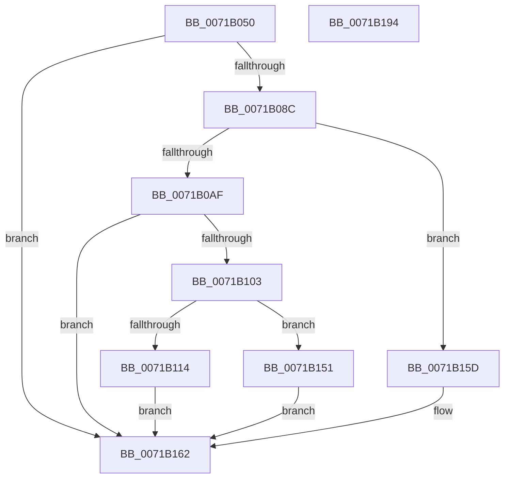

# IopConnectLinkTrackingPort

- RVA: `0x0071B050`–`0x0071B195` (길이 `325` bytes)
- VA: `0x000000014071B050`
- 실행 섹션: `PAGE`
- PDB 이름 있음: `예`; PDB Function 태그: `아니요`
- unwind 정보 RVA: `0x000C7508`
- 디코드: `79`개 명령, `325/325` bytes 표시
- 미해석 바이트: `0` (있으면 어셈블리에 `.byte`로 보존)

> 이 문서는 커널 이미지의 기계어와 PDB 기호를 분석해 생성했습니다. 4번과 5번은 함수 원형과 자료형을 바이너리 사용 방식에서 추정한 C 해석이며 원본 소스 복구 결과는 아닙니다.

## 1. Dependencies

- 직접 호출 지점: **7**; 고유 호출 대상: **6**
- 직접 호출자로 확인된 함수: **0**
- RIP 상대 이미지 참조: **6**

### Outgoing calls
- `0x0071B0C7` → [RtlInitUnicodeString](../../text/42/RtlInitUnicodeString_function_0042A780.md) (function, `0x0042A780`)
- `0x0071B0F8` → [NtSecureConnectPort](../92/NtSecureConnectPort_function_00922F20.md) (function, `0x00922F20`)
- `0x0071B134` → [ObReferenceObjectByHandle](../86/ObReferenceObjectByHandle_function_00868DB0.md) (function, `0x00868DB0`)
- `0x0071B14A` → [NtClose](../86/NtClose_function_00868870.md) (function, `0x00868870`)
- `0x0071B151` → [NtClose](../86/NtClose_function_00868870.md) (function, `0x00868870`)
- `0x0071B16E` → [KeSetEvent](../../text/33/KeSetEvent_function_0033F310.md) (function, `0x0033F310`)
- `0x0071B17A` → [_security_check_cookie](../../text/6A/_security_check_cookie_function_006AC640.md) (function, `0x006AC640`)

### Direct callers
- 이 함수 시작 RVA로 연결되는 직접 call은 확인되지 않았습니다. 간접 호출은 완전히 역산할 수 없습니다.

### Static image references
- `0x0071B067` → RVA `0x00E0A740` (`.data`; read)
- `0x0071B07C` → RVA `0x00FD9C50` (`PAGEDATA`; read)
- `0x0071B09B` → RVA `0x00FD9F88` (`PAGEDATA`; read)
- `0x0071B0AF` → RVA `0x00AFC750` (` ?? ::NNGAKEGL::`string'`; read)
- `0x0071B114` → RVA `0x00FC6F70` (`ALMOSTRO`; read)
- `0x0071B143` → RVA `0x00FD9C50` (`PAGEDATA`; write)

## 2. Other-region calls and transfers

- 다른 실행 섹션으로 향하는 call: **3**
  - `0x0071B0C7` → [RtlInitUnicodeString](../../text/42/RtlInitUnicodeString_function_0042A780.md) (`PAGE` → `.text`)
  - `0x0071B16E` → [KeSetEvent](../../text/33/KeSetEvent_function_0033F310.md) (`PAGE` → `.text`)
  - `0x0071B17A` → [_security_check_cookie](../../text/6A/_security_check_cookie_function_006AC640.md) (`PAGE` → `.text`)
- 별도 외부 분기/꼬리 이동을 확인하지 못했습니다.

## 3. Assembly (complete function range)

```asm
0071B050  48 89 5C 24 10                  mov qword ptr [rsp + 0x10], rbx
0071B055  48 89 7C 24 18                  mov qword ptr [rsp + 0x18], rdi
0071B05A  55                              push rbp
0071B05B  48 8D 6C 24 A9                  lea rbp, [rsp - 0x57]
0071B060  48 81 EC 90 00 00 00            sub rsp, 0x90
0071B067  48 8B 05 D2 F6 6E 00            mov rax, qword ptr [rip + 0x6ef6d2]
0071B06E  48 33 C4                        xor rax, rsp
0071B071  48 89 45 47                     mov qword ptr [rbp + 0x47], rax
0071B075  48 83 65 1F 00                  and qword ptr [rbp + 0x1f], 0
0071B07A  33 DB                           xor ebx, ebx
0071B07C  48 39 1D CD EB 8B 00            cmp qword ptr [rip + 0x8bebcd], rbx
0071B083  48 8B F9                        mov rdi, rcx
0071B086  0F 85 D6 00 00 00               jne 0x14071b162
0071B08C  21 5D 17                        and dword ptr [rbp + 0x17], ebx
0071B08F  33 C0                           xor eax, eax
0071B091  48 89 45 37                     mov qword ptr [rbp + 0x37], rax
0071B095  0F 57 C0                        xorps xmm0, xmm0
0071B098  89 45 3F                        mov dword ptr [rbp + 0x3f], eax
0071B09B  48 8B 05 E6 EE 8B 00            mov rax, qword ptr [rip + 0x8beee6]
0071B0A2  0F 11 45 27                     movups xmmword ptr [rbp + 0x27], xmm0
0071B0A6  39 58 04                        cmp dword ptr [rax + 4], ebx
0071B0A9  0F 84 AE 00 00 00               je 0x14071b15d
0071B0AF  48 8D 15 9A 16 3E 00            lea rdx, [rip + 0x3e169a]
0071B0B6  C7 45 3B 02 00 00 00            mov dword ptr [rbp + 0x3b], 2
0071B0BD  48 8D 4D 27                     lea rcx, [rbp + 0x27]
0071B0C1  66 C7 45 3F 01 01               mov word ptr [rbp + 0x3f], 0x101
0071B0C7  E8 B4 F6 D0 FF                  call 0x14042a780
0071B0CC  48 21 5C 24 40                  and qword ptr [rsp + 0x40], rbx
0071B0D1  48 8D 45 17                     lea rax, [rbp + 0x17]
0071B0D5  48 21 5C 24 38                  and qword ptr [rsp + 0x38], rbx
0071B0DA  4C 8D 45 37                     lea r8, [rbp + 0x37]
0071B0DE  48 89 44 24 30                  mov qword ptr [rsp + 0x30], rax
0071B0E3  48 8D 55 27                     lea rdx, [rbp + 0x27]
0071B0E7  48 21 5C 24 28                  and qword ptr [rsp + 0x28], rbx
0071B0EC  48 8D 4D 1F                     lea rcx, [rbp + 0x1f]
0071B0F0  48 21 5C 24 20                  and qword ptr [rsp + 0x20], rbx
0071B0F5  45 33 C9                        xor r9d, r9d
0071B0F8  E8 23 7E 20 00                  call 0x140922f20
0071B0FD  8B D8                           mov ebx, eax
0071B0FF  85 C0                           test eax, eax
0071B101  78 5F                           js 0x14071b162
0071B103  8B 45 17                        mov eax, dword ptr [rbp + 0x17]
0071B106  48 8B 4D 1F                     mov rcx, qword ptr [rbp + 0x1f]
0071B10A  83 C0 80                        add eax, -0x80
0071B10D  3D 80 00 00 00                  cmp eax, 0x80
0071B112  77 3D                           ja 0x14071b151
0071B114  4C 8B 05 55 BE 8A 00            mov r8, qword ptr [rip + 0x8abe55]
0071B11B  48 8D 45 17                     lea rax, [rbp + 0x17]
0071B11F  48 83 64 24 28 00               and qword ptr [rsp + 0x28], 0
0071B125  45 33 C9                        xor r9d, r9d
0071B128  48 83 65 17 00                  and qword ptr [rbp + 0x17], 0
0071B12D  33 D2                           xor edx, edx
0071B12F  48 89 44 24 20                  mov qword ptr [rsp + 0x20], rax
0071B134  E8 77 DC 14 00                  call 0x140868db0
0071B139  48 8B 4D 1F                     mov rcx, qword ptr [rbp + 0x1f]
0071B13D  8B D8                           mov ebx, eax
0071B13F  48 8B 45 17                     mov rax, qword ptr [rbp + 0x17]
0071B143  48 89 05 06 EB 8B 00            mov qword ptr [rip + 0x8beb06], rax
0071B14A  E8 21 D7 14 00                  call 0x140868870
0071B14F  EB 11                           jmp 0x14071b162
0071B151  E8 1A D7 14 00                  call 0x140868870
0071B156  BB 0D 00 00 C0                  mov ebx, 0xc000000d
0071B15B  EB 05                           jmp 0x14071b162
0071B15D  BB 34 00 00 C0                  mov ebx, 0xc0000034
0071B162  48 8D 4F 20                     lea rcx, [rdi + 0x20]
0071B166  89 5F 38                        mov dword ptr [rdi + 0x38], ebx
0071B169  45 33 C0                        xor r8d, r8d
0071B16C  33 D2                           xor edx, edx
0071B16E  E8 9D 41 C2 FF                  call 0x14033f310
0071B173  48 8B 4D 47                     mov rcx, qword ptr [rbp + 0x47]
0071B177  48 33 CC                        xor rcx, rsp
0071B17A  E8 C1 14 F9 FF                  call 0x1406ac640
0071B17F  4C 8D 9C 24 90 00 00 00         lea r11, [rsp + 0x90]
0071B187  49 8B 5B 18                     mov rbx, qword ptr [r11 + 0x18]
0071B18B  49 8B 7B 20                     mov rdi, qword ptr [r11 + 0x20]
0071B18F  49 8B E3                        mov rsp, r11
0071B192  5D                              pop rbp
0071B193  C3                              ret
0071B194  CC                              int3
```

## 4. C-style interpretation (structured pseudocode)

```c
__int64 __fastcall IopConnectLinkTrackingPort(__int64 a1, __int64 a2, __int64 a3, int a4)
{
    __int64 result;
    __int64 v_rbx;
    __int64 v_rsp;
    unsigned __int64 v_stack_m18;
    unsigned int v_stack_m20;
    unsigned int v_stack_m24;
    unsigned __int64 v_stack_m28;
    unsigned __int64 v_stack_m38;
    unsigned __int64 v_stack_m40;
    unsigned int v_stack_m48;
    unsigned __int64 v_stack_m58;
    unsigned __int64 v_stack_m5F;
    unsigned __int64 v_stack_m60;
    unsigned __int64 v_stack_m68;
    unsigned __int64 v_stack_m70;
    unsigned __int64 v_stack_m78;
    unsigned __int64 v_stack_m8;
    unsigned __int64 v_stack_p10;
    unsigned __int64 v_stack_p18;

    v_stack_p10 = v_rbx;
    v_stack_p18 = v_rdi;
    v_rsp = (v_rsp) - (144);
    result = (*(unsigned __int64 *)(v_rip + 7272146)) ^ (v_rsp);
    v_stack_m18 = result;
    v_rbx = 0;
    if ((*(unsigned __int64 *)(v_rip + 9169869)) != 0) goto loc_0071B162;
    result = 0;
    v_stack_m28 = 0;
    v_stack_m20 = 0;
    v_stack_m38 = v_xmm0;
    if ((*(unsigned int *)(*(unsigned __int64 *)(v_rip + 9170662) + 4)) == 0) goto loc_0071B15D;
    v_stack_m24 = 2;
    v_stack_m20 = 257;
    result = RtlInitUnicodeString(v_stack_m38, v_rip + 4069018, a3, a4);
    v_stack_m68 = v_stack_m48;
    a4 = 0;
    result = NtSecureConnectPort(v_stack_m40, v_stack_m38, v_stack_m28, a4);
    if (sign_flag) goto loc_0071B162;
    result = (unsigned int)(((unsigned int)(v_stack_m48)) + (-128));
    if (((unsigned int)(result)) > 128) goto loc_0071B151;
    a4 = 0;
    a2 = 0;
    v_stack_m78 = v_stack_m48;
    result = ObReferenceObjectByHandle(v_stack_m40, a2, *(unsigned __int64 *)(v_rip + 9092693), a4);
    *(unsigned __int64 *)(v_rip + 9169670) = v_stack_m48;
    result = NtClose(v_stack_m40, a2, *(unsigned __int64 *)(v_rip + 9092693), a4);
    goto loc_0071B162;
loc_0071B151:
    result = NtClose(v_stack_m40, a2, *(unsigned __int64 *)(v_rip + 9092693), a4);
    goto loc_0071B162;
loc_0071B15D:
loc_0071B162:
    *(unsigned int *)(a1 + 56) = (unsigned int)((unsigned int)(0xC0000034ULL));
    a3 = 0;
    a2 = 0;
    result = KeSetEvent(a1 + 32, a2, a3, a4);
    a1 = (v_stack_m18) ^ (v_rsp);
    result = _security_check_cookie(a1, a2, a3, a4);
    return result;
}
```

## 5. (Beta) C Style

```c
int64_t IopConnectLinkTrackingPort(void *Arg1, int64_t Arg2, int64_t Arg3, int32_t Arg4)
{
    uint8_t *arg1 = (uint8_t *)Arg1;

    int64_t result;
    int64_t local_rbx;
    int64_t local_rsp;
    uint64_t v_stack_m18;
    uint32_t v_stack_m20;
    uint32_t v_stack_m24;
    uint64_t v_stack_m28;
    uint64_t v_stack_m38;
    uint64_t v_stack_m40;
    uint32_t v_stack_m48;
    uint64_t v_stack_m58;
    uint64_t v_stack_m5F;
    uint64_t v_stack_m60;
    uint64_t v_stack_m68;
    uint64_t v_stack_m70;
    uint64_t v_stack_m78;
    uint64_t v_stack_m8;
    uint64_t v_stack_p10;
    uint64_t v_stack_p18;

    v_stack_p10 = local_rbx;
    v_stack_p18 = local_rdi;
    local_rsp = (local_rsp) - (144);
    result = (*(uint64_t *)(v_rip + 0x6EF6D2)) ^ (local_rsp);
    v_stack_m18 = result;
    local_rbx = 0;
    if ((*(uint64_t *)(v_rip + 0x8BEBCD)) != 0) goto loc_0071B162;
    result = 0;
    v_stack_m28 = 0;
    v_stack_m20 = 0;
    v_stack_m38 = v_xmm0;
    if ((*(uint32_t *)(*(uint64_t *)(v_rip + 0x8BEEE6) + 0x4)) == 0) goto loc_0071B15D;
    v_stack_m24 = 2;
    v_stack_m20 = 257;
    result = RtlInitUnicodeString(v_stack_m38, v_rip + 4069018, Arg3, Arg4);
    v_stack_m68 = v_stack_m48;
    Arg4 = 0;
    result = NtSecureConnectPort(v_stack_m40, v_stack_m38, v_stack_m28, Arg4);
    if (sign_flag) goto loc_0071B162;
    result = (uint32_t)(((uint32_t)(v_stack_m48)) + (-128));
    if (((uint32_t)(result)) > 128) goto loc_0071B151;
    Arg4 = 0;
    Arg2 = 0;
    v_stack_m78 = v_stack_m48;
    result = ObReferenceObjectByHandle(v_stack_m40, Arg2, *(uint64_t *)(v_rip + 0x8ABE55), Arg4);
    *(uint64_t *)(v_rip + 0x8BEB06) = v_stack_m48;
    result = NtClose(v_stack_m40, Arg2, *(uint64_t *)(v_rip + 0x8ABE55), Arg4);
    goto loc_0071B162;
loc_0071B151:
    result = NtClose(v_stack_m40, Arg2, *(uint64_t *)(v_rip + 0x8ABE55), Arg4);
    goto loc_0071B162;
loc_0071B15D:
loc_0071B162:
    *(uint32_t *)(arg1 + 0x38) = (uint32_t)((uint32_t)(0xC0000034ULL));
    Arg3 = 0;
    Arg2 = 0;
    result = KeSetEvent(Arg1 + 32, Arg2, Arg3, Arg4);
    Arg1 = (v_stack_m18) ^ (local_rsp);
    result = _security_check_cookie(Arg1, Arg2, Arg3, Arg4);
    return result;
}
```

### 관측된 메모리 오프셋

구조체 형식이 확인되지 않은 접근은 인자 기준의 오프셋으로만 기록했습니다.

| 기준 인자 | 오프셋 표현 | 폭 (bit) | 접근 |
|---|---:|---:|---|
| `Arg1` | `+ 0x20` | `64` | `R` |
| `Arg1` | `+ 0x38` | `32` | `W` |

## 6. Execution-region graph

[열기: 2D/3D 그래프와 함수 탐색 컨트롤 패널](../../../control-panel.html?section=page&rva=0x0071B050&view=graph)

- 2D 그래프는 위에서 아래로 흐르고, 3D 그래프는 빈 공간을 드래그해 회전합니다. Shift+드래그는 이동, 휠은 확대·축소, 함수 노드 선택은 대상 보고서 이동입니다.

### Static fallback


