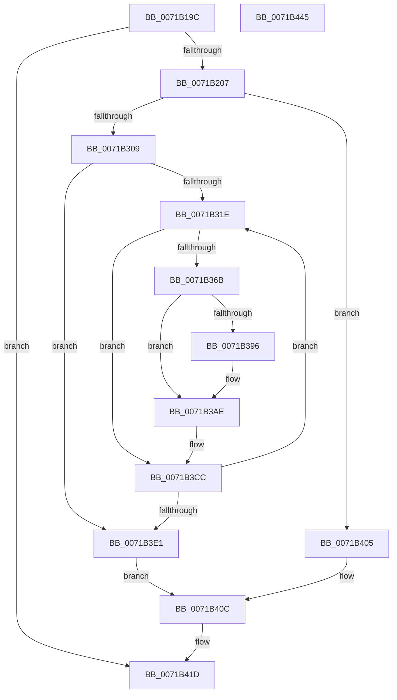

# IopCopyBootLogRegistryToFile

- RVA: `0x0071B19C`–`0x0071B446` (길이 `682` bytes)
- VA: `0x000000014071B19C`
- 실행 섹션: `PAGE`
- PDB 이름 있음: `예`; PDB Function 태그: `아니요`
- unwind 정보 RVA: `0x000C73D8`
- 디코드: `143`개 명령, `682/682` bytes 표시
- 미해석 바이트: `0` (있으면 어셈블리에 `.byte`로 보존)

> 이 문서는 커널 이미지의 기계어와 PDB 기호를 분석해 생성했습니다. 4번과 5번은 함수 원형과 자료형을 바이너리 사용 방식에서 추정한 C 해석이며 원본 소스 복구 결과는 아닙니다.

## 1. Dependencies

- 직접 호출 지점: **24**; 고유 호출 대상: **19**
- 직접 호출자로 확인된 함수: **1**
- RIP 상대 이미지 참조: **7**

### Outgoing calls
- `0x0071B225` → [ExAcquireResourceExclusiveLite](../../text/21/ExAcquireResourceExclusiveLite_function_00214E20.md) (function, `0x00214E20`)
- `0x0071B235` → [IopBootLogToFile](IopBootLogToFile_function_0071AD54.md) (function, `0x0071AD54`)
- `0x0071B246` → [ExSystemTimeToLocalTime](../../text/2F/ExSystemTimeToLocalTime_function_002FE1C0.md) (function, `0x002FE1C0`)
- `0x0071B255` → [RtlTimeToTimeFields](../../text/42/RtlTimeToTimeFields_function_0042E0F0.md) (function, `0x0042E0F0`)
- `0x0071B2AC` → [RtlStringCchPrintfA](../../text/59/RtlStringCchPrintfA_function_00596BC8.md) (function, `0x00596BC8`)
- `0x0071B2B9` → [RtlInitAnsiString](../../text/47/RtlInitAnsiString_function_00470F40.md) (function, `0x00470F40`)
- `0x0071B2CA` → [RtlAnsiStringToUnicodeString](../90/RtlAnsiStringToUnicodeString_function_0090BEA0.md) (function, `0x0090BEA0`)
- `0x0071B2D4` → [IopBootLogToFile](IopBootLogToFile_function_0071AD54.md) (function, `0x0071AD54`)
- `0x0071B2DE` → [RtlFreeAnsiString](../9C/RtlFreeAnsiString_function_009C0800.md) (function, `0x009C0800`)
- `0x0071B2FC` → [IopOpenRegistryKey](../A8/IopOpenRegistryKey_function_00A8F200.md) (function, `0x00A8F200`)
- `0x0071B334` → [RtlStringCchPrintfW](../../text/48/RtlStringCchPrintfW_function_00482D5C.md) (function, `0x00482D5C`)
- `0x0071B344` → [RtlCreateUnicodeString](../9B/RtlCreateUnicodeString_function_009BD860.md) (function, `0x009BD860`)
- `0x0071B362` → [IopOpenRegistryKey](../A8/IopOpenRegistryKey_function_00A8F200.md) (function, `0x00A8F200`)
- `0x0071B388` → [IopGetRegistryValue](../99/IopGetRegistryValue_function_009990EC.md) (function, `0x009990EC`)
- `0x0071B3A0` → [RtlInitUnicodeString](../../text/42/RtlInitUnicodeString_function_0042A780.md) (function, `0x0042A780`)
- `0x0071B3A9` → [IopBootLogToFile](IopBootLogToFile_function_0071AD54.md) (function, `0x0071AD54`)
- `0x0071B3B3` → [ExFreePoolWithTag](../../poolcode/B8/ExFreePoolWithTag_function_00B82870.md) (function, `0x00B82870`)
- `0x0071B3BD` → [ZwDeleteKey](../../text/6A/ZwDeleteKey_function_006AEC50.md) (function, `0x006AEC50`)
- `0x0071B3C7` → [ZwClose](../../text/6A/ZwClose_function_006AD2B0.md) (function, `0x006AD2B0`)
- `0x0071B3E6` → [ZwDeleteKey](../../text/6A/ZwDeleteKey_function_006AEC50.md) (function, `0x006AEC50`)
- `0x0071B3F0` → [ZwClose](../../text/6A/ZwClose_function_006AD2B0.md) (function, `0x006AD2B0`)
- `0x0071B410` → [ExReleaseResourceLite](../../text/25/ExReleaseResourceLite_function_0025FA10.md) (function, `0x0025FA10`)
- `0x0071B418` → [KiLeaveCriticalRegionUnsafe](../../text/25/KiLeaveCriticalRegionUnsafe_function_0025F010.md) (function, `0x0025F010`)
- `0x0071B427` → [_security_check_cookie](../../text/6A/_security_check_cookie_function_006AC640.md) (function, `0x006AC640`)

### Direct callers
- [CmCompleteRegistryInitialization](../7D/CmCompleteRegistryInitialization_function_007DF1EC.md) at `0x007DF399`

### Static image references
- `0x0071B1BA` → RVA `0x00E0A740` (`.data`; read)
- `0x0071B1E3` → RVA `0x00FD8028` (`PAGEDATA`; read)
- `0x0071B23F` → RVA `0x00FC6E28` (`ALMOSTRO`; read)
- `0x0071B29B` → RVA `0x00AFCAA0` (` ?? ::NNGAKEGL::`string'`; read)
- `0x0071B2EE` → RVA `0x00FDA0C8` (`PAGEDATA`; read)
- `0x0071B321` → RVA `0x00AFCAE0` (` ?? ::NNGAKEGL::`string'`; read)
- `0x0071B37B` → RVA `0x00AFCAD0` (` ?? ::NNGAKEGL::`string'`; read)

## 2. Other-region calls and transfers

- 다른 실행 섹션으로 향하는 call: **15**
  - `0x0071B225` → [ExAcquireResourceExclusiveLite](../../text/21/ExAcquireResourceExclusiveLite_function_00214E20.md) (`PAGE` → `.text`)
  - `0x0071B246` → [ExSystemTimeToLocalTime](../../text/2F/ExSystemTimeToLocalTime_function_002FE1C0.md) (`PAGE` → `.text`)
  - `0x0071B255` → [RtlTimeToTimeFields](../../text/42/RtlTimeToTimeFields_function_0042E0F0.md) (`PAGE` → `.text`)
  - `0x0071B2AC` → [RtlStringCchPrintfA](../../text/59/RtlStringCchPrintfA_function_00596BC8.md) (`PAGE` → `.text`)
  - `0x0071B2B9` → [RtlInitAnsiString](../../text/47/RtlInitAnsiString_function_00470F40.md) (`PAGE` → `.text`)
  - `0x0071B334` → [RtlStringCchPrintfW](../../text/48/RtlStringCchPrintfW_function_00482D5C.md) (`PAGE` → `.text`)
  - `0x0071B3A0` → [RtlInitUnicodeString](../../text/42/RtlInitUnicodeString_function_0042A780.md) (`PAGE` → `.text`)
  - `0x0071B3B3` → [ExFreePoolWithTag](../../poolcode/B8/ExFreePoolWithTag_function_00B82870.md) (`PAGE` → `POOLCODE`)
  - `0x0071B3BD` → [ZwDeleteKey](../../text/6A/ZwDeleteKey_function_006AEC50.md) (`PAGE` → `.text`)
  - `0x0071B3C7` → [ZwClose](../../text/6A/ZwClose_function_006AD2B0.md) (`PAGE` → `.text`)
  - `0x0071B3E6` → [ZwDeleteKey](../../text/6A/ZwDeleteKey_function_006AEC50.md) (`PAGE` → `.text`)
  - `0x0071B3F0` → [ZwClose](../../text/6A/ZwClose_function_006AD2B0.md) (`PAGE` → `.text`)
  - `0x0071B410` → [ExReleaseResourceLite](../../text/25/ExReleaseResourceLite_function_0025FA10.md) (`PAGE` → `.text`)
  - `0x0071B418` → [KiLeaveCriticalRegionUnsafe](../../text/25/KiLeaveCriticalRegionUnsafe_function_0025F010.md) (`PAGE` → `.text`)
  - `0x0071B427` → [_security_check_cookie](../../text/6A/_security_check_cookie_function_006AC640.md) (`PAGE` → `.text`)
- 별도 외부 분기/꼬리 이동을 확인하지 못했습니다.

## 3. Assembly (complete function range)

```asm
0071B19C  48 8B C4                        mov rax, rsp
0071B19F  48 89 58 08                     mov qword ptr [rax + 8], rbx
0071B1A3  48 89 70 10                     mov qword ptr [rax + 0x10], rsi
0071B1A7  48 89 78 18                     mov qword ptr [rax + 0x18], rdi
0071B1AB  55                              push rbp
0071B1AC  48 8D A8 28 FD FF FF            lea rbp, [rax - 0x2d8]
0071B1B3  48 81 EC D0 03 00 00            sub rsp, 0x3d0
0071B1BA  48 8B 05 7F F5 6E 00            mov rax, qword ptr [rip + 0x6ef57f]
0071B1C1  48 33 C4                        xor rax, rsp
0071B1C4  48 89 85 C0 02 00 00            mov qword ptr [rbp + 0x2c0], rax
0071B1CB  48 83 64 24 58 00               and qword ptr [rsp + 0x58], 0
0071B1D1  0F 57 C0                        xorps xmm0, xmm0
0071B1D4  48 83 64 24 60 00               and qword ptr [rsp + 0x60], 0
0071B1DA  0F 57 C9                        xorps xmm1, xmm1
0071B1DD  48 83 64 24 50 00               and qword ptr [rsp + 0x50], 0
0071B1E3  48 83 3D 3D CE 8B 00 00         cmp qword ptr [rip + 0x8bce3d], 0
0071B1EB  0F 11 45 98                     movups xmmword ptr [rbp - 0x68], xmm0
0071B1EF  0F 11 44 24 68                  movups xmmword ptr [rsp + 0x68], xmm0
0071B1F4  0F 11 4D 88                     movups xmmword ptr [rbp - 0x78], xmm1
0071B1F8  0F 11 44 24 78                  movups xmmword ptr [rsp + 0x78], xmm0
0071B1FD  0F 11 4D A8                     movups xmmword ptr [rbp - 0x58], xmm1
0071B201  0F 84 16 02 00 00               je 0x14071b41d
0071B207  65 48 8B 34 25 88 01 00 00      mov rsi, qword ptr gs:[0x188]
0071B210  B2 01                           mov dl, 1
0071B212  66 FF 8E E4 01 00 00            dec word ptr [rsi + 0x1e4]
0071B219  90                              nop
0071B21A  48 8B 0D 07 CE 8B 00            mov rcx, qword ptr [rip + 0x8bce07]
0071B221  48 83 C1 40                     add rcx, 0x40
0071B225  E8 F6 9B AF FF                  call 0x140214e20
0071B22A  48 8B 0D F7 CD 8B 00            mov rcx, qword ptr [rip + 0x8bcdf7]
0071B231  48 83 C1 30                     add rcx, 0x30
0071B235  E8 1A FB FF FF                  call 0x14071ad54
0071B23A  48 8D 54 24 50                  lea rdx, [rsp + 0x50]
0071B23F  48 8D 0D E2 BB 8A 00            lea rcx, [rip + 0x8abbe2]
0071B246  E8 75 2F BE FF                  call 0x1402fe1c0
0071B24B  48 8D 54 24 68                  lea rdx, [rsp + 0x68]
0071B250  48 8D 4C 24 50                  lea rcx, [rsp + 0x50]
0071B255  E8 96 2E D1 FF                  call 0x14042e0f0
0071B25A  0F BF 44 24 74                  movsx eax, word ptr [rsp + 0x74]
0071B25F  0F BF 4C 24 72                  movsx ecx, word ptr [rsp + 0x72]
0071B264  0F BF 54 24 70                  movsx edx, word ptr [rsp + 0x70]
0071B269  44 0F BF 44 24 6E               movsx r8d, word ptr [rsp + 0x6e]
0071B26F  44 0F BF 54 24 68               movsx r10d, word ptr [rsp + 0x68]
0071B275  44 0F BF 5C 24 6C               movsx r11d, word ptr [rsp + 0x6c]
0071B27B  44 0F BF 4C 24 6A               movsx r9d, word ptr [rsp + 0x6a]
0071B281  89 44 24 48                     mov dword ptr [rsp + 0x48], eax
0071B285  89 4C 24 40                     mov dword ptr [rsp + 0x40], ecx
0071B289  48 8D 4D C0                     lea rcx, [rbp - 0x40]
0071B28D  89 54 24 38                     mov dword ptr [rsp + 0x38], edx
0071B291  BA 00 01 00 00                  mov edx, 0x100
0071B296  44 89 44 24 30                  mov dword ptr [rsp + 0x30], r8d
0071B29B  4C 8D 05 FE 17 3E 00            lea r8, [rip + 0x3e17fe]
0071B2A2  44 89 54 24 28                  mov dword ptr [rsp + 0x28], r10d
0071B2A7  44 89 5C 24 20                  mov dword ptr [rsp + 0x20], r11d
0071B2AC  E8 17 B9 E7 FF                  call 0x140596bc8
0071B2B1  48 8D 55 C0                     lea rdx, [rbp - 0x40]
0071B2B5  48 8D 4D 88                     lea rcx, [rbp - 0x78]
0071B2B9  E8 82 5C D5 FF                  call 0x140470f40
0071B2BE  41 B0 01                        mov r8b, 1
0071B2C1  48 8D 55 88                     lea rdx, [rbp - 0x78]
0071B2C5  48 8D 4C 24 78                  lea rcx, [rsp + 0x78]
0071B2CA  E8 D1 0B 1F 00                  call 0x14090bea0
0071B2CF  48 8D 4C 24 78                  lea rcx, [rsp + 0x78]
0071B2D4  E8 7B FA FF FF                  call 0x14071ad54
0071B2D9  48 8D 4C 24 78                  lea rcx, [rsp + 0x78]
0071B2DE  E8 1D 55 2A 00                  call 0x1409c0800
0071B2E3  41 B9 3F 00 0F 00               mov r9d, 0xf003f
0071B2E9  C6 44 24 20 00                  mov byte ptr [rsp + 0x20], 0
0071B2EE  4C 8D 05 D3 ED 8B 00            lea r8, [rip + 0x8bedd3]
0071B2F5  33 D2                           xor edx, edx
0071B2F7  48 8D 4C 24 60                  lea rcx, [rsp + 0x60]
0071B2FC  E8 FF 3E 37 00                  call 0x140a8f200
0071B301  85 C0                           test eax, eax
0071B303  0F 88 FC 00 00 00               js 0x14071b405
0071B309  48 8B 05 18 CD 8B 00            mov rax, qword ptr [rip + 0x8bcd18]
0071B310  33 DB                           xor ebx, ebx
0071B312  39 98 A8 00 00 00               cmp dword ptr [rax + 0xa8], ebx
0071B318  0F 86 C3 00 00 00               jbe 0x14071b3e1
0071B31E  44 8B CB                        mov r9d, ebx
0071B321  4C 8D 05 B8 17 3E 00            lea r8, [rip + 0x3e17b8]
0071B328  BA 00 01 00 00                  mov edx, 0x100
0071B32D  48 8D 8D C0 00 00 00            lea rcx, [rbp + 0xc0]
0071B334  E8 23 7A D6 FF                  call 0x140482d5c
0071B339  48 8D 95 C0 00 00 00            lea rdx, [rbp + 0xc0]
0071B340  48 8D 4D 98                     lea rcx, [rbp - 0x68]
0071B344  E8 17 25 2A 00                  call 0x1409bd860
0071B349  48 8B 54 24 60                  mov rdx, qword ptr [rsp + 0x60]
0071B34E  4C 8D 45 98                     lea r8, [rbp - 0x68]
0071B352  41 B9 3F 00 0F 00               mov r9d, 0xf003f
0071B358  C6 44 24 20 00                  mov byte ptr [rsp + 0x20], 0
0071B35D  48 8D 4C 24 58                  lea rcx, [rsp + 0x58]
0071B362  E8 99 3E 37 00                  call 0x140a8f200
0071B367  85 C0                           test eax, eax
0071B369  78 61                           js 0x14071b3cc
0071B36B  48 8B 4C 24 58                  mov rcx, qword ptr [rsp + 0x58]
0071B370  4C 8D 4C 24 50                  lea r9, [rsp + 0x50]
0071B375  48 83 64 24 50 00               and qword ptr [rsp + 0x50], 0
0071B37B  48 8D 15 4E 17 3E 00            lea rdx, [rip + 0x3e174e]
0071B382  41 B8 00 01 00 00               mov r8d, 0x100
0071B388  E8 5F DD 27 00                  call 0x1409990ec
0071B38D  48 8B 7C 24 50                  mov rdi, qword ptr [rsp + 0x50]
0071B392  85 C0                           test eax, eax
0071B394  78 18                           js 0x14071b3ae
0071B396  8B 57 08                        mov edx, dword ptr [rdi + 8]
0071B399  48 8D 4D A8                     lea rcx, [rbp - 0x58]
0071B39D  48 03 D7                        add rdx, rdi
0071B3A0  E8 DB F3 D0 FF                  call 0x14042a780
0071B3A5  48 8D 4D A8                     lea rcx, [rbp - 0x58]
0071B3A9  E8 A6 F9 FF FF                  call 0x14071ad54
0071B3AE  33 D2                           xor edx, edx
0071B3B0  48 8B CF                        mov rcx, rdi
0071B3B3  E8 B8 74 46 00                  call 0x140b82870
0071B3B8  48 8B 4C 24 58                  mov rcx, qword ptr [rsp + 0x58]
0071B3BD  E8 8E 38 F9 FF                  call 0x1406aec50
0071B3C2  48 8B 4C 24 58                  mov rcx, qword ptr [rsp + 0x58]
0071B3C7  E8 E4 1E F9 FF                  call 0x1406ad2b0
0071B3CC  48 8B 05 55 CC 8B 00            mov rax, qword ptr [rip + 0x8bcc55]
0071B3D3  FF C3                           inc ebx
0071B3D5  3B 98 A8 00 00 00               cmp ebx, dword ptr [rax + 0xa8]
0071B3DB  0F 82 3D FF FF FF               jb 0x14071b31e
0071B3E1  48 8B 4C 24 60                  mov rcx, qword ptr [rsp + 0x60]
0071B3E6  E8 65 38 F9 FF                  call 0x1406aec50
0071B3EB  48 8B 4C 24 60                  mov rcx, qword ptr [rsp + 0x60]
0071B3F0  E8 BB 1E F9 FF                  call 0x1406ad2b0
0071B3F5  48 8B 0D 2C CC 8B 00            mov rcx, qword ptr [rip + 0x8bcc2c]
0071B3FC  C6 81 AC 00 00 00 01            mov byte ptr [rcx + 0xac], 1
0071B403  EB 07                           jmp 0x14071b40c
0071B405  48 8B 0D 1C CC 8B 00            mov rcx, qword ptr [rip + 0x8bcc1c]
0071B40C  48 83 C1 40                     add rcx, 0x40
0071B410  E8 FB 45 B4 FF                  call 0x14025fa10
0071B415  48 8B CE                        mov rcx, rsi
0071B418  E8 F3 3B B4 FF                  call 0x14025f010
0071B41D  48 8B 8D C0 02 00 00            mov rcx, qword ptr [rbp + 0x2c0]
0071B424  48 33 CC                        xor rcx, rsp
0071B427  E8 14 12 F9 FF                  call 0x1406ac640
0071B42C  4C 8D 9C 24 D0 03 00 00         lea r11, [rsp + 0x3d0]
0071B434  49 8B 5B 10                     mov rbx, qword ptr [r11 + 0x10]
0071B438  49 8B 73 18                     mov rsi, qword ptr [r11 + 0x18]
0071B43C  49 8B 7B 20                     mov rdi, qword ptr [r11 + 0x20]
0071B440  49 8B E3                        mov rsp, r11
0071B443  5D                              pop rbp
0071B444  C3                              ret
0071B445  CC                              int3
```

## 4. C-style interpretation (structured pseudocode)

```c
__int64 __fastcall IopCopyBootLogRegistryToFile(void)
{
    __int64 result;
    __int64 v_rbx;
    __int64 v_rsp;
    unsigned __int64 v_stack_m360;
    unsigned __int16 v_stack_m364;
    unsigned __int16 v_stack_m366;
    unsigned __int16 v_stack_m368;
    unsigned __int16 v_stack_m36A;
    unsigned __int16 v_stack_m36C;
    unsigned __int16 v_stack_m36E;
    unsigned __int64 v_stack_m370;
    unsigned __int64 v_stack_m378;
    unsigned __int64 v_stack_m380;
    unsigned __int64 v_stack_m388;
    unsigned int v_stack_m390;
    unsigned int v_stack_m398;
    unsigned int v_stack_m3A0;
    unsigned int v_stack_m3A8;
    unsigned int v_stack_m3B0;
    unsigned int v_stack_m3B8;
    unsigned __int64 v_stack_m8;

    *(unsigned __int64 *)(v_rsp + 8) = v_rbx;
    *(unsigned __int64 *)(v_rsp + 16) = v_rsi;
    *(unsigned __int64 *)(v_rsp + 24) = v_rdi;
    v_rsp = (v_rsp) - (976);
    result = (*(unsigned __int64 *)(v_rip + 7271807)) ^ (v_rsp);
    *(unsigned __int64 *)(v_rsp - 728 + 704) = result;
    *(unsigned __int64 *)(v_rsp - 728 - 104) = v_xmm0;
    v_stack_m370 = v_xmm0;
    *(unsigned __int64 *)(v_rsp - 728 - 120) = v_xmm1;
    v_stack_m360 = v_xmm0;
    *(unsigned __int64 *)(v_rsp - 728 - 88) = v_xmm1;
    if ((*(unsigned __int64 *)(v_rip + 9162301)) == 0) goto loc_0071B41D;
    a1 = (*(unsigned __int64 *)(v_rip + 9162247)) + (64);
    result = ExAcquireResourceExclusiveLite(a1, 1, a3, a4);
    a1 = (*(unsigned __int64 *)(v_rip + 9162231)) + (48);
    result = IopBootLogToFile(a1, 1, a3, a4);
    result = ExSystemTimeToLocalTime(v_rip + 9092066, v_stack_m388, a3, a4);
    result = RtlTimeToTimeFields(v_stack_m388, v_stack_m370, a3, a4);
    v_stack_m390 = (unsigned int)((__int16)(v_stack_m364));
    v_stack_m398 = (unsigned int)((__int16)(v_stack_m366));
    v_stack_m3A0 = (unsigned int)((__int16)(v_stack_m368));
    v_stack_m3A8 = (unsigned int)((__int16)(v_stack_m36A));
    v_stack_m3B0 = (unsigned int)((__int16)(v_stack_m370));
    v_stack_m3B8 = (unsigned int)((__int16)(v_stack_m36C));
    result = RtlStringCchPrintfA(v_rsp - 728 - 64, 256, v_rip + 4069374, (__int16)(v_stack_m36E));
    result = RtlInitAnsiString(v_rsp - 728 - 120, v_rsp - 728 - 64, v_rip + 4069374, (__int16)(v_stack_m36E));
    result = RtlAnsiStringToUnicodeString(v_stack_m360, v_rsp - 728 - 120, 1, (__int16)(v_stack_m36E));
    result = IopBootLogToFile(v_stack_m360, v_rsp - 728 - 120, 1, (__int16)(v_stack_m36E));
    result = RtlFreeAnsiString(v_stack_m360, v_rsp - 728 - 120, 1, (__int16)(v_stack_m36E));
    v_stack_m3B8 = 0;
    a2 = 0;
    result = IopOpenRegistryKey(v_stack_m378, a2, v_rip + 9170387, (unsigned int)(0xF003FULL));
    if (sign_flag) goto loc_0071B405;
    v_rbx = 0;
    if ((*(unsigned int *)(*(unsigned __int64 *)(v_rip + 9162008) + 168)) <= 0) goto loc_0071B3E1;
loc_0071B31E:
    result = RtlStringCchPrintfW(v_rsp - 728 + 192, 256, v_rip + 4069304, 0);
    result = RtlCreateUnicodeString(v_rsp - 728 - 104, v_rsp - 728 + 192, v_rip + 4069304, 0);
    v_stack_m3B8 = 0;
    result = IopOpenRegistryKey(v_stack_m380, v_stack_m378, v_rsp - 728 - 104, (unsigned int)(0xF003FULL));
    if (sign_flag) goto loc_0071B3CC;
    result = IopGetRegistryValue(v_stack_m380, v_rip + 4069198, 256, v_stack_m388);
    if (!(sign_flag)) {
        a2 = *(unsigned int *)(v_stack_m388 + 8);
        a1 = v_rsp - 728 - 88;
        a2 = (a2) + (v_stack_m388);
        result = RtlInitUnicodeString(a1, a2, 256, v_stack_m388);
        a1 = v_rsp - 728 - 88;
        result = IopBootLogToFile(a1, a2, 256, v_stack_m388);
    }
    a2 = 0;
    result = ExFreePoolWithTag(v_stack_m388, a2, 256, v_stack_m388);
    result = ZwDeleteKey(v_stack_m380, a2, 256, v_stack_m388);
    result = ZwClose(v_stack_m380, a2, 256, v_stack_m388);
loc_0071B3CC:
    v_rbx = (unsigned int)((v_rbx) + 1);
    if (((unsigned int)(v_rbx)) < (*(unsigned int *)(*(unsigned __int64 *)(v_rip + 9161813) + 168))) goto loc_0071B31E;
loc_0071B3E1:
    result = ZwDeleteKey(v_stack_m378, a2, 256, v_stack_m388);
    result = ZwClose(v_stack_m378, a2, 256, v_stack_m388);
    *(unsigned __int8 *)(*(unsigned __int64 *)(v_rip + 9161772) + 172) = 1;
    goto loc_0071B40C;
loc_0071B405:
loc_0071B40C:
    a1 = (*(unsigned __int64 *)(v_rip + 9161756)) + (64);
    result = ExReleaseResourceLite(a1, a2, 256, v_stack_m388);
    result = KiLeaveCriticalRegionUnsafe(*(unsigned __int64 *)(gs_base + (0 + 392)), a2, 256, v_stack_m388);
loc_0071B41D:
    a1 = (*(unsigned __int64 *)(v_rsp - 728 + 704)) ^ (v_rsp);
    result = _security_check_cookie(a1, a2, 256, v_stack_m388);
    return result;
}
```

## 5. (Beta) C Style

```c
void IopCopyBootLogRegistryToFile(void)
{
    int64_t result;
    int64_t local_rbx;
    int64_t local_rsp;
    uint64_t v_stack_m360;
    uint16_t v_stack_m364;
    uint16_t v_stack_m366;
    uint16_t v_stack_m368;
    uint16_t v_stack_m36A;
    uint16_t v_stack_m36C;
    uint16_t v_stack_m36E;
    uint64_t v_stack_m370;
    uint64_t v_stack_m378;
    uint64_t v_stack_m380;
    uint64_t v_stack_m388;
    uint32_t v_stack_m390;
    uint32_t v_stack_m398;
    uint32_t v_stack_m3A0;
    uint32_t v_stack_m3A8;
    uint32_t v_stack_m3B0;
    uint32_t v_stack_m3B8;
    uint64_t v_stack_m8;

    *(uint64_t *)(local_rsp + 0x8) = local_rbx;
    *(uint64_t *)(local_rsp + 0x10) = local_rsi;
    *(uint64_t *)(local_rsp + 0x18) = local_rdi;
    local_rsp = (local_rsp) - (976);
    result = (*(uint64_t *)(v_rip + 0x6EF57F)) ^ (local_rsp);
    *(uint64_t *)(local_rsp - 0x2D8 + 0x2C0) = result;
    *(uint64_t *)(local_rsp - 0x2D8 - 0x68) = v_xmm0;
    v_stack_m370 = v_xmm0;
    *(uint64_t *)(local_rsp - 0x2D8 - 0x78) = v_xmm1;
    v_stack_m360 = v_xmm0;
    *(uint64_t *)(local_rsp - 0x2D8 - 0x58) = v_xmm1;
    if ((*(uint64_t *)(v_rip + 0x8BCE3D)) == 0) goto loc_0071B41D;
    a1 = (*(uint64_t *)(v_rip + 0x8BCE07)) + (64);
    result = ExAcquireResourceExclusiveLite(a1, 1, a3, a4);
    a1 = (*(uint64_t *)(v_rip + 0x8BCDF7)) + (48);
    result = IopBootLogToFile(a1, 1, a3, a4);
    result = ExSystemTimeToLocalTime(v_rip + 9092066, v_stack_m388, a3, a4);
    result = RtlTimeToTimeFields(v_stack_m388, v_stack_m370, a3, a4);
    v_stack_m390 = (uint32_t)((int16_t)(v_stack_m364));
    v_stack_m398 = (uint32_t)((int16_t)(v_stack_m366));
    v_stack_m3A0 = (uint32_t)((int16_t)(v_stack_m368));
    v_stack_m3A8 = (uint32_t)((int16_t)(v_stack_m36A));
    v_stack_m3B0 = (uint32_t)((int16_t)(v_stack_m370));
    v_stack_m3B8 = (uint32_t)((int16_t)(v_stack_m36C));
    result = RtlStringCchPrintfA(local_rsp - 728 - 64, 256, v_rip + 4069374, (int16_t)(v_stack_m36E));
    result = RtlInitAnsiString(local_rsp - 728 - 120, local_rsp - 728 - 64, v_rip + 4069374, (int16_t)(v_stack_m36E));
    result = RtlAnsiStringToUnicodeString(v_stack_m360, local_rsp - 728 - 120, 1, (int16_t)(v_stack_m36E));
    result = IopBootLogToFile(v_stack_m360, local_rsp - 728 - 120, 1, (int16_t)(v_stack_m36E));
    result = RtlFreeAnsiString(v_stack_m360, local_rsp - 728 - 120, 1, (int16_t)(v_stack_m36E));
    v_stack_m3B8 = 0;
    a2 = 0;
    result = IopOpenRegistryKey(v_stack_m378, a2, v_rip + 9170387, (uint32_t)(0xF003FULL));
    if (sign_flag) goto loc_0071B405;
    local_rbx = 0;
    if ((*(uint32_t *)(*(uint64_t *)(v_rip + 0x8BCD18) + 0xA8)) <= 0) goto loc_0071B3E1;
loc_0071B31E:
    result = RtlStringCchPrintfW(local_rsp - 728 + 192, 256, v_rip + 4069304, 0);
    result = RtlCreateUnicodeString(local_rsp - 728 - 104, local_rsp - 728 + 192, v_rip + 4069304, 0);
    v_stack_m3B8 = 0;
    result = IopOpenRegistryKey(v_stack_m380, v_stack_m378, local_rsp - 728 - 104, (uint32_t)(0xF003FULL));
    if (sign_flag) goto loc_0071B3CC;
    result = IopGetRegistryValue(v_stack_m380, v_rip + 4069198, 256, v_stack_m388);
    if (!(sign_flag)) {
        a2 = *(uint32_t *)(v_stack_m388 + 0x8);
        a1 = local_rsp - 728 - 88;
        a2 = (a2) + (v_stack_m388);
        result = RtlInitUnicodeString(a1, a2, 256, v_stack_m388);
        a1 = local_rsp - 728 - 88;
        result = IopBootLogToFile(a1, a2, 256, v_stack_m388);
    }
    a2 = 0;
    result = ExFreePoolWithTag(v_stack_m388, a2, 256, v_stack_m388);
    result = ZwDeleteKey(v_stack_m380, a2, 256, v_stack_m388);
    result = ZwClose(v_stack_m380, a2, 256, v_stack_m388);
loc_0071B3CC:
    local_rbx = (uint32_t)((local_rbx) + 1);
    if (((uint32_t)(local_rbx)) < (*(uint32_t *)(*(uint64_t *)(v_rip + 0x8BCC55) + 0xA8))) goto loc_0071B31E;
loc_0071B3E1:
    result = ZwDeleteKey(v_stack_m378, a2, 256, v_stack_m388);
    result = ZwClose(v_stack_m378, a2, 256, v_stack_m388);
    *(uint8_t *)(*(uint64_t *)(v_rip + 0x8BCC2C) + 0xAC) = 1;
    goto loc_0071B40C;
loc_0071B405:
loc_0071B40C:
    a1 = (*(uint64_t *)(v_rip + 0x8BCC1C)) + (64);
    result = ExReleaseResourceLite(a1, a2, 256, v_stack_m388);
    result = KiLeaveCriticalRegionUnsafe(*(uint64_t *)(gs_base + (0 + 0x188)), a2, 256, v_stack_m388);
loc_0071B41D:
    a1 = (*(uint64_t *)(local_rsp - 0x2D8 + 0x2C0)) ^ (local_rsp);
    result = _security_check_cookie(a1, a2, 256, v_stack_m388);
    return result;
}
```

## 6. Execution-region graph

[열기: 2D/3D 그래프와 함수 탐색 컨트롤 패널](../../../control-panel.html?section=page&rva=0x0071B19C&view=graph)

- 2D 그래프는 위에서 아래로 흐르고, 3D 그래프는 빈 공간을 드래그해 회전합니다. Shift+드래그는 이동, 휠은 확대·축소, 함수 노드 선택은 대상 보고서 이동입니다.

### Static fallback


