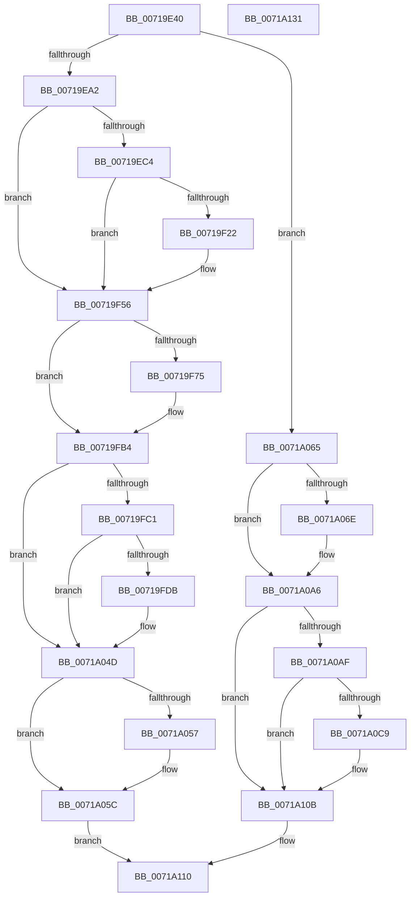

# IopCrashDumpPolicyChangeWnfCallback

- RVA: `0x00719E40`–`0x0071A132` (길이 `754` bytes)
- VA: `0x0000000140719E40`
- 실행 섹션: `PAGE`
- PDB 이름 있음: `예`; PDB Function 태그: `아니요`
- unwind 정보 RVA: `0x000C6F60`
- 디코드: `162`개 명령, `754/754` bytes 표시
- 미해석 바이트: `0` (있으면 어셈블리에 `.byte`로 보존)

> 이 문서는 커널 이미지의 기계어와 PDB 기호를 분석해 생성했습니다. 4번과 5번은 함수 원형과 자료형을 바이너리 사용 방식에서 추정한 C 해석이며 원본 소스 복구 결과는 아닙니다.

## 1. Dependencies

- 직접 호출 지점: **17**; 고유 호출 대상: **12**
- 직접 호출자로 확인된 함수: **0**
- RIP 상대 이미지 참조: **12**

### Outgoing calls
- `0x00719EA4` → [IopInitializeDumpPolicySettings](IopInitializeDumpPolicySettings_function_0071A444.md) (function, `0x0071A444`)
- `0x00719EB4` → [CmIsStateSeparationEnabled](../../text/4A/CmIsStateSeparationEnabled_function_004A4754.md) (function, `0x004A4754`)
- `0x00719ECF` → [RtlInitUnicodeString](../../text/42/RtlInitUnicodeString_function_0042A780.md) (function, `0x0042A780`)
- `0x00719F19` → [ZwCreateKey](../../text/6A/ZwCreateKey_function_006AD470.md) (function, `0x006AD470`)
- `0x00719F2E` → [RtlInitUnicodeString](../../text/42/RtlInitUnicodeString_function_0042A780.md) (function, `0x0042A780`)
- `0x00719F51` → [ZwSetValueKey](../../text/6A/ZwSetValueKey_function_006ADCD0.md) (function, `0x006ADCD0`)
- `0x00719F63` → [IoConfigureCrashDump](../../text/59/IoConfigureCrashDump_function_00591CB4.md) (function, `0x00591CB4`)
- `0x00719F6C` → [IopDumpIsTracingEnabled](../../text/4F/IopDumpIsTracingEnabled_function_004FC5D0.md) (function, `0x004FC5D0`)
- `0x00719FAF` → [EtwWrite](../../text/41/EtwWrite_function_0041C720.md) (function, `0x0041C720`)
- `0x00719FD2` → [tlgKeywordOn](../../text/42/tlgKeywordOn_function_0042EAA0.md) (function, `0x0042EAA0`)
- `0x0071A048` → [tlgWriteTransfer_EtwWriteTransfer](../../text/42/tlgWriteTransfer_EtwWriteTransfer_function_004260E0.md) (function, `0x004260E0`)
- `0x0071A057` → [ZwClose](../../text/6A/ZwClose_function_006AD2B0.md) (function, `0x006AD2B0`)
- `0x0071A065` → [IopDumpIsTracingEnabled](../../text/4F/IopDumpIsTracingEnabled_function_004FC5D0.md) (function, `0x004FC5D0`)
- `0x0071A0A1` → [EtwWrite](../../text/41/EtwWrite_function_0041C720.md) (function, `0x0041C720`)
- `0x0071A0C0` → [tlgKeywordOn](../../text/42/tlgKeywordOn_function_0042EAA0.md) (function, `0x0042EAA0`)
- `0x0071A106` → [tlgWriteTransfer_EtwWriteTransfer](../../text/42/tlgWriteTransfer_EtwWriteTransfer_function_004260E0.md) (function, `0x004260E0`)
- `0x0071A117` → [_security_check_cookie](../../text/6A/_security_check_cookie_function_006AC640.md) (function, `0x006AC640`)

### Direct callers
- 이 함수 시작 RVA로 연결되는 직접 call은 확인되지 않았습니다. 간접 호출은 완전히 역산할 수 없습니다.

### Static image references
- `0x00719E57` → RVA `0x00E0A740` (`.data`; read)
- `0x00719E7D` → RVA `0x00020A38` (`.rdata`; read)
- `0x00719EA9` → RVA `0x00E0A9BA` (`.data`; read)
- `0x00719EC4` → RVA `0x00AFC270` (` ?? ::NNGAKEGL::`string'`; read)
- `0x00719F22` → RVA `0x00AFC250` (` ?? ::NNGAKEGL::`string'`; read)
- `0x00719F75` → RVA `0x00E65EF0` (`.data`; read)
- `0x00719F85` → RVA `0x00022500` (`.rdata`; read)
- `0x00719FB4` → RVA `0x00E06DE8` (`.data`; read)
- `0x00719FEB` → RVA `0x00045D84` (`.rdata`; read)
- `0x0071A075` → RVA `0x00AFC300` (` ?? ::NNGAKEGL::`string'`; read)
- `0x0071A080` → RVA `0x000229D8` (`.rdata`; read)
- `0x0071A0D9` → RVA `0x00045A47` (`.rdata`; read)

## 2. Other-region calls and transfers

- 다른 실행 섹션으로 향하는 call: **16**
  - `0x00719EB4` → [CmIsStateSeparationEnabled](../../text/4A/CmIsStateSeparationEnabled_function_004A4754.md) (`PAGE` → `.text`)
  - `0x00719ECF` → [RtlInitUnicodeString](../../text/42/RtlInitUnicodeString_function_0042A780.md) (`PAGE` → `.text`)
  - `0x00719F19` → [ZwCreateKey](../../text/6A/ZwCreateKey_function_006AD470.md) (`PAGE` → `.text`)
  - `0x00719F2E` → [RtlInitUnicodeString](../../text/42/RtlInitUnicodeString_function_0042A780.md) (`PAGE` → `.text`)
  - `0x00719F51` → [ZwSetValueKey](../../text/6A/ZwSetValueKey_function_006ADCD0.md) (`PAGE` → `.text`)
  - `0x00719F63` → [IoConfigureCrashDump](../../text/59/IoConfigureCrashDump_function_00591CB4.md) (`PAGE` → `.text`)
  - `0x00719F6C` → [IopDumpIsTracingEnabled](../../text/4F/IopDumpIsTracingEnabled_function_004FC5D0.md) (`PAGE` → `.text`)
  - `0x00719FAF` → [EtwWrite](../../text/41/EtwWrite_function_0041C720.md) (`PAGE` → `.text`)
  - `0x00719FD2` → [tlgKeywordOn](../../text/42/tlgKeywordOn_function_0042EAA0.md) (`PAGE` → `.text`)
  - `0x0071A048` → [tlgWriteTransfer_EtwWriteTransfer](../../text/42/tlgWriteTransfer_EtwWriteTransfer_function_004260E0.md) (`PAGE` → `.text`)
  - `0x0071A057` → [ZwClose](../../text/6A/ZwClose_function_006AD2B0.md) (`PAGE` → `.text`)
  - `0x0071A065` → [IopDumpIsTracingEnabled](../../text/4F/IopDumpIsTracingEnabled_function_004FC5D0.md) (`PAGE` → `.text`)
  - `0x0071A0A1` → [EtwWrite](../../text/41/EtwWrite_function_0041C720.md) (`PAGE` → `.text`)
  - `0x0071A0C0` → [tlgKeywordOn](../../text/42/tlgKeywordOn_function_0042EAA0.md) (`PAGE` → `.text`)
  - `0x0071A106` → [tlgWriteTransfer_EtwWriteTransfer](../../text/42/tlgWriteTransfer_EtwWriteTransfer_function_004260E0.md) (`PAGE` → `.text`)
  - `0x0071A117` → [_security_check_cookie](../../text/6A/_security_check_cookie_function_006AC640.md) (`PAGE` → `.text`)
- 별도 외부 분기/꼬리 이동을 확인하지 못했습니다.

## 3. Assembly (complete function range)

```asm
00719E40  48 89 5C 24 08                  mov qword ptr [rsp + 8], rbx
00719E45  48 89 7C 24 10                  mov qword ptr [rsp + 0x10], rdi
00719E4A  55                              push rbp
00719E4B  48 8D 6C 24 D0                  lea rbp, [rsp - 0x30]
00719E50  48 81 EC 30 01 00 00            sub rsp, 0x130
00719E57  48 8B 05 E2 08 6F 00            mov rax, qword ptr [rip + 0x6f08e2]
00719E5E  48 33 C4                        xor rax, rsp
00719E61  48 89 45 20                     mov qword ptr [rbp + 0x20], rax
00719E65  33 C0                           xor eax, eax
00719E67  0F 57 C0                        xorps xmm0, xmm0
00719E6A  89 44 24 5C                     mov dword ptr [rsp + 0x5c], eax
00719E6E  33 DB                           xor ebx, ebx
00719E70  48 89 45 88                     mov qword ptr [rbp - 0x78], rax
00719E74  0F 57 C9                        xorps xmm1, xmm1
00719E77  89 45 90                        mov dword ptr [rbp - 0x70], eax
00719E7A  48 8B 02                        mov rax, qword ptr [rdx]
00719E7D  48 3B 05 B4 6B 90 FF            cmp rax, qword ptr [rip - 0x6f944c]
00719E84  0F 11 45 98                     movups xmmword ptr [rbp - 0x68], xmm0
00719E88  48 89 5C 24 50                  mov qword ptr [rsp + 0x50], rbx
00719E8D  0F 11 4C 24 58                  movups xmmword ptr [rsp + 0x58], xmm1
00719E92  0F 11 44 24 68                  movups xmmword ptr [rsp + 0x68], xmm0
00719E97  0F 11 44 24 78                  movups xmmword ptr [rsp + 0x78], xmm0
00719E9C  0F 85 C3 01 00 00               jne 0x14071a065
00719EA2  33 C9                           xor ecx, ecx
00719EA4  E8 9B 05 00 00                  call 0x14071a444
00719EA9  0F B6 05 0A 0B 6F 00            movzx eax, byte ptr [rip + 0x6f0b0a]
00719EB0  89 44 24 48                     mov dword ptr [rsp + 0x48], eax
00719EB4  E8 9B A8 D8 FF                  call 0x1404a4754
00719EB9  8D 7B 04                        lea edi, [rbx + 4]
00719EBC  84 C0                           test al, al
00719EBE  0F 84 92 00 00 00               je 0x140719f56
00719EC4  48 8D 15 A5 23 3E 00            lea rdx, [rip + 0x3e23a5]
00719ECB  48 8D 4D 98                     lea rcx, [rbp - 0x68]
00719ECF  E8 AC 08 D1 FF                  call 0x14042a780
00719ED4  48 8D 45 98                     lea rax, [rbp - 0x68]
00719ED8  48 89 5C 24 30                  mov qword ptr [rsp + 0x30], rbx
00719EDD  0F 57 C0                        xorps xmm0, xmm0
00719EE0  89 5C 24 28                     mov dword ptr [rsp + 0x28], ebx
00719EE4  45 33 C9                        xor r9d, r9d
00719EE7  48 89 44 24 78                  mov qword ptr [rsp + 0x78], rax
00719EEC  4C 8D 44 24 68                  lea r8, [rsp + 0x68]
00719EF1  C7 44 24 68 30 00 00 00         mov dword ptr [rsp + 0x68], 0x30
00719EF9  BA 3F 00 0F 00                  mov edx, 0xf003f
00719EFE  48 89 5C 24 70                  mov qword ptr [rsp + 0x70], rbx
00719F03  48 8D 4C 24 50                  lea rcx, [rsp + 0x50]
00719F08  C7 45 80 40 02 00 00            mov dword ptr [rbp - 0x80], 0x240
00719F0F  F3 0F 7F 45 88                  movdqu xmmword ptr [rbp - 0x78], xmm0
00719F14  48 89 5C 24 20                  mov qword ptr [rsp + 0x20], rbx
00719F19  E8 52 35 F9 FF                  call 0x1406ad470
00719F1E  85 C0                           test eax, eax
00719F20  78 34                           js 0x140719f56
00719F22  48 8D 15 27 23 3E 00            lea rdx, [rip + 0x3e2327]
00719F29  48 8D 4C 24 58                  lea rcx, [rsp + 0x58]
00719F2E  E8 4D 08 D1 FF                  call 0x14042a780
00719F33  48 8B 4C 24 50                  mov rcx, qword ptr [rsp + 0x50]
00719F38  48 8D 44 24 48                  lea rax, [rsp + 0x48]
00719F3D  89 7C 24 28                     mov dword ptr [rsp + 0x28], edi
00719F41  48 8D 54 24 58                  lea rdx, [rsp + 0x58]
00719F46  44 8B CF                        mov r9d, edi
00719F49  48 89 44 24 20                  mov qword ptr [rsp + 0x20], rax
00719F4E  45 33 C0                        xor r8d, r8d
00719F51  E8 7A 3D F9 FF                  call 0x1406adcd0
00719F56  38 1D 5E 0A 6F 00               cmp byte ptr [rip + 0x6f0a5e], bl
00719F5C  8B CB                           mov ecx, ebx
00719F5E  0F 95 C1                        setne cl
00719F61  33 D2                           xor edx, edx
00719F63  E8 4C 7D E7 FF                  call 0x140591cb4
00719F68  89 44 24 44                     mov dword ptr [rsp + 0x44], eax
00719F6C  E8 5F 26 DE FF                  call 0x1404fc5d0
00719F71  84 C0                           test al, al
00719F73  74 3F                           je 0x140719fb4
00719F75  48 8B 0D 74 BF 74 00            mov rcx, qword ptr [rip + 0x74bf74]
00719F7C  48 8D 44 24 48                  lea rax, [rsp + 0x48]
00719F81  48 89 45 A8                     mov qword ptr [rbp - 0x58], rax
00719F85  48 8D 15 74 85 90 FF            lea rdx, [rip - 0x6f7a8c]
00719F8C  48 8D 44 24 44                  lea rax, [rsp + 0x44]
00719F91  48 89 7D B0                     mov qword ptr [rbp - 0x50], rdi
00719F95  48 89 45 B8                     mov qword ptr [rbp - 0x48], rax
00719F99  41 B9 02 00 00 00               mov r9d, 2
00719F9F  48 8D 45 A8                     lea rax, [rbp - 0x58]
00719FA3  48 89 7D C0                     mov qword ptr [rbp - 0x40], rdi
00719FA7  45 33 C0                        xor r8d, r8d
00719FAA  48 89 44 24 20                  mov qword ptr [rsp + 0x20], rax
00719FAF  E8 6C 27 D0 FF                  call 0x14041c720
00719FB4  83 3D 2D CE 6E 00 05            cmp dword ptr [rip + 0x6ece2d], 5
00719FBB  0F 86 8C 00 00 00               jbe 0x14071a04d
00719FC1  48 BA 00 00 00 00 00 40 00 00   movabs rdx, 0x400000000000
00719FCB  48 8D 0D 16 CE 6E 00            lea rcx, [rip + 0x6ece16]
00719FD2  E8 C9 4A D1 FF                  call 0x14042eaa0
00719FD7  84 C0                           test al, al
00719FD9  74 72                           je 0x14071a04d
00719FDB  48 8D 45 A8                     lea rax, [rbp - 0x58]
00719FDF  48 C7 45 A8 00 00 00 01         mov qword ptr [rbp - 0x58], 0x1000000
00719FE7  48 89 45 F0                     mov qword ptr [rbp - 0x10], rax
00719FEB  48 8D 15 92 BD 92 FF            lea rdx, [rip - 0x6d426e]
00719FF2  8B 44 24 44                     mov eax, dword ptr [rsp + 0x44]
00719FF6  48 8D 0D EB CD 6E 00            lea rcx, [rip + 0x6ecdeb]
00719FFD  89 44 24 4C                     mov dword ptr [rsp + 0x4c], eax
0071A001  45 33 C9                        xor r9d, r9d
0071A004  48 8D 44 24 4C                  lea rax, [rsp + 0x4c]
0071A009  48 C7 45 F8 08 00 00 00         mov qword ptr [rbp - 8], 8
0071A011  48 89 45 00                     mov qword ptr [rbp], rax
0071A015  45 33 C0                        xor r8d, r8d
0071A018  8A 05 9C 09 6F 00               mov al, byte ptr [rip + 0x6f099c]
0071A01E  88 44 24 40                     mov byte ptr [rsp + 0x40], al
0071A022  48 8D 44 24 40                  lea rax, [rsp + 0x40]
0071A027  48 89 45 10                     mov qword ptr [rbp + 0x10], rax
0071A02B  48 8D 45 D0                     lea rax, [rbp - 0x30]
0071A02F  48 89 44 24 28                  mov qword ptr [rsp + 0x28], rax
0071A034  C7 44 24 20 05 00 00 00         mov dword ptr [rsp + 0x20], 5
0071A03C  48 89 7D 08                     mov qword ptr [rbp + 8], rdi
0071A040  48 C7 45 18 01 00 00 00         mov qword ptr [rbp + 0x18], 1
0071A048  E8 93 C0 D0 FF                  call 0x1404260e0
0071A04D  48 8B 4C 24 50                  mov rcx, qword ptr [rsp + 0x50]
0071A052  48 85 C9                        test rcx, rcx
0071A055  74 05                           je 0x14071a05c
0071A057  E8 54 32 F9 FF                  call 0x1406ad2b0
0071A05C  8B 44 24 44                     mov eax, dword ptr [rsp + 0x44]
0071A060  E9 AB 00 00 00                  jmp 0x14071a110
0071A065  E8 66 25 DE FF                  call 0x1404fc5d0
0071A06A  84 C0                           test al, al
0071A06C  74 38                           je 0x14071a0a6
0071A06E  48 8B 0D 7B BE 74 00            mov rcx, qword ptr [rip + 0x74be7b]
0071A075  48 8D 05 84 22 3E 00            lea rax, [rip + 0x3e2284]
0071A07C  48 89 45 A8                     mov qword ptr [rbp - 0x58], rax
0071A080  48 8D 15 51 89 90 FF            lea rdx, [rip - 0x6f76af]
0071A087  48 8D 45 A8                     lea rax, [rbp - 0x58]
0071A08B  48 C7 45 B0 1F 00 00 00         mov qword ptr [rbp - 0x50], 0x1f
0071A093  41 B9 01 00 00 00               mov r9d, 1
0071A099  48 89 44 24 20                  mov qword ptr [rsp + 0x20], rax
0071A09E  45 33 C0                        xor r8d, r8d
0071A0A1  E8 7A 26 D0 FF                  call 0x14041c720
0071A0A6  83 3D 3B CD 6E 00 05            cmp dword ptr [rip + 0x6ecd3b], 5
0071A0AD  76 5C                           jbe 0x14071a10b
0071A0AF  48 BA 00 00 00 00 00 40 00 00   movabs rdx, 0x400000000000
0071A0B9  48 8D 0D 28 CD 6E 00            lea rcx, [rip + 0x6ecd28]
0071A0C0  E8 DB 49 D1 FF                  call 0x14042eaa0
0071A0C5  84 C0                           test al, al
0071A0C7  74 42                           je 0x14071a10b
0071A0C9  48 8D 45 A8                     lea rax, [rbp - 0x58]
0071A0CD  48 C7 45 A8 00 00 00 01         mov qword ptr [rbp - 0x58], 0x1000000
0071A0D5  48 89 45 F0                     mov qword ptr [rbp - 0x10], rax
0071A0D9  48 8D 15 67 B9 92 FF            lea rdx, [rip - 0x6d4699]
0071A0E0  48 8D 45 D0                     lea rax, [rbp - 0x30]
0071A0E4  48 C7 45 F8 08 00 00 00         mov qword ptr [rbp - 8], 8
0071A0EC  48 89 44 24 28                  mov qword ptr [rsp + 0x28], rax
0071A0F1  48 8D 0D F0 CC 6E 00            lea rcx, [rip + 0x6eccf0]
0071A0F8  45 33 C9                        xor r9d, r9d
0071A0FB  C7 44 24 20 03 00 00 00         mov dword ptr [rsp + 0x20], 3
0071A103  45 33 C0                        xor r8d, r8d
0071A106  E8 D5 BF D0 FF                  call 0x1404260e0
0071A10B  B8 0D 00 00 C0                  mov eax, 0xc000000d
0071A110  48 8B 4D 20                     mov rcx, qword ptr [rbp + 0x20]
0071A114  48 33 CC                        xor rcx, rsp
0071A117  E8 24 25 F9 FF                  call 0x1406ac640
0071A11C  4C 8D 9C 24 30 01 00 00         lea r11, [rsp + 0x130]
0071A124  49 8B 5B 10                     mov rbx, qword ptr [r11 + 0x10]
0071A128  49 8B 7B 18                     mov rdi, qword ptr [r11 + 0x18]
0071A12C  49 8B E3                        mov rsp, r11
0071A12F  5D                              pop rbp
0071A130  C3                              ret
0071A131  CC                              int3
```

## 4. C-style interpretation (structured pseudocode)

```c
__int64 __fastcall IopCrashDumpPolicyChangeWnfCallback(int a1, __int64 a2, __int64 a3, int a4)
{
    __int64 result;
    __int64 v_rbx;
    __int64 v_rsp;
    unsigned __int64 v_stack_m108;
    unsigned int v_stack_m110;
    unsigned __int64 v_stack_m118;
    unsigned __int64 v_stack_m18;
    unsigned __int64 v_stack_m20;
    unsigned __int64 v_stack_m28;
    unsigned __int64 v_stack_m30;
    unsigned __int64 v_stack_m38;
    unsigned __int64 v_stack_m40;
    unsigned __int64 v_stack_m48;
    unsigned __int64 v_stack_m68;
    unsigned __int64 v_stack_m78;
    unsigned __int64 v_stack_m8;
    unsigned __int64 v_stack_m80;
    unsigned __int64 v_stack_m88;
    unsigned __int64 v_stack_m90;
    unsigned __int64 v_stack_mA0;
    unsigned int v_stack_mA8;
    unsigned __int64 v_stack_mB0;
    unsigned int v_stack_mB8;
    unsigned __int64 v_stack_mC0;
    unsigned __int64 v_stack_mC8;
    unsigned __int64 v_stack_mD0;
    unsigned int v_stack_mDC;
    unsigned __int64 v_stack_mE0;
    unsigned __int64 v_stack_mE8;
    unsigned int v_stack_mEC;
    unsigned int v_stack_mF0;
    unsigned int v_stack_mF4;
    unsigned __int8 v_stack_mF8;
    unsigned __int64 v_stack_p10;
    unsigned __int64 v_stack_p8;

    v_stack_p8 = v_rbx;
    v_stack_p10 = v_rdi;
    v_rsp = (v_rsp) - (304);
    result = (*(unsigned __int64 *)(v_rip + 7276770)) ^ (v_rsp);
    v_stack_m18 = result;
    result = 0;
    v_stack_mDC = 0;
    v_rbx = 0;
    v_stack_mB0 = 0;
    v_stack_mA8 = 0;
    v_stack_mA0 = v_xmm0;
    v_stack_mE8 = 0;
    v_stack_mE0 = v_xmm1;
    v_stack_mD0 = v_xmm0;
    v_stack_mC0 = v_xmm0;
    if ((*(unsigned __int64 *)(a2)) != (*(unsigned __int64 *)(v_rip - 7312460))) goto loc_0071A065;
    a1 = 0;
    result = IopInitializeDumpPolicySettings(a1, a2, a3, a4);
    v_stack_mF0 = (unsigned int)(*(unsigned __int8 *)(v_rip + 7277322));
    result = CmIsStateSeparationEnabled(a1, a2, a3, a4);
    if ((unsigned __int8)(result) == 0) goto loc_00719F56;
    result = RtlInitUnicodeString(v_stack_mA0, v_rip + 4072357, a3, a4);
    v_stack_m108 = 0;
    v_stack_m110 = 0;
    a4 = 0;
    v_stack_mC0 = v_stack_mA0;
    v_stack_mD0 = 48;
    v_stack_mC8 = 0;
    v_stack_mB8 = 576;
    v_stack_mB0 = v_xmm0;
    v_stack_m118 = 0;
    result = ZwCreateKey(v_stack_mE8, (unsigned int)(0xF003FULL), v_stack_mD0, a4);
    if (!(sign_flag)) {
        a2 = v_rip + 4072231;
        a1 = v_stack_mE0;
        result = RtlInitUnicodeString(a1, a2, v_stack_mD0, a4);
        a1 = v_stack_mE8;
        result = v_stack_mF0;
        v_stack_m110 = (unsigned int)(v_rbx + 4);
        a2 = v_stack_mE0;
        a4 = (unsigned int)(v_rbx + 4);
        v_stack_m118 = result;
        a3 = 0;
        result = ZwSetValueKey(a1, a2, a3, a4);
    }
    a1 = ((*(unsigned __int8 *)(v_rip + 7277150)) != 0) ? 1 : 0;
    a2 = 0;
    result = IoConfigureCrashDump(a1, a2, a3, a4);
    v_stack_mF4 = (unsigned int)(result);
    result = IopDumpIsTracingEnabled(a1, a2, a3, a4);
    if ((unsigned __int8)(result) != 0) {
        a1 = *(unsigned __int64 *)(v_rip + 7651188);
        result = v_stack_mF0;
        v_stack_m90 = result;
        a2 = v_rip - 7305868;
        result = v_stack_mF4;
        v_stack_m88 = v_rbx + 4;
        v_stack_m80 = result;
        a4 = 2;
        result = v_stack_m90;
        v_stack_m78 = v_rbx + 4;
        a3 = 0;
        v_stack_m118 = result;
        result = EtwWrite(a1, a2, a3, a4);
    }
    if ((*(unsigned int *)(v_rip + 7261741)) <= 5) goto loc_0071A04D;
    result = tlgKeywordOn(v_rip + 7261718, a2, a3, a4);
    if ((unsigned __int8)(result) != 0) {
        result = v_stack_m90;
        v_stack_m90 = 0x1000000ULL;
        v_stack_m48 = result;
        a2 = v_rip - 7160430;
        result = v_stack_mF4;
        a1 = v_rip + 7261675;
        v_stack_mEC = (unsigned int)(result);
        a4 = 0;
        result = v_stack_mEC;
        v_stack_m40 = 8;
        v_stack_m38 = result;
        a3 = 0;
        result = *(unsigned __int8 *)(v_rip + 7276956);
        v_stack_mF8 = (unsigned __int8)(result);
        result = v_stack_mF8;
        v_stack_m28 = result;
        result = v_stack_m68;
        v_stack_m110 = result;
        v_stack_m118 = 5;
        v_stack_m30 = v_rbx + 4;
        v_stack_m20 = 1;
        result = tlgWriteTransfer_EtwWriteTransfer(a1, a2, a3, a4);
    }
    if (v_stack_mE8 != 0) {
        result = ZwClose(v_stack_mE8, a2, a3, a4);
    }
    goto loc_0071A110;
loc_0071A065:
    result = IopDumpIsTracingEnabled(v_stack_mE8, a2, a3, a4);
    if ((unsigned __int8)(result) != 0) {
        a1 = *(unsigned __int64 *)(v_rip + 7650939);
        result = v_rip + 4072068;
        v_stack_m90 = result;
        a2 = v_rip - 7304879;
        result = v_stack_m90;
        v_stack_m88 = 31;
        a4 = 1;
        v_stack_m118 = result;
        a3 = 0;
        result = EtwWrite(a1, a2, a3, a4);
    }
    if ((*(unsigned int *)(v_rip + 7261499)) <= 5) goto loc_0071A10B;
    result = tlgKeywordOn(v_rip + 7261480, a2, a3, a4);
    if ((unsigned __int8)(result) != 0) {
        result = v_stack_m90;
        v_stack_m90 = 0x1000000ULL;
        v_stack_m48 = result;
        a2 = v_rip - 7161497;
        result = v_stack_m68;
        v_stack_m40 = 8;
        v_stack_m110 = result;
        a1 = v_rip + 7261424;
        a4 = 0;
        v_stack_m118 = 3;
        a3 = 0;
        result = tlgWriteTransfer_EtwWriteTransfer(a1, a2, a3, a4);
    }
loc_0071A110:
    a1 = (v_stack_m18) ^ (v_rsp);
    result = _security_check_cookie(a1, a2, a3, a4);
    return result;
}
```

## 5. (Beta) C Style

```c
int64_t IopCrashDumpPolicyChangeWnfCallback(int32_t Arg1, void *Arg2, int64_t Arg3, int32_t Arg4)
{
    uint8_t *arg2 = (uint8_t *)Arg2;

    int64_t result;
    int64_t local_rbx;
    int64_t local_rsp;
    uint64_t v_stack_m108;
    uint32_t v_stack_m110;
    uint64_t v_stack_m118;
    uint64_t v_stack_m18;
    uint64_t v_stack_m20;
    uint64_t v_stack_m28;
    uint64_t v_stack_m30;
    uint64_t v_stack_m38;
    uint64_t v_stack_m40;
    uint64_t v_stack_m48;
    uint64_t v_stack_m68;
    uint64_t v_stack_m78;
    uint64_t v_stack_m8;
    uint64_t v_stack_m80;
    uint64_t v_stack_m88;
    uint64_t v_stack_m90;
    uint64_t v_stack_mA0;
    uint32_t v_stack_mA8;
    uint64_t v_stack_mB0;
    uint32_t v_stack_mB8;
    uint64_t v_stack_mC0;
    uint64_t v_stack_mC8;
    uint64_t v_stack_mD0;
    uint32_t v_stack_mDC;
    uint64_t v_stack_mE0;
    uint64_t v_stack_mE8;
    uint32_t v_stack_mEC;
    uint32_t v_stack_mF0;
    uint32_t v_stack_mF4;
    uint8_t v_stack_mF8;
    uint64_t v_stack_p10;
    uint64_t v_stack_p8;

    v_stack_p8 = local_rbx;
    v_stack_p10 = local_rdi;
    local_rsp = (local_rsp) - (304);
    result = (*(uint64_t *)(v_rip + 0x6F08E2)) ^ (local_rsp);
    v_stack_m18 = result;
    result = 0;
    v_stack_mDC = 0;
    local_rbx = 0;
    v_stack_mB0 = 0;
    v_stack_mA8 = 0;
    v_stack_mA0 = v_xmm0;
    v_stack_mE8 = 0;
    v_stack_mE0 = v_xmm1;
    v_stack_mD0 = v_xmm0;
    v_stack_mC0 = v_xmm0;
    if ((*(uint64_t *)(arg2)) != (*(uint64_t *)(v_rip - 0x6F944C))) goto loc_0071A065;
    Arg1 = 0;
    result = IopInitializeDumpPolicySettings(Arg1, Arg2, Arg3, Arg4);
    v_stack_mF0 = (uint32_t)(*(uint8_t *)(v_rip + 0x6F0B0A));
    result = CmIsStateSeparationEnabled(Arg1, Arg2, Arg3, Arg4);
    if ((uint8_t)(result) == 0) goto loc_00719F56;
    result = RtlInitUnicodeString(v_stack_mA0, v_rip + 4072357, Arg3, Arg4);
    v_stack_m108 = 0;
    v_stack_m110 = 0;
    Arg4 = 0;
    v_stack_mC0 = v_stack_mA0;
    v_stack_mD0 = 48;
    v_stack_mC8 = 0;
    v_stack_mB8 = 576;
    v_stack_mB0 = v_xmm0;
    v_stack_m118 = 0;
    result = ZwCreateKey(v_stack_mE8, (uint32_t)(0xF003FULL), v_stack_mD0, Arg4);
    if (!(sign_flag)) {
        Arg2 = v_rip + 4072231;
        Arg1 = v_stack_mE0;
        result = RtlInitUnicodeString(Arg1, Arg2, v_stack_mD0, Arg4);
        Arg1 = v_stack_mE8;
        result = v_stack_mF0;
        v_stack_m110 = (uint32_t)(local_rbx + 4);
        Arg2 = v_stack_mE0;
        Arg4 = (uint32_t)(local_rbx + 4);
        v_stack_m118 = result;
        Arg3 = 0;
        result = ZwSetValueKey(Arg1, Arg2, Arg3, Arg4);
    }
    Arg1 = ((*(uint8_t *)(v_rip + 0x6F0A5E)) != 0) ? 1 : 0;
    Arg2 = 0;
    result = IoConfigureCrashDump(Arg1, Arg2, Arg3, Arg4);
    v_stack_mF4 = (uint32_t)(result);
    result = IopDumpIsTracingEnabled(Arg1, Arg2, Arg3, Arg4);
    if ((uint8_t)(result) != 0) {
        Arg1 = *(uint64_t *)(v_rip + 0x74BF74);
        result = v_stack_mF0;
        v_stack_m90 = result;
        Arg2 = v_rip - 7305868;
        result = v_stack_mF4;
        v_stack_m88 = local_rbx + 4;
        v_stack_m80 = result;
        Arg4 = 2;
        result = v_stack_m90;
        v_stack_m78 = local_rbx + 4;
        Arg3 = 0;
        v_stack_m118 = result;
        result = EtwWrite(Arg1, Arg2, Arg3, Arg4);
    }
    if ((*(uint32_t *)(v_rip + 0x6ECE2D)) <= 5) goto loc_0071A04D;
    result = tlgKeywordOn(v_rip + 7261718, Arg2, Arg3, Arg4);
    if ((uint8_t)(result) != 0) {
        result = v_stack_m90;
        v_stack_m90 = 0x1000000ULL;
        v_stack_m48 = result;
        Arg2 = v_rip - 7160430;
        result = v_stack_mF4;
        Arg1 = v_rip + 7261675;
        v_stack_mEC = (uint32_t)(result);
        Arg4 = 0;
        result = v_stack_mEC;
        v_stack_m40 = 8;
        v_stack_m38 = result;
        Arg3 = 0;
        result = *(uint8_t *)(v_rip + 0x6F099C);
        v_stack_mF8 = (uint8_t)(result);
        result = v_stack_mF8;
        v_stack_m28 = result;
        result = v_stack_m68;
        v_stack_m110 = result;
        v_stack_m118 = 5;
        v_stack_m30 = local_rbx + 4;
        v_stack_m20 = 1;
        result = tlgWriteTransfer_EtwWriteTransfer(Arg1, Arg2, Arg3, Arg4);
    }
    if (v_stack_mE8 != 0) {
        result = ZwClose(v_stack_mE8, Arg2, Arg3, Arg4);
    }
    goto loc_0071A110;
loc_0071A065:
    result = IopDumpIsTracingEnabled(v_stack_mE8, Arg2, Arg3, Arg4);
    if ((uint8_t)(result) != 0) {
        Arg1 = *(uint64_t *)(v_rip + 0x74BE7B);
        result = v_rip + 4072068;
        v_stack_m90 = result;
        Arg2 = v_rip - 7304879;
        result = v_stack_m90;
        v_stack_m88 = 31;
        Arg4 = 1;
        v_stack_m118 = result;
        Arg3 = 0;
        result = EtwWrite(Arg1, Arg2, Arg3, Arg4);
    }
    if ((*(uint32_t *)(v_rip + 0x6ECD3B)) <= 5) goto loc_0071A10B;
    result = tlgKeywordOn(v_rip + 7261480, Arg2, Arg3, Arg4);
    if ((uint8_t)(result) != 0) {
        result = v_stack_m90;
        v_stack_m90 = 0x1000000ULL;
        v_stack_m48 = result;
        Arg2 = v_rip - 7161497;
        result = v_stack_m68;
        v_stack_m40 = 8;
        v_stack_m110 = result;
        Arg1 = v_rip + 7261424;
        Arg4 = 0;
        v_stack_m118 = 3;
        Arg3 = 0;
        result = tlgWriteTransfer_EtwWriteTransfer(Arg1, Arg2, Arg3, Arg4);
    }
loc_0071A110:
    Arg1 = (v_stack_m18) ^ (local_rsp);
    result = _security_check_cookie(Arg1, Arg2, Arg3, Arg4);
    return result;
}
```

### 관측된 메모리 오프셋

구조체 형식이 확인되지 않은 접근은 인자 기준의 오프셋으로만 기록했습니다.

| 기준 인자 | 오프셋 표현 | 폭 (bit) | 접근 |
|---|---:|---:|---|
| `Arg2` | `+ 0x0` | `64` | `R` |

## 6. Execution-region graph

[열기: 2D/3D 그래프와 함수 탐색 컨트롤 패널](../../../control-panel.html?section=page&rva=0x00719E40&view=graph)

- 2D 그래프는 위에서 아래로 흐르고, 3D 그래프는 빈 공간을 드래그해 회전합니다. Shift+드래그는 이동, 휠은 확대·축소, 함수 노드 선택은 대상 보고서 이동입니다.

### Static fallback


