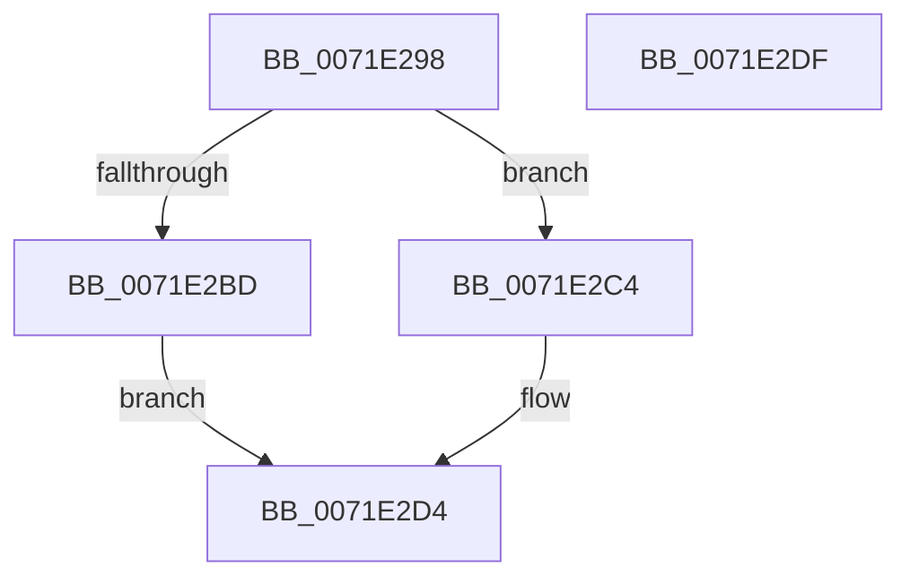

# IopCreateVpb

- RVA: `0x0071E298`–`0x0071E2E0` (길이 `72` bytes)
- VA: `0x000000014071E298`
- 실행 섹션: `PAGE`
- PDB 이름 있음: `예`; PDB Function 태그: `아니요`
- unwind 정보 RVA: `0x0005CAAC`
- 디코드: `21`개 명령, `72/72` bytes 표시
- 미해석 바이트: `0` (있으면 어셈블리에 `.byte`로 보존)

> 이 문서는 커널 이미지의 기계어와 PDB 기호를 분석해 생성했습니다. 4번과 5번은 함수 원형과 자료형을 바이너리 사용 방식에서 추정한 C 해석이며 원본 소스 복구 결과는 아닙니다.

## 1. Dependencies

- 직접 호출 지점: **1**; 고유 호출 대상: **1**
- 직접 호출자로 확인된 함수: **2**
- RIP 상대 이미지 참조: **0**

### Outgoing calls
- `0x0071E2B3` → [ExAllocatePool2](../../poolcode/B8/ExAllocatePool2_function_00B820F0.md) (function, `0x00B820F0`)

### Direct callers
- [IoCreateDevice](../9A/IoCreateDevice_function_009A4B00.md) at `0x009A4F7F`
- [IoVerifyVolume](../AC/IoVerifyVolume_function_00ACF200.md) at `0x00ACF36D`

### Static image references
- 디코드된 RIP-relative 메모리 참조가 없습니다.

## 2. Other-region calls and transfers

- 다른 실행 섹션으로 향하는 call: **1**
  - `0x0071E2B3` → [ExAllocatePool2](../../poolcode/B8/ExAllocatePool2_function_00B820F0.md) (`PAGE` → `POOLCODE`)
- 별도 외부 분기/꼬리 이동을 확인하지 못했습니다.

## 3. Assembly (complete function range)

```asm
0071E298  48 89 5C 24 08                  mov qword ptr [rsp + 8], rbx
0071E29D  57                              push rdi
0071E29E  48 83 EC 20                     sub rsp, 0x20
0071E2A2  BA 60 00 00 00                  mov edx, 0x60
0071E2A7  48 8B D9                        mov rbx, rcx
0071E2AA  41 B8 56 70 62 20               mov r8d, 0x20627056
0071E2B0  8D 4A E0                        lea ecx, [rdx - 0x20]
0071E2B3  E8 38 3E 46 00                  call 0x140b820f0
0071E2B8  48 85 C0                        test rax, rax
0071E2BB  75 07                           jne 0x14071e2c4
0071E2BD  B8 9A 00 00 C0                  mov eax, 0xc000009a
0071E2C2  EB 10                           jmp 0x14071e2d4
0071E2C4  C7 00 0A 00 60 00               mov dword ptr [rax], 0x60000a
0071E2CA  48 89 58 10                     mov qword ptr [rax + 0x10], rbx
0071E2CE  48 89 43 38                     mov qword ptr [rbx + 0x38], rax
0071E2D2  33 C0                           xor eax, eax
0071E2D4  48 8B 5C 24 30                  mov rbx, qword ptr [rsp + 0x30]
0071E2D9  48 83 C4 20                     add rsp, 0x20
0071E2DD  5F                              pop rdi
0071E2DE  C3                              ret
0071E2DF  CC                              int3
```

## 4. C-style interpretation (structured pseudocode)

```c
__int64 __fastcall IopCreateVpb(__int64 a1)
{
    __int64 result;
    __int64 v_rsp;
    unsigned __int64 v_stack_p8;

    v_stack_p8 = v_rbx;
    v_rsp = (v_rsp) - (32);
    result = ExAllocatePool2(96 - 32, 96, (unsigned int)(0x20627056ULL), a4);
    if (result != 0) goto loc_0071E2C4;
    goto loc_0071E2D4;
loc_0071E2C4:
    *(unsigned int *)((unsigned int)(0xC000009AULL)) = 0x60000AULL;
    *(unsigned __int64 *)((unsigned int)(0xC000009AULL) + 16) = a1;
    *(unsigned __int64 *)(a1 + 56) = (unsigned int)(0xC000009AULL);
    result = 0;
loc_0071E2D4:
    v_rsp = (v_rsp) + (32);
    return result;
}
```

## 5. (Beta) C Style

```c
int64_t IopCreateVpb(void *Arg1)
{
    uint8_t *arg1 = (uint8_t *)Arg1;

    int64_t result;
    int64_t local_rsp;
    uint64_t v_stack_p8;

    v_stack_p8 = local_rbx;
    local_rsp = (local_rsp) - (32);
    result = ExAllocatePool2(96 - 32, 96, (uint32_t)(0x20627056ULL), a4);
    if (result != 0) goto loc_0071E2C4;
    goto loc_0071E2D4;
loc_0071E2C4:
    *(uint32_t *)((uint32_t)(0xC000009AULL)) = 0x60000AULL;
    *(void **)((uint32_t)(0xC000009AULL) + 0x10) = Arg1;
    *(uint64_t *)(arg1 + 0x38) = (uint32_t)(0xC000009AULL);
    result = 0;
loc_0071E2D4:
    local_rsp = (local_rsp) + (32);
    return result;
}
```

### 관측된 메모리 오프셋

구조체 형식이 확인되지 않은 접근은 인자 기준의 오프셋으로만 기록했습니다.

| 기준 인자 | 오프셋 표현 | 폭 (bit) | 접근 |
|---|---:|---:|---|
| `Arg1` | `+ 0x38` | `64` | `W` |

## 6. Execution-region graph

[열기: 2D/3D 그래프와 함수 탐색 컨트롤 패널](../../../control-panel.html?section=page&rva=0x0071E298&view=graph)

- 2D 그래프는 위에서 아래로 흐르고, 3D 그래프는 빈 공간을 드래그해 회전합니다. Shift+드래그는 이동, 휠은 확대·축소, 함수 노드 선택은 대상 보고서 이동입니다.

### Static fallback


