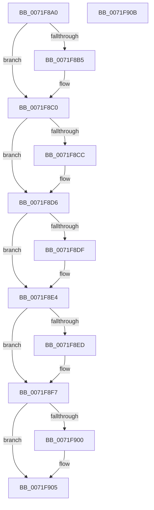

# IopDeleteIoRing

- RVA: `0x0071F8A0`–`0x0071F90C` (길이 `108` bytes)
- VA: `0x000000014071F8A0`
- 실행 섹션: `PAGE`
- PDB 이름 있음: `예`; PDB Function 태그: `아니요`
- unwind 정보 RVA: `0x0005CF00`
- 디코드: `30`개 명령, `108/108` bytes 표시
- 미해석 바이트: `0` (있으면 어셈블리에 `.byte`로 보존)

> 이 문서는 커널 이미지의 기계어와 PDB 기호를 분석해 생성했습니다. 4번과 5번은 함수 원형과 자료형을 바이너리 사용 방식에서 추정한 C 해석이며 원본 소스 복구 결과는 아닙니다.

## 1. Dependencies

- 직접 호출 지점: **5**; 고유 호출 대상: **5**
- 직접 호출자로 확인된 함수: **0**
- RIP 상대 이미지 참조: **0**

### Outgoing calls
- `0x0071F8BB` → [IopIoRingCleanupRegBufferArray](IopIoRingCleanupRegBufferArray_function_0071F914.md) (function, `0x0071F914`)
- `0x0071F8D1` → [ExFreePoolWithTag](../../poolcode/B8/ExFreePoolWithTag_function_00B82870.md) (function, `0x00B82870`)
- `0x0071F8DF` → [IopUnlockAndFreeMdl](../../text/29/IopUnlockAndFreeMdl_function_0029F200.md) (function, `0x0029F200`)
- `0x0071F8F2` → [MiRemoveFromSystemSpace](../../text/29/MiRemoveFromSystemSpace_function_002962FC.md) (function, `0x002962FC`)
- `0x0071F900` → [ObfDereferenceObject](../../text/2F/ObfDereferenceObject_function_002F9350.md) (function, `0x002F9350`)

### Direct callers
- 이 함수 시작 RVA로 연결되는 직접 call은 확인되지 않았습니다. 간접 호출은 완전히 역산할 수 없습니다.

### Static image references
- 디코드된 RIP-relative 메모리 참조가 없습니다.

## 2. Other-region calls and transfers

- 다른 실행 섹션으로 향하는 call: **4**
  - `0x0071F8D1` → [ExFreePoolWithTag](../../poolcode/B8/ExFreePoolWithTag_function_00B82870.md) (`PAGE` → `POOLCODE`)
  - `0x0071F8DF` → [IopUnlockAndFreeMdl](../../text/29/IopUnlockAndFreeMdl_function_0029F200.md) (`PAGE` → `.text`)
  - `0x0071F8F2` → [MiRemoveFromSystemSpace](../../text/29/MiRemoveFromSystemSpace_function_002962FC.md) (`PAGE` → `.text`)
  - `0x0071F900` → [ObfDereferenceObject](../../text/2F/ObfDereferenceObject_function_002F9350.md) (`PAGE` → `.text`)
- 별도 외부 분기/꼬리 이동을 확인하지 못했습니다.

## 3. Assembly (complete function range)

```asm
0071F8A0  40 53                           push rbx
0071F8A2  48 83 EC 20                     sub rsp, 0x20
0071F8A6  48 8B 91 B8 00 00 00            mov rdx, qword ptr [rcx + 0xb8]
0071F8AD  48 8B D9                        mov rbx, rcx
0071F8B0  48 85 D2                        test rdx, rdx
0071F8B3  74 0B                           je 0x14071f8c0
0071F8B5  8B 89 B0 00 00 00               mov ecx, dword ptr [rcx + 0xb0]
0071F8BB  E8 54 00 00 00                  call 0x14071f914
0071F8C0  48 8B 8B C8 00 00 00            mov rcx, qword ptr [rbx + 0xc8]
0071F8C7  48 85 C9                        test rcx, rcx
0071F8CA  74 0A                           je 0x14071f8d6
0071F8CC  BA 49 72 52 46                  mov edx, 0x46527249
0071F8D1  E8 9A 2F 46 00                  call 0x140b82870
0071F8D6  48 8B 4B 48                     mov rcx, qword ptr [rbx + 0x48]
0071F8DA  48 85 C9                        test rcx, rcx
0071F8DD  74 05                           je 0x14071f8e4
0071F8DF  E8 1C F9 B7 FF                  call 0x14029f200
0071F8E4  48 8B 4B 40                     mov rcx, qword ptr [rbx + 0x40]
0071F8E8  48 85 C9                        test rcx, rcx
0071F8EB  74 0A                           je 0x14071f8f7
0071F8ED  BA 01 00 00 00                  mov edx, 1
0071F8F2  E8 05 6A B7 FF                  call 0x1402962fc
0071F8F7  48 8B 4B 38                     mov rcx, qword ptr [rbx + 0x38]
0071F8FB  48 85 C9                        test rcx, rcx
0071F8FE  74 05                           je 0x14071f905
0071F900  E8 4B 9A BD FF                  call 0x1402f9350
0071F905  48 83 C4 20                     add rsp, 0x20
0071F909  5B                              pop rbx
0071F90A  C3                              ret
0071F90B  CC                              int3
```

## 4. C-style interpretation (structured pseudocode)

```c
__int64 __fastcall IopDeleteIoRing(__int64 a1)
{
    __int64 result;
    __int64 v_rsp;

    v_rsp = (v_rsp) - (32);
    if (*(unsigned __int64 *)(a1 + 184) != 0) {
        a1 = *(unsigned int *)(a1 + 176);
        result = IopIoRingCleanupRegBufferArray(a1, *(unsigned __int64 *)(a1 + 184), a3, a4);
    }
    if (*(unsigned __int64 *)(a1 + 200) != 0) {
        a2 = 0x46527249ULL;
        result = ExFreePoolWithTag(*(unsigned __int64 *)(a1 + 200), a2, a3, a4);
    }
    if (*(unsigned __int64 *)(a1 + 72) != 0) {
        result = IopUnlockAndFreeMdl(*(unsigned __int64 *)(a1 + 72), a2, a3, a4);
    }
    if (*(unsigned __int64 *)(a1 + 64) != 0) {
        a2 = 1;
        result = MiRemoveFromSystemSpace(*(unsigned __int64 *)(a1 + 64), a2, a3, a4);
    }
    if (*(unsigned __int64 *)(a1 + 56) != 0) {
        result = ObfDereferenceObject(*(unsigned __int64 *)(a1 + 56), a2, a3, a4);
    }
    v_rsp = (v_rsp) + (32);
    return result;
}
```

## 5. (Beta) C Style

```c
int64_t IopDeleteIoRing(void *Arg1)
{
    uint8_t *arg1 = (uint8_t *)Arg1;

    int64_t result;
    int64_t local_rsp;

    local_rsp = (local_rsp) - (32);
    if (*(uint64_t *)(arg1 + 0xB8) != 0) {
        Arg1 = *(uint32_t *)(arg1 + 0xB0);
        result = IopIoRingCleanupRegBufferArray(Arg1, *(uint64_t *)(arg1 + 0xB8), a3, a4);
    }
    if (*(uint64_t *)(arg1 + 0xC8) != 0) {
        a2 = 0x46527249ULL;
        result = ExFreePoolWithTag(*(uint64_t *)(arg1 + 0xC8), a2, a3, a4);
    }
    if (*(uint64_t *)(arg1 + 0x48) != 0) {
        result = IopUnlockAndFreeMdl(*(uint64_t *)(arg1 + 0x48), a2, a3, a4);
    }
    if (*(uint64_t *)(arg1 + 0x40) != 0) {
        a2 = 1;
        result = MiRemoveFromSystemSpace(*(uint64_t *)(arg1 + 0x40), a2, a3, a4);
    }
    if (*(uint64_t *)(arg1 + 0x38) != 0) {
        result = ObfDereferenceObject(*(uint64_t *)(arg1 + 0x38), a2, a3, a4);
    }
    local_rsp = (local_rsp) + (32);
    return result;
}
```

### 관측된 메모리 오프셋

구조체 형식이 확인되지 않은 접근은 인자 기준의 오프셋으로만 기록했습니다.

| 기준 인자 | 오프셋 표현 | 폭 (bit) | 접근 |
|---|---:|---:|---|
| `Arg1` | `+ 0x38` | `64` | `R` |
| `Arg1` | `+ 0x40` | `64` | `R` |
| `Arg1` | `+ 0x48` | `64` | `R` |
| `Arg1` | `+ 0xB0` | `32` | `R` |
| `Arg1` | `+ 0xB8` | `64` | `R` |
| `Arg1` | `+ 0xC8` | `64` | `R` |

## 6. Execution-region graph

[열기: 2D/3D 그래프와 함수 탐색 컨트롤 패널](../../../control-panel.html?section=page&rva=0x0071F8A0&view=graph)

- 2D 그래프는 위에서 아래로 흐르고, 3D 그래프는 빈 공간을 드래그해 회전합니다. Shift+드래그는 이동, 휠은 확대·축소, 함수 노드 선택은 대상 보고서 이동입니다.

### Static fallback


