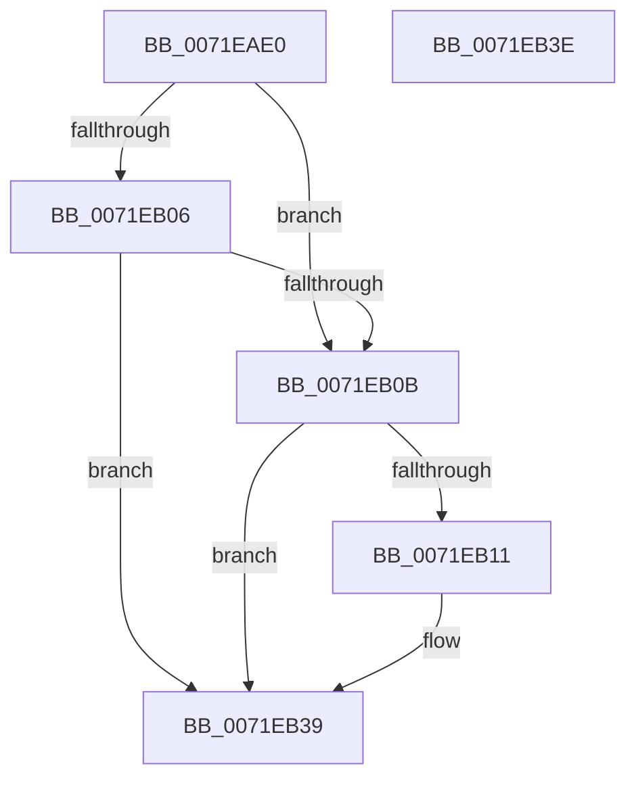

# IopDispatchSessionNotifications

- RVA: `0x0071EAE0`–`0x0071EB3F` (길이 `95` bytes)
- VA: `0x000000014071EAE0`
- 실행 섹션: `PAGE`
- PDB 이름 있음: `예`; PDB Function 태그: `아니요`
- unwind 정보 RVA: `0x00063458`
- 디코드: `27`개 명령, `95/95` bytes 표시
- 미해석 바이트: `0` (있으면 어셈블리에 `.byte`로 보존)

> 이 문서는 커널 이미지의 기계어와 PDB 기호를 분석해 생성했습니다. 4번과 5번은 함수 원형과 자료형을 바이너리 사용 방식에서 추정한 C 해석이며 원본 소스 복구 결과는 아닙니다.

## 1. Dependencies

- 직접 호출 지점: **1**; 고유 호출 대상: **1**
- 직접 호출자로 확인된 함수: **0**
- RIP 상대 이미지 참조: **1**

### Outgoing calls
- `0x0071EB34` → [guard_dispatch_icall](../../text/6B/guard_dispatch_icall_function_006BAAD0.md) (function, `0x006BAAD0`)

### Direct callers
- 이 함수 시작 RVA로 연결되는 직접 call은 확인되지 않았습니다. 간접 호출은 완전히 역산할 수 없습니다.

### Static image references
- `0x0071EAEF` → RVA `0x00027818` (`.rdata`; read)

## 2. Other-region calls and transfers

- 다른 실행 섹션으로 향하는 call: **1**
  - `0x0071EB34` → [guard_dispatch_icall](../../text/6B/guard_dispatch_icall_function_006BAAD0.md) (`PAGE` → `.text`)
- 별도 외부 분기/꼬리 이동을 확인하지 못했습니다.

## 3. Assembly (complete function range)

```asm
0071EAE0  48 83 EC 48                     sub rsp, 0x48
0071EAE4  4C 63 5A 20                     movsxd r11, dword ptr [rdx + 0x20]
0071EAE8  4C 8B C2                        mov r8, rdx
0071EAEB  48 8B 41 30                     mov rax, qword ptr [rcx + 0x30]
0071EAEF  48 8D 15 22 8D 90 FF            lea rdx, [rip - 0x6f72de]
0071EAF6  4C 8B D1                        mov r10, rcx
0071EAF9  42 8B 14 9A                     mov edx, dword ptr [rdx + r11*4]
0071EAFD  49 8D 48 38                     lea rcx, [r8 + 0x38]
0071EB01  48 85 C0                        test rax, rax
0071EB04  74 05                           je 0x14071eb0b
0071EB06  48 3B 01                        cmp rax, qword ptr [rcx]
0071EB09  75 2E                           jne 0x14071eb39
0071EB0B  41 85 52 38                     test dword ptr [r10 + 0x38], edx
0071EB0F  74 28                           je 0x14071eb39
0071EB11  41 8B 50 28                     mov edx, dword ptr [r8 + 0x28]
0071EB15  49 8B 42 18                     mov rax, qword ptr [r10 + 0x18]
0071EB19  4D 8B 4A 40                     mov r9, qword ptr [r10 + 0x40]
0071EB1D  48 8B 09                        mov rcx, qword ptr [rcx]
0071EB20  89 54 24 28                     mov dword ptr [rsp + 0x28], edx
0071EB24  49 8B 50 30                     mov rdx, qword ptr [r8 + 0x30]
0071EB28  45 8B C3                        mov r8d, r11d
0071EB2B  48 89 54 24 20                  mov qword ptr [rsp + 0x20], rdx
0071EB30  49 8B 52 28                     mov rdx, qword ptr [r10 + 0x28]
0071EB34  E8 97 BF F9 FF                  call 0x1406baad0
0071EB39  48 83 C4 48                     add rsp, 0x48
0071EB3D  C3                              ret
0071EB3E  CC                              int3
```

## 4. C-style interpretation (structured pseudocode)

```c
__int64 __fastcall IopDispatchSessionNotifications(__int64 a1, __int64 a2)
{
    __int64 result;
    __int64 v_rsp;
    unsigned int v_stack_m20;
    unsigned __int64 v_stack_m28;

    v_rsp = (v_rsp) - (72);
    if (*(unsigned __int64 *)(a1 + 48) == 0) goto loc_0071EB0B;
    if ((*(unsigned __int64 *)(a1 + 48)) != (*(unsigned __int64 *)(a2 + 56))) goto loc_0071EB39;
loc_0071EB0B:
    result = *(unsigned __int64 *)(a1 + 48);
    if (((*(unsigned int *)(a1 + 56)) & ((unsigned int)((unsigned int)(*(unsigned int *)(v_rip - 7303902 + (int)(*(unsigned int *)(a2 + 32)) * 4))))) != 0) {
        a2 = *(unsigned int *)(a2 + 40);
        result = *(unsigned __int64 *)(a1 + 24);
        a4 = *(unsigned __int64 *)(a1 + 64);
        a1 = *(unsigned __int64 *)(a2 + 56);
        v_stack_m20 = (unsigned int)(a2);
        a2 = *(unsigned __int64 *)(a2 + 48);
        a3 = (unsigned int)((int)(*(unsigned int *)(a2 + 32)));
        v_stack_m28 = a2;
        a2 = *(unsigned __int64 *)(a1 + 40);
        result = guard_dispatch_icall(a1, a2, a3, a4);
    }
    v_rsp = (v_rsp) + (72);
    return result;
}
```

## 5. (Beta) C Style

```c
int64_t IopDispatchSessionNotifications(void *Arg1, void *Arg2)
{
    uint8_t *arg1 = (uint8_t *)Arg1;
    uint8_t *arg2 = (uint8_t *)Arg2;

    int64_t result;
    int64_t local_rsp;
    uint32_t v_stack_m20;
    uint64_t v_stack_m28;

    local_rsp = (local_rsp) - (72);
    if (*(uint64_t *)(arg1 + 0x30) == 0) goto loc_0071EB0B;
    if ((*(uint64_t *)(arg1 + 0x30)) != (*(uint64_t *)(arg2 + 0x38))) goto loc_0071EB39;
loc_0071EB0B:
    result = *(uint64_t *)(arg1 + 0x30);
    if (((*(uint32_t *)(arg1 + 0x38)) & ((uint32_t)((uint32_t)(*(uint32_t *)(v_rip - 0x6F72DE + (int32_t)(*(uint32_t *)(arg2 + 0x20)) * 4))))) != 0) {
        Arg2 = *(uint32_t *)(arg2 + 0x28);
        result = *(uint64_t *)(arg1 + 0x18);
        a4 = *(uint64_t *)(arg1 + 0x40);
        Arg1 = *(uint64_t *)(arg2 + 0x38);
        v_stack_m20 = (uint32_t)(Arg2);
        Arg2 = *(uint64_t *)(arg2 + 0x30);
        a3 = (uint32_t)((int32_t)(*(uint32_t *)(arg2 + 0x20)));
        v_stack_m28 = Arg2;
        Arg2 = *(uint64_t *)(arg1 + 0x28);
        result = guard_dispatch_icall(Arg1, Arg2, a3, a4);
    }
    local_rsp = (local_rsp) + (72);
    return result;
}
```

### 관측된 메모리 오프셋

구조체 형식이 확인되지 않은 접근은 인자 기준의 오프셋으로만 기록했습니다.

| 기준 인자 | 오프셋 표현 | 폭 (bit) | 접근 |
|---|---:|---:|---|
| `Arg1` | `+ 0x18` | `64` | `R` |
| `Arg1` | `+ 0x28` | `64` | `R` |
| `Arg1` | `+ 0x30` | `64` | `R` |
| `Arg1` | `+ 0x38` | `32` | `R` |
| `Arg1` | `+ 0x40` | `64` | `R` |
| `Arg2` | `+ 0x0` | `64` | `R` |
| `Arg2` | `+ 0x20` | `32` | `R` |
| `Arg2` | `+ 0x28` | `32` | `R` |
| `Arg2` | `+ 0x30` | `64` | `R` |
| `Arg2` | `+ 0x38` | `64` | `R` |

## 6. Execution-region graph

[열기: 2D/3D 그래프와 함수 탐색 컨트롤 패널](../../../control-panel.html?section=page&rva=0x0071EAE0&view=graph)

- 2D 그래프는 위에서 아래로 흐르고, 3D 그래프는 빈 공간을 드래그해 회전합니다. Shift+드래그는 이동, 휠은 확대·축소, 함수 노드 선택은 대상 보고서 이동입니다.

### Static fallback


