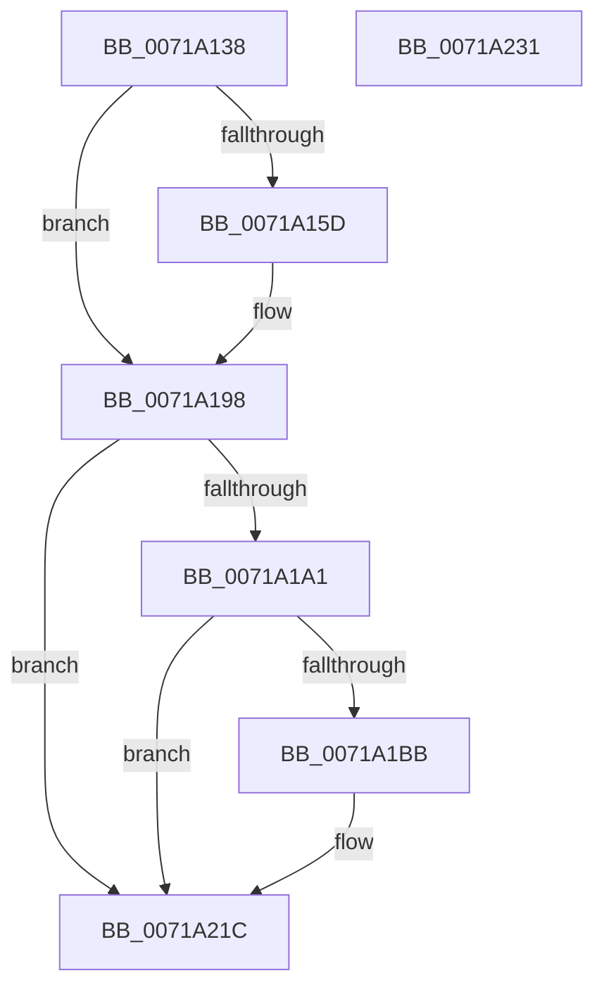

# IopDumpTraceForceDumpDisabled

- RVA: `0x0071A138`–`0x0071A232` (길이 `250` bytes)
- VA: `0x000000014071A138`
- 실행 섹션: `PAGE`
- PDB 이름 있음: `예`; PDB Function 태그: `아니요`
- unwind 정보 RVA: `0x0009EA9C`
- 디코드: `53`개 명령, `250/250` bytes 표시
- 미해석 바이트: `0` (있으면 어셈블리에 `.byte`로 보존)

> 이 문서는 커널 이미지의 기계어와 PDB 기호를 분석해 생성했습니다. 4번과 5번은 함수 원형과 자료형을 바이너리 사용 방식에서 추정한 C 해석이며 원본 소스 복구 결과는 아닙니다.

## 1. Dependencies

- 직접 호출 지점: **5**; 고유 호출 대상: **5**
- 직접 호출자로 확인된 함수: **2**
- RIP 상대 이미지 참조: **6**

### Outgoing calls
- `0x0071A154` → [IopDumpIsTracingEnabled](../../text/4F/IopDumpIsTracingEnabled_function_004FC5D0.md) (function, `0x004FC5D0`)
- `0x0071A193` → [EtwWrite](../../text/41/EtwWrite_function_0041C720.md) (function, `0x0041C720`)
- `0x0071A1B2` → [tlgKeywordOn](../../text/42/tlgKeywordOn_function_0042EAA0.md) (function, `0x0042EAA0`)
- `0x0071A217` → [tlgWriteTransfer_EtwWriteTransfer](../../text/42/tlgWriteTransfer_EtwWriteTransfer_function_004260E0.md) (function, `0x004260E0`)
- `0x0071A223` → [_security_check_cookie](../../text/6A/_security_check_cookie_function_006AC640.md) (function, `0x006AC640`)

### Direct callers
- [IoInitSystemPreDrivers](../../init/C2/IoInitSystemPreDrivers_function_00C2AC3C.md) at `0x00C2BC69`
- [IopInitCrashDumpDuringSysInit](../../init/C2/IopInitCrashDumpDuringSysInit_function_00C2CAE4.md) at `0x00C2CB41`

### Static image references
- `0x0071A146` → RVA `0x00E0A740` (`.data`; read)
- `0x0071A161` → RVA `0x00E660BC` (`.data`; read)
- `0x0071A168` → RVA `0x00E65EF0` (`.data`; read)
- `0x0071A16F` → RVA `0x00023318` (`.rdata`; read)
- `0x0071A198` → RVA `0x00E06DE8` (`.data`; read)
- `0x0071A1C7` → RVA `0x00045B2B` (`.rdata`; read)

## 2. Other-region calls and transfers

- 다른 실행 섹션으로 향하는 call: **5**
  - `0x0071A154` → [IopDumpIsTracingEnabled](../../text/4F/IopDumpIsTracingEnabled_function_004FC5D0.md) (`PAGE` → `.text`)
  - `0x0071A193` → [EtwWrite](../../text/41/EtwWrite_function_0041C720.md) (`PAGE` → `.text`)
  - `0x0071A1B2` → [tlgKeywordOn](../../text/42/tlgKeywordOn_function_0042EAA0.md) (`PAGE` → `.text`)
  - `0x0071A217` → [tlgWriteTransfer_EtwWriteTransfer](../../text/42/tlgWriteTransfer_EtwWriteTransfer_function_004260E0.md) (`PAGE` → `.text`)
  - `0x0071A223` → [_security_check_cookie](../../text/6A/_security_check_cookie_function_006AC640.md) (`PAGE` → `.text`)
- 별도 외부 분기/꼬리 이동을 확인하지 못했습니다.

## 3. Assembly (complete function range)

```asm
0071A138  40 55                           push rbp
0071A13A  48 8D 6C 24 A9                  lea rbp, [rsp - 0x57]
0071A13F  48 81 EC A0 00 00 00            sub rsp, 0xa0
0071A146  48 8B 05 F3 05 6F 00            mov rax, qword ptr [rip + 0x6f05f3]
0071A14D  48 33 C4                        xor rax, rsp
0071A150  48 89 45 47                     mov qword ptr [rbp + 0x47], rax
0071A154  E8 77 24 DE FF                  call 0x1404fc5d0
0071A159  84 C0                           test al, al
0071A15B  74 3B                           je 0x14071a198
0071A15D  83 65 03 00                     and dword ptr [rbp + 3], 0
0071A161  48 8D 05 54 BF 74 00            lea rax, [rip + 0x74bf54]
0071A168  48 8B 0D 81 BD 74 00            mov rcx, qword ptr [rip + 0x74bd81]
0071A16F  48 8D 15 A2 91 90 FF            lea rdx, [rip - 0x6f6e5e]
0071A176  48 89 45 F7                     mov qword ptr [rbp - 9], rax
0071A17A  41 B9 01 00 00 00               mov r9d, 1
0071A180  48 8D 45 F7                     lea rax, [rbp - 9]
0071A184  C7 45 FF 04 00 00 00            mov dword ptr [rbp - 1], 4
0071A18B  45 33 C0                        xor r8d, r8d
0071A18E  48 89 44 24 20                  mov qword ptr [rsp + 0x20], rax
0071A193  E8 88 25 D0 FF                  call 0x14041c720
0071A198  83 3D 49 CC 6E 00 05            cmp dword ptr [rip + 0x6ecc49], 5
0071A19F  76 7B                           jbe 0x14071a21c
0071A1A1  48 BA 00 00 00 00 00 40 00 00   movabs rdx, 0x400000000000
0071A1AB  48 8D 0D 36 CC 6E 00            lea rcx, [rip + 0x6ecc36]
0071A1B2  E8 E9 48 D1 FF                  call 0x14042eaa0
0071A1B7  84 C0                           test al, al
0071A1B9  74 61                           je 0x14071a21c
0071A1BB  83 65 33 00                     and dword ptr [rbp + 0x33], 0
0071A1BF  48 8D 45 EF                     lea rax, [rbp - 0x11]
0071A1C3  83 65 43 00                     and dword ptr [rbp + 0x43], 0
0071A1C7  48 8D 15 5D B9 92 FF            lea rdx, [rip - 0x6d46a3]
0071A1CE  48 89 45 27                     mov qword ptr [rbp + 0x27], rax
0071A1D2  48 8D 0D 0F CC 6E 00            lea rcx, [rip + 0x6ecc0f]
0071A1D9  8A 05 DD BE 74 00               mov al, byte ptr [rip + 0x74bedd]
0071A1DF  45 33 C9                        xor r9d, r9d
0071A1E2  88 45 E7                        mov byte ptr [rbp - 0x19], al
0071A1E5  45 33 C0                        xor r8d, r8d
0071A1E8  48 8D 45 E7                     lea rax, [rbp - 0x19]
0071A1EC  48 C7 45 EF 00 00 00 01         mov qword ptr [rbp - 0x11], 0x1000000
0071A1F4  48 89 45 37                     mov qword ptr [rbp + 0x37], rax
0071A1F8  48 8D 45 07                     lea rax, [rbp + 7]
0071A1FC  48 89 44 24 28                  mov qword ptr [rsp + 0x28], rax
0071A201  C7 44 24 20 04 00 00 00         mov dword ptr [rsp + 0x20], 4
0071A209  C7 45 2F 08 00 00 00            mov dword ptr [rbp + 0x2f], 8
0071A210  C7 45 3F 01 00 00 00            mov dword ptr [rbp + 0x3f], 1
0071A217  E8 C4 BE D0 FF                  call 0x1404260e0
0071A21C  48 8B 4D 47                     mov rcx, qword ptr [rbp + 0x47]
0071A220  48 33 CC                        xor rcx, rsp
0071A223  E8 18 24 F9 FF                  call 0x1406ac640
0071A228  48 81 C4 A0 00 00 00            add rsp, 0xa0
0071A22F  5D                              pop rbp
0071A230  C3                              ret
0071A231  CC                              int3
```

## 4. C-style interpretation (structured pseudocode)

```c
__int64 __fastcall IopDumpTraceForceDumpDisabled(__int64 a1, __int64 a2, int a3)
{
    __int64 result;
    __int64 v_rsp;
    unsigned __int64 v_stack_m18;
    unsigned int v_stack_m1C;
    unsigned int v_stack_m20;
    unsigned __int64 v_stack_m28;
    unsigned int v_stack_m2C;
    unsigned int v_stack_m30;
    unsigned __int64 v_stack_m38;
    unsigned __int64 v_stack_m58;
    unsigned int v_stack_m5C;
    unsigned __int64 v_stack_m5F;
    unsigned int v_stack_m60;
    unsigned __int64 v_stack_m68;
    unsigned __int64 v_stack_m70;
    unsigned __int8 v_stack_m78;
    unsigned __int64 v_stack_m80;
    unsigned __int64 v_stack_m88;

    v_rsp = (v_rsp) - (160);
    result = (*(unsigned __int64 *)(v_rip + 7276019)) ^ (v_rsp);
    v_stack_m18 = result;
    result = IopDumpIsTracingEnabled(a1, a2, a3, a4);
    if ((unsigned __int8)(result) != 0) {
        result = v_rip + 7651156;
        a1 = *(unsigned __int64 *)(v_rip + 7650689);
        a2 = v_rip - 7302750;
        v_stack_m68 = result;
        a4 = 1;
        result = v_stack_m68;
        v_stack_m60 = 4;
        a3 = 0;
        v_stack_m88 = result;
        result = EtwWrite(a1, a2, a3, a4);
    }
    if ((*(unsigned int *)(v_rip + 7261257)) <= 5) goto loc_0071A21C;
    result = tlgKeywordOn(v_rip + 7261238, a2, a3, a4);
    if ((unsigned __int8)(result) != 0) {
        result = v_stack_m70;
        a2 = v_rip - 7161507;
        v_stack_m38 = result;
        a1 = v_rip + 7261199;
        result = *(unsigned __int8 *)(v_rip + 7651037);
        a4 = 0;
        v_stack_m78 = (unsigned __int8)(result);
        a3 = 0;
        result = v_stack_m78;
        v_stack_m70 = 0x1000000ULL;
        v_stack_m28 = result;
        result = v_stack_m58;
        v_stack_m80 = result;
        v_stack_m88 = 4;
        v_stack_m30 = 8;
        v_stack_m20 = 1;
        result = tlgWriteTransfer_EtwWriteTransfer(a1, a2, a3, a4);
    }
    a1 = (v_stack_m18) ^ (v_rsp);
    result = _security_check_cookie(a1, a2, a3, a4);
    v_rsp = (v_rsp) + (160);
    return result;
}
```

## 5. (Beta) C Style

```c
int64_t IopDumpTraceForceDumpDisabled(int64_t Arg1, int64_t Arg2, int32_t Arg3)
{
    int64_t result;
    int64_t local_rsp;
    uint64_t v_stack_m18;
    uint32_t v_stack_m1C;
    uint32_t v_stack_m20;
    uint64_t v_stack_m28;
    uint32_t v_stack_m2C;
    uint32_t v_stack_m30;
    uint64_t v_stack_m38;
    uint64_t v_stack_m58;
    uint32_t v_stack_m5C;
    uint64_t v_stack_m5F;
    uint32_t v_stack_m60;
    uint64_t v_stack_m68;
    uint64_t v_stack_m70;
    uint8_t v_stack_m78;
    uint64_t v_stack_m80;
    uint64_t v_stack_m88;

    local_rsp = (local_rsp) - (160);
    result = (*(uint64_t *)(v_rip + 0x6F05F3)) ^ (local_rsp);
    v_stack_m18 = result;
    result = IopDumpIsTracingEnabled(Arg1, Arg2, Arg3, a4);
    if ((uint8_t)(result) != 0) {
        result = v_rip + 7651156;
        Arg1 = *(uint64_t *)(v_rip + 0x74BD81);
        Arg2 = v_rip - 7302750;
        v_stack_m68 = result;
        a4 = 1;
        result = v_stack_m68;
        v_stack_m60 = 4;
        Arg3 = 0;
        v_stack_m88 = result;
        result = EtwWrite(Arg1, Arg2, Arg3, a4);
    }
    if ((*(uint32_t *)(v_rip + 0x6ECC49)) <= 5) goto loc_0071A21C;
    result = tlgKeywordOn(v_rip + 7261238, Arg2, Arg3, a4);
    if ((uint8_t)(result) != 0) {
        result = v_stack_m70;
        Arg2 = v_rip - 7161507;
        v_stack_m38 = result;
        Arg1 = v_rip + 7261199;
        result = *(uint8_t *)(v_rip + 0x74BEDD);
        a4 = 0;
        v_stack_m78 = (uint8_t)(result);
        Arg3 = 0;
        result = v_stack_m78;
        v_stack_m70 = 0x1000000ULL;
        v_stack_m28 = result;
        result = v_stack_m58;
        v_stack_m80 = result;
        v_stack_m88 = 4;
        v_stack_m30 = 8;
        v_stack_m20 = 1;
        result = tlgWriteTransfer_EtwWriteTransfer(Arg1, Arg2, Arg3, a4);
    }
    Arg1 = (v_stack_m18) ^ (local_rsp);
    result = _security_check_cookie(Arg1, Arg2, Arg3, a4);
    local_rsp = (local_rsp) + (160);
    return result;
}
```

## 6. Execution-region graph

[열기: 2D/3D 그래프와 함수 탐색 컨트롤 패널](../../../control-panel.html?section=page&rva=0x0071A138&view=graph)

- 2D 그래프는 위에서 아래로 흐르고, 3D 그래프는 빈 공간을 드래그해 회전합니다. Shift+드래그는 이동, 휠은 확대·축소, 함수 노드 선택은 대상 보고서 이동입니다.

### Static fallback


